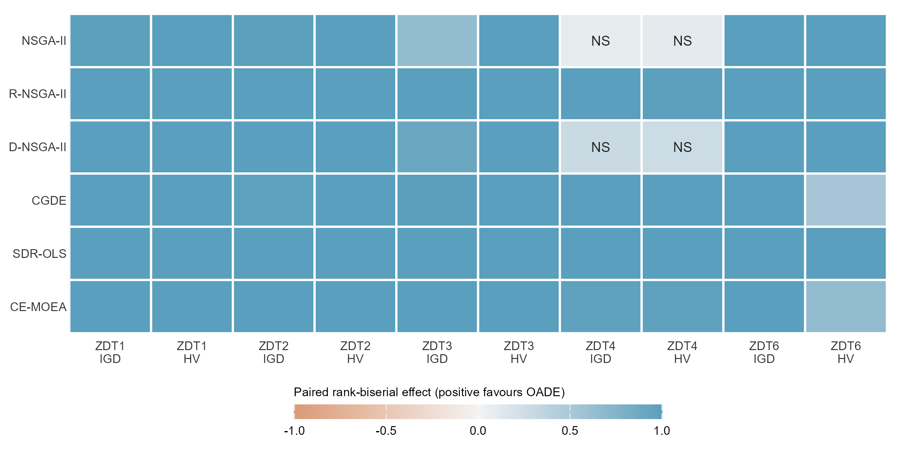
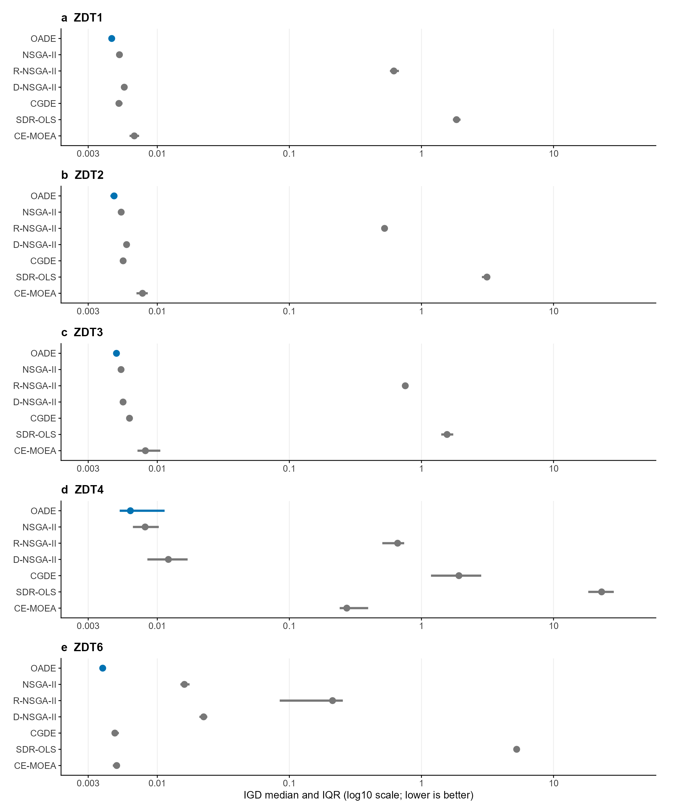
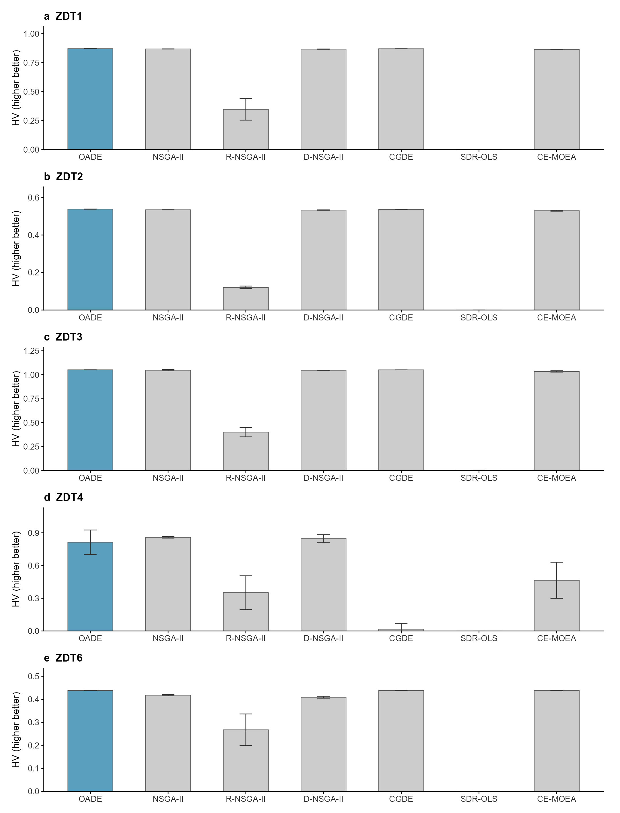
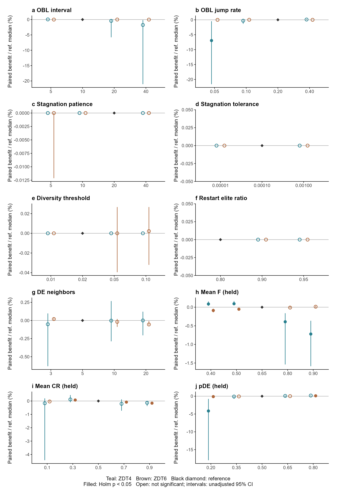
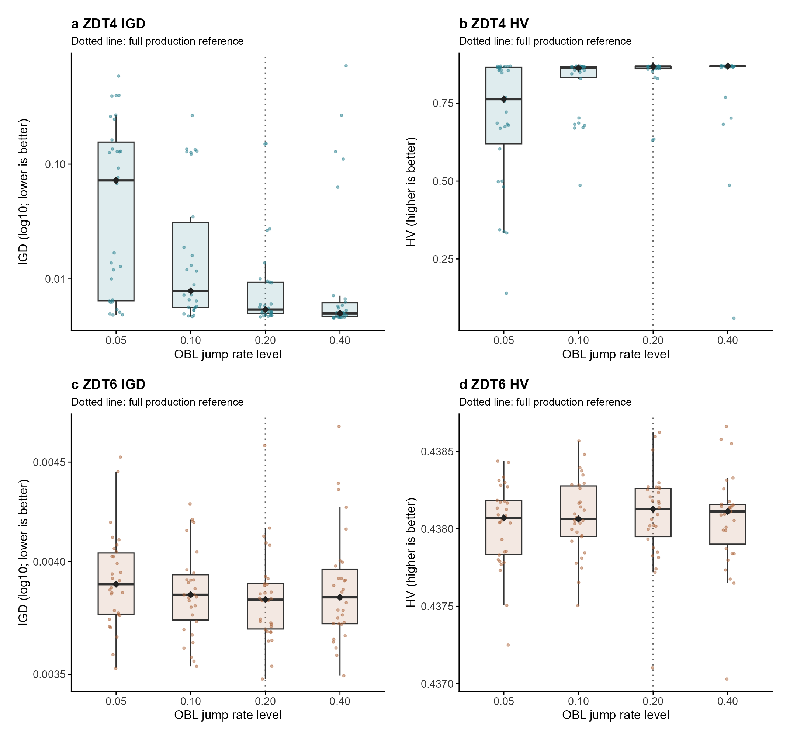

# OADE-NSGA-II

**Language:** **English** | [Tiếng Việt](README.vi.md)

OADE-NSGA-II combines DE/SBX offspring generation, F/CR adaptation, periodic opposition-based diversity injection and NSGA-II survival. The main solver uses one fixed configuration; configurable research variants are kept separately.

## Current evaluation baseline

**As of 15 November 2026, ZDT v2 is the starting point for algorithm comparisons.** Tables, figures and claims from runs preceding the baseline corrections have been removed from this README. They do not establish the performance of the current implementation. All earlier result datasets, reports and archives have been removed. Only the audited ZDT v2 evaluation is retained. DTLZ/WFG have not been reevaluated with these corrected baselines, so current-version conclusions are unavailable for those suites.

[Audited report](docs/reports/zdt_seven_fixed_oade_v2_report.md) · [Protocol](docs/protocols/zdt_seven_fixed_oade.md) · [Baseline identities and source papers](docs/protocols/baselines.md)

## Design and configuration

| Item | Setting |
|---|---|
| Dataset | ZDT1/2/3: D=30; ZDT4/6: D=10; M=2 |
| Algorithms | OADE_NSGAII, NSGA2, RNSGA2, DNSGA2, CGDE_NSGAII, NSGAII_SDR_OLS, CE_MOEA |
| Population / budget | 100 / 20,000 objective evaluations per run |
| Seeds | 42–71; 30 runs per algorithm/problem; 1,050 total |
| Implementation revision | `paper_corrections_2026_11_14`; `zdt_seven_fixed_oade_v2` |
| OADE | `oade_nsga2`, `local_oade`, uniform, adaptive restart, periodic OBL, `success_rate` |

OADE starts with F=0.65, CR=0.5 and pDE=0.5; five neighbors; patience 20; tolerance 10⁻⁴; diversity threshold 0.02; elite ratio 0.8; OBL interval 10 and jump rate 0.2. The manifest captures these settings. The benchmark does not use `research.oade_nsga2`.

All solvers receive the same uniform input within each problem/seed. SDR-OLS applies its own initial OBL selection. OBL, local search and RNSGA2 aspiration-point evaluations count against the budget. Atomic batches may leave unused evaluations; use actual n_eval when comparing costs.

## Comparison results

**All 1,050 runs completed; 1,049 are valid.** CGDE on ZDT4, seed 63, produced a collapsed front. OADE is better on **56/60 endpoints** after Holm correction across all 60 tests. The four endpoints without a detected difference are ZDT4 IGD/HV against NSGA2 and DNSGA2. No endpoint favors a baseline under the specified test.

In the table, “+/+” means OADE is better on both IGD/HV; “NS/NS” means neither difference is detected. CGDE ZDT4 comparisons use n=29; all others use n=30. Endpoints are not independent experiments.

| Problem | NSGA2 | RNSGA2 | DNSGA2 | CGDE_NSGAII | NSGAII_SDR_OLS | CE_MOEA |
|---|---|---|---|---|---|---|
| ZDT1 | +/+ | +/+ | +/+ | +/+ | +/+ | +/+ |
| ZDT2 | +/+ | +/+ | +/+ | +/+ | +/+ | +/+ |
| ZDT3 | +/+ | +/+ | +/+ | +/+ | +/+ | +/+ |
| ZDT4 | NS/NS | +/+ | NS/NS | +/+ | +/+ | +/+ |
| ZDT6 | +/+ | +/+ | +/+ | +/+ | +/+ | +/+ |

Lower IGD and higher HV indicate better quality. Quality cells show **mean (best run)** over valid runs; runtime is median seconds/run. Best means minimum IGD or maximum HV among the 30 runs (29 valid runs for CGDE ZDT4); these extrema may come from different seeds. SD remains in the source CSV, but is omitted from the tables. All seven solvers are shown per problem, without pooling metrics across differently scaled problems.

Bold numbers mark the best central and best-run values separately within each problem/table: minimum IGD/runtime and maximum HV. In reference → tested-level cells, compare the two centers and two best-run values separately. Winners and ties use unrounded source values; display uses four significant digits (e.g. `4.47e-3`), so equal-looking rounded values need not be ties. Emphasis is descriptive, not a statistical test; intervals and p-values are not ranked.

### ZDT1

| Algorithm | Valid | IGD ↓ mean (best) | HV ↑ mean (best) | Median runtime (s) |
|---|---:|---:|---:|---:|
| OADE_NSGAII | 30/30 | **4.47e-3** (**3.952e-3**) | **8.708e-1** (**8.713e-1**) | 7.398 |
| NSGA2 | 30/30 | 5.175e-3 (4.417e-3) | 8.681e-1 (8.686e-1) | 3.484 |
| RNSGA2 | 30/30 | 6.33e-1 (4.845e-1) | 3.481e-1 (4.932e-1) | 3.610 |
| DNSGA2 | 30/30 | 5.633e-3 (4.97e-3) | 8.671e-1 (8.683e-1) | **3.257** |
| CGDE_NSGAII | 30/30 | 5.202e-3 (4.584e-3) | 8.699e-1 (8.706e-1) | 118.025 |
| NSGAII_SDR_OLS | 30/30 | 1.845e0 (1.493e0) | 0 (0) | 38.268 |
| CE_MOEA | 30/30 | 6.8e-3 (5.543e-3) | 8.646e-1 (8.67e-1) | 178.953 |

### ZDT2

| Algorithm | Valid | IGD ↓ mean (best) | HV ↑ mean (best) | Median runtime (s) |
|---|---:|---:|---:|---:|
| OADE_NSGAII | 30/30 | **4.71e-3** (**4.149e-3**) | **5.377e-1** (**5.38e-1**) | 7.897 |
| NSGA2 | 30/30 | 5.405e-3 (4.938e-3) | 5.341e-1 (5.349e-1) | **2.778** |
| RNSGA2 | 30/30 | 5.235e-1 (4.467e-1) | 1.209e-1 (1.46e-1) | 3.858 |
| DNSGA2 | 30/30 | 5.881e-3 (5.189e-3) | 5.327e-1 (5.345e-1) | 3.399 |
| CGDE_NSGAII | 30/30 | 5.539e-3 (4.774e-3) | 5.365e-1 (5.373e-1) | 156.693 |
| NSGAII_SDR_OLS | 30/30 | 3.042e0 (2.344e0) | 0 (0) | 41.547 |
| CE_MOEA | 30/30 | 7.8e-3 (5.356e-3) | 5.293e-1 (5.338e-1) | 180.302 |

### ZDT3

| Algorithm | Valid | IGD ↓ mean (best) | HV ↑ mean (best) | Median runtime (s) |
|---|---:|---:|---:|---:|
| OADE_NSGAII | 30/30 | **4.998e-3** (**4.453e-3**) | **1.051e0** (**1.052e0**) | 7.426 |
| NSGA2 | 30/30 | 7.191e-3 (4.695e-3) | 1.047e0 (1.049e0) | 3.804 |
| RNSGA2 | 30/30 | 7.406e-1 (5.024e-1) | 4.01e-1 (6.188e-1) | 5.867 |
| DNSGA2 | 30/30 | 5.568e-3 (5.049e-3) | 1.047e0 (1.048e0) | **2.980** |
| CGDE_NSGAII | 30/30 | 6.126e-3 (5.246e-3) | 1.051e0 (1.051e0) | 178.629 |
| NSGAII_SDR_OLS | 30/30 | 1.575e0 (1.128e0) | 8.119e-4 (1.219e-2) | 40.696 |
| CE_MOEA | 30/30 | 8.813e-3 (6.121e-3) | 1.034e0 (1.045e0) | 117.514 |

### ZDT4

| Algorithm | Valid | IGD ↓ mean (best) | HV ↑ mean (best) | Median runtime (s) |
|---|---:|---:|---:|---:|
| OADE_NSGAII | 30/30 | 3.979e-2 (4.636e-3) | 8.139e-1 (**8.693e-1**) | 9.062 |
| NSGA2 | 30/30 | **9.953e-3** (4.767e-3) | **8.594e-1** (8.686e-1) | **3.273** |
| RNSGA2 | 30/30 | 6.206e-1 (2.416e-1) | 3.511e-1 (6.767e-1) | 5.031 |
| DNSGA2 | 30/30 | 1.997e-2 (**4.574e-3**) | 8.467e-1 (8.688e-1) | 3.765 |
| CGDE_NSGAII | 29/30 | 2.32e0 (4.666e-1) | 1.647e-2 (2.453e-1) | 118.540 |
| NSGAII_SDR_OLS | 30/30 | 2.384e1 (1.233e1) | 0 (0) | 15.735 |
| CE_MOEA | 30/30 | 2.884e-1 (1.337e-2) | 4.653e-1 (8.518e-1) | 206.108 |

### ZDT6

| Algorithm | Valid | IGD ↓ mean (best) | HV ↑ mean (best) | Median runtime (s) |
|---|---:|---:|---:|---:|
| OADE_NSGAII | 30/30 | **3.881e-3** (**3.461e-3**) | **4.381e-1** (**4.385e-1**) | 7.923 |
| NSGA2 | 30/30 | 1.637e-2 (1.299e-2) | 4.179e-1 (4.226e-1) | 3.054 |
| RNSGA2 | 30/30 | 1.858e-1 (2.775e-2) | 2.676e-1 (3.977e-1) | 5.488 |
| DNSGA2 | 30/30 | 2.259e-2 (1.699e-2) | 4.089e-1 (4.17e-1) | **2.542** |
| CGDE_NSGAII | 30/30 | 4.828e-3 (4.24e-3) | 4.379e-1 (4.385e-1) | 114.378 |
| NSGAII_SDR_OLS | 30/30 | 5.257e0 (4.394e0) | 0 (0) | 15.004 |
| CE_MOEA | 30/30 | 4.887e-3 (4.268e-3) | 4.378e-1 (4.385e-1) | 138.853 |

## Visual comparison (R)

The figures use the audited ZDT v2 data. Blue highlights OADE; grey shows the baselines. All valid quality observations are retained, including the ZDT4 tails. See the [Vietnamese report and figure legends](docs/reports/zdt_seven_fixed_oade_v2_report.md#biểu-đồ-so-sánh-bằng-r) for interpretation and reproduction.



Positive rank-biserial effects favour OADE. **NS** marks the four endpoints with Holm-adjusted p ≥ 0.05 across the full 60-test family; nonsignificance does not establish equivalence. Colour represents paired effect size, not improvement percentage.

| Quality distributions | Measured cost |
|---|---|
| [IGD: all valid runs](docs/reports/figures/zdt_v2/igd_distribution.png) · [PDF](docs/reports/figures/zdt_v2/igd_distribution.pdf) | [Runtime: all completed runs](docs/reports/figures/zdt_v2/runtime_distribution.png) · [PDF](docs/reports/figures/zdt_v2/runtime_distribution.pdf) |
| [HV: all valid runs](docs/reports/figures/zdt_v2/hv_distribution.png) · [PDF](docs/reports/figures/zdt_v2/hv_distribution.pdf) | Runtime reflects the measured four-worker environment. |

## Effect sizes and limitations

### IGD on a log scale and HV bars





IGD points show **median**, with lines spanning Q1–Q3 on a shared log10 axis across all five problems. Smaller IGD remains visible alongside values several orders of magnitude larger; no constant is added. HV bars show mean ± SD on linear axes starting at zero. Lower IGD and higher HV are better. For mean-based detail with NSGA2/DNSGA2, see the [labelled IGD bars](docs/reports/figures/zdt_v2/igd_bars_focus.png) and [labelled HV bars](docs/reports/figures/zdt_v2/hv_bars_focus.png). These summaries do not replace the paired tests or the full distributions.

### Interpretation

Relative to NSGA2, OADE median IGD decreases by 12.59% on ZDT1, 11.64% on ZDT2, 7.69% on ZDT3, 22.63% on ZDT4 and 75.92% on ZDT6. The ZDT4 difference is not statistically significant. Percentages compare group medians, not the median of paired percentage changes.

- **ZDT4 instability:** OADE median IGD is 0.00625933, but its mean is 0.0397899, worse than NSGA2 (mean 0.00995272) and DNSGA2 (mean 0.0199731). Several large-error seeds change the interpretation; they remain in the analysis.
- **ZDT6 HV against CGDE:** the improvement is only about 0.0256%, with Holm p=0.0465056, a small effect close to the threshold.
- **Cost:** OADE median runtime is about 1.95–2.84 times that of NSGA2 across problems in the measured four-worker setting. Implementation differences prevent a pure complexity comparison.
- **Baseline scope:** RNSGA2 targets preference regions; DNSGA2 targets dynamic problems; CE on ZDT is a search-core adaptation. SDR-OLS has HV=0 in 148/150 runs and spends many evaluations on local search. Local reconstructions follow public papers with documented assumptions.
- **Mechanism boundary:** this benchmark does not isolate restart, OBL or success_rate contributions or establish superiority beyond the five measured ZDT problems.

## Statistics and verification

Two-sided paired Wilcoxon signed-rank tests use zero_method=wilcox and SciPy method=auto; all-zero differences receive p=1. Overall conclusions use Holm correction across 60 endpoints at alpha=0.05. Only prespecified invalid pairs are excluded, with exclusion counts reported. A nonsignificant result does not establish equivalence. Supplementary data include rank-biserial effects and unadjusted 95% bootstrap intervals for median paired differences.

The audit verifies 1,050 primary checksums, 106 source/dependency hashes, the reference snapshot, uniform inputs and every final X/F. Recomputed IGD/HV match exactly; 35 summary rows and 60 tests are independently cross-checked. Actual evaluations total 20,979,322. Batch callbacks must be read using actual n_eval, not nominal checkpoint targets.

- [Execution manifest](results/experiments/zdt_seven_fixed_oade_v2/study_manifest.json)
- [Audit record](results/experiments/zdt_seven_fixed_oade_v2/derived/audit.json)
- [Audited summary](results/experiments/zdt_seven_fixed_oade_v2/derived/audited_summary.csv)
- [Paired comparisons, effects and intervals](results/experiments/zdt_seven_fixed_oade_v2/derived/audited_comparisons.csv)
- [Independent audit recipe](analysis/audit_zdt_seven_v2.py)

## Reproduce the current evaluation

Use a new directory for an independent execution; do not overwrite the evaluated dataset:

```powershell
$env:OMP_NUM_THREADS="1"
$env:OPENBLAS_NUM_THREADS="1"
$env:MKL_NUM_THREADS="1"

.\.venv\Scripts\python.exe -m research benchmark-zdt-seven --stage plan
.\.venv\Scripts\python.exe -m research benchmark-zdt-seven --stage run --jobs 4 --out-dir results/experiments/zdt_seven_fixed_oade_v2_replication
```

Add `--resume` to continue the same interrupted execution. The `-m research` entry point orchestrates experiments; the OADE solver remains the main `oade_nsga2` package. The manifest rejects changes in code, configuration, environment or primary artifacts. Legacy benchmark commands do not reproduce the current tables.

## Parameter effects on ZDT4 and ZDT6

The OFAT study completed **2,100/2,100 valid runs**: 35 configurations × 2 problems × 30 fresh seeds (7000–7029), population 100 and a 20,000-FE cap per run. After Holm across **124 endpoints**, the reference was better in **15**, tested levels in **5**, and **104 were nonsignificant**. An endpoint is a problem × level-versus-reference × metric; shared references do not make these independent experiments. [Audited report](docs/reports/mechanism_sensitivity_report.md) · [Complete tables](docs/reports/mechanism_sensitivity_tables.md) · [Protocol and levels](docs/protocols/mechanism_sensitivity.md).

**References:** static parameters use full production OADE; mean F/CR/pDE use matched **held-value** references at 0.65/0.5/0.5. Only the parameter being studied is held; the other adaptive parameters remain active. Held-level results are not direct tests against full adaptive OADE. Lower IGD and higher HV are better.

### Which parameters affect quality?

“Better/worse” below describes the tested level relative to its reference at Holm p < 0.05. **NS** means no difference was detected, not equivalence. Every endpoint uses 30 paired seeds.

| Parameter and reference | ZDT4: IGD | ZDT4: HV | ZDT6: IGD | ZDT6: HV |
|---|---|---|---|---|
| OBL interval, ref. 10 | 5/20/40 NS | 5/20/40 NS | 5/20/40 NS | 5/20/40 NS |
| OBL jump rate, ref. 0.2 | **0.05 worse**; 0.1/0.4 NS | **0.05 worse**; 0.1/0.4 NS | All tested levels NS | All tested levels NS |
| Patience, tolerance, diversity threshold, elite ratio | All tested levels NS | All tested levels NS | All tested levels NS | All tested levels NS |
| DE neighbors, ref. 5 | 3/10/20 NS | 3/10/20 NS | 3/10/20 NS | 3/10/20 NS |
| Held mean F, ref. 0.65 | **0.5 better; 0.8/0.9 worse**; 0.4 NS | **0.4/0.5 better; 0.8/0.9 worse** | **0.5 worse**; 0.4/0.8/0.9 NS | **0.4/0.5 worse**; 0.8/0.9 NS |
| Held mean CR, ref. 0.5 | All tested levels NS | All tested levels NS | **0.9 worse**; 0.1/0.3/0.7 NS | **0.3 better; 0.7/0.9 worse**; 0.1 NS |
| Held pDE, ref. 0.5 | **0.2 worse**; 0.35/0.65/0.8 NS | **0.2 worse**; 0.35/0.65/0.8 NS | All tested levels NS | **0.8 better; 0.2 worse**; 0.35/0.65 NS |



Positive favors the tested level; negative favors the reference. Teal is ZDT4, brown ZDT6. Filled points follow Holm; open points are NS. Intervals are **unadjusted** 95% paired-bootstrap CIs. Values are paired median HV differences divided by the reference median, not median per-seed percentage improvements. Panels use separate ranges. The [IGD overview](docs/reports/figures/mechanism_sensitivity/paired_igd_overview.png) uses a signed pseudo-log axis to retain long intervals; see the [12-figure reading guide](docs/reports/mechanism_sensitivity_figures.md).

### Quality achieved in representative comparisons

Values are **group median (best run): reference → tested level**, not medians of paired differences. Parentheses contain the best of the 30 runs for that metric. Statistical conclusions come from the paired tests, not from differences between medians or best runs.

| Problem | Single-parameter change | Median IGD ↓ | Median HV ↑ | Holm conclusion |
|---|---|---:|---:|---|
| ZDT4 | OBL jump rate 0.2 → 0.05 | 0.00541441 → 0.0721610 | 0.867651 → 0.762704 | Both worse; p=0.005069 / 0.006915 |
| ZDT4 | Held mean F 0.65 → 0.5 | 0.00480515 → 0.00451561 | 0.869223 → 0.870173 | Both better; p=0.005565 / 9.691×10⁻⁶ |
| ZDT6 | Held mean F 0.65 → 0.5 | 0.00382934 → 0.00402787 | 0.438053 → 0.437742 | Both worse; p=0.006208 / 0.005069 |
| ZDT6 | Held mean CR 0.5 → 0.3 | 0.00373864 → 0.00366901 | 0.438227 → 0.438471 | IGD NS; HV better, p=0.048311 |
| ZDT6 | Held pDE 0.5 → 0.8 | 0.00381187 → 0.00366338 | 0.438208 → 0.438799 | IGD NS; HV better, p=3.037×10⁻⁵ |


Lower held F helps ZDT4 in specific comparisons, while F=0.5 hurts ZDT6. Each point is one seed; boxes are Q1–Q3 and diamonds are medians. IGD uses log10 coordinates, HV linear axes. The dotted vertical line is the held reference. All tails remain visible; heights across panels with different ranges are not directly comparable.



Jump rate 0.05 hurts ZDT4; the remaining contrasts do not establish 0.2 as optimal. Box/point definitions match the F figure; the reference here is full production with jump rate 0.2.

**Empirical conclusion:** no alternative level was shown to improve both problems and both metrics consistently. CR=0.3 and pDE=0.8 have evidence of HV-only improvement on ZDT6; the CR result is close to the significance threshold. Restart settings can change behavior without a detected quality gain: on ZDT6, patience=5 produced 102 completed restarts in 19/30 seeds, versus 8 in 6/30 seeds for full, yet both quality endpoints remained NS. On ZDT4, full and the tested restart-parameter variants had no completed restarts.

This two-problem OFAT study does not test interactions or optimize parameter combinations. Do not combine favorable levels into a new configuration without validation, extrapolate to DTLZ/WFG, or change production defaults from these tables. Competitors were not rerun, so the study does not revise the ZDT v2 benchmark conclusions above. [Data and 124-endpoint audit](results/experiments/mechanism_sensitivity_v1/derived/audit.json).

## Other component studies and documentation

Component-study code and protocols remain available. Earlier component results were removed. A subsequent 480-run ZDT4/ZDT6 mechanism study has an [audited report and R figures](docs/reports/mechanism_zdt46_report.md), with explicit provenance limitations: full OADE wins 6 endpoints, interventions win 4, and 18 are nonsignificant after Holm across 28 endpoints.

- [Fixed and research OADE implementations](docs/protocols/oade_implementations.md)
- [Restart ablation](docs/protocols/restart_comparison.md)
- [Periodic diversity injection](docs/protocols/diversity_injection.md)
- [Initialization study](docs/protocols/initialization_comparison.md)
- [Probability adaptation](docs/protocols/probability_ablation.md)
- [Baseline corrections and reconstruction assumptions](docs/protocols/baseline_paper_corrections.md)
- [Experiment registry](docs/protocols/experiment_registry.md)
- [Documentation index](docs/index.md)
