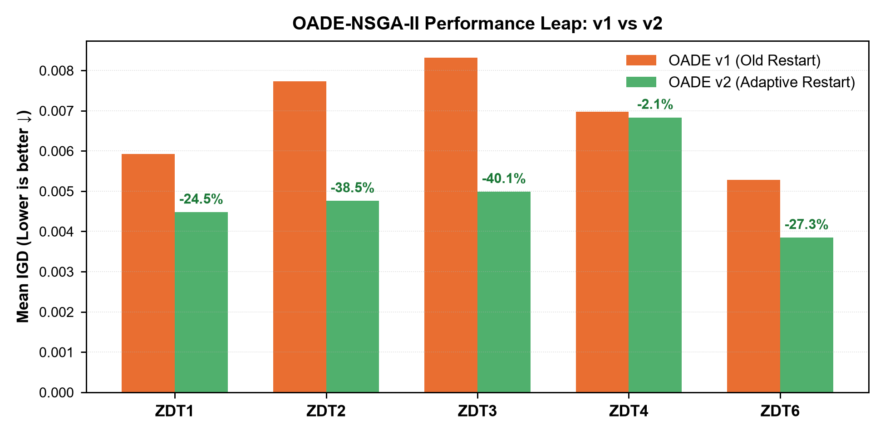
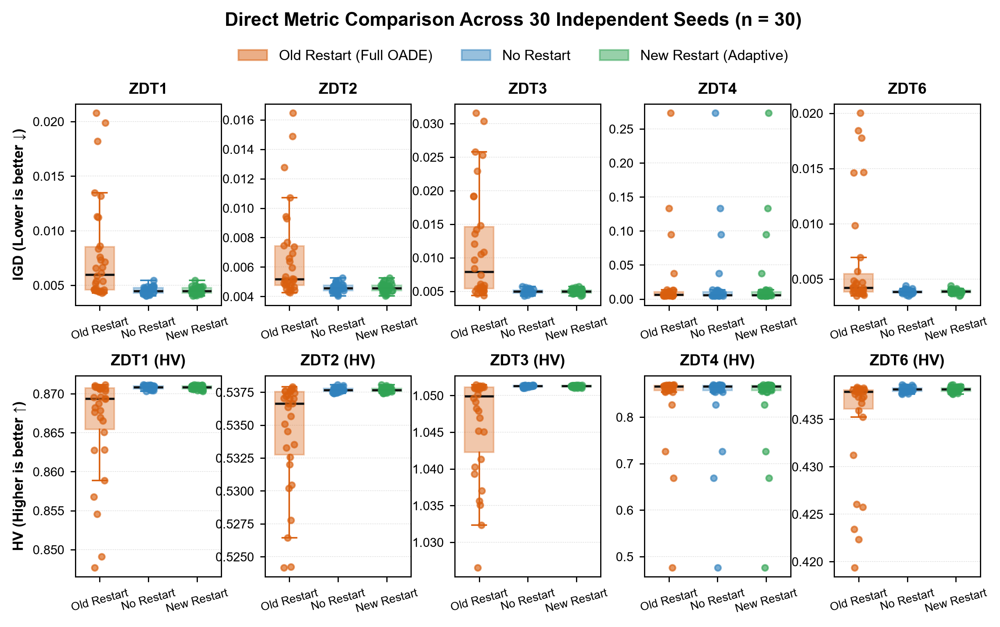
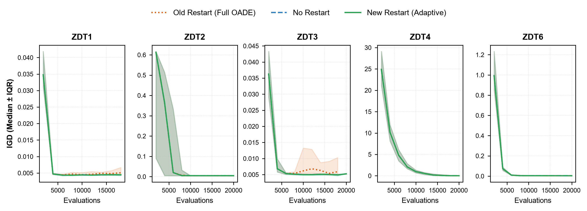
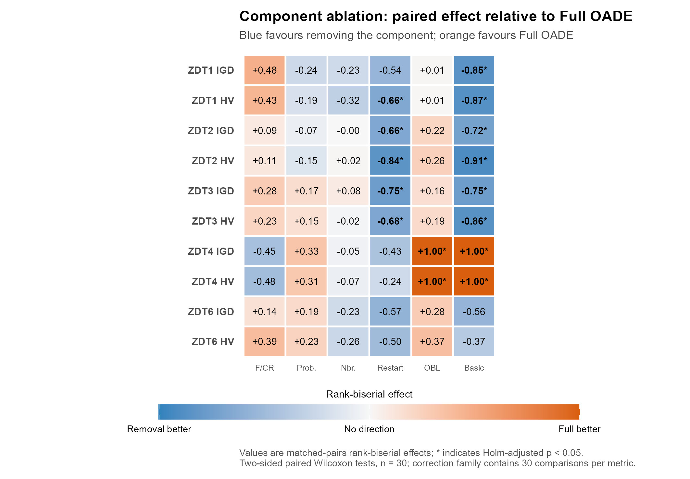
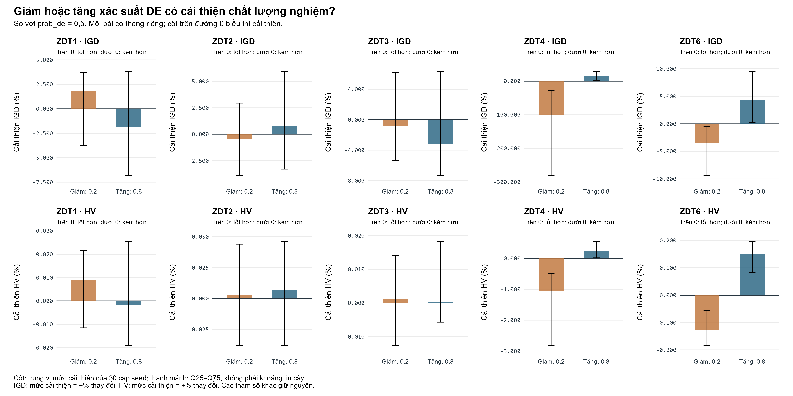
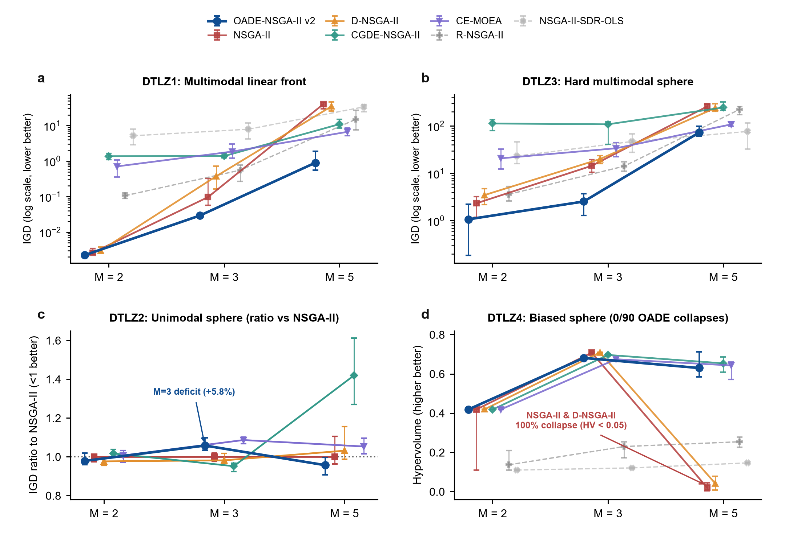
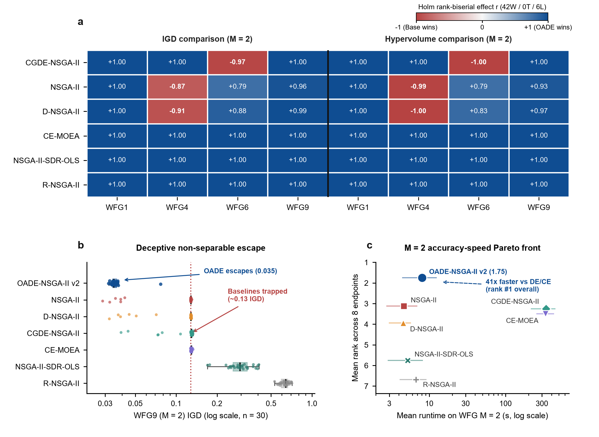

# OADE-NSGA-II

**Language:** **English** | [Tiếng Việt](README.vi.md)

This project evaluates adaptive differential evolution and opposition-based learning within NSGA-II. ZDT is the current research priority. Results are reported separately for each problem, including comparator performance, classic/adaptive configurations and inference boundaries.

## Study design and reading guide

OADE-NSGA-II combines neighborhood-based DE offspring, online F/CR updates, periodic opposition-based candidates and NSGA-II environmental selection. Classic uses the original restart; adaptive adds diversity conditions and local replacement. Algorithm design and evidence for individual component contributions are interpreted separately.

| Item | Specification |
| --- | --- |
| Benchmark ZDT | 7 algorithms; 30 paired seeds 42–71; population 100; evaluation cap 20,000 |
| ZDT1 / ZDT2 / ZDT3 | 30 variables; 2 objectives |
| ZDT4 / ZDT6 | 10 variables; 2 objectives |
| Restart confirmation | Classic / no restart / adaptive; 30 paired seeds 1000–1029 |
| Adaptive OFAT | 9 parameters; 19 unique configurations; 30 seeds 6000–6029 per problem/configuration |
| Metrics | IGD ↓; HV ↑; mean ± sample SD for benchmarks; median and Q25–Q75 for OFAT |

Tables below report individual problems. Holm corrections retain their original families; reused comparator blocks are not new independent runs. Common uniform benchmark initialization bypasses standalone initial Sobol/OBL. Runtime describes the measured implementation, rather than hardware-independent complexity.



**Figure 1. Classic and adaptive on each ZDT problem.** Each pair shows mean IGD over 30 benchmark seeds. Percentages describe configuration differences and do not isolate a restart mechanism.

## ZDT: primary research focus

Each problem has reports for the seven-algorithm benchmark, classic/adaptive comparison, restart confirmation, ablation and parameter sensitivity. Open the problem README for its full tables and tests.

### ZDT1

In benchmark seeds 42–71, adaptive OADE had a mean IGD of **0.00447533**, compared with **0.00517466** for NSGA2. These results apply to ZDT1, with 30 runs per algorithm and a 20,000-evaluation cap.

**Comparators: mean ± SD, 30 runs per algorithm.**

| Algorithm | IGD ↓ | HV ↑ | s/run |
| --- | --- | --- | --- |
| OADE_NSGAII | 0.00447533 ± 0.00025124 | 0.870866 ± 0.000232239 | 14.4968 |
| NSGA2 | 0.00517466 ± 0.000297904 | 0.868053 ± 0.000417268 | 0.92875 |
| RNSGA2 | 0.632973 ± 0.0876243 | 0.348062 ± 0.0938884 | 2.75757 |
| DNSGA2 | 0.00563295 ± 0.000423465 | 0.867066 ± 0.00068501 | 0.853377 |
| CGDE_NSGAII | 0.00743342 ± 0.000527482 | 0.863362 ± 0.000968519 | 39.5621 |
| NSGAII_SDR_OLS | 0.0156331 ± 0.0197044 | 0.858421 ± 0.0148456 | 1.04961 |
| CE_MOEA | 0.00690817 ± 0.000873872 | 0.864472 ± 0.00177852 | 38.8171 |

**Classic → adaptive, seeds 42–71:** mean IGD 0.00592521 → 0.00447533; mean HV 0.868961 → 0.870866. Adaptive versus NSGA2 paired tests gave Holm p = 5.58794e-08 for IGD and 5.58794e-08 for HV. The classic–adaptive difference here is descriptive.

**Restart confirmation, seeds 1000–1029:** means of 30 runs per variant.

| Variant | IGD mean ↓ | HV mean ↑ |
| --- | --- | --- |
| Classic | 0.00792113 | 0.866365 |
| No restart | 0.00453077 | 0.870819 |
| Adaptive | 0.00453077 | 0.870819 |

**Adaptive sensitivity.** In OFAT seeds 6000–6029, increasing population from 100 to 200 changed median IGD from 0.00439707 to 0.00222923 and median HV from 0.870962 to 0.87382.

Increasing initial DE probability from 0.5 to 0.8 changed median IGD from 0.00439707 to 0.00442112 and median HV from 0.870962 to 0.870941. These are problem-specific OFAT responses, not an optimal configuration or an interaction analysis.

**Classic ablation (OADE_NO_RESTART versus Full OADE).** IGD: no difference detected, p Holm = 0.171003; HV: favors removal, p Holm = 0.0238779. This is not an ablation of the adaptive configuration.

[Problem report](results/by_problem/zdt/zdt1/README.md) · [Classic/adaptive](results/by_problem/zdt/zdt1/reports/classic_vs_adaptive.md) · [Sensitivity](results/by_problem/zdt/zdt1/reports/sensitivity_adaptive.md) · [CSV ZIP](results/by_problem/zdt/zdt1/csv_results.zip)

### ZDT2

In benchmark seeds 42–71, adaptive OADE had a mean IGD of **0.00475622**, compared with **0.00540493** for NSGA2. These results apply to ZDT2, with 30 runs per algorithm and a 20,000-evaluation cap.

**Comparators: mean ± SD, 30 runs per algorithm.**

| Algorithm | IGD ↓ | HV ↑ | s/run |
| --- | --- | --- | --- |
| OADE_NSGAII | 0.00475622 ± 0.000292104 | 0.537674 ± 0.000221914 | 14.7846 |
| NSGA2 | 0.00540493 ± 0.000306249 | 0.534072 ± 0.000611177 | 1.97288 |
| RNSGA2 | 0.523507 ± 0.0253141 | 0.120884 ± 0.00708899 | 6.41374 |
| DNSGA2 | 0.00588101 ± 0.00039197 | 0.532697 ± 0.000974228 | 1.84104 |
| CGDE_NSGAII | 0.00681507 ± 0.00051003 | 0.530572 ± 0.00116976 | 136.061 |
| NSGAII_SDR_OLS | 0.0503186 ± 0.152326 | 0.499634 ± 0.106117 | 3.47569 |
| CE_MOEA | 0.00747684 ± 0.000980341 | 0.52967 ± 0.00190535 | 144.511 |

**Classic → adaptive, seeds 42–71:** mean IGD 0.00773397 → 0.00475622; mean HV 0.533739 → 0.537674. Adaptive versus NSGA2 paired tests gave Holm p = 7.82311e-08 for IGD and 5.58794e-08 for HV. The classic–adaptive difference here is descriptive.

**Restart confirmation, seeds 1000–1029:** means of 30 runs per variant.

| Variant | IGD mean ↓ | HV mean ↑ |
| --- | --- | --- |
| Classic | 0.00678176 | 0.53447 |
| No restart | 0.00459058 | 0.537682 |
| Adaptive | 0.00459058 | 0.537682 |

**Adaptive sensitivity.** In OFAT seeds 6000–6029, increasing population from 100 to 200 changed median IGD from 0.0046646 to 0.00236691 and median HV from 0.537652 to 0.540519.

Increasing initial DE probability from 0.5 to 0.8 changed median IGD from 0.0046646 to 0.00461182 and median HV from 0.537652 to 0.537702. These are problem-specific OFAT responses, not an optimal configuration or an interaction analysis.

**Classic ablation (OADE_NO_RESTART versus Full OADE).** IGD: favors removal, p Holm = 0.0228426; HV: favors removal, p Holm = 0.000265241. This is not an ablation of the adaptive configuration.

[Problem report](results/by_problem/zdt/zdt2/README.md) · [Classic/adaptive](results/by_problem/zdt/zdt2/reports/classic_vs_adaptive.md) · [Sensitivity](results/by_problem/zdt/zdt2/reports/sensitivity_adaptive.md) · [CSV ZIP](results/by_problem/zdt/zdt2/csv_results.zip)

### ZDT3

In benchmark seeds 42–71, adaptive OADE had a mean IGD of **0.00498585**, compared with **0.00719117** for NSGA2. These results apply to ZDT3, with 30 runs per algorithm and a 20,000-evaluation cap.

**Comparators: mean ± SD, 30 runs per algorithm.**

| Algorithm | IGD ↓ | HV ↑ | s/run |
| --- | --- | --- | --- |
| OADE_NSGAII | 0.00498585 ± 0.000336107 | 1.05122 ± 0.000152005 | 10.7916 |
| NSGA2 | 0.00719117 ± 0.0102307 | 1.04718 ± 0.00669921 | 1.68703 |
| RNSGA2 | 0.740552 ± 0.0573164 | 0.401005 ± 0.0494966 | 2.38314 |
| DNSGA2 | 0.0055682 ± 0.000290586 | 1.04695 ± 0.000679974 | 1.62852 |
| CGDE_NSGAII | 0.00826161 ± 0.000984232 | 1.03505 ± 0.0036038 | 108.59 |
| NSGAII_SDR_OLS | 0.0186481 ± 0.00296968 | 1.03581 ± 0.00435762 | 2.53103 |
| CE_MOEA | 0.00856088 ± 0.00153316 | 1.0344 ± 0.0051157 | 100.297 |

**Classic → adaptive, seeds 42–71:** mean IGD 0.0083192 → 0.00498585; mean HV 1.04924 → 1.05122. Adaptive versus NSGA2 paired tests gave Holm p = 0.00114028 for IGD and 5.58794e-08 for HV. The classic–adaptive difference here is descriptive.

**Restart confirmation, seeds 1000–1029:** means of 30 runs per variant.

| Variant | IGD mean ↓ | HV mean ↑ |
| --- | --- | --- |
| Classic | 0.011652 | 1.04618 |
| No restart | 0.0049638 | 1.05126 |
| Adaptive | 0.0049638 | 1.05126 |

**Adaptive sensitivity.** In OFAT seeds 6000–6029, increasing population from 100 to 200 changed median IGD from 0.00515966 to 0.00249304 and median HV from 1.05118 to 1.0528.

Increasing initial DE probability from 0.5 to 0.8 changed median IGD from 0.00515966 to 0.00512136 and median HV from 1.05118 to 1.05127. These are problem-specific OFAT responses, not an optimal configuration or an interaction analysis.

**Classic ablation (OADE_NO_RESTART versus Full OADE).** IGD: favors removal, p Holm = 0.0033301; HV: favors removal, p Holm = 0.0175104. This is not an ablation of the adaptive configuration.

[Problem report](results/by_problem/zdt/zdt3/README.md) · [Classic/adaptive](results/by_problem/zdt/zdt3/reports/classic_vs_adaptive.md) · [Sensitivity](results/by_problem/zdt/zdt3/reports/sensitivity_adaptive.md) · [CSV ZIP](results/by_problem/zdt/zdt3/csv_results.zip)

### ZDT4

In benchmark seeds 42–71, adaptive OADE had a mean IGD of **0.00683066**, compared with **0.00995272** for NSGA2. These results apply to ZDT4, with 30 runs per algorithm and a 20,000-evaluation cap.

OFAT recorded a loss of solution quality at population 200; this boundary remains visible in the ZDT4 report.

**Comparators: mean ± SD, 30 runs per algorithm.**

| Algorithm | IGD ↓ | HV ↑ | s/run |
| --- | --- | --- | --- |
| OADE_NSGAII | 0.00683066 ± 0.00332858 | 0.865051 ± 0.00567877 | 11.9833 |
| NSGA2 | 0.00995272 ± 0.00508029 | 0.859362 ± 0.0079104 | 2.20807 |
| RNSGA2 | 0.620575 ± 0.165318 | 0.351077 ± 0.155278 | 2.09675 |
| DNSGA2 | 0.0199731 ± 0.0273695 | 0.84675 ± 0.0368674 | 2.10489 |
| CGDE_NSGAII | 12.1716 ± 2.80042 | 0 ± 0 | 138.416 |
| NSGAII_SDR_OLS | 10.8914 ± 6.7777 | 0 ± 0 | 2.36871 |
| CE_MOEA | 0.357214 ± 0.234331 | 0.409725 ± 0.22787 | 129.2 |

**Classic → adaptive, seeds 42–71:** mean IGD 0.00697718 → 0.00683066; mean HV 0.864878 → 0.865051. Adaptive versus NSGA2 paired tests gave Holm p = 0.00404036 for IGD and 0.00087182 for HV. The classic–adaptive difference here is descriptive.

**Restart confirmation, seeds 1000–1029:** means of 30 runs per variant.

| Variant | IGD mean ↓ | HV mean ↑ |
| --- | --- | --- |
| Classic | 0.0240858 | 0.839208 |
| No restart | 0.0240433 | 0.839264 |
| Adaptive | 0.0240433 | 0.839264 |

**Adaptive sensitivity.** In OFAT seeds 6000–6029, increasing population from 100 to 200 changed median IGD from 0.00558256 to 0.598477 and median HV from 0.867216 to 0.092856.

Increasing initial DE probability from 0.5 to 0.8 changed median IGD from 0.00558256 to 0.00466007 and median HV from 0.867216 to 0.869327. These are problem-specific OFAT responses, not an optimal configuration or an interaction analysis.

**Classic ablation (OADE_NO_OBL versus Full OADE).** IGD: favors Full OADE, p Holm = 1.08033e-07; HV: favors Full OADE, p Holm = 1.08033e-07. This is not an ablation of the adaptive configuration.

[Problem report](results/by_problem/zdt/zdt4/README.md) · [Classic/adaptive](results/by_problem/zdt/zdt4/reports/classic_vs_adaptive.md) · [Sensitivity](results/by_problem/zdt/zdt4/reports/sensitivity_adaptive.md) · [CSV ZIP](results/by_problem/zdt/zdt4/csv_results.zip)

### ZDT6

In benchmark seeds 42–71, adaptive OADE had a mean IGD of **0.003844**, compared with **0.0163681** for NSGA2. These results apply to ZDT6, with 30 runs per algorithm and a 20,000-evaluation cap.

The IGD test detected no difference from CGDE_NSGAII, whereas HV favored CGDE_NSGAII. The comparison with NSGA2 does not establish superiority over every algorithm.

**Comparators: mean ± SD, 30 runs per algorithm.**

| Algorithm | IGD ↓ | HV ↑ | s/run |
| --- | --- | --- | --- |
| OADE_NSGAII | 0.003844 ± 0.000192923 | 0.438177 ± 0.000252795 | 13.3414 |
| NSGA2 | 0.0163681 ± 0.00201149 | 0.417891 ± 0.00287211 | 2.05538 |
| RNSGA2 | 0.185764 ± 0.0927869 | 0.267636 ± 0.06859 | 2.20712 |
| DNSGA2 | 0.0225884 ± 0.00279408 | 0.408917 ± 0.00399733 | 2.01973 |
| CGDE_NSGAII | 0.00382305 ± 0.000222667 | 0.439057 ± 0.000199467 | 103.072 |
| NSGAII_SDR_OLS | 0.139446 ± 0.0827475 | 0.282923 ± 0.0589616 | 2.12093 |
| CE_MOEA | 0.00495683 ± 0.000335953 | 0.437794 ± 0.000359974 | 101.561 |

**Classic → adaptive, seeds 42–71:** mean IGD 0.00528589 → 0.003844; mean HV 0.436557 → 0.438177. Adaptive versus NSGA2 paired tests gave Holm p = 5.58794e-08 for IGD and 5.58794e-08 for HV. The classic–adaptive difference here is descriptive.

**Restart confirmation, seeds 1000–1029:** means of 30 runs per variant.

| Variant | IGD mean ↓ | HV mean ↑ |
| --- | --- | --- |
| Classic | 0.00656552 | 0.435092 |
| No restart | 0.00386259 | 0.438147 |
| Adaptive | 0.00387635 | 0.438148 |

**Adaptive sensitivity.** In OFAT seeds 6000–6029, increasing population from 100 to 200 changed median IGD from 0.00382752 to 0.0024559 and median HV from 0.438266 to 0.439487.

Increasing initial DE probability from 0.5 to 0.8 changed median IGD from 0.00382752 to 0.00362852 and median HV from 0.438266 to 0.438773. These are problem-specific OFAT responses, not an optimal configuration or an interaction analysis.

**Classic ablation (OADE_NO_RESTART versus Full OADE).** IGD: no difference detected, p Holm = 0.132859; HV: no difference detected, p Holm = 0.361487. This is not an ablation of the adaptive configuration.

[Problem report](results/by_problem/zdt/zdt6/README.md) · [Classic/adaptive](results/by_problem/zdt/zdt6/reports/classic_vs_adaptive.md) · [Sensitivity](results/by_problem/zdt/zdt6/reports/sensitivity_adaptive.md) · [CSV ZIP](results/by_problem/zdt/zdt6/csv_results.zip)

## Visual evidence: ZDT restart, convergence, ablation and sensitivity

These figures reuse existing research outputs. Each panel or row pair retains its problem identity; pooled win counts do not replace problem-specific conclusions.



**Figure 2. Held-out restart distributions.** IGD and HV are shown separately for each problem and variant (30 seeds, 1000–1029). No-restart and adaptive overlap closely; final metrics alone do not establish trigger operation.



**Figure 3. Within-budget convergence.** Curves show median IGD and shaded IQR for each problem. Panels have different vertical scales. The trajectories compare outcomes, not observed trigger counts.



**Figure 4. Classic component ablation.** Blue favors removing the named component; orange favors Full OADE. Asterisks mark Holm-adjusted p < 0.05. The ZDT4 OBL result contrasts with restart removals on ZDT1–3; there is no uniform component benefit.



**Figure 5. Initial DE probability sensitivity.** Bars show median improvement over 0.5 using 30 matched seeds; whiskers show Q25–Q75, not confidence intervals. Positive values mean improvement for both IGD and HV. Each problem has its own scale; median paired improvements differ from ratios of marginal medians quoted above.

OFAT baseline runs are reused between parameter tables. Under a fixed evaluation cap, population changes alter both available generations and solution-set resolution. These responses require confirmation before changing default settings.

## Strengths observed on ZDT

These strengths concern the implemented configurations on ZDT1/2/3/4/6 under the reported conditions. They accompany the problem-specific tables and figures, rather than establish superiority across problem classes.

| Strength | Current evidence | Interpretation boundary |
| --- | --- | --- |
| Solution quality versus NSGA2 | Adaptive has lower mean IGD and higher mean HV than NSGA2 in each reported ZDT problem; paired tests remain problem-specific. | 30 seeds 42–71, population 100, 20,000-evaluation cap; not superiority over every comparator. |
| Lower dispersion than classic on ZDT1–3 | Adaptive benchmark IGD SD is lower than classic separately on ZDT1, ZDT2 and ZDT3; held-out distributions expose poor-quality classic tails. | A configuration-level benefit; near-overlap with no-restart prevents attribution to the adaptive trigger. |
| Specific component evidence on ZDT4 | Classic ablation favors retaining OBL over removing it for both IGD and HV after Holm correction. | Periodic OBL under common uniform initialization, not standalone initial Sobol/OBL. |
| Evidence for sensitivity checks and reproduction | Matched-seed benchmarks, separate confirmation seeds, adaptive OFAT, manifests and SHA-256 ZIP records are available. | A strength of the experimental record, not a convergence or optimality guarantee. |

## Limitations and claim boundaries

| Limitation | ZDT evidence or design boundary | Consequence |
| --- | --- | --- |
| Not better than every algorithm | ZDT6: no IGD difference detected from CGDE_NSGAII, while HV favors CGDE_NSGAII. | Retain metric- and comparator-specific conclusions. |
| Runtime overhead | Adaptive OADE is slower than NSGA2/DNSGA2 in the measured ZDT runtime rows. | Assess quality alongside implementation-specific cost; runtime does not establish theoretical complexity. |
| Configuration and budget sensitivity | ZDT4 deteriorates strongly at population 200 under the 20,000-evaluation cap. | Larger populations are not a universally beneficial default. |
| Adaptive restart value remains unisolated | Adaptive and no-restart nearly overlap in confirmation; trigger telemetry was not saved. | Fresh seeds and restart checks/activations are needed for a mechanism claim. |
| OFAT does not establish interactions or optimality | One parameter changes around baseline; F/CR and DE probability can update within a run. | Favorable levels are confirmation candidates, not a general optimum. |
| Initialization benefit remains untested | Benchmark populations use common uniform initialization, bypassing standalone Sobol/OBL. | Periodic-OBL ablation does not establish an initialization benefit. |
| Uncertainty and provenance gaps | Current tables lack paired-effect CIs; some historical blocks lack execution manifests. | SD/IQR are not CIs; current environments cannot be assigned retrospectively. |
| Limited primary scope | The current focus is the reported continuous bi-objective ZDT problems; ZDT5 is not included. | Generalization to more objectives, constraints, discrete variables or applications is not established. |

## Research direction: consolidate ZDT, then extend

**The current priority is to strengthen the ZDT conclusions.** Existing DTLZ/WFG extension results remain below as supplementary evidence. They do not replace the ZDT focus or establish general superiority.

| Stage | Work to prioritize | Evidence to add |
| --- | --- | --- |
| 1. Consolidate ZDT | Confirm adaptive versus no-restart, candidate parameter settings and the ZDT4 population boundary. | Fresh seeds, restart telemetry/evaluation cost, paired-effect CIs and quality–cost analysis. |
| 2. Extend DTLZ/WFG | Add comparisons and ablations per problem and objective count; retain existing batches as supplementary evidence. | Verified comparators, explicit budgets, invalid-output handling and scaling checks. |
| 3. Other problem classes | Consider constrained, discrete or application problems once their evaluation objective is defined. | Task-appropriate protocols and comparators, without directly transferring ZDT settings or claims. |

This is a research direction, not a list of completed experiments. New evidence will be added to its own problem folder with configuration, seeds, budget, manifest and a separate report. See the [detailed evidence plan](docs/protocols/followup_experiments.md).

## DTLZ: incremental extension by problem

Each objective-count configuration has its own record. Existing results remain separate for incremental extension.

| Problem | Algorithms | IGD OADE ↓ | IGD NSGA2 ↓ | HV OADE ↑ | Detail |
| --- | --- | --- | --- | --- | --- |
| DTLZ1_M2 | 7 | 0.00228432 | 0.00294605 | 0.233218 | [Report](results/by_problem/dtlz/dtlz1_m2/README.md) |
| DTLZ1_M3 | 7 | 0.0292282 | 0.191546 | 0.184658 | [Report](results/by_problem/dtlz/dtlz1_m3/README.md) |
| DTLZ1_M5 | 7 | 2.55293 | 39.7519 | 0.00919743 | [Report](results/by_problem/dtlz/dtlz1_m5/README.md) |
| DTLZ2_M2 | 7 | 0.00504106 | 0.0050504 | 0.418953 | [Report](results/by_problem/dtlz/dtlz2_m2/README.md) |
| DTLZ2_M3 | 7 | 0.0766053 | 0.0719165 | 0.684464 | [Report](results/by_problem/dtlz/dtlz2_m3/README.md) |
| DTLZ2_M5 | 7 | 0.42009 | 0.457093 | 0.460191 | [Report](results/by_problem/dtlz/dtlz2_m5/README.md) |
| DTLZ3_M2 | 7 | 1.34808 | 2.64577 | 0.0997882 | [Report](results/by_problem/dtlz/dtlz3_m2/README.md) |
| DTLZ3_M3 | 7 | 2.52939 | 15.3961 | 0.0407079 | [Report](results/by_problem/dtlz/dtlz3_m3/README.md) |
| DTLZ3_M5 | 7 | 80.8224 | 251.863 | 0 | [Report](results/by_problem/dtlz/dtlz3_m5/README.md) |
| DTLZ4_M2 | 7 | 0.00513331 | 0.275331 | 0.418761 | [Report](results/by_problem/dtlz/dtlz4_m2/README.md) |
| DTLZ4_M3 | 7 | 0.0786625 | 0.0698968 | 0.680528 | [Report](results/by_problem/dtlz/dtlz4_m3/README.md) |
| DTLZ4_M5 | 7 | 0.372651 | 0.802355 | 0.647577 | [Report](results/by_problem/dtlz/dtlz4_m5/README.md) |

**Visible failure boundary:** OADE had HV = 0 in 17/30 DTLZ1_M5 runs and all 30 DTLZ3_M5 runs. These are reference-point quality outcomes, not necessarily structural output failures. Valid matched-pair counts are reported per comparison.



**Figure 6. DTLZ objective-count scaling.** Panels separately show DTLZ1, DTLZ3, DTLZ2 comparisons and DTLZ4 HV. Log-scale IGD exposes the difficulty of increasing the objective count; ZDT results are not substituted for DTLZ evidence.

## WFG: incremental extension by problem

Each objective-count configuration has its own record. Existing results remain separate for incremental extension.

| Problem | Algorithms | IGD OADE ↓ | IGD NSGA2 ↓ | HV OADE ↑ | Detail |
| --- | --- | --- | --- | --- | --- |
| WFG1_M2 | 7 | 1.02608 | 1.20215 | 1.77197 | [Report](results/by_problem/wfg/wfg1_m2/README.md) |
| WFG1_M3 | 5 | 1.41795 | 1.39246 | 16.4028 | [Report](results/by_problem/wfg/wfg1_m3/README.md) |
| WFG1_M5 | 5 | 1.99485 | 1.99336 | 1303.85 | [Report](results/by_problem/wfg/wfg1_m5/README.md) |
| WFG4_M2 | 7 | 0.0332224 | 0.0263514 | 2.146 | [Report](results/by_problem/wfg/wfg4_m2/README.md) |
| WFG4_M3 | 5 | 0.353783 | 0.280393 | 16.2589 | [Report](results/by_problem/wfg/wfg4_m3/README.md) |
| WFG4_M5 | 5 | 1.38378 | 1.23067 | 663.471 | [Report](results/by_problem/wfg/wfg4_m5/README.md) |
| WFG6_M2 | 7 | 0.0547901 | 0.0716943 | 2.04237 | [Report](results/by_problem/wfg/wfg6_m2/README.md) |
| WFG6_M3 | 5 | 0.396159 | 0.322633 | 15.7194 | [Report](results/by_problem/wfg/wfg6_m3/README.md) |
| WFG6_M5 | 5 | 1.45639 | 1.35347 | 1359.38 | [Report](results/by_problem/wfg/wfg6_m5/README.md) |
| WFG9_M2 | 7 | 0.0363613 | 0.110123 | 2.15299 | [Report](results/by_problem/wfg/wfg9_m2/README.md) |
| WFG9_M3 | 5 | 0.340685 | 0.341724 | 17.6942 | [Report](results/by_problem/wfg/wfg9_m3/README.md) |
| WFG9_M5 | 5 | 1.96313 | 1.73254 | 983.527 | [Report](results/by_problem/wfg/wfg9_m5/README.md) |

M=2 rows use the seven-algorithm benchmark; M=3/5 use the five-algorithm compact study. Shared M=2 blocks are not new independent runs. Means in the table are not the medians plotted below.



**Figure 7. Bi-objective WFG comparator profiles.** Panel a retains separate IGD/HV effects for WFG1/4/6/9; panel b shows WFG9 run distributions. Panel c is the original figure’s aggregate cost context, not a substitute for the problem rows above or evidence for M=3/5.

## Reading the evidence

Benchmarks report mean ± SD; adaptive sensitivity reports median and IQR (Q25–Q75). Lower IGD and higher HV indicate better quality within a problem. Paired Wilcoxon tests retain their original Holm correction families after reports are split.

Classic and adaptive are two OADE configurations; the six comparator blocks are reused between the ZDT benchmarks. Restart seeds 1000–1029 and OFAT seeds 6000–6029 are interpreted separately. Final quality does not itself establish the restart mechanism, and OFAT does not evaluate parameter interactions.

## Data access and reproduction

CSVs are distributed as ZIP bundles. Markdown reports and figures can be read directly. See the [download index and SHA-256 records](results/CSV_DOWNLOADS.md).

```powershell
python -m venv .venv
.venv\Scripts\python.exe -m pip install -e .
.venv\Scripts\python.exe scripts/csv_archives.py restore
```

Reproduce the adaptive ZDT benchmark in a new directory:

```powershell
.venv\Scripts\python.exe main.py benchmark --config config/suites/algorithm_benchmark_v2.yaml --out-dir results/reproduction_zdt_v2
```

After updating source evidence, regenerate problem reports and bundles:

```powershell
.venv\Scripts\python.exe scripts/organize_by_problem.py
.venv\Scripts\python.exe scripts/csv_archives.py pack
```

## Methods documentation

- [Baseline identities and citations](docs/protocols/baselines.md)
- [Experiment registry](docs/protocols/experiment_registry.md)
- [Reproducibility](docs/protocols/reproducibility.md)
- [Documentation index](docs/index.md)
