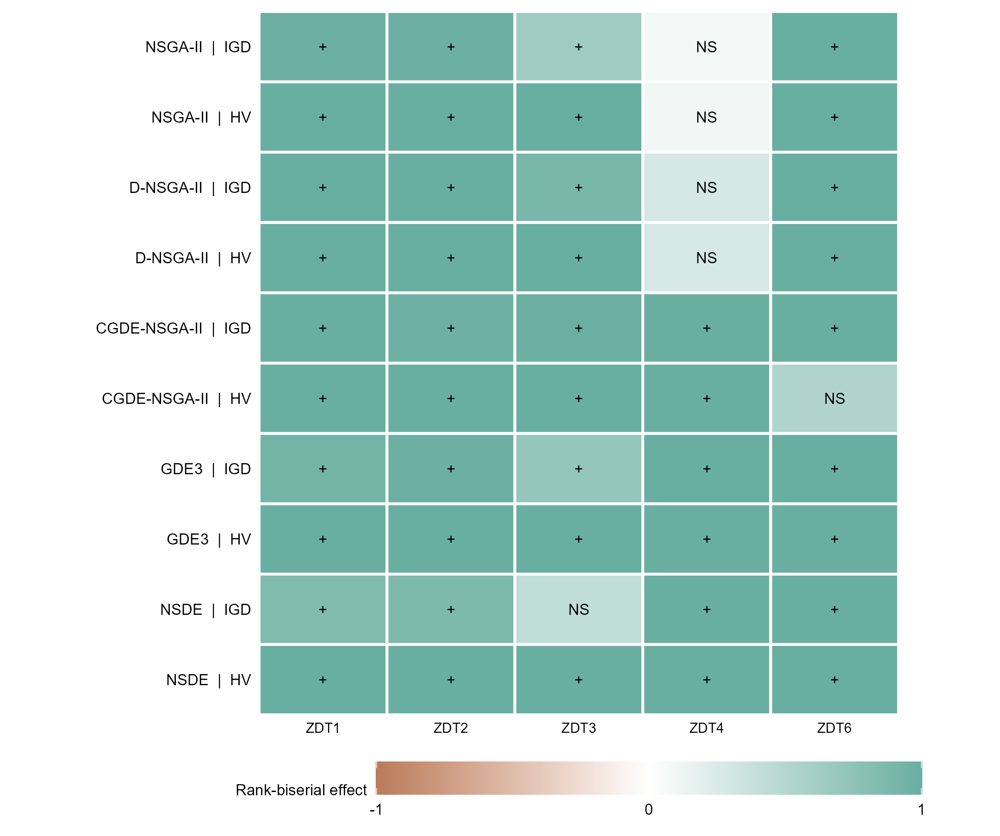
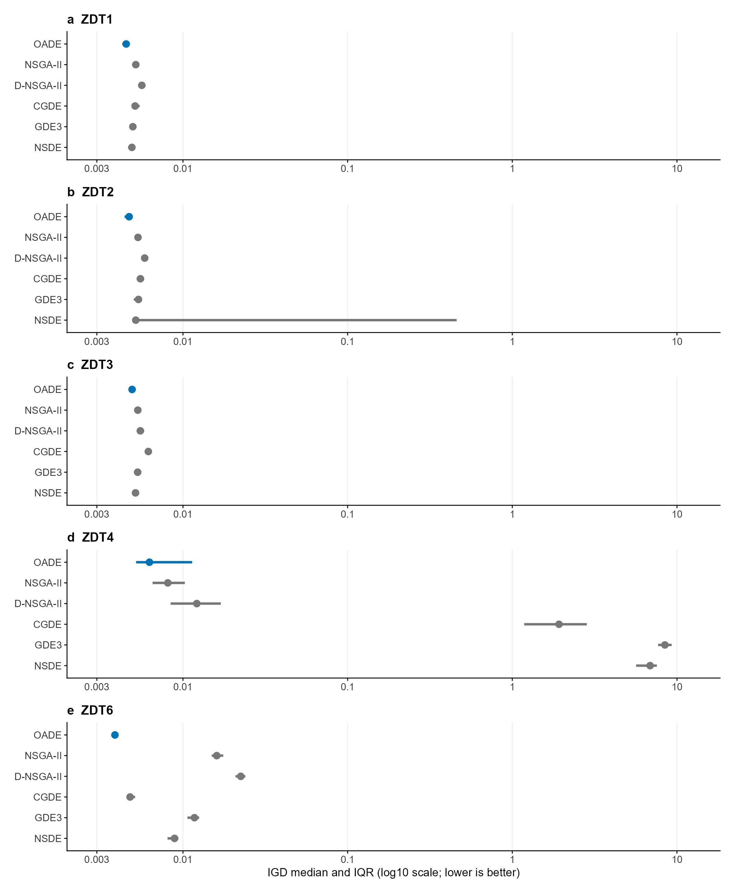
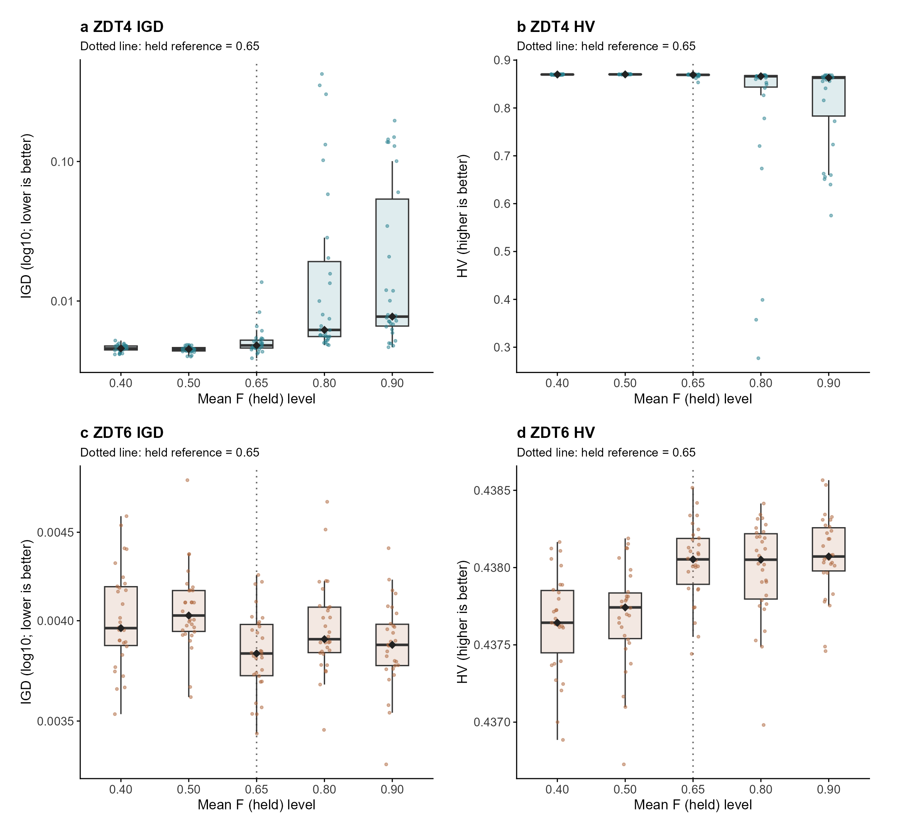

# OADE-NSGA-II

**Language:** **English** | [Tiếng Việt](README.vi.md)

OADE-NSGA-II combines DE/SBX offspring generation, F/CR adaptation, periodic opposition-based diversity injection, adaptive restart and NSGA-II survival. Production OADE and the existing CGDE implementation are unchanged.

## Current comparison baseline — six algorithms

As of 19 November 2026, the main comparison uses **OADE_NSGAII, NSGA2, DNSGA2, CGDE_NSGAII, GDE3 and NSDE**. CE-MOEA, R-NSGA-II and SDR-OLS are removed from the active suite. Their source/configurations remain for legacy reproducibility.

| Algorithm | Implementation | Comparison role |
|---|---|---|
| OADE-NSGA-II | Fixed local production solver | Proposed method |
| NSGA-II | pymoo | NSGA-II foundation |
| D-NSGA-II | pymoo | Diversity response; tested here on static problems |
| CGDE-NSGA-II | Existing local paper-based reconstruction | Cross-generation neighborhood DE |
| GDE3 | pymoo 0.6.2+ | DE parent–trial competition |
| NSDE | pymoo 0.6.2+ | DE variation with NSGA-II sorting/survival |

GDE3 and NSDE use the library search implementations: `DE/rand/1/bin`, F=0.5, CR=0.5, gamma=1e-4, bounce-back repair and default RankAndCrowding survival. All six receive the same uniform initialization per problem/seed. No new baseline search operator is reconstructed locally.

[Execution protocol](docs/protocols/zdt_six_fixed_oade.md) · [Suite configuration](config/suites/zdt_six_fixed_oade.yaml) · [Baseline registry](docs/protocols/baselines.md).

## Experiment settings and result status

| Item | Setting |
|---|---|
| Problems | ZDT1/2/3: D=30; ZDT4/6: D=10; M=2 throughout |
| Population / budget | 100 / at most 20,000 objective evaluations per run |
| Seeds | 42–71, 30 independent runs per algorithm/problem |
| Total | **900 fresh runs**, at most 18 million solver evaluations |
| Statistics | OADE versus five baselines: **50 endpoints**, global Holm, alpha=0.05 |
| Parallelism | Default 8 processes; `--jobs` overrides it |
| New output | `results/experiments/zdt_six_fixed_oade_v1/` |

<!-- six-solver-audited-results:start -->

**Completed: 900 runs, 899 valid.** Global Holm across 50 endpoints: **OADE better in 44, 6 nonsignificant, none significantly favoring a baseline**. CGDE–ZDT4 seed 63 collapsed; that group has 29 valid runs, all others 30. OADE has the best means on ZDT1/2/3/6; NSGA-II has the best means on ZDT4. [Audited report](docs/reports/zdt_six_fixed_oade_report.md).

Cells show mean (best run): min IGD/max HV; means and best runs are bolded separately using unrounded values. Metric best runs may use different seeds; NS does not establish equivalence.

### IGD ↓ — mean (best)

| Problem | NSGA2 | DNSGA2 | CGDE_NSGAII | GDE3 | NSDE | OADE_NSGAII |
|---|---:|---:|---:|---:|---:|---:|
| ZDT1 | 5.175e-3 (4.417e-3) | 5.633e-3 (4.97e-3) | 5.202e-3 (4.584e-3) | 4.961e-3 (4.469e-3) | 4.872e-3 (4.373e-3) | **4.47e-3** (**3.952e-3**) |
| ZDT2 | 5.405e-3 (4.938e-3) | 5.881e-3 (5.189e-3) | 5.539e-3 (4.774e-3) | 8.597e-2 (4.764e-3) | 1.665e-1 (4.535e-3) | **4.71e-3** (**4.149e-3**) |
| ZDT3 | 7.191e-3 (4.695e-3) | 5.568e-3 (5.049e-3) | 6.126e-3 (5.246e-3) | 5.349e-3 (4.917e-3) | 5.186e-3 (4.565e-3) | **4.998e-3** (**4.453e-3**) |
| ZDT4 | **9.953e-3** (4.767e-3) | 1.997e-2 (**4.574e-3**) | 2.32e0 (4.666e-1) | 8.542e0 (5.599e0) | 6.938e0 (3.668e0) | 3.979e-2 (4.636e-3) |
| ZDT6 | 1.637e-2 (1.299e-2) | 2.259e-2 (1.699e-2) | 4.828e-3 (4.24e-3) | 1.154e-2 (8.408e-3) | 2.588e-2 (7.242e-3) | **3.881e-3** (**3.461e-3**) |

### HV ↑ — mean (best)

| Problem | NSGA2 | DNSGA2 | CGDE_NSGAII | GDE3 | NSDE | OADE_NSGAII |
|---|---:|---:|---:|---:|---:|---:|
| ZDT1 | 8.681e-1 (8.686e-1) | 8.671e-1 (8.683e-1) | 8.699e-1 (8.706e-1) | 8.686e-1 (8.693e-1) | 8.689e-1 (8.695e-1) | **8.708e-1** (**8.713e-1**) |
| ZDT2 | 5.341e-1 (5.349e-1) | 5.327e-1 (5.345e-1) | 5.365e-1 (5.373e-1) | 4.78e-1 (5.356e-1) | 4.218e-1 (5.359e-1) | **5.377e-1** (**5.38e-1**) |
| ZDT3 | 1.047e0 (1.049e0) | 1.047e0 (1.048e0) | 1.051e0 (1.051e0) | 1.048e0 (1.049e0) | 1.048e0 (1.049e0) | **1.051e0** (**1.052e0**) |
| ZDT4 | **8.594e-1** (8.686e-1) | 8.467e-1 (8.688e-1) | 1.647e-2 (2.453e-1) | 0 (0) | 0 (0) | 8.139e-1 (**8.693e-1**) |
| ZDT6 | 4.179e-1 (4.226e-1) | 4.089e-1 (4.17e-1) | 4.379e-1 (4.385e-1) | 4.249e-1 (4.297e-1) | 4.175e-1 (4.315e-1) | **4.381e-1** (**4.385e-1**) |

<!-- deb-metrics-results:start -->

These additional tables use the same 899 valid runs: 29 for CGDE–ZDT4 and 30 for every other group. Mean and population variance (denominator R, `ddof=0`) summarize per-run metric values. Lower Υ and Δ are better; the lowest mean per problem is bolded using unrounded values. These are descriptive statistics; the Holm tests below apply only to IGD/HV.

### Table II — Convergence metric Υ ↓

For each algorithm: **first row = Mean, second row = Variance**.

<table>
  <thead>
    <tr><th>Algorithm</th><th>ZDT1</th><th>ZDT2</th><th>ZDT3</th><th>ZDT4</th><th>ZDT6</th></tr>
  </thead>
  <tbody>
    <tr><td rowspan="2">NSGA2</td><td align="right">2.2348e-03</td><td align="right">2.4863e-03</td><td align="right">1.3769e-03</td><td align="right"><strong>6.9653e-03</strong></td><td align="right">1.6054e-02</td></tr>
    <tr><td align="right">7.0131e-08</td><td align="right">1.3827e-07</td><td align="right">1.2695e-08</td><td align="right">1.4216e-05</td><td align="right">4.4706e-06</td></tr>
    <tr><td rowspan="2">DNSGA2</td><td align="right">2.8974e-03</td><td align="right">3.2709e-03</td><td align="right">1.6760e-03</td><td align="right">1.3031e-02</td><td align="right">2.2695e-02</td></tr>
    <tr><td align="right">1.5361e-07</td><td align="right">3.3720e-07</td><td align="right">2.6135e-08</td><td align="right">4.6938e-04</td><td align="right">8.9087e-06</td></tr>
    <tr><td rowspan="2">CGDE_NSGAII</td><td align="right"><strong>7.2046e-04</strong></td><td align="right"><strong>7.2782e-04</strong></td><td align="right"><strong>8.4640e-04</strong></td><td align="right">2.5441e+00</td><td align="right"><strong>5.6601e-04</strong></td></tr>
    <tr><td align="right">2.4015e-09</td><td align="right">3.2820e-09</td><td align="right">2.6503e-09</td><td align="right">3.1629e+00</td><td align="right">1.7199e-09</td></tr>
    <tr><td rowspan="2">GDE3</td><td align="right">1.8007e-03</td><td align="right">1.8516e-03</td><td align="right">1.4047e-03</td><td align="right">2.6912e+01</td><td align="right">1.0764e-02</td></tr>
    <tr><td align="right">2.2505e-08</td><td align="right">2.0834e-07</td><td align="right">9.2944e-09</td><td align="right">5.1855e+01</td><td align="right">2.1147e-06</td></tr>
    <tr><td rowspan="2">NSDE</td><td align="right">1.6374e-03</td><td align="right">1.3625e-03</td><td align="right">1.2684e-03</td><td align="right">2.6735e+01</td><td align="right">7.4932e-03</td></tr>
    <tr><td align="right">1.2610e-08</td><td align="right">4.6051e-07</td><td align="right">4.8345e-09</td><td align="right">5.1947e+01</td><td align="right">2.0685e-06</td></tr>
    <tr><td rowspan="2">OADE_NSGAII</td><td align="right">7.8155e-04</td><td align="right">7.4881e-04</td><td align="right">8.5883e-04</td><td align="right">3.8085e-02</td><td align="right">1.2273e-03</td></tr>
    <tr><td align="right">3.3734e-09</td><td align="right">3.7071e-09</td><td align="right">2.2691e-09</td><td align="right">5.9209e-03</td><td align="right">1.8040e-08</td></tr>
  </tbody>
</table>

### Table III — Diversity metric Δ ↓

For each algorithm: **first row = Mean, second row = Variance**.

<table>
  <thead>
    <tr><th>Algorithm</th><th>ZDT1</th><th>ZDT2</th><th>ZDT3</th><th>ZDT4</th><th>ZDT6</th></tr>
  </thead>
  <tbody>
    <tr><td rowspan="2">NSGA2</td><td align="right">3.4968e-01</td><td align="right">3.4559e-01</td><td align="right">5.5206e-01</td><td align="right">4.0147e-01</td><td align="right">3.3786e-01</td></tr>
    <tr><td align="right">8.1914e-04</td><td align="right">9.5195e-04</td><td align="right">6.1092e-04</td><td align="right">2.5620e-02</td><td align="right">6.0995e-04</td></tr>
    <tr><td rowspan="2">DNSGA2</td><td align="right"><strong>3.3776e-01</strong></td><td align="right"><strong>3.4071e-01</strong></td><td align="right">5.4211e-01</td><td align="right"><strong>3.9833e-01</strong></td><td align="right">3.5114e-01</td></tr>
    <tr><td align="right">5.6915e-04</td><td align="right">1.0573e-03</td><td align="right">3.4178e-04</td><td align="right">6.5907e-03</td><td align="right">7.1913e-04</td></tr>
    <tr><td rowspan="2">CGDE_NSGAII</td><td align="right">5.1806e-01</td><td align="right">5.5545e-01</td><td align="right">6.6530e-01</td><td align="right">8.1657e-01</td><td align="right">6.6988e-01</td></tr>
    <tr><td align="right">4.5954e-03</td><td align="right">3.5296e-03</td><td align="right">1.1084e-03</td><td align="right">3.2703e-03</td><td align="right">1.6770e-03</td></tr>
    <tr><td rowspan="2">GDE3</td><td align="right">3.5093e-01</td><td align="right">4.4231e-01</td><td align="right">5.3140e-01</td><td align="right">9.4363e-01</td><td align="right"><strong>3.3060e-01</strong></td></tr>
    <tr><td align="right">6.8594e-04</td><td align="right">4.8431e-02</td><td align="right">3.4406e-04</td><td align="right">5.9575e-03</td><td align="right">5.9186e-04</td></tr>
    <tr><td rowspan="2">NSDE</td><td align="right">3.4990e-01</td><td align="right">5.2035e-01</td><td align="right"><strong>5.2847e-01</strong></td><td align="right">9.2765e-01</td><td align="right">3.5644e-01</td></tr>
    <tr><td align="right">9.1802e-04</td><td align="right">8.3941e-02</td><td align="right">3.7982e-04</td><td align="right">1.2274e-02</td><td align="right">1.5135e-02</td></tr>
    <tr><td rowspan="2">OADE_NSGAII</td><td align="right">3.6366e-01</td><td align="right">3.6948e-01</td><td align="right">5.4395e-01</td><td align="right">4.0232e-01</td><td align="right">3.4681e-01</td></tr>
    <tr><td align="right">1.0134e-03</td><td align="right">8.4133e-04</td><td align="right">5.1888e-04</td><td align="right">2.5441e-02</td><td align="right">7.6387e-04</td></tr>
  </tbody>
</table>

Υ uses 500 approximately equal arc-length reference points on analytical ZDT fronts. Δ uses the true extremes and consecutive nondominated-point distances; on ZDT3, inter-segment gaps remain part of the original formula. [Method and limitations](docs/protocols/deb_metrics.md).

[CSV Υ](results/experiments/zdt_six_fixed_oade_v1/derived/deb_metrics/convergence_metric_results.csv) · [CSV Δ](results/experiments/zdt_six_fixed_oade_v1/derived/deb_metrics/diversity_metric_results.csv) · [Excel](results/experiments/zdt_six_fixed_oade_v1/derived/deb_metrics/experimental_results.xlsx) · [Per-run data](results/experiments/zdt_six_fixed_oade_v1/derived/deb_metrics/detailed_run_results.csv)

<!-- deb-metrics-results:end -->

Holm outcomes in **IGD / HV** order; +: OADE significantly better, NS: no detected difference.

| Baseline | ZDT1 | ZDT2 | ZDT3 | ZDT4 | ZDT6 | OADE better / 10 |
|---|---|---|---|---|---|---:|
| NSGA2 | + / + | + / + | + / + | NS / NS | + / + | 8 |
| DNSGA2 | + / + | + / + | + / + | NS / NS | + / + | 8 |
| CGDE_NSGAII | + / + | + / + | + / + | + / + | + / NS | 9 |
| GDE3 | + / + | + / + | + / + | + / + | + / + | 10 |
| NSDE | + / + | + / + | NS / + | + / + | + / + | 9 |



Color shows rank-biserial effects (positive favors OADE), not percentage improvement. GDE3/NSDE had lower measured runtime but poor ZDT4 quality (HV=0); NSDE–ZDT3 IGD and CGDE–ZDT6 HV remain nonsignificant. Independent recalculation matched 900 primary records, 30 summaries and 50 tests, with zero objective/IGD/HV discrepancy. [Statistical data and interpretation limits](docs/reports/zdt_six_fixed_oade_report.md).



Points show medians and segments show Q1–Q3 on a shared log10 axis, not confidence intervals. [All-seed IGD](docs/reports/figures/zdt_six/igd_distribution.png) · [HV](docs/reports/figures/zdt_six/hv_distribution.png) · [Runtime](docs/reports/figures/zdt_six/runtime_distribution.png) · [OADE Pareto fronts from current data](docs/reports/oade_zdt_pareto_fronts.md).

<!-- six-solver-audited-results:end -->

No results from the old seven-algorithm study are relabeled, pooled or copied into the new comparison. The [previous ZDT v2 report](docs/reports/zdt_seven_fixed_oade_v2_report.md), original datasets remain **historical evidence**, including their original 60-endpoint correction and implementation limitations. Existing OADE-only mechanism/parameter studies below remain separate evidence.

## Run the new comparison

```powershell
# Inspect only; no solver execution.
.\.venv\Scripts\python.exe -m research benchmark-zdt-six --stage plan --jobs 8

$env:OMP_NUM_THREADS = "1"
$env:OPENBLAS_NUM_THREADS = "1"
$env:MKL_NUM_THREADS = "1"

# Fresh replication: use a NEW output directory.
.\.venv\Scripts\python.exe -m research benchmark-zdt-six --stage run --jobs 8 --out-dir results/experiments/zdt_six_replication

# Resume the same study with unchanged source/configuration/environment.
.\.venv\Scripts\python.exe -m research benchmark-zdt-six --stage run --jobs 8 --resume
```

Use `--stage report --resume` to regenerate completed-study tables. Use a new `--out-dir` for replication; do not run the legacy `benchmark-zdt-seven` command for this suite. Objective calls inside all solvers count toward the cap; preserve actual FE when interpreting convergence. Recorded runtime includes implementation, worker and machine effects; see the report for its limits.

## Parameter effects on ZDT4 and ZDT6

The OFAT study completed **2,100/2,100 valid runs**: 35 configurations × 2 problems × 30 fresh seeds (7000–7029), population 100 and a 20,000-FE cap per run. After Holm across **124 endpoints**, the reference was better in **15**, tested levels in **5**, and **104 were nonsignificant**. An endpoint is a problem × level-versus-reference × metric; shared references do not make these independent experiments. [Audited report](docs/reports/mechanism_sensitivity_report.md) · [Complete tables](docs/reports/mechanism_sensitivity_tables.md) · [Protocol and levels](docs/protocols/mechanism_sensitivity.md).

**References:** static parameters use full production OADE; mean F/CR/pDE use matched **held-value** references at 0.65/0.5/0.5. Only the parameter being studied is held; the other adaptive parameters remain active. Held-level results are not direct tests against full adaptive OADE. Lower IGD and higher HV are better.

### Which parameters affect quality?

“Better/worse” below describes the tested level relative to its reference at Holm p < 0.05. **NS** means no difference was detected, not equivalence. Every endpoint uses 30 paired seeds.

| Parameter and reference | ZDT4: IGD | ZDT4: HV | ZDT6: IGD | ZDT6: HV |
|---|---|---|---|---|
| OBL interval, ref. 10 | 5/20/40 NS | 5/20/40 NS | 5/20/40 NS | 5/20/40 NS |
| OBL jump rate, ref. 0.2 | **0.05 worse**; 0.1/0.4 NS | **0.05 worse**; 0.1/0.4 NS | All tested levels NS | All tested levels NS |
| Patience, tolerance, diversity threshold, elite ratio | All tested levels NS | All tested levels NS | All tested levels NS | All tested levels NS |
| DE neighbors, ref. 5 | 3/10/20 NS | 3/10/20 NS | 3/10/20 NS | 3/10/20 NS |
| Held mean F, ref. 0.65 | **0.5 better; 0.8/0.9 worse**; 0.4 NS | **0.4/0.5 better; 0.8/0.9 worse** | **0.5 worse**; 0.4/0.8/0.9 NS | **0.4/0.5 worse**; 0.8/0.9 NS |
| Held mean CR, ref. 0.5 | All tested levels NS | All tested levels NS | **0.9 worse**; 0.1/0.3/0.7 NS | **0.3 better; 0.7/0.9 worse**; 0.1 NS |
| Held pDE, ref. 0.5 | **0.2 worse**; 0.35/0.65/0.8 NS | **0.2 worse**; 0.35/0.65/0.8 NS | All tested levels NS | **0.8 better; 0.2 worse**; 0.35/0.65 NS |


Positive favors the tested level; negative favors the reference. Teal is ZDT4, brown ZDT6. Filled points follow Holm; open points are NS. Intervals are **unadjusted** 95% paired-bootstrap CIs. Values are paired median HV differences divided by the reference median, not median per-seed percentage improvements. Panels use separate ranges. The [IGD overview](docs/reports/figures/mechanism_sensitivity/paired_igd_overview.png) uses a signed pseudo-log axis to retain long intervals; see the [12-figure reading guide](docs/reports/mechanism_sensitivity_figures.md).

### Quality achieved in representative comparisons

Values are **group median (best run): reference → tested level**, not medians of paired differences. Parentheses contain the best of the 30 runs for that metric. Statistical conclusions come from the paired tests, not from differences between medians or best runs.

| Problem | Single-parameter change | Median IGD ↓ | Median HV ↑ | Holm conclusion |
|---|---|---:|---:|---|
| ZDT4 | OBL jump rate 0.2 → 0.05 | 0.00541441 → 0.0721610 | 0.867651 → 0.762704 | Both worse; p=0.005069 / 0.006915 |
| ZDT4 | Held mean F 0.65 → 0.5 | 0.00480515 → 0.00451561 | 0.869223 → 0.870173 | Both better; p=0.005565 / 9.691×10⁻⁶ |
| ZDT6 | Held mean F 0.65 → 0.5 | 0.00382934 → 0.00402787 | 0.438053 → 0.437742 | Both worse; p=0.006208 / 0.005069 |
| ZDT6 | Held mean CR 0.5 → 0.3 | 0.00373864 → 0.00366901 | 0.438227 → 0.438471 | IGD NS; HV better, p=0.048311 |
| ZDT6 | Held pDE 0.5 → 0.8 | 0.00381187 → 0.00366338 | 0.438208 → 0.438799 | IGD NS; HV better, p=3.037×10⁻⁵ |



Lower held F helps ZDT4 in specific comparisons, while F=0.5 hurts ZDT6. Each point is one seed; boxes are Q1–Q3 and diamonds are medians. IGD uses log10 coordinates, HV linear axes. The dotted vertical line is the held reference. All tails remain visible; heights across panels with different ranges are not directly comparable.


Jump rate 0.05 hurts ZDT4; the remaining contrasts do not establish 0.2 as optimal. Box/point definitions match the F figure; the reference here is full production with jump rate 0.2.

**Empirical conclusion:** no alternative level was shown to improve both problems and both metrics consistently. CR=0.3 and pDE=0.8 have evidence of HV-only improvement on ZDT6; the CR result is close to the significance threshold. Restart settings can change behavior without a detected quality gain: on ZDT6, patience=5 produced 102 completed restarts in 19/30 seeds, versus 8 in 6/30 seeds for full, yet both quality endpoints remained NS. On ZDT4, full and the tested restart-parameter variants had no completed restarts.

This two-problem OFAT study does not test interactions or optimize parameter combinations. Do not combine favorable levels into a new configuration without validation, extrapolate to DTLZ/WFG, or change production defaults from these tables. Competitors were not rerun, so the study does not revise the ZDT v2 benchmark conclusions above. [Data and 124-endpoint audit](results/experiments/mechanism_sensitivity_v1/derived/audit.json).

## Other component studies and documentation

Component-study code and protocols remain available. Earlier component results were removed. A subsequent 480-run ZDT4/ZDT6 mechanism study has an [audited report and R figures](docs/reports/mechanism_zdt46_report.md), with explicit provenance limitations: full OADE wins 6 endpoints, interventions win 4, and 18 are nonsignificant after Holm across 28 endpoints.

- [Fixed and research OADE implementations](docs/protocols/oade_implementations.md)
- [Restart ablation](docs/protocols/restart_comparison.md)
- [Periodic diversity injection](docs/protocols/diversity_injection.md)
- [Probability adaptation](docs/protocols/probability_ablation.md)
- [Baseline corrections and reconstruction assumptions](docs/protocols/baseline_paper_corrections.md)
- [Experiment registry](docs/protocols/experiment_registry.md)
- [Documentation index](docs/index.md)
