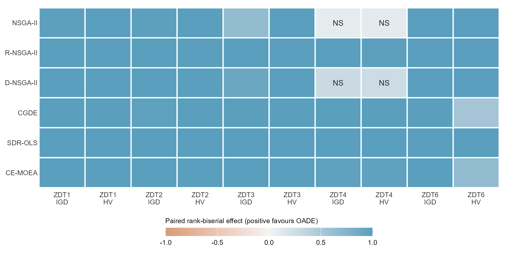
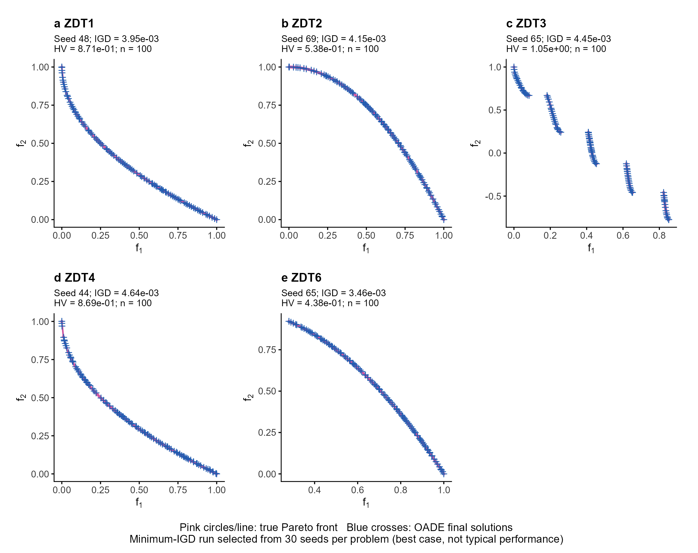
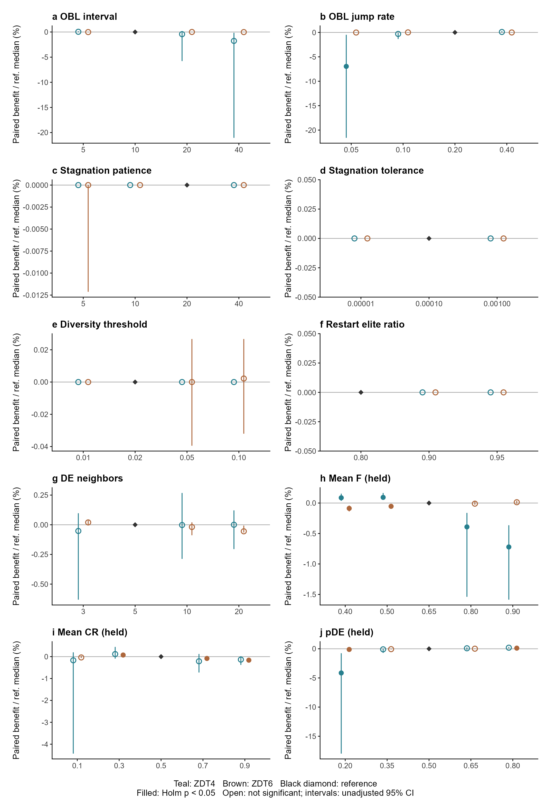
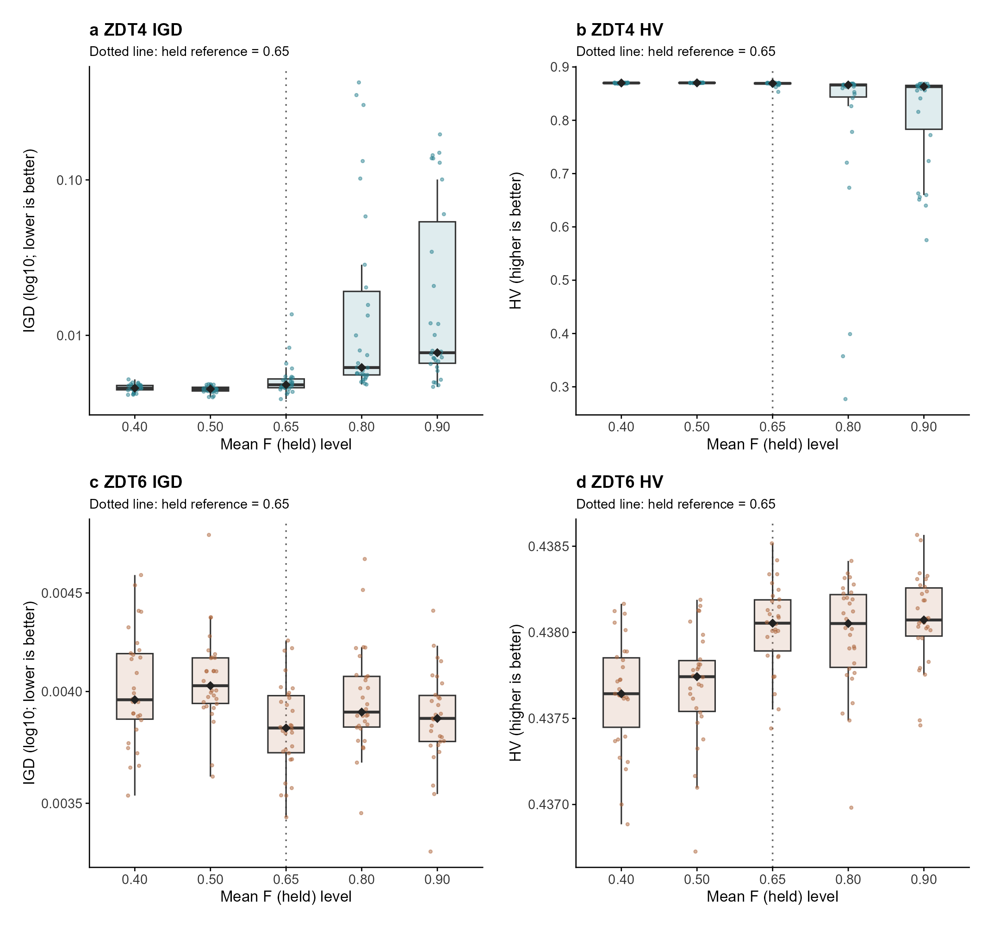
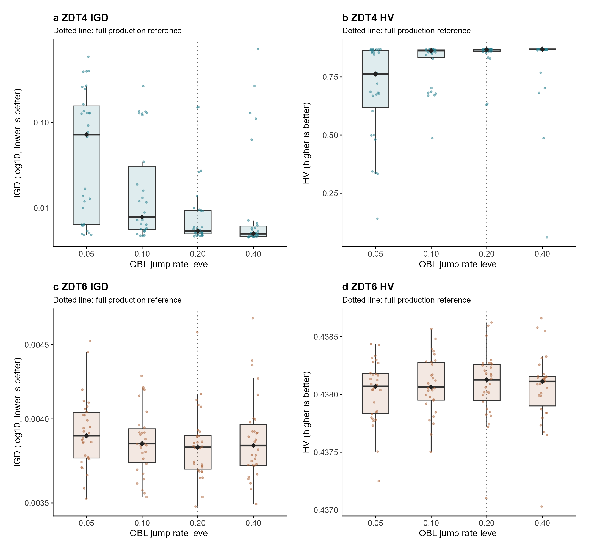

# OADE-NSGA-II

**Ngôn ngữ:** [English](README.md) | **Tiếng Việt**

OADE-NSGA-II kết hợp sinh offspring bằng DE/SBX, cập nhật F/CR, bơm đa dạng OBL định kỳ và chọn lọc NSGA-II. Bản chính dùng một cấu hình thống nhất; các biến thể nghiên cứu được tách riêng.

## Mốc kết quả hiện tại

**Từ ngày 15/11/2026, ZDT v2 là mốc bắt đầu cho đối chứng thuật toán.** Các bảng, hình và nhận định từ những lần chạy trước khi sửa baseline đã được gỡ khỏi README này; chúng không được dùng để chứng minh hiệu quả của mã hiện tại. Toàn bộ dữ liệu, báo cáo và bản đóng gói kết quả cũ đã được xóa. Chỉ giữ bộ ZDT v2 đã đối chiếu. DTLZ/WFG chưa được chấm lại với bộ baseline mới nên chưa có kết luận hiện tại cho các tập đó.

[Báo cáo đã đối chiếu](docs/reports/zdt_seven_fixed_oade_v2_report.md) · [Giao thức](docs/protocols/zdt_seven_fixed_oade.md) · [Baseline và bài báo nguồn](docs/protocols/baselines.md)

## Thiết kế và cấu hình

Xem [bộ biểu đồ R và chú thích trong báo cáo](docs/reports/zdt_seven_fixed_oade_v2_report.md#biểu-đồ-so-sánh-bằng-r): phân bố IGD/HV, hiệu ứng theo cặp seed và runtime của đủ bảy thuật toán.



Màu dương thiên về OADE; màu thể hiện rank-biserial effect, không phải phần trăm cải thiện. Bốn ô NS thuộc ZDT4 so với NSGA2/DNSGA2. [IGD](docs/reports/figures/zdt_v2/igd_distribution.png) · [HV](docs/reports/figures/zdt_v2/hv_distribution.png) · [Runtime](docs/reports/figures/zdt_v2/runtime_distribution.png).

### Cấu hình thí nghiệm

Biểu đồ [IGD đủ 7 thuật toán với trục log₁₀](docs/reports/figures/zdt_v2/igd_log_comparison.png) dùng điểm median và đoạn Q1–Q3 để nhìn rõ các nhóm chênh lệch nhiều bậc độ lớn. [HV](docs/reports/figures/zdt_v2/hv_bars.png) giữ cột mean ± SD từ 0. Bản cột tập trung OADE/NSGA2/DNSGA2 có nhãn số: [IGD](docs/reports/figures/zdt_v2/igd_bars_focus.png) · [HV](docs/reports/figures/zdt_v2/hv_bars_focus.png). Xem định nghĩa và giới hạn trong báo cáo.

| Thành phần | Thiết lập |
|---|---|
| Bài toán | ZDT1/2/3: D=30; ZDT4/6: D=10; M=2 |
| Thuật toán | OADE_NSGAII, NSGA2, RNSGA2, DNSGA2, CGDE_NSGAII, NSGAII_SDR_OLS, CE_MOEA |
| Quần thể / ngân sách | 100 / 20.000 lần đánh giá mục tiêu mỗi run |
| Seed | 42–71; 30 run mỗi thuật toán/bài; tổng 1.050 |
| Phiên bản triển khai | `paper_corrections_2026_11_14`; `zdt_seven_fixed_oade_v2` |
| OADE | `oade_nsga2`, `local_oade`, uniform, adaptive restart, periodic OBL, `success_rate` |

OADE khởi đầu với F=0,65, CR=0,5, pDE=0,5; 5 láng giềng; patience 20; tolerance 10⁻⁴; diversity threshold 0,02; elite ratio 0,8; OBL interval 10 và jump rate 0,2. Cấu hình được chụp trong manifest; không chạy bản `research.oade_nsga2`.

Mỗi bài/seed có cùng uniform input giữa các solver. SDR-OLS vẫn thực hiện OBL khởi tạo riêng; mọi đánh giá OBL, local search và thiết lập aspiration points của RNSGA2 đều nằm trong ngân sách. Batch có thể để dư FE; dùng n_eval thực khi đối chiếu chi phí.

## Kết quả đối chứng

**1.050 run đã hoàn tất; 1.049 hợp lệ.** CGDE trên ZDT4, seed 63, có collapsed front. OADE tốt hơn ở **56/60 endpoint** sau Holm chung 60 kiểm định; bốn endpoint chưa phát hiện khác biệt là IGD/HV trên ZDT4 so với NSGA2 và DNSGA2. Không có endpoint nào kết luận baseline tốt hơn OADE theo kiểm định đã định.

Trong bảng dưới, “+/+” nghĩa là OADE tốt hơn ở cả IGD/HV; “NS/NS” nghĩa là chưa phát hiện khác biệt ở cả hai. Các cặp CGDE ZDT4 dùng n=29, còn lại n=30. Đây là số endpoint, không phải các thí nghiệm độc lập.

| Bài | NSGA2 | RNSGA2 | DNSGA2 | CGDE_NSGAII | NSGAII_SDR_OLS | CE_MOEA |
|---|---|---|---|---|---|---|
| ZDT1 | +/+ | +/+ | +/+ | +/+ | +/+ | +/+ |
| ZDT2 | +/+ | +/+ | +/+ | +/+ | +/+ | +/+ |
| ZDT3 | +/+ | +/+ | +/+ | +/+ | +/+ | +/+ |
| ZDT4 | NS/NS | +/+ | NS/NS | +/+ | +/+ | +/+ |
| ZDT6 | +/+ | +/+ | +/+ | +/+ | +/+ | +/+ |

IGD giảm tốt, HV tăng tốt. Ô chất lượng dùng **mean (best run)** trên run hợp lệ. Bỏ cột Valid và Runtime khỏi hai bảng chất lượng; số liệu đầy đủ vẫn giữ trong CSV nguồn. Trong ngoặc là IGD nhỏ nhất hoặc HV lớn nhất của 30 lượt (CGDE ZDT4 chỉ có 29 lượt hợp lệ); hai cực trị có thể thuộc hai seed khác nhau. Không hiển thị SD bên cạnh, vẫn giữ SD trong CSV nguồn. Giữ bảy thuật toán trên từng bài, không gộp chỉ số giữa các bài có thang đo khác nhau.

In đậm giá trị trung tâm và best-run tốt nhất riêng trong cùng bài/bảng: IGD nhỏ nhất, HV lớn nhất. Trong ô mốc → mức thử, so riêng hai giá trị trung tâm và hai best-run. Xác định đồng hạng trên số liệu chưa làm tròn; hiển thị 4 chữ số có nghĩa, ví dụ `4.47e-3`, nên số nhìn bằng nhau chưa chắc đồng hạng. In đậm chỉ mô tả số học, không biểu thị ý nghĩa thống kê; không xếp hạng khoảng tin cậy hoặc p-value.

### Bảng 1. Giá trị IGD

| Bài toán | NSGA-II | R-NSGA-II | D-NSGA-II | CGDE | SDR-OLS | CE-MOEA | OADE-NSGA-II |
|---|---:|---:|---:|---:|---:|---:|---:|
| ZDT1 | 5.175e-3 (4.417e-3) | 6.33e-1 (4.845e-1) | 5.633e-3 (4.97e-3) | 5.202e-3 (4.584e-3) | 1.845e0 (1.493e0) | 6.8e-3 (5.543e-3) | **4.47e-3** (**3.952e-3**) |
| ZDT2 | 5.405e-3 (4.938e-3) | 5.235e-1 (4.467e-1) | 5.881e-3 (5.189e-3) | 5.539e-3 (4.774e-3) | 3.042e0 (2.344e0) | 7.8e-3 (5.356e-3) | **4.71e-3** (**4.149e-3**) |
| ZDT3 | 7.191e-3 (4.695e-3) | 7.406e-1 (5.024e-1) | 5.568e-3 (5.049e-3) | 6.126e-3 (5.246e-3) | 1.575e0 (1.128e0) | 8.813e-3 (6.121e-3) | **4.998e-3** (**4.453e-3**) |
| ZDT4 | **9.953e-3** (4.767e-3) | 6.206e-1 (2.416e-1) | 1.997e-2 (**4.574e-3**) | 2.32e0 (4.666e-1) | 2.384e1 (1.233e1) | 2.884e-1 (1.337e-2) | 3.979e-2 (4.636e-3) |
| ZDT6 | 1.637e-2 (1.299e-2) | 1.858e-1 (2.775e-2) | 2.259e-2 (1.699e-2) | 4.828e-3 (4.24e-3) | 5.257e0 (4.394e0) | 4.887e-3 (4.268e-3) | **3.881e-3** (**3.461e-3**) |

### Bảng 2. Giá trị HV

| Bài toán | NSGA-II | R-NSGA-II | D-NSGA-II | CGDE | SDR-OLS | CE-MOEA | OADE-NSGA-II |
|---|---:|---:|---:|---:|---:|---:|---:|
| ZDT1 | 8.681e-1 (8.686e-1) | 3.481e-1 (4.932e-1) | 8.671e-1 (8.683e-1) | 8.699e-1 (8.706e-1) | 0 (0) | 8.646e-1 (8.67e-1) | **8.708e-1** (**8.713e-1**) |
| ZDT2 | 5.341e-1 (5.349e-1) | 1.209e-1 (1.46e-1) | 5.327e-1 (5.345e-1) | 5.365e-1 (5.373e-1) | 0 (0) | 5.293e-1 (5.338e-1) | **5.377e-1** (**5.38e-1**) |
| ZDT3 | 1.047e0 (1.049e0) | 4.01e-1 (6.188e-1) | 1.047e0 (1.048e0) | 1.051e0 (1.051e0) | 8.119e-4 (1.219e-2) | 1.034e0 (1.045e0) | **1.051e0** (**1.052e0**) |
| ZDT4 | **8.594e-1** (8.686e-1) | 3.511e-1 (6.767e-1) | 8.467e-1 (8.688e-1) | 1.647e-2 (2.453e-1) | 0 (0) | 4.653e-1 (8.518e-1) | 8.139e-1 (**8.693e-1**) |
| ZDT6 | 4.179e-1 (4.226e-1) | 2.676e-1 (3.977e-1) | 4.089e-1 (4.17e-1) | 4.379e-1 (4.385e-1) | 0 (0) | 4.378e-1 (4.385e-1) | **4.381e-1** (**4.385e-1**) |

## Nghiệm OADE trên Pareto front chuẩn



Hồng là PF chuẩn, dấu cộng xanh là 100 nghiệm cuối của OADE trong mỗi panel. Chọn seed có IGD nhỏ nhất trong 30 lượt mỗi bài: ZDT1=48, ZDT2=69, ZDT3=65, ZDT4=44, ZDT6=65. Đây là best-case theo IGD, không phải kết quả điển hình hoặc nhất thiết tốt nhất theo HV. [Hình riêng, dữ liệu và quy tắc chọn](docs/reports/oade_zdt_pareto_fronts.md).

## Mức cải thiện và giới hạn

So với NSGA2, IGD median OADE giảm 12,59% trên ZDT1; 11,64% trên ZDT2; 7,69% trên ZDT3; 22,63% trên ZDT4; 75,92% trên ZDT6. Riêng ZDT4 chưa đạt ý nghĩa thống kê. Phần trăm tính từ hai median nhóm, không phải median phần trăm theo cặp.

- **ZDT4 thiếu ổn định:** OADE có IGD median 0,00625933 nhưng mean 0,0397899, kém NSGA2 (mean 0,00995272) và DNSGA2 (mean 0,0199731). Một số seed sai số lớn làm thay đổi kết luận; không loại chúng khỏi phân tích.
- **HV ZDT6 so với CGDE:** chỉ tăng khoảng 0,0256%, p Holm=0,0465056; cải thiện nhỏ và sát ngưỡng.
- **Chi phí:** runtime median OADE cao hơn NSGA2 khoảng 1,95–2,84 lần theo từng bài trong môi trường bốn worker đã đo; khác biệt triển khai không cho phép suy ra độ phức tạp thuần túy.
- **Phạm vi baseline:** RNSGA2 nhắm vùng ưu tiên, DNSGA2 nhắm bài động; CE trên ZDT chỉ là adaptation lõi tìm kiếm. SDR-OLS có 148/150 run HV=0 và local search tiêu tốn nhiều FE. Các bản tự dựng dùng bài báo công khai và quy ước được ghi rõ.
- **Giới hạn cơ chế:** benchmark này không tách đóng góp của restart, OBL hay success_rate và không chứng minh ưu thế ngoài năm bài ZDT đã đo.

## Thống kê và kiểm chứng

Wilcoxon signed-rank hai phía theo cặp seed, zero_method=wilcox, SciPy method=auto; all-zero p=1. Kết luận chung dùng Holm trên 60 endpoint, alpha=0,05. Chỉ loại cặp invalid theo quy tắc đã định; báo số cặp bị loại. Không phát hiện khác biệt không chứng minh tương đương. Bảng dữ liệu bổ sung có rank-biserial và CI bootstrap 95% của median chênh lệch, chưa hiệu chỉnh đa kiểm định.

Audit xác minh 1.050 checksum primary, 106 hash source/dependency, reference snapshot, uniform input và toàn bộ final X/F. IGD/HV tính lại khớp chính xác; 35 dòng summary và 60 kiểm định được đối chiếu độc lập. Tổng FE thực là 20.979.322. Các checkpoint sau batch phải đọc theo n_eval thực, không coi target danh nghĩa là thời điểm đã đo.

- [Manifest thực thi](results/experiments/zdt_seven_fixed_oade_v2/study_manifest.json)
- [Biên bản kiểm chứng](results/experiments/zdt_seven_fixed_oade_v2/derived/audit.json)
- [Bảng tổng hợp đã đối chiếu](results/experiments/zdt_seven_fixed_oade_v2/derived/audited_summary.csv)
- [Đối chứng theo cặp, effect size và khoảng tin cậy](results/experiments/zdt_seven_fixed_oade_v2/derived/audited_comparisons.csv)
- [Mã kiểm chứng độc lập](analysis/audit_zdt_seven_v2.py)

## Chạy lại từ mốc hiện tại

Không chạy ghi đè lên bộ đã chấm. Dùng thư mục mới cho lần chạy độc lập:

```powershell
$env:OMP_NUM_THREADS="1"
$env:OPENBLAS_NUM_THREADS="1"
$env:MKL_NUM_THREADS="1"

.\.venv\Scripts\python.exe -m research benchmark-zdt-seven --stage plan
.\.venv\Scripts\python.exe -m research benchmark-zdt-seven --stage run --jobs 4 --out-dir results/experiments/zdt_seven_fixed_oade_v2_replication
```

Thêm `--resume` để tiếp tục đúng lần chạy bị gián đoạn. Lệnh `-m research` điều phối thí nghiệm; solver OADE vẫn là bản chính `oade_nsga2`. Manifest từ chối thay đổi mã, cấu hình, môi trường hoặc primary bị sửa. Không dùng lệnh benchmark cũ để tái tạo các bảng hiện tại.

## Ảnh hưởng của mức tham số trên ZDT4 và ZDT6

Nghiên cứu OFAT đã hoàn tất **2.100/2.100 lượt hợp lệ**: 35 cấu hình × 2 bài × 30 seed mới (7000–7029), quần thể 100, cap 20.000 FE/lượt. Sau Holm chung **124 endpoint**, mốc tốt hơn ở **15**, mức thử tốt hơn ở **5**, **104 chưa phát hiện khác biệt**. Endpoint là bài × mức so với mốc × chỉ số, không phải các thí nghiệm độc lập. [Báo cáo đã audit](docs/reports/mechanism_sensitivity_report.md) · [Bảng đầy đủ](docs/reports/mechanism_sensitivity_tables.md) · [Giao thức và các mức](docs/protocols/mechanism_sensitivity.md).

**Mốc so sánh:** tham số tĩnh so với full production; mean F/CR/pDE so với cùng tham số được **giữ cố định (held)** tại 0,65/0,5/0,5. Khi giữ một tham số, các tham số thích nghi khác vẫn hoạt động. Kết quả held không phải phép so trực tiếp với full adaptive. IGD thấp tốt hơn; HV cao tốt hơn.

### Tham số nào làm thay đổi kết quả?

Trong bảng, “tốt/kém hơn” là mức thử so với mốc, đã đạt p Holm <0,05; **NS** là chưa phát hiện khác biệt, không chứng minh tương đương. Mỗi endpoint dùng đủ 30 cặp seed.

| Tham số và mốc | ZDT4: IGD | ZDT4: HV | ZDT6: IGD | ZDT6: HV |
|---|---|---|---|---|
| OBL interval, mốc 10 | NS ở 5/20/40 | NS ở 5/20/40 | NS ở 5/20/40 | NS ở 5/20/40 |
| OBL jump rate, mốc 0,2 | **0,05 kém hơn**; 0,1/0,4 NS | **0,05 kém hơn**; 0,1/0,4 NS | NS ở mọi mức thử | NS ở mọi mức thử |
| Patience, tolerance, diversity threshold, elite ratio | NS ở mọi mức thử | NS ở mọi mức thử | NS ở mọi mức thử | NS ở mọi mức thử |
| Số láng giềng, mốc 5 | NS ở 3/10/20 | NS ở 3/10/20 | NS ở 3/10/20 | NS ở 3/10/20 |
| Mean F held, mốc 0,65 | **0,5 tốt hơn; 0,8/0,9 kém hơn**; 0,4 NS | **0,4/0,5 tốt hơn; 0,8/0,9 kém hơn** | **0,5 kém hơn**; 0,4/0,8/0,9 NS | **0,4/0,5 kém hơn**; 0,8/0,9 NS |
| Mean CR held, mốc 0,5 | NS ở mọi mức thử | NS ở mọi mức thử | **0,9 kém hơn**; 0,1/0,3/0,7 NS | **0,3 tốt hơn; 0,7/0,9 kém hơn**; 0,1 NS |
| pDE held, mốc 0,5 | **0,2 kém hơn**; 0,35/0,65/0,8 NS | **0,2 kém hơn**; 0,35/0,65/0,8 NS | NS ở mọi mức thử | **0,8 tốt hơn; 0,2 kém hơn**; 0,35/0,65 NS |



**Cách đọc:** dương là mức thử tốt hơn, âm là kém hơn; xanh ZDT4, nâu ZDT6. Chấm đặc theo Holm, chấm rỗng là NS; đoạn dọc là CI bootstrap 95% **chưa hiệu chỉnh**. Đại lượng hiển thị là median chênh lệch HV theo cặp chia cho median mốc, không phải phần trăm cải thiện của từng seed. Các panel có phạm vi riêng. [Tổng quan IGD](docs/reports/figures/mechanism_sensitivity/paired_igd_overview.png) dùng signed pseudo-log để giữ cả CI dài; [hướng dẫn đầy đủ cho 12 hình](docs/reports/mechanism_sensitivity_figures.md).

### Chất lượng đạt được ở các trường hợp tiêu biểu

Số dưới đây là **median nhóm (best run): mốc → mức thử**, không phải median chênh lệch theo cặp. Trong ngoặc là giá trị tốt nhất trong 30 lượt cho chỉ số đó. Kết luận vẫn dựa trên kiểm định theo cặp, không suy ra từ hai median hoặc best-run khác nhau.

| Bài | Thay đổi một tham số | IGD median (best) ↓ | HV median (best) ↑ | Kết luận sau Holm |
|---|---|---:|---:|---|
| ZDT4 | OBL jump rate 0,2 → 0,05 | **5.414e-3** (**4.68e-3**) → 7.216e-2 (4.858e-3) | **8.677e-1** (**8.696e-1**) → 7.627e-1 (8.693e-1) | Kém ở cả hai; p=0,005069 / 0,006915 |
| ZDT4 | Mean F held 0,65 → 0,5 | 4.805e-3 (**3.89e-3**) → **4.516e-3** (3.995e-3) | 8.692e-1 (8.704e-1) → **8.702e-1** (**8.71e-1**) | Tốt ở cả hai; p=0,005565 / 9,691×10⁻⁶ |
| ZDT6 | Mean F held 0,65 → 0,5 | **3.829e-3** (**3.442e-3**) → 4.028e-3 (3.613e-3) | **4.381e-1** (**4.385e-1**) → 4.377e-1 (4.382e-1) | Kém ở cả hai; p=0,006208 / 0,005069 |
| ZDT6 | Mean CR held 0,5 → 0,3 | 3.739e-3 (3.44e-3) → **3.669e-3** (**3.28e-3**) | 4.382e-1 (4.387e-1) → **4.385e-1** (**4.391e-1**) | IGD NS; HV tốt hơn, p=0,048311 |
| ZDT6 | pDE held 0,5 → 0,8 | 3.812e-3 (3.31e-3) → **3.663e-3** (**3.034e-3**) | 4.382e-1 (4.387e-1) → **4.388e-1** (**4.395e-1**) | IGD NS; HV tốt hơn, p=3,037×10⁻⁵ |



F thấp có lợi trên ZDT4 trong những so sánh cụ thể nhưng F=0,5 gây bất lợi trên ZDT6. Mỗi chấm là một seed, hộp là Q1–Q3, hình thoi là median; IGD dùng trục log10, HV tuyến tính. Đường dọc chấm là mốc held. Giữ đủ các đuôi sai số, không so độ cao giữa các panel có phạm vi khác nhau.



Giảm jump rate xuống 0,05 làm ZDT4 kém hơn; các mức còn lại chưa đủ bằng chứng xác định 0,2 là tối ưu. Cách đọc hộp/điểm như hình F; mốc ở đây là full production với jump rate=0,2.

**Kết luận thực nghiệm:** không có mức thay thế nào được chứng minh cải thiện đồng đều cả hai bài và hai chỉ số. CR=0,3 và pDE=0,8 chỉ có bằng chứng cải thiện HV trên ZDT6; riêng CR=0,3 có p sát ngưỡng. Ngưỡng restart có thể làm thay đổi hành vi mà chưa cải thiện chất lượng đạt ngưỡng: trên ZDT6, patience=5 tạo 102 restart trong 19/30 seed so với 8 restart trong 6/30 seed của full, nhưng IGD/HV vẫn NS. Trên ZDT4, full và các mức tham số restart đã thử không có restart hoàn tất.

Đây là OFAT trên hai bài, không kiểm định tương tác hay tối ưu tổ hợp tham số. Không cộng các mức thắng thành cấu hình mới, không suy rộng sang DTLZ/WFG và không tự đổi production. Bộ này không chạy lại các đối thủ nên không thay kết luận benchmark ZDT v2 ở trên. [Audit dữ liệu và 124 kiểm định](results/experiments/mechanism_sensitivity_v1/derived/audit.json).

## Nghiên cứu thành phần khác và tài liệu

Mã nguồn và giao thức nghiên cứu thành phần vẫn còn. Kết quả thành phần cũ đã được xóa. Bộ chạy mới 480 lượt trên ZDT4/ZDT6 đã có [báo cáo, biểu đồ và kiểm chứng độc lập](docs/reports/mechanism_zdt46_report.md): 6 endpoint thiên về bản đầy đủ, 4 thiên về biến thể và 18 chưa phát hiện khác biệt sau Holm chung 28 endpoint. Báo cáo nêu rõ giới hạn provenance và số lần restart kích hoạt thấp.

- [OADE bản thống nhất và bản nghiên cứu](docs/protocols/oade_implementations.md)
- [Ablation restart](docs/protocols/restart_comparison.md)
- [Bơm đa dạng định kỳ](docs/protocols/diversity_injection.md)
- [Nghiên cứu khởi tạo](docs/protocols/initialization_comparison.md)
- [Thích nghi xác suất toán tử](docs/protocols/probability_ablation.md)
- [Sửa baseline và giả định tái dựng](docs/protocols/baseline_paper_corrections.md)
- [Danh mục thí nghiệm](docs/protocols/experiment_registry.md)
- [Mục lục tài liệu](docs/index.md)
