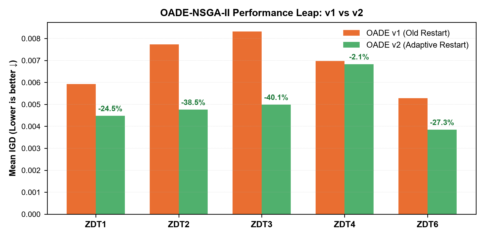
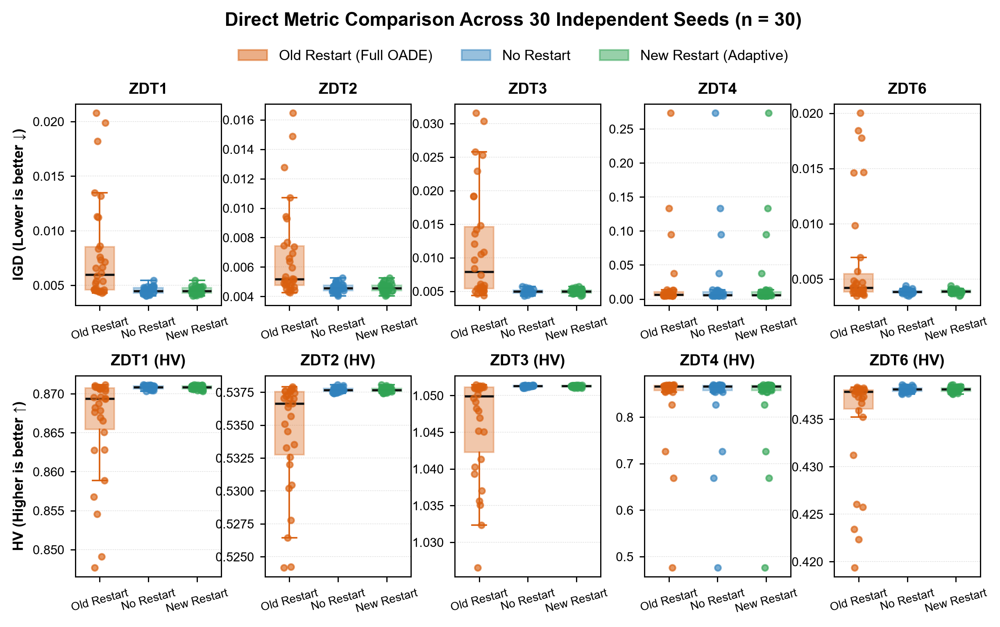
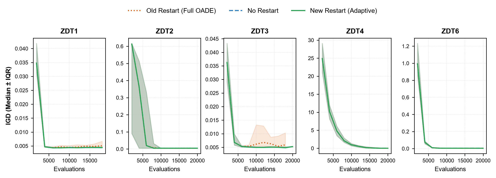
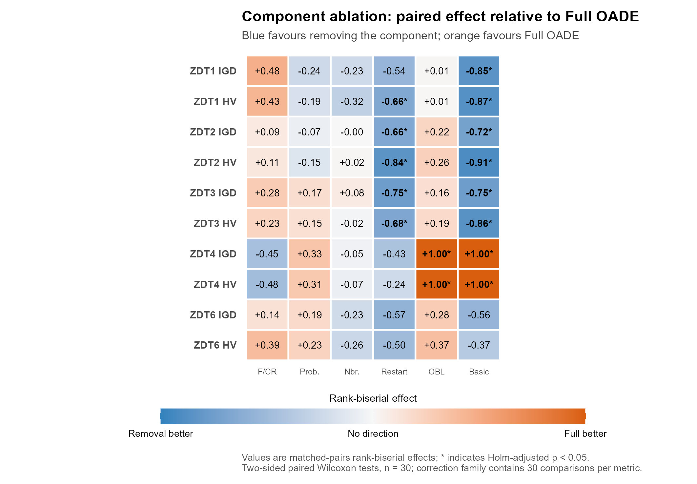
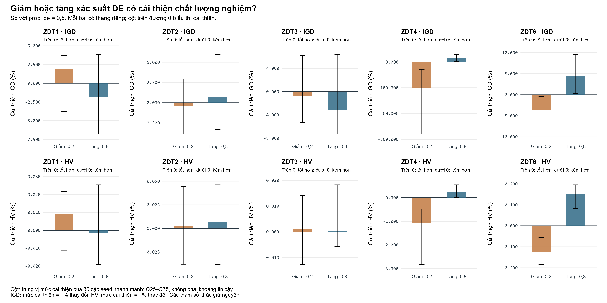
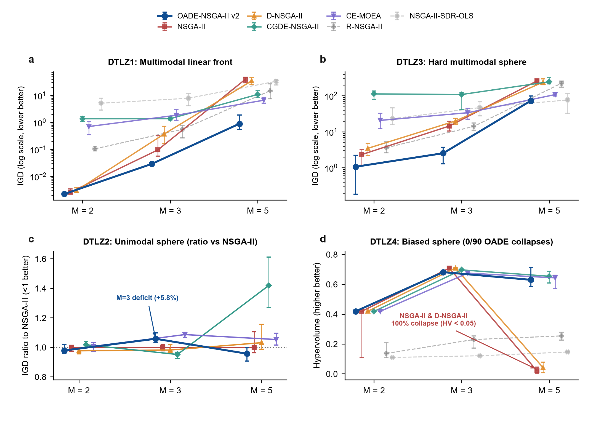
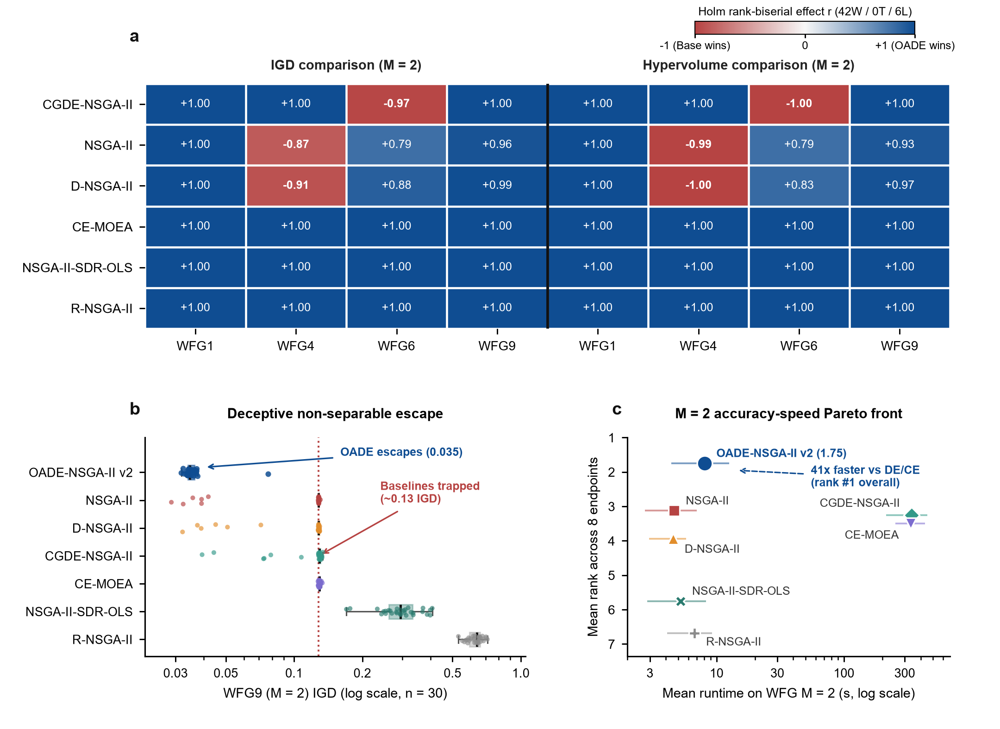

# OADE-NSGA-II

**Ngôn ngữ:** [English](README.md) | **Tiếng Việt**

Dự án đánh giá việc kết hợp differential evolution thích nghi và học đối lập trong khung NSGA-II. Nghiên cứu hiện ưu tiên ZDT. Kết quả được trình bày theo từng bài toán, với đối chứng, cấu hình classic/adaptive và giới hạn suy luận riêng.

## Thiết kế nghiên cứu và cách đọc

OADE-NSGA-II kết hợp tạo ứng viên DE theo lân cận, cập nhật F/CR trực tuyến, bổ sung nghiệm đối lập định kỳ và lựa chọn môi trường NSGA-II. Classic dùng restart cổ điển; adaptive bổ sung điều kiện đa dạng và thay thế cục bộ. Thiết kế thuật toán và bằng chứng về đóng góp từng thành phần được đọc tách biệt.

| Thành phần | Thiết lập |
| --- | --- |
| Benchmark ZDT | 7 algorithms; 30 paired seeds 42–71; population 100; evaluation cap 20,000 |
| ZDT1 / ZDT2 / ZDT3 | 30 variables; 2 objectives |
| ZDT4 / ZDT6 | 10 variables; 2 objectives |
| Restart confirmation | Classic / no restart / adaptive; 30 paired seeds 1000–1029 |
| Adaptive OFAT | 9 parameters; 19 unique configurations; 30 seeds 6000–6029 per problem/configuration |
| Metrics | IGD ↓; HV ↑; mean ± sample SD for benchmarks; median and Q25–Q75 for OFAT |

Các bảng dưới đây báo cáo từng bài toán. Holm giữ nguyên họ kiểm định gốc; các block đối chứng dùng chung không được đếm lại thành lượt chạy mới. Khởi tạo uniform chung trong benchmark bỏ qua Sobol/OBL khởi tạo độc lập. Runtime là thời gian của bản triển khai đã đo, không phải độ phức tạp độc lập phần cứng.



**Hình 1. Classic và adaptive trên từng bài ZDT.** Mỗi cặp cột là mean IGD của 30 seed benchmark. Phần trăm trên hình là chênh lệch mô tả giữa hai cấu hình, không cô lập nguyên nhân do restart.

## ZDT: trọng tâm nghiên cứu

Mỗi bài dưới đây có báo cáo benchmark 7 thuật toán, so sánh classic/adaptive, xác nhận restart, ablation và độ nhạy tham số. Chọn bài toán để đọc đầy đủ bảng số liệu và kiểm định.

### ZDT1

Ở benchmark seed 42–71, mean IGD của OADE adaptive là **0.00447533**, so với **0.00517466** của NSGA2. Đây là kết quả của riêng ZDT1, với 30 lượt/thuật toán và trần 20.000 đánh giá.

**Đối chứng: mean ± SD, 30 lượt/thuật toán.**

| Algorithm | IGD ↓ | HV ↑ | s/run |
| --- | --- | --- | --- |
| OADE_NSGAII | 0.00447533 ± 0.00025124 | 0.870866 ± 0.000232239 | 14.4968 |
| NSGA2 | 0.00517466 ± 0.000297904 | 0.868053 ± 0.000417268 | 0.92875 |
| RNSGA2 | 0.632973 ± 0.0876243 | 0.348062 ± 0.0938884 | 2.75757 |
| DNSGA2 | 0.00563295 ± 0.000423465 | 0.867066 ± 0.00068501 | 0.853377 |
| CGDE_NSGAII | 0.00743342 ± 0.000527482 | 0.863362 ± 0.000968519 | 39.5621 |
| NSGAII_SDR_OLS | 0.0156331 ± 0.0197044 | 0.858421 ± 0.0148456 | 1.04961 |
| CE_MOEA | 0.00690817 ± 0.000873872 | 0.864472 ± 0.00177852 | 38.8171 |

**Classic → adaptive, seed 42–71:** mean IGD 0.00592521 → 0.00447533; mean HV 0.868961 → 0.870866. So với NSGA2, kiểm định ghép cặp của adaptive có p Holm IGD = 5.58794e-08, HV = 5.58794e-08. Chênh lệch classic–adaptive ở đây là mô tả.

**Xác nhận restart, seed 1000–1029:** mean của 30 lượt/biến thể.

| Variant | IGD mean ↓ | HV mean ↑ |
| --- | --- | --- |
| Classic | 0.00792113 | 0.866365 |
| No restart | 0.00453077 | 0.870819 |
| Adaptive | 0.00453077 | 0.870819 |

**Độ nhạy adaptive.** Ở OFAT seed 6000–6029, tăng population từ 100 lên 200 làm median IGD đổi từ 0.00439707 thành 0.00222923; median HV đổi từ 0.870962 thành 0.87382.

Tăng xác suất DE khởi tạo từ 0,5 lên 0,8 làm median IGD đổi từ 0.00439707 thành 0.00442112, median HV từ 0.870962 thành 0.870941. Đây là đáp ứng OFAT của bài toán này, chưa phải cấu hình tối ưu hoặc bằng chứng tương tác.

**Ablation classic (OADE_NO_RESTART so với Full OADE).** IGD: chưa phát hiện khác biệt, p Holm = 0.171003; HV: ưu thế cho biến thể loại bỏ, p Holm = 0.0238779. Không chuyển kết luận này thành ablation của cấu hình adaptive.

[Báo cáo chính](results/by_problem/zdt/zdt1/README.md) · [Classic/adaptive](results/by_problem/zdt/zdt1/reports/classic_vs_adaptive.md) · [Độ nhạy](results/by_problem/zdt/zdt1/reports/sensitivity_adaptive.md) · [CSV ZIP](results/by_problem/zdt/zdt1/csv_results.zip)

### ZDT2

Ở benchmark seed 42–71, mean IGD của OADE adaptive là **0.00475622**, so với **0.00540493** của NSGA2. Đây là kết quả của riêng ZDT2, với 30 lượt/thuật toán và trần 20.000 đánh giá.

**Đối chứng: mean ± SD, 30 lượt/thuật toán.**

| Algorithm | IGD ↓ | HV ↑ | s/run |
| --- | --- | --- | --- |
| OADE_NSGAII | 0.00475622 ± 0.000292104 | 0.537674 ± 0.000221914 | 14.7846 |
| NSGA2 | 0.00540493 ± 0.000306249 | 0.534072 ± 0.000611177 | 1.97288 |
| RNSGA2 | 0.523507 ± 0.0253141 | 0.120884 ± 0.00708899 | 6.41374 |
| DNSGA2 | 0.00588101 ± 0.00039197 | 0.532697 ± 0.000974228 | 1.84104 |
| CGDE_NSGAII | 0.00681507 ± 0.00051003 | 0.530572 ± 0.00116976 | 136.061 |
| NSGAII_SDR_OLS | 0.0503186 ± 0.152326 | 0.499634 ± 0.106117 | 3.47569 |
| CE_MOEA | 0.00747684 ± 0.000980341 | 0.52967 ± 0.00190535 | 144.511 |

**Classic → adaptive, seed 42–71:** mean IGD 0.00773397 → 0.00475622; mean HV 0.533739 → 0.537674. So với NSGA2, kiểm định ghép cặp của adaptive có p Holm IGD = 7.82311e-08, HV = 5.58794e-08. Chênh lệch classic–adaptive ở đây là mô tả.

**Xác nhận restart, seed 1000–1029:** mean của 30 lượt/biến thể.

| Variant | IGD mean ↓ | HV mean ↑ |
| --- | --- | --- |
| Classic | 0.00678176 | 0.53447 |
| No restart | 0.00459058 | 0.537682 |
| Adaptive | 0.00459058 | 0.537682 |

**Độ nhạy adaptive.** Ở OFAT seed 6000–6029, tăng population từ 100 lên 200 làm median IGD đổi từ 0.0046646 thành 0.00236691; median HV đổi từ 0.537652 thành 0.540519.

Tăng xác suất DE khởi tạo từ 0,5 lên 0,8 làm median IGD đổi từ 0.0046646 thành 0.00461182, median HV từ 0.537652 thành 0.537702. Đây là đáp ứng OFAT của bài toán này, chưa phải cấu hình tối ưu hoặc bằng chứng tương tác.

**Ablation classic (OADE_NO_RESTART so với Full OADE).** IGD: ưu thế cho biến thể loại bỏ, p Holm = 0.0228426; HV: ưu thế cho biến thể loại bỏ, p Holm = 0.000265241. Không chuyển kết luận này thành ablation của cấu hình adaptive.

[Báo cáo chính](results/by_problem/zdt/zdt2/README.md) · [Classic/adaptive](results/by_problem/zdt/zdt2/reports/classic_vs_adaptive.md) · [Độ nhạy](results/by_problem/zdt/zdt2/reports/sensitivity_adaptive.md) · [CSV ZIP](results/by_problem/zdt/zdt2/csv_results.zip)

### ZDT3

Ở benchmark seed 42–71, mean IGD của OADE adaptive là **0.00498585**, so với **0.00719117** của NSGA2. Đây là kết quả của riêng ZDT3, với 30 lượt/thuật toán và trần 20.000 đánh giá.

**Đối chứng: mean ± SD, 30 lượt/thuật toán.**

| Algorithm | IGD ↓ | HV ↑ | s/run |
| --- | --- | --- | --- |
| OADE_NSGAII | 0.00498585 ± 0.000336107 | 1.05122 ± 0.000152005 | 10.7916 |
| NSGA2 | 0.00719117 ± 0.0102307 | 1.04718 ± 0.00669921 | 1.68703 |
| RNSGA2 | 0.740552 ± 0.0573164 | 0.401005 ± 0.0494966 | 2.38314 |
| DNSGA2 | 0.0055682 ± 0.000290586 | 1.04695 ± 0.000679974 | 1.62852 |
| CGDE_NSGAII | 0.00826161 ± 0.000984232 | 1.03505 ± 0.0036038 | 108.59 |
| NSGAII_SDR_OLS | 0.0186481 ± 0.00296968 | 1.03581 ± 0.00435762 | 2.53103 |
| CE_MOEA | 0.00856088 ± 0.00153316 | 1.0344 ± 0.0051157 | 100.297 |

**Classic → adaptive, seed 42–71:** mean IGD 0.0083192 → 0.00498585; mean HV 1.04924 → 1.05122. So với NSGA2, kiểm định ghép cặp của adaptive có p Holm IGD = 0.00114028, HV = 5.58794e-08. Chênh lệch classic–adaptive ở đây là mô tả.

**Xác nhận restart, seed 1000–1029:** mean của 30 lượt/biến thể.

| Variant | IGD mean ↓ | HV mean ↑ |
| --- | --- | --- |
| Classic | 0.011652 | 1.04618 |
| No restart | 0.0049638 | 1.05126 |
| Adaptive | 0.0049638 | 1.05126 |

**Độ nhạy adaptive.** Ở OFAT seed 6000–6029, tăng population từ 100 lên 200 làm median IGD đổi từ 0.00515966 thành 0.00249304; median HV đổi từ 1.05118 thành 1.0528.

Tăng xác suất DE khởi tạo từ 0,5 lên 0,8 làm median IGD đổi từ 0.00515966 thành 0.00512136, median HV từ 1.05118 thành 1.05127. Đây là đáp ứng OFAT của bài toán này, chưa phải cấu hình tối ưu hoặc bằng chứng tương tác.

**Ablation classic (OADE_NO_RESTART so với Full OADE).** IGD: ưu thế cho biến thể loại bỏ, p Holm = 0.0033301; HV: ưu thế cho biến thể loại bỏ, p Holm = 0.0175104. Không chuyển kết luận này thành ablation của cấu hình adaptive.

[Báo cáo chính](results/by_problem/zdt/zdt3/README.md) · [Classic/adaptive](results/by_problem/zdt/zdt3/reports/classic_vs_adaptive.md) · [Độ nhạy](results/by_problem/zdt/zdt3/reports/sensitivity_adaptive.md) · [CSV ZIP](results/by_problem/zdt/zdt3/csv_results.zip)

### ZDT4

Ở benchmark seed 42–71, mean IGD của OADE adaptive là **0.00683066**, so với **0.00995272** của NSGA2. Đây là kết quả của riêng ZDT4, với 30 lượt/thuật toán và trần 20.000 đánh giá.

OFAT ghi nhận suy giảm chất lượng ở population 200; giới hạn này được giữ trong báo cáo chính của ZDT4.

**Đối chứng: mean ± SD, 30 lượt/thuật toán.**

| Algorithm | IGD ↓ | HV ↑ | s/run |
| --- | --- | --- | --- |
| OADE_NSGAII | 0.00683066 ± 0.00332858 | 0.865051 ± 0.00567877 | 11.9833 |
| NSGA2 | 0.00995272 ± 0.00508029 | 0.859362 ± 0.0079104 | 2.20807 |
| RNSGA2 | 0.620575 ± 0.165318 | 0.351077 ± 0.155278 | 2.09675 |
| DNSGA2 | 0.0199731 ± 0.0273695 | 0.84675 ± 0.0368674 | 2.10489 |
| CGDE_NSGAII | 12.1716 ± 2.80042 | 0 ± 0 | 138.416 |
| NSGAII_SDR_OLS | 10.8914 ± 6.7777 | 0 ± 0 | 2.36871 |
| CE_MOEA | 0.357214 ± 0.234331 | 0.409725 ± 0.22787 | 129.2 |

**Classic → adaptive, seed 42–71:** mean IGD 0.00697718 → 0.00683066; mean HV 0.864878 → 0.865051. So với NSGA2, kiểm định ghép cặp của adaptive có p Holm IGD = 0.00404036, HV = 0.00087182. Chênh lệch classic–adaptive ở đây là mô tả.

**Xác nhận restart, seed 1000–1029:** mean của 30 lượt/biến thể.

| Variant | IGD mean ↓ | HV mean ↑ |
| --- | --- | --- |
| Classic | 0.0240858 | 0.839208 |
| No restart | 0.0240433 | 0.839264 |
| Adaptive | 0.0240433 | 0.839264 |

**Độ nhạy adaptive.** Ở OFAT seed 6000–6029, tăng population từ 100 lên 200 làm median IGD đổi từ 0.00558256 thành 0.598477; median HV đổi từ 0.867216 thành 0.092856.

Tăng xác suất DE khởi tạo từ 0,5 lên 0,8 làm median IGD đổi từ 0.00558256 thành 0.00466007, median HV từ 0.867216 thành 0.869327. Đây là đáp ứng OFAT của bài toán này, chưa phải cấu hình tối ưu hoặc bằng chứng tương tác.

**Ablation classic (OADE_NO_OBL so với Full OADE).** IGD: ưu thế cho Full OADE, p Holm = 1.08033e-07; HV: ưu thế cho Full OADE, p Holm = 1.08033e-07. Không chuyển kết luận này thành ablation của cấu hình adaptive.

[Báo cáo chính](results/by_problem/zdt/zdt4/README.md) · [Classic/adaptive](results/by_problem/zdt/zdt4/reports/classic_vs_adaptive.md) · [Độ nhạy](results/by_problem/zdt/zdt4/reports/sensitivity_adaptive.md) · [CSV ZIP](results/by_problem/zdt/zdt4/csv_results.zip)

### ZDT6

Ở benchmark seed 42–71, mean IGD của OADE adaptive là **0.003844**, so với **0.0163681** của NSGA2. Đây là kết quả của riêng ZDT6, với 30 lượt/thuật toán và trần 20.000 đánh giá.

Kiểm định IGD không phát hiện khác biệt với CGDE_NSGAII, còn HV ưu thế cho CGDE_NSGAII. Lợi thế so với NSGA2 không đồng nghĩa vượt mọi thuật toán.

**Đối chứng: mean ± SD, 30 lượt/thuật toán.**

| Algorithm | IGD ↓ | HV ↑ | s/run |
| --- | --- | --- | --- |
| OADE_NSGAII | 0.003844 ± 0.000192923 | 0.438177 ± 0.000252795 | 13.3414 |
| NSGA2 | 0.0163681 ± 0.00201149 | 0.417891 ± 0.00287211 | 2.05538 |
| RNSGA2 | 0.185764 ± 0.0927869 | 0.267636 ± 0.06859 | 2.20712 |
| DNSGA2 | 0.0225884 ± 0.00279408 | 0.408917 ± 0.00399733 | 2.01973 |
| CGDE_NSGAII | 0.00382305 ± 0.000222667 | 0.439057 ± 0.000199467 | 103.072 |
| NSGAII_SDR_OLS | 0.139446 ± 0.0827475 | 0.282923 ± 0.0589616 | 2.12093 |
| CE_MOEA | 0.00495683 ± 0.000335953 | 0.437794 ± 0.000359974 | 101.561 |

**Classic → adaptive, seed 42–71:** mean IGD 0.00528589 → 0.003844; mean HV 0.436557 → 0.438177. So với NSGA2, kiểm định ghép cặp của adaptive có p Holm IGD = 5.58794e-08, HV = 5.58794e-08. Chênh lệch classic–adaptive ở đây là mô tả.

**Xác nhận restart, seed 1000–1029:** mean của 30 lượt/biến thể.

| Variant | IGD mean ↓ | HV mean ↑ |
| --- | --- | --- |
| Classic | 0.00656552 | 0.435092 |
| No restart | 0.00386259 | 0.438147 |
| Adaptive | 0.00387635 | 0.438148 |

**Độ nhạy adaptive.** Ở OFAT seed 6000–6029, tăng population từ 100 lên 200 làm median IGD đổi từ 0.00382752 thành 0.0024559; median HV đổi từ 0.438266 thành 0.439487.

Tăng xác suất DE khởi tạo từ 0,5 lên 0,8 làm median IGD đổi từ 0.00382752 thành 0.00362852, median HV từ 0.438266 thành 0.438773. Đây là đáp ứng OFAT của bài toán này, chưa phải cấu hình tối ưu hoặc bằng chứng tương tác.

**Ablation classic (OADE_NO_RESTART so với Full OADE).** IGD: chưa phát hiện khác biệt, p Holm = 0.132859; HV: chưa phát hiện khác biệt, p Holm = 0.361487. Không chuyển kết luận này thành ablation của cấu hình adaptive.

[Báo cáo chính](results/by_problem/zdt/zdt6/README.md) · [Classic/adaptive](results/by_problem/zdt/zdt6/reports/classic_vs_adaptive.md) · [Độ nhạy](results/by_problem/zdt/zdt6/reports/sensitivity_adaptive.md) · [CSV ZIP](results/by_problem/zdt/zdt6/csv_results.zip)

## Minh họa: restart, hội tụ, ablation và độ nhạy ZDT

Các hình dùng lại trực tiếp kết quả đã lưu. Mỗi ô hoặc cặp hàng giữ định danh bài toán riêng; không dùng tổng thắng/thua để thay cho kết luận từng bài.



**Hình 2. Phân bố xác nhận restart.** IGD và HV được tách theo bài toán và biến thể, mỗi nhóm 30 seed 1000–1029. No-restart và adaptive gần trùng nhau; chỉ số cuối không tự chứng minh trigger đã hoạt động.



**Hình 3. Hội tụ trong ngân sách.** Đường biểu diễn median IGD, vùng tô là IQR theo từng bài. Các ô có thang tung khác nhau. Đường hội tụ so sánh kết quả, không phải số lần kích hoạt trigger.



**Hình 4. Ablation thành phần classic.** Xanh ưu thế cho loại bỏ thành phần; cam ưu thế cho Full OADE. Dấu sao là p Holm < 0,05. Vai trò OBL trên ZDT4 khác với loại bỏ restart trên ZDT1–3; không có lợi ích đồng đều của mọi thành phần.



**Hình 5. Độ nhạy xác suất DE khởi tạo.** Cột là median cải thiện so với mức 0,5 qua 30 cặp seed; thanh mảnh là Q25–Q75, không phải khoảng tin cậy. Giá trị dương là cải thiện cho cả IGD/HV. Mỗi bài có thang riêng; median thay đổi từng cặp khác với tỷ lệ giữa các median biên nêu ở trên.

Baseline OFAT được dùng lại giữa các bảng tham số. Khi thay population ở trần đánh giá cố định, cả số thế hệ khả dụng và độ phân giải tập nghiệm đều thay đổi. Các đáp ứng trên cần thí nghiệm xác nhận trước khi chọn lại cấu hình mặc định.

## Ưu điểm ghi nhận trên ZDT

Các ưu điểm sau là kết quả của bản triển khai và điều kiện đã thử trên ZDT1/2/3/4/6. Đọc chúng cùng các bảng và hình phía trên; không chuyển thành khẳng định ưu thế trên mọi lớp bài toán.

| Ưu điểm | Bằng chứng hiện có | Phạm vi diễn giải |
| --- | --- | --- |
| Chất lượng nghiệm so với NSGA2 | Adaptive có mean IGD thấp hơn và mean HV cao hơn NSGA2 trong từng bài ZDT đã báo cáo; các kiểm định ghép cặp được giữ theo bài. | 30 seed 42–71, population 100, trần 20.000 đánh giá; không suy ra vượt mọi đối chứng. |
| Giảm phân tán so với classic trên ZDT1–3 | SD của IGD trong benchmark adaptive thấp hơn classic trên riêng ZDT1, ZDT2 và ZDT3; hình xác nhận cho thấy các đuôi chất lượng kém của classic. | Lợi ích ở mức cấu hình; no-restart gần trùng adaptive nên chưa quy nguyên nhân cho trigger. |
| Có bằng chứng thành phần cụ thể trên ZDT4 | Ablation classic cho thấy giữ OBL tốt hơn loại OBL trên cả IGD và HV sau hiệu chỉnh Holm. | Đánh giá bổ sung OBL định kỳ với khởi tạo uniform chung, không phải lợi ích của Sobol/OBL khởi tạo. |
| Có dữ liệu để kiểm tra độ nhạy và tái lập | Benchmark ghép seed, thí nghiệm xác nhận riêng, OFAT adaptive, manifest và ZIP có SHA-256 đều đã có. | Đây là ưu điểm của hồ sơ thực nghiệm; không tự tạo bảo đảm về hội tụ hoặc tối ưu. |

## Hạn chế và giới hạn kết luận

| Hạn chế | Biểu hiện trên ZDT | Hệ quả khi diễn giải |
| --- | --- | --- |
| Không vượt mọi thuật toán | ZDT6: IGD chưa phát hiện khác biệt với CGDE_NSGAII, trong khi HV ưu thế cho CGDE_NSGAII. | Báo cáo riêng từng chỉ số và đối chứng; không kết luận thắng tuyệt đối. |
| Chi phí chạy cao hơn đối chứng đơn giản | OADE adaptive chậm hơn NSGA2/DNSGA2 trong các hàng runtime ZDT đã đo. | Lợi ích chất lượng cần được cân nhắc cùng thời gian và bản triển khai; không suy ra độ phức tạp lý thuyết từ runtime. |
| Nhạy với cấu hình và ngân sách | ZDT4 suy giảm mạnh tại population 200 ở trần 20.000 đánh giá; tăng population không có lợi đồng đều. | Không chọn một mức population lớn làm mặc định cho mọi bài. |
| Chưa cô lập giá trị của restart adaptive | Kết quả adaptive và no-restart gần trùng trong xác nhận; đợt này không lưu telemetry trigger. | Cần seed mới và số lần kiểm tra/kích hoạt restart trước khi khẳng định cơ chế. |
| OFAT chưa đo tương tác hoặc xác nhận tối ưu | Mỗi lần chỉ thay một tham số quanh baseline; F/CR và xác suất DE có thể cập nhật trong lượt chạy. | Các mức có lợi là ứng viên xác nhận, không phải cấu hình tối ưu tổng quát. |
| Chưa kiểm tra riêng lợi ích khởi tạo | Benchmark truyền quần thể uniform chung, bỏ qua khởi tạo Sobol/OBL độc lập. | Không dùng ablation OBL định kỳ để khẳng định lợi ích khởi tạo. |
| Bất định và provenance còn thiếu | Chưa có CI của hiệu ứng ghép cặp trong các bảng hiện tại; một số block lịch sử thiếu manifest thực thi. | SD/IQR không thay cho CI; không gán môi trường hiện tại cho những lượt chạy lịch sử. |
| Phạm vi nghiên cứu chính còn hẹp | Trọng tâm hiện tại là ZDT liên tục hai mục tiêu đã có dữ liệu; ZDT5 không nằm trong bộ đang báo cáo. | Chưa xác lập khả năng tổng quát sang nhiều mục tiêu, ràng buộc, biến rời rạc hoặc bài toán thực tế. |

## Định hướng: hoàn thiện ZDT trước, mở rộng sau

**Ưu tiên hiện tại là củng cố kết luận trên ZDT.** DTLZ/WFG đã có một số kết quả mở rộng và vẫn được giữ ở các mục bên dưới, nhưng chưa thay thế trọng tâm nghiên cứu ZDT hoặc xác lập ưu thế tổng quát.

| Giai đoạn | Việc cần làm | Bằng chứng cần bổ sung |
| --- | --- | --- |
| 1. Hoàn thiện ZDT | Xác nhận adaptive so với no-restart; kiểm tra ứng viên tham số và giới hạn population trên ZDT4. | Seed mới, telemetry restart, chi phí đánh giá restart, CI ghép cặp và phân tích chất lượng/chi phí. |
| 2. Mở rộng DTLZ/WFG | Bổ sung so sánh và ablation theo từng bài, từng số mục tiêu; giữ các đợt đã có làm bằng chứng bổ sung. | Đối chứng được kiểm chứng, giao thức ngân sách rõ ràng, xử lý output không hợp lệ và kiểm tra khả năng mở rộng. |
| 3. Các lớp bài toán khác | Lần lượt xét bài toán có ràng buộc, biến rời rạc hoặc bài toán ứng dụng khi xác định được mục tiêu đánh giá. | Giao thức và đối chứng phù hợp từng lớp; không chuyển trực tiếp cấu hình hoặc kết luận ZDT. |

Đây là định hướng nghiên cứu, không phải các thí nghiệm đã hoàn tất. Kết quả mới sẽ được bổ sung vào đúng thư mục bài toán, kèm cấu hình, seed, ngân sách, manifest và báo cáo riêng. [Kế hoạch bằng chứng chi tiết](docs/protocols/followup_experiments.md).

## DTLZ: bổ sung theo từng bài toán

Mỗi cấu hình số mục tiêu có hồ sơ riêng. Các kết quả hiện có được giữ tách biệt để tiếp tục chạy và bổ sung.

| Problem | Algorithms | IGD OADE ↓ | IGD NSGA2 ↓ | HV OADE ↑ | Detail |
| --- | --- | --- | --- | --- | --- |
| DTLZ1_M2 | 7 | 0.00228432 | 0.00294605 | 0.233218 | [Report](results/by_problem/dtlz/dtlz1_m2/README.md) |
| DTLZ1_M3 | 7 | 0.0292282 | 0.191546 | 0.184658 | [Report](results/by_problem/dtlz/dtlz1_m3/README.md) |
| DTLZ1_M5 | 7 | 2.55293 | 39.7519 | 0.00919743 | [Report](results/by_problem/dtlz/dtlz1_m5/README.md) |
| DTLZ2_M2 | 7 | 0.00504106 | 0.0050504 | 0.418953 | [Report](results/by_problem/dtlz/dtlz2_m2/README.md) |
| DTLZ2_M3 | 7 | 0.0766053 | 0.0719165 | 0.684464 | [Report](results/by_problem/dtlz/dtlz2_m3/README.md) |
| DTLZ2_M5 | 7 | 0.42009 | 0.457093 | 0.460191 | [Report](results/by_problem/dtlz/dtlz2_m5/README.md) |
| DTLZ3_M2 | 7 | 1.34808 | 2.64577 | 0.0997882 | [Report](results/by_problem/dtlz/dtlz3_m2/README.md) |
| DTLZ3_M3 | 7 | 2.52939 | 15.3961 | 0.0407079 | [Report](results/by_problem/dtlz/dtlz3_m3/README.md) |
| DTLZ3_M5 | 7 | 80.8224 | 251.863 | 0 | [Report](results/by_problem/dtlz/dtlz3_m5/README.md) |
| DTLZ4_M2 | 7 | 0.00513331 | 0.275331 | 0.418761 | [Report](results/by_problem/dtlz/dtlz4_m2/README.md) |
| DTLZ4_M3 | 7 | 0.0786625 | 0.0698968 | 0.680528 | [Report](results/by_problem/dtlz/dtlz4_m3/README.md) |
| DTLZ4_M5 | 7 | 0.372651 | 0.802355 | 0.647577 | [Report](results/by_problem/dtlz/dtlz4_m5/README.md) |

**Giới hạn cần thấy ngay:** ở DTLZ1_M5, OADE có 17/30 lượt HV = 0; ở DTLZ3_M5 là 30/30 lượt. Đây là giới hạn chất lượng theo điểm tham chiếu, không đồng nghĩa lỗi cấu trúc output. Số cặp hợp lệ của từng đối chứng được ghi trong báo cáo riêng.



**Hình 6. DTLZ theo số mục tiêu.** Các ô tách DTLZ1, DTLZ3, so sánh DTLZ2 và HV DTLZ4. Thang IGD log cho thấy khó khăn khi tăng số mục tiêu; không lấy kết quả ZDT để thay cho bằng chứng trên DTLZ.

## WFG: bổ sung theo từng bài toán

Mỗi cấu hình số mục tiêu có hồ sơ riêng. Các kết quả hiện có được giữ tách biệt để tiếp tục chạy và bổ sung.

| Problem | Algorithms | IGD OADE ↓ | IGD NSGA2 ↓ | HV OADE ↑ | Detail |
| --- | --- | --- | --- | --- | --- |
| WFG1_M2 | 7 | 1.02608 | 1.20215 | 1.77197 | [Report](results/by_problem/wfg/wfg1_m2/README.md) |
| WFG1_M3 | 5 | 1.41795 | 1.39246 | 16.4028 | [Report](results/by_problem/wfg/wfg1_m3/README.md) |
| WFG1_M5 | 5 | 1.99485 | 1.99336 | 1303.85 | [Report](results/by_problem/wfg/wfg1_m5/README.md) |
| WFG4_M2 | 7 | 0.0332224 | 0.0263514 | 2.146 | [Report](results/by_problem/wfg/wfg4_m2/README.md) |
| WFG4_M3 | 5 | 0.353783 | 0.280393 | 16.2589 | [Report](results/by_problem/wfg/wfg4_m3/README.md) |
| WFG4_M5 | 5 | 1.38378 | 1.23067 | 663.471 | [Report](results/by_problem/wfg/wfg4_m5/README.md) |
| WFG6_M2 | 7 | 0.0547901 | 0.0716943 | 2.04237 | [Report](results/by_problem/wfg/wfg6_m2/README.md) |
| WFG6_M3 | 5 | 0.396159 | 0.322633 | 15.7194 | [Report](results/by_problem/wfg/wfg6_m3/README.md) |
| WFG6_M5 | 5 | 1.45639 | 1.35347 | 1359.38 | [Report](results/by_problem/wfg/wfg6_m5/README.md) |
| WFG9_M2 | 7 | 0.0363613 | 0.110123 | 2.15299 | [Report](results/by_problem/wfg/wfg9_m2/README.md) |
| WFG9_M3 | 5 | 0.340685 | 0.341724 | 17.6942 | [Report](results/by_problem/wfg/wfg9_m3/README.md) |
| WFG9_M5 | 5 | 1.96313 | 1.73254 | 983.527 | [Report](results/by_problem/wfg/wfg9_m5/README.md) |

Các hàng M=2 dùng benchmark đủ 7 thuật toán; M=3/5 dùng tập compact 5 thuật toán. Không cộng các block M=2 dùng chung thành lượt độc lập mới. Mean trong bảng không phải median được vẽ ở hình bên dưới.



**Hình 7. Đối chứng WFG hai mục tiêu.** Ô a giữ hiệu ứng IGD/HV riêng cho WFG1/4/6/9; ô b trình bày phân bố WFG9. Ô c là bối cảnh chi phí tổng hợp trong hình gốc, không thay cho kết quả từng hàng ở bảng trên và không áp dụng cho M=3/5.

## Cách đọc bằng chứng

Benchmark dùng mean ± SD; độ nhạy adaptive dùng median và IQR (Q25–Q75). IGD thấp hơn và HV cao hơn là tốt hơn theo bài toán. Các phép Wilcoxon ghép cặp và hiệu chỉnh Holm giữ nguyên họ kiểm định gốc, dù báo cáo đã tách theo bài.

Classic và adaptive là hai cấu hình OADE; sáu block đối chứng được dùng chung giữa hai benchmark ZDT. Thí nghiệm restart seed 1000–1029 và OFAT seed 6000–6029 được đọc riêng. Chất lượng cuối không tự chứng minh cơ chế restart; OFAT không đánh giá tương tác tham số.

## Tải dữ liệu và chạy lại

CSV được phân phối trong ZIP. Báo cáo Markdown và hình có thể xem trực tiếp. [Danh mục tải và SHA-256](results/CSV_DOWNLOADS.md).

```powershell
python -m venv .venv
.venv\Scripts\python.exe -m pip install -e .
.venv\Scripts\python.exe scripts/csv_archives.py restore
```

Tái lập benchmark adaptive ZDT vào thư mục mới:

```powershell
.venv\Scripts\python.exe main.py benchmark --config config/suites/algorithm_benchmark_v2.yaml --out-dir results/reproduction_zdt_v2
```

Sau khi bổ sung dữ liệu nguồn, tái tạo hồ sơ và đóng gói:

```powershell
.venv\Scripts\python.exe scripts/organize_by_problem.py
.venv\Scripts\python.exe scripts/csv_archives.py pack
```

## Tài liệu phương pháp

- [Baseline identities and citations](docs/protocols/baselines.md)
- [Experiment registry](docs/protocols/experiment_registry.md)
- [Reproducibility](docs/protocols/reproducibility.md)
- [Documentation index](docs/index.md)
