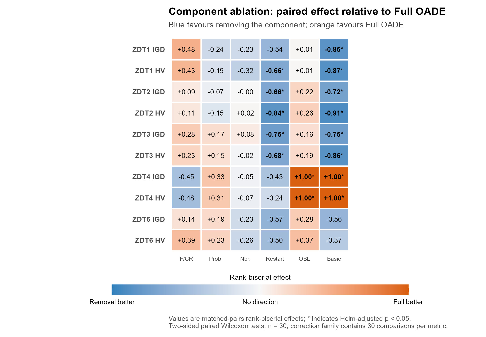
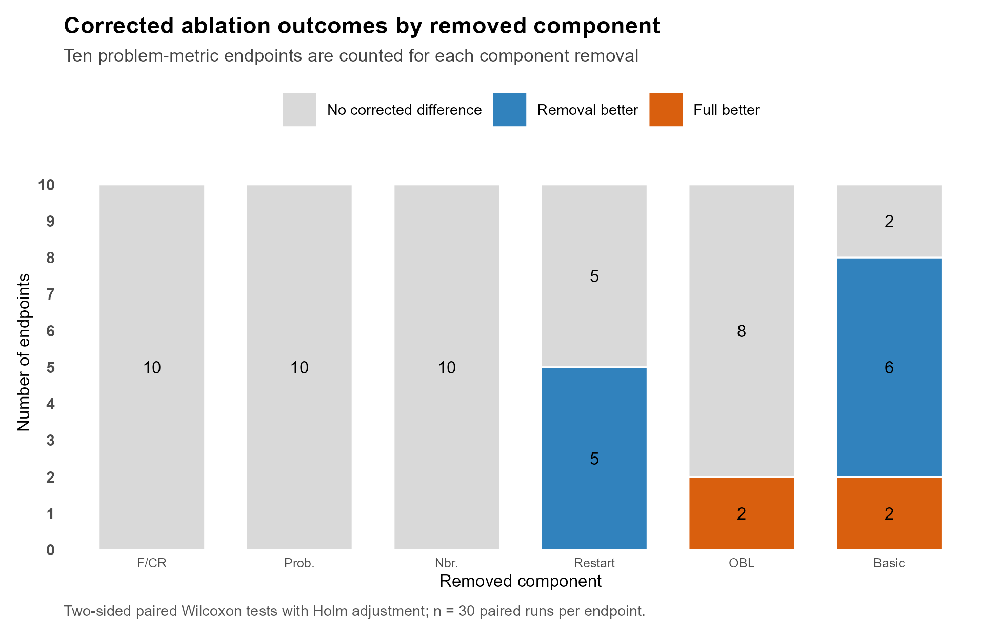
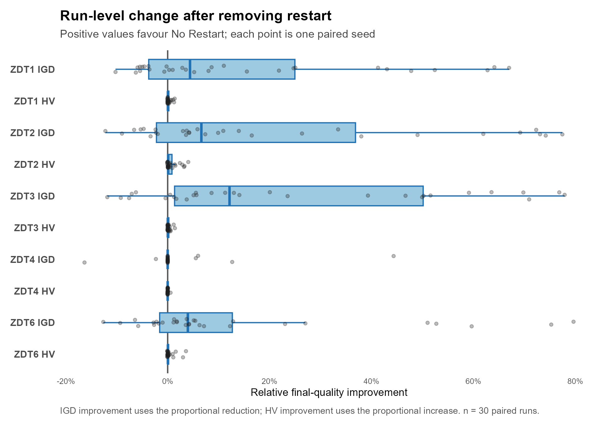

# OADE-NSGA-II Component Ablation Report

## Scope

This report evaluates the fixed-budget component ablation stored in `results/ablation`. The central question is whether each OADE-NSGA-II component improves final IGD or HV under the five tested bi-objective ZDT problems. The analysis treats one stochastic run as the independent unit and pairs variants by problem and run index.

## Design and completeness

| Item | Value |
|---|---|
| Problems | ZDT1, ZDT2, ZDT3, ZDT4, and ZDT6 |
| Variants | Full OADE, five single-component removals, and OADE Basic |
| Runs | 30 paired runs per problem and variant |
| Evaluation budget | 20,000 objective evaluations per run |
| Final observations | 1,050 |
| Validation | 1,050 `ok`; 0 invalid |
| Metrics | IGD (lower is better) and HV (higher is better) |
| Test | Two-sided paired Wilcoxon signed-rank test |
| Multiplicity | Holm adjustment separately across the 30 comparisons for each metric |
| Effect size | Matched-pairs rank-biserial effect; positive favours Full OADE |

`OADE_BASIC` disables F/CR adaptation, operator-probability adaptation, neighbourhood selection, restart, and opposition-based learning (OBL) simultaneously. It therefore measures the joint contribution of the complete component package and cannot identify an individual component by itself.

## Visual summary

Blue cells favour removing the named component, whereas orange cells favour Full OADE. Values are matched-pairs rank-biserial effects; an asterisk identifies a two-sided paired Wilcoxon result with Holm-adjusted p < 0.05. The crossover is visible directly: removing restart favours ZDT1-ZDT3, while retaining OBL is decisive on ZDT4.

The count view separates isolated evidence from the joint Basic comparison. No corrected endpoint difference was detected for removing F/CR adaptation, probability adaptation, or neighbourhood selection. Removing restart was better on five endpoints; retaining OBL was better on both ZDT4 endpoints. Basic produced a six-versus-two crossover, confirming that the complete package is problem-dependent rather than uniformly beneficial.

## Descriptive results

Values are mean ± sample standard deviation over 30 runs.

| Problem | Variant | IGD ↓ | HV ↑ |
|---|---|---:|---:|
| ZDT1 | Full OADE | 0.005925 ± 0.002536 | 0.868961 ± 0.003342 |
|  | No F/CR adaptation | 0.007522 ± 0.004233 | 0.866833 ± 0.006583 |
|  | No probability adaptation | 0.005763 ± 0.002954 | 0.869054 ± 0.003917 |
|  | No neighbourhood | 0.005286 ± 0.002854 | 0.869774 ± 0.004070 |
|  | No restart | 0.004475 ± 0.000251 | 0.870866 ± 0.000232 |
|  | No OBL | 0.006321 ± 0.004042 | 0.868520 ± 0.005350 |
|  | Basic | **0.004413 ± 0.000289** | **0.870983 ± 0.000236** |
| ZDT2 | Full OADE | 0.007734 ± 0.005316 | 0.533739 ± 0.006240 |
|  | No F/CR adaptation | 0.008112 ± 0.005557 | 0.532875 ± 0.007235 |
|  | No probability adaptation | 0.007803 ± 0.006695 | 0.534245 ± 0.006773 |
|  | No neighbourhood | 0.008285 ± 0.006568 | 0.532825 ± 0.007688 |
|  | No restart | 0.004741 ± 0.000302 | 0.537667 ± 0.000210 |
|  | No OBL | 0.009689 ± 0.006504 | 0.531500 ± 0.007544 |
|  | Basic | **0.004661 ± 0.000300** | **0.537679 ± 0.000219** |
| ZDT3 | Full OADE | 0.008319 ± 0.005096 | 1.049238 ± 0.003634 |
|  | No F/CR adaptation | 0.010723 ± 0.006936 | 1.047546 ± 0.005525 |
|  | No probability adaptation | 0.009552 ± 0.006540 | 1.048329 ± 0.004745 |
|  | No neighbourhood | 0.008349 ± 0.005025 | 1.049171 ± 0.004113 |
|  | No restart | **0.004986 ± 0.000336** | 1.051221 ± 0.000152 |
|  | No OBL | 0.008642 ± 0.003806 | 1.049038 ± 0.002942 |
|  | Basic | 0.005050 ± 0.000360 | **1.051283 ± 0.000111** |
| ZDT4 | Full OADE | 0.006977 ± 0.003323 | 0.864878 ± 0.005621 |
|  | No F/CR adaptation | **0.006442 ± 0.004255** | **0.866429 ± 0.006972** |
|  | No probability adaptation | 0.026120 ± 0.055656 | 0.835610 ± 0.084467 |
|  | No neighbourhood | 0.011423 ± 0.022604 | 0.858239 ± 0.034412 |
|  | No restart | 0.006831 ± 0.003329 | 0.865051 ± 0.005679 |
|  | No OBL | 0.348355 ± 0.179423 | 0.407034 ± 0.190865 |
|  | Basic | 0.379585 ± 0.312182 | 0.426806 ± 0.278845 |
| ZDT6 | Full OADE | 0.005286 ± 0.003371 | 0.436557 ± 0.003740 |
|  | No F/CR adaptation | 0.005813 ± 0.004542 | 0.435739 ± 0.005094 |
|  | No probability adaptation | 0.006148 ± 0.004953 | 0.435511 ± 0.005601 |
|  | No neighbourhood | 0.005289 ± 0.003952 | 0.436622 ± 0.004195 |
|  | No restart | 0.003836 ± 0.000194 | **0.438171 ± 0.000263** |
|  | No OBL | 0.006036 ± 0.004233 | 0.435614 ± 0.004869 |
|  | Basic | **0.003804 ± 0.000232** | 0.438117 ± 0.000200 |

Descriptive best values are not automatically inferential wins. The paired results below determine which differences remained detectable after multiplicity correction.

## Paired inferential results

### Opposition-based learning is necessary for ZDT4 performance

Removing OBL caused a large ZDT4 deterioration. Mean IGD increased from 0.006977 to 0.348355 and mean HV decreased from 0.864878 to 0.407034. Full OADE was better for both IGD (Holm-adjusted p = 1.08 × 10⁻⁷, effect = 0.996) and HV (adjusted p = 1.08 × 10⁻⁷, effect = 0.996). OADE Basic, which also disables OBL, failed similarly: Full OADE was better for both metrics (adjusted p = 5.59 × 10⁻⁸, effect = 1.000).

The distribution confirms a broad failure rather than a shift driven by one run. Twenty-nine of 30 No-OBL runs had IGD above 0.02, compared with one of 30 Full-OADE runs. This evidence establishes that OBL is critical for the current method on ZDT4 under the tested design. OBL did not show a corrected benefit on ZDT1, ZDT2, ZDT3, or ZDT6.

### The current restart mechanism is harmful on ZDT1-ZDT3

Removing restart improved mean IGD and HV on ZDT1-ZDT3 and sharply reduced run-to-run variability. The HV improvement was significant on ZDT1 (adjusted p = 0.0239, effect = -0.660), ZDT2 (p = 0.000265, effect = -0.841), and ZDT3 (p = 0.0175, effect = -0.677). IGD also favoured No Restart on ZDT2 (p = 0.0228, effect = -0.665) and ZDT3 (p = 0.00333, effect = -0.755). The ZDT1 IGD difference did not remain significant after correction.

Removing restart produced no corrected difference on ZDT4 or ZDT6. The evidence therefore supports disabling or redesigning the current restart policy for these static ZDT tasks. It does not establish that all restart mechanisms are harmful, because only the present trigger and restart implementation were tested.

### The remaining adaptive components have no isolated corrected benefit

Removing F/CR adaptation, operator-probability adaptation, or neighbourhood selection produced no significant Full-versus-removal comparison after Holm correction on any tested problem or metric. This result is insufficient to claim equivalence. It shows only that the current experiment did not establish a detectable isolated benefit at the corrected threshold.

The ZDT4 tails still warrant attention. No Probability Adaptation produced five runs with IGD above 0.02, including three above 0.1, whereas Full OADE had only one run above 0.02. No Neighbourhood produced two runs above 0.02, including one above 0.1. These rare failures increased the mean and standard deviation but did not produce a corrected paired-median result. The components may contribute to failure prevention or interact with OBL, which requires a factorial or targeted follow-up design.

### Basic OADE exposes a problem-dependent interaction

OADE Basic significantly outperformed Full OADE on both metrics for each of ZDT1, ZDT2, and ZDT3. Conversely, Full OADE decisively outperformed Basic on both ZDT4 metrics. No corrected Full-versus-Basic difference was detected on ZDT6.

This crossover rules out a single global conclusion that the complete package is uniformly better or uniformly worse. The joint package appears unnecessary or harmful on the simpler ZDT1-ZDT3 landscapes but is essential on multimodal ZDT4, primarily because of OBL. Because Basic removes five components simultaneously, this comparison does not identify interactions among the remaining components.

## Runtime

Mean runtime averaged across the five problems ranged from 3.21 to 3.87 seconds per run across variants. Full OADE averaged 3.39 seconds. No F/CR Adaptation was fastest at 3.21 seconds, while Basic and No Neighbourhood were slowest at approximately 3.87 seconds. These small differences were measured during parallel execution and should not be treated as hardware-independent algorithmic complexity.

## Research conclusion

The ablation changes the recommended algorithm-development priority. OBL should be retained because it prevents systematic failure on ZDT4. The restart policy should be redesigned or made conditional because it reduced quality and increased variability on ZDT1-ZDT3 without a detected benefit on ZDT4 or ZDT6. The evidence does not currently justify claiming that F/CR adaptation, probability adaptation, or neighbourhood selection independently improves final quality, although the latter two may reduce rare ZDT4 failures.

A defensible next version is not simply OADE Basic. The most evidence-supported candidate is Full OADE with restart disabled, followed by a preregistered comparison against Full OADE and Basic. A second candidate should retain OBL while testing simpler adaptive configurations. These candidates must be evaluated on new seeds and on DTLZ/WFG problems to avoid selecting a configuration solely on the same ZDT evidence used to design it.

## Recommended next experiments

1. **Confirm the no-restart candidate on held-out seeds.** Compare Full OADE, No Restart, and Basic on the five ZDT problems using 30 new paired seeds. The primary hypothesis should be that No Restart improves ZDT1-ZDT3 without degrading ZDT4.
2. **Test an adaptive or conservative restart trigger.** Trigger restart only when both stagnation and diversity collapse are observed, or reduce the restarted fraction. Compare this candidate with No Restart rather than only with Full OADE.
3. **Run DTLZ and WFG before finalizing the method.** Include three-objective problems to determine whether OBL and restart effects generalize beyond the five bi-objective ZDT tasks.
4. **Resolve possible component interactions.** Use a targeted factorial design involving OBL, restart, and probability adaptation on ZDT4. This can determine whether probability adaptation prevents tail failures only when OBL is active.
5. **Add uncertainty intervals.** Bootstrap the paired median difference or another prespecified paired effect estimate. Current rank-biserial effects have no stored confidence intervals.

## Claim boundary

The ablation supports component claims only for the five tested bi-objective ZDT problems, 20,000 evaluations, the present parameter settings, and the current implementations. It does not establish component importance on constrained, noisy, dynamic, many-objective, DTLZ, or WFG problems. It also does not establish equivalence when a corrected comparison is non-significant.

## Data provenance

- `results/ablation/algorithm_benchmark_raw_runs.csv`
- `results/ablation/algorithm_benchmark_igd_hv_summary.csv`
- `results/ablation/algorithm_benchmark_paired_statistics.csv`
- `results/ablation/algorithm_benchmark_validation.csv`
- `results/ablation/algorithm_benchmark_cost_summary.csv`
- `results/ablation/algorithm_benchmark_convergence.csv`
- `config/ablation.yaml`
- `config/ablations/*.yaml`

The completion log records `Saved benchmark outputs to results/ablation (0 invalid runs).`

The visual summary is generated reproducibly by `analysis/figures/generate_research_figures.R`; on Windows, run `./scripts/render_research_figures.ps1`. Editable PDF/SVG, high-resolution TIFF, PNG preview, source-data CSV, and collision-audit JSON files are stored under `results/figures`.
