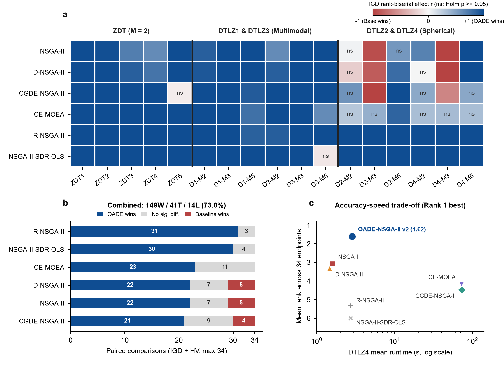
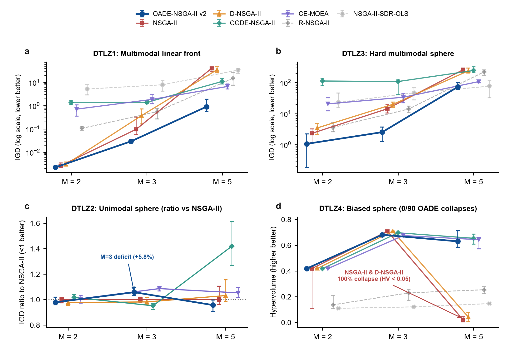

# OADE-NSGA-II v2: Integrated 7-Algorithm Evaluation Report (ZDT + DTLZ1–DTLZ4)

## 1. Executive Summary

This report integrates the **DTLZ1–DTLZ4 multi- and many-objective benchmark** (`results/dtlz_benchmark`, $M \in \{2, 3, 5\}$, 12 problem configurations, 2,520 scheduled stochastic runs) with the **ZDT Benchmark v2** (`results/algorithm_benchmark_v2`, $M = 2$, 5 problems, 1,050 scheduled stochastic runs). Together, these evaluations cover **17 problem configurations and 3,570 scheduled runs**, comparing **OADE-NSGA-II v2** (Adaptive Diversity-Aware Restart) against six baseline implementations. Each run has a 20,000-evaluation cap; some algorithms stop below the cap.

### Summary of observed outcomes
1. **Combined 7-algorithm scorecard (204 pairwise comparisons)**:
   * Across the 17 tested problem configurations, OADE-NSGA-II v2 had **149 significant wins (73.0%), 41 comparisons with no detected difference (20.1%), and 14 significant losses (6.9%)**:
     * **ZDT suite (60 comparisons)**: **58 wins, 1 with no detected difference, 1 loss**.
     * **DTLZ1–DTLZ4 suite (144 comparisons)**: **91 wins, 40 with no detected difference, 13 losses**.
   * These are descriptive counts of results adjusted within separate suite-by-metric Holm families ($m=30$ per ZDT metric; $m=72$ per DTLZ metric). They are not a single Holm correction over 204 tests. Comparisons against `CE-MOEA` (23–11–0), `NSGA-II-SDR-OLS` (30–4–0), and `R-NSGA-II` (31–3–0) had no significant losses; outcomes against `NSGA-II` (22–7–5), `D-NSGA-II` (22–7–5), and `CGDE-NSGA-II` (21–9–4) were mixed.
2. **Observed outcomes in selected DTLZ configurations**:
   * OADE had favorable corrected comparisons on the tested DTLZ1 and DTLZ3 cases; outcomes varied by objective count, metric, and comparator. These full-algorithm comparisons do not identify which component produced the differences.
   * On DTLZ4, no collapsed OADE front was recorded in 90 runs. `NSGA-II` had 11/30 collapsed fronts at $M=2$ and 30/30 at $M=5$; `D-NSGA-II` had 4/30 and 30/30. These are observed rates in this experiment, not a guarantee against future failures.
   * Across the 48 comparisons on the four $M=5$ configurations, OADE had no significant losses against `NSGA-II` or `D-NSGA-II`. A non-significant result does not establish equivalence.
3. **Newly Identified Weaknesses (Empirical Failure Boundaries)**:
   * **3-Objective Smooth/Biased Spherical Deficit (`dtlz2_m3`, `dtlz4_m3`)**: All 6 of OADE's IGD losses and 5 of its 7 DTLZ HV losses occur exclusively on 3-objective spherical fronts when baselines avoid local traps (`NSGA-II`, `D-NSGA-II`, and `CGDE-NSGA-II` beat OADE on `dtlz2_m3` and `dtlz4_m3` by ~6%–14% IGD and ~2.3%–4.1% HV).
   * **5-Objective Crowding Saturation under Extreme Multimodality (`dtlz1_m5`, `dtlz3_m5`)**: While outperforming baselines on IGD, OADE's `HV` still hits the zero reference-point floor in 17/30 runs on `dtlz1_m5` ($\text{HV}_{\text{med}} = 0.0000$) and 30/30 runs on `dtlz3_m5`.

---

## 2. Experimental Design, Validation Audit, and Statistical Discipline

The report states the design, validation status, test family, effect-size direction, and data sources. This is not a claim of formal compliance with a journal-specific checklist.

| Design Element | ZDT Benchmark v2 (`results/algorithm_benchmark_v2`) | DTLZ1–4 Benchmark (`results/dtlz_benchmark`) |
|---|---|---|
| **Test Suite** | ZDT1 ($D=30$), ZDT2 ($D=30$), ZDT3 ($D=30$), ZDT4 ($D=10$), ZDT6 ($D=10$); all $M=2$ | DTLZ1 ($M \in \{2,3,5\}, D \in \{6,7,9\}$) DTLZ2–4 ($M \in \{2,3,5\}, D \in \{11,12,14\}$) |
| **Compared Algorithms (7)** | `OADE_NSGAII` (v2), `NSGA2`, `DNSGA2`, `RNSGA2`, `CGDE_NSGAII`, `NSGAII_SDR_OLS`, `CE_MOEA` | Identical 7-algorithm pool and parameter configs |
| **Experimental Unit ($n$)** | $n = 30$ paired stochastic runs per problem (seeds `42–71`, matched initial populations) | $n = 30$ paired stochastic runs per config (seeds `42–71`, matched initial populations) |
| **Total Scheduled Runs** | 1,050 runs (5 problems × 7 × 30) | 2,520 runs (12 configs × 7 × 30) |
| **Validation & Exclusions** | 1,050 / 1,050 valid (0 exclusions) | 2,502 / 2,520 valid; **18 invalid (`collapsed_front`)**: • `NSGAII_SDR_OLS`: 15 excluded (`dtlz1_m2`: 4, `dtlz1_m3`: 2, `dtlz2_m2`: 1, `dtlz2_m3`: 1, `dtlz4_m2`: 3, `dtlz4_m3`: 1, `dtlz4_m5`: 3) • `CGDE_NSGAII`: 3 excluded (`dtlz4_m2`: 3) • `OADE_NSGAII`: **0 excluded (360/360 valid; 510/510 across ZDT+DTLZ)** |
| **Budget Cap & Compliance** | 20,000 evaluations (`OADE` utilization: >99.7%) | 20,000 evaluations (`OADE` utilization: 99.74%–99.82%) |
| **Pareto Front & HV Ref.** | Exact analytical ZDT front; $\mathbf{r} = \max(\text{PF}) + 0.1$ | Das-Dennis reference directions ($H \in \{200, 20, 6\}$ for $M \in \{2, 3, 5\}$); $\mathbf{r} = \max(\text{PF}) + 0.1$ |
| **Inferential Testing** | Two-sided paired Wilcoxon signed-rank (`zero_method="wilcox"`) | Identical; all-zero paired differences safely assigned `statistic = 0.0, p_value = 1.0` |
| **Multiplicity Family** | Holm-Bonferroni separately per metric within the ZDT suite ($m = 30$, $\alpha = 0.05$) | Holm-Bonferroni separately per metric within the DTLZ suite ($m = 72$, $\alpha = 0.05$) |
| **Effect Size** | Matched-pairs rank-biserial $r \in [-1, 1]$ ($r > 0$ favors OADE) | Matched-pairs rank-biserial $r \in [-1, 1]$ ($r > 0$ favors OADE) |

> [!NOTE]
> **Reporting Precision & Skewness**: Because multimodal traps and corner collapses can produce skewed distributions, the report gives both **Median [IQR]** and **Mean ± SD**. Inferential outcomes, not descriptive ranks, govern superiority claims. Eighteen invalid collapsed-front runs are listed separately; the paired metric tests use only valid matched runs, so their estimates describe performance conditional on valid output. Failure rates should also be considered when comparing algorithms.

> **Run completeness clarification**: All **2,520/2,520 scheduled run records** are present. The 18 records marked `collapsed_front` are completed runs that reached 20,000 evaluations, but their returned fronts failed the validator because all objective vectors were identical after rounding to 12 decimal places (front sizes ranged from 2 to 18). They are not missing or unexecuted runs. The budget is a cap, so other runs can finish slightly below 20,000 evaluations when another generation would exceed it.

---

## 3. Integrated 7-Algorithm Scorecard (ZDT + DTLZ1–DTLZ4)

Across **204 paired Wilcoxon comparisons** ($102$ IGD + $102$ HV across 17 benchmark configurations), with Holm correction within the suite-by-metric families specified above:

| Comparator Algorithm | ZDT v2 (W / ND / L) | DTLZ1–4 IGD (W / ND / L) | DTLZ1–4 HV (W / ND / L) | DTLZ1–4 Total (W / ND / L) | **Combined 204 Comparisons (W / ND / L)** |
|---|---:|---:|---:|---:|---:|
| **`NSGA2`** (Deb et al., 2002) | 10 / 0 / 0 | 8 / 2 / 2 | 4 / 5 / 3 | 12 / 7 / 5 | **22 / 7 / 5** |
| **`DNSGA2`** | 10 / 0 / 0 | 8 / 2 / 2 | 4 / 5 / 3 | 12 / 7 / 5 | **22 / 7 / 5** |
| **`CGDE_NSGAII`** | 8 / 1 / 1 | 6 / 4 / 2 | 7 / 4 / 1 | 13 / 8 / 3 | **21 / 9 / 4** |
| **`CE_MOEA`** | 10 / 0 / 0 | 7 / 5 / 0 | 6 / 6 / 0 | 13 / 11 / 0 | **23 / 11 / 0** |
| **`NSGAII_SDR_OLS`** | 10 / 0 / 0 | 12 / 0 / 0 | 8 / 4 / 0 | 20 / 4 / 0 | **30 / 4 / 0** |
| **`RNSGA2`** | 10 / 0 / 0 | 12 / 0 / 0 | 9 / 3 / 0 | 21 / 3 / 0 | **31 / 3 / 0** |
| **Total** | **58 / 1 / 1 (96.7%)** | **53 / 13 / 6 (73.6%)** | **38 / 27 / 7 (52.8%)** | **91 / 40 / 13 (63.2%)** | **149 / 41 / 14 (73.0%)** |

*(W = OADE-NSGA-II v2 is significantly better; ND = no difference detected after Holm correction; L = comparator is significantly better. ND does not establish equivalence.)*

### Descriptive Rank #1 Summary (17 Problems × 2 Metrics = 34 Endpoints):
* **ZDT v2**: Rank #1 on **4/5 IGD** and **4/5 HV** by both mean and median (`zdt6` ranked #2 behind `CGDE_NSGAII`).
* **DTLZ1–4**:
  * **IGD**: Rank #1 on **8/12** configs by median and **8/12** by mean. On `dtlz3_m5`, OADE's mean ($80.8224$) is higher than SDR-OLS ($75.5503$), although its median ($72.7081$) is lower than SDR-OLS ($76.7487$); the corrected comparison detected no difference ($p_{\text{adj}} = 1.0$).
  * **HV**: Rank #1 on **7/12** configs by mean. On `dtlz3_m5`, all algorithms had mean HV $0.0000$; on `dtlz4_m5`, OADE ranked second behind CGDE ($0.6476$ vs $0.6546$). The corrected `dtlz4_m5` comparison detected no difference ($p_{\text{adj}} = 1.0$).

### 3.1 Multi-Panel Visual Synthesis

*Figure 1: Integrated 7-algorithm landscape across 17 benchmark configurations (ZDT1–4, ZDT6 and DTLZ1–4, $M \in \{2,3,5\}$). **a**, Matched-pairs rank-biserial effect size ($r \in [-1, +1]$) on IGD ($n = 26$–$30$ valid pairs per cell; two-sided paired Wilcoxon tests; Holm correction within separate ZDT and DTLZ metric families, $\alpha = 0.05$, $m=30$ and $m=72$ respectively). Blue denotes OADE superiority; coral highlights the 3-objective deficits at `D2-M3` and `D4-M3`. **b**, Descriptive count across the 204 comparisons (149 wins, 41 with no detected difference, 14 losses); this is not a single correction family. **c**, Mean rank across 34 endpoints using IGD medians and HV means. Because this panel mixes descriptive summaries, interpret it as a navigation aid; the separate per-metric results and adjusted pairwise tests carry the inferential interpretation. Runtime reflects the Python/Cython implementations and environment, not asymptotic complexity. Source data: `results/figures/integrated_7algo_source_data.csv` and `results/figures/integrated_7algo_cost_rank_source.csv`.*

*Figure 2: Multi-objective scaling ($M = 2 \to 3 \to 5$) across DTLZ1–DTLZ4 ($n = 26$–$30$ valid runs per point; markers show medians and error bars show interquartile ranges [25th–75th percentiles]). **a, b**, Log-scale IGD summaries for multimodal DTLZ1 and DTLZ3. **c**, DTLZ2 IGD normalized to the `NSGA-II` median (`< 1.0` favors OADE); the plotted medians show a 5.8% higher IGD for OADE at $M=3$ and a lower median at $M=5$. Off-scale `R-NSGA-II` and `NSGA-II-SDR-OLS` values are omitted from the zoomed y-range and retained in the source table. **d**, On biased DTLZ4 ($\alpha=100$), 11/30 (`M=2`) and 30/30 (`M=5`) `NSGA-II` and `D-NSGA-II` runs were classified as collapsed; no OADE collapse was recorded in 90 runs. These rates are specific to the observed runs. Source data: `results/figures/dtlz1_4_scaling_source_data.csv`.*

---

## 4. Quantitative DTLZ1–DTLZ4 Results & Statistical Synthesis

In the tables below, `ND` denotes a comparison with no statistically detected difference after the stated Holm correction; it does not imply equivalence. `Win` and `Loss` refer to OADE's corrected pairwise result. Metric summaries and tests use valid matched runs only; the 18 collapsed-front cases remain separately reported as failures. Therefore, the pairwise quality results are conditional on a valid output.

### 4.1 Multimodal Traps: DTLZ1 (Linear Front) and DTLZ3 (Concave Sphere)

| Problem | Algorithm | $n$ valid runs | IGD ↓ Median [IQR] | IGD Mean ± SD | HV ↑ Median [IQR] (HV>0) | HV Mean ± SD | $p_{\text{adj}}$ vs OADE (IGD / HV) | Effect $r$ (IGD / HV) |
|---|---|---:|---|---|---|---|---|---|
| **`dtlz1_m2`** | **`OADE_NSGAII`** | 30 | **0.0022** [0.0022–0.0023] | **0.0023 ± 0.0002** | **0.2333** [0.2332–0.2333] (30/30) | **0.2332 ± 0.0003** | REF | REF |
| | `NSGA2` | 30 | 0.0026 [0.0023–0.0034] | 0.0029 ± 0.0008 | 0.2326 [0.2318–0.2330] (30/30) | 0.2323 ± 0.0009 | $5.64\times 10^{-5}$ / $6.00\times 10^{-7}$ | +0.884 / +0.983 |
| | `DNSGA2` | 30 | 0.0030 [0.0026–0.0038] | 0.0038 ± 0.0023 | 0.2322 [0.2315–0.2326] (30/30) | 0.2316 ± 0.0021 | $8.81\times 10^{-6}$ / $4.20\times 10^{-6}$ | +0.931 / +0.953 |
| | `CE_MOEA` | 30 | 0.7074 [0.3541–1.0626] | 0.9225 ± 0.9631 | 0.0000 [0.0000–0.0184] (13/30) | 0.0227 ± 0.0527 | $1.34\times 10^{-7}$ / $1.34\times 10^{-7}$ | +1.000 / +1.000 |
| | `CGDE_NSGAII` | 30 | 1.3723 [1.0884–1.6412] | 1.3697 ± 0.3721 | 0.0000 [0.0000–0.0000] (0/30) | 0.0000 ± 0.0000 | $1.34\times 10^{-7}$ / $1.34\times 10^{-7}$ | +1.000 / +1.000 |
| **`dtlz1_m3`** | **`OADE_NSGAII`** | 30 | **0.0292** [0.0278–0.0304] | **0.0292 ± 0.0017** | **0.1848** [0.1843–0.1852] (30/30) | **0.1847 ± 0.0008** | REF | REF |
| | `NSGA2` | 30 | 0.0967 [0.0565–0.3199] | 0.1915 ± 0.1733 | 0.1541 [0.0426–0.1728] (28/30) | 0.1127 ± 0.0678 | $1.34\times 10^{-7}$ / $1.34\times 10^{-7}$ | +1.000 / +1.000 |
| | `DNSGA2` | 30 | 0.3727 [0.1632–0.7198] | 0.5060 ± 0.3968 | 0.0201 [0.0000–0.1164] (19/30) | 0.0541 ± 0.0659 | $1.34\times 10^{-7}$ / $1.34\times 10^{-7}$ | +1.000 / +1.000 |
| **`dtlz1_m5`** | **`OADE_NSGAII`** | 30 | **0.8972** [0.5516–1.9079] | **2.5529 ± 4.9734** | **0.0000** [0.0000–0.0022] (**13/30**) | **0.0092 ± 0.0219** | REF | REF |
| | `CE_MOEA` (IGD #2) | 30 | 6.6788 [5.1433–8.4391] | 6.8997 ± 2.4777 | 0.0000 [0.0000–0.0000] (0/30) | 0.0000 ± 0.0000 | $1.01\times 10^{-3}$ / $4.86\times 10^{-2}$ | +0.785 / +1.000* |
| | `NSGA2` | 30 | 40.1716 [29.5702–45.7091] | 39.7519 ± 14.7814 | 0.0000 [0.0000–0.0000] (0/30) | 0.0000 ± 0.0000 | $1.34\times 10^{-7}$ / $4.86\times 10^{-2}$ | +1.000 / +1.000* |
| **`dtlz3_m2`** | **`OADE_NSGAII`** | 30 | **1.0708** [0.1843–2.2460] | **1.3481 ± 1.2721** | **0.0000** [0.0000–0.1824] (**11/30**) | **0.0998 ± 0.1582** | REF | REF |
| | `NSGA2` | 30 | 2.3349 [1.1734–3.2312] | 2.6458 ± 1.9932 | 0.0000 [0.0000–0.0000] (3/30) | 0.0115 ± 0.0550 | $0.0298$ / $0.0774$ (ND) | +0.630 / +0.934 |
| | `CGDE_NSGAII` | 30 | 113.0306 [80.2563–136.1106] | 106.4339 ± 41.4792 | 0.0000 [0.0000–0.0000] (0/30) | 0.0000 ± 0.0000 | $1.34\times 10^{-7}$ / $0.0836$ (ND) | +1.000 / +1.000 |
| **`dtlz3_m3`** | **`OADE_NSGAII`** | 30 | **2.5460** [1.2854–3.6934] | **2.5294 ± 1.4931** | **0.0000** [0.0000–0.0000] (**3/30**) | **0.0407 ± 0.1551** | REF | REF |
| | `RNSGA2` / `NSGA2` | 30 | 14.1763 / 14.4721 | 15.4019 / 15.3961 | 0.0000 (0/30) / 0.0000 (0/30) | 0.0000 / 0.0000 | $1.34\times 10^{-7}$ / $1.000$ (ND) | +1.000 / +1.000 |
| **`dtlz3_m5`** | **`OADE_NSGAII`** | 30 | **72.7081** [61.9094–99.7879] | 80.8224 ± 29.0538 | 0.0000 [0.0000–0.0000] (0/30) | 0.0000 ± 0.0000 | REF | REF |
| | `NSGAII_SDR_OLS` | 30 | 76.7487 [32.5450–115.6856] | **75.5503 ± 44.3015** | 0.0000 (0/30) | 0.0000 ± 0.0000 | $1.000$ (ND) / $1.000$ (ND) | -0.092 / 0.000 |
| | `CE_MOEA` / `NSGA2` | 30 | 108.3939 / 258.9448 | 106.1331 / 251.8627 | 0.0000 (0/30) / 0.0000 (0/30) | 0.0000 / 0.0000 | $0.0303$ / $1.34\times 10^{-7}$ (IGD) | +0.626 / +1.000 |

*\*Note on `dtlz1_m5` HV: OADE had HV = 0 in 17/30 runs and each listed competitor had HV = 0 in 30/30 runs. `r = +1.000*` reflects the 13 non-zero paired differences; `p_adj = 0.0486` sits narrowly below $\alpha = 0.05$ under $m=72$.*

### 4.2 Unimodal (DTLZ2) and Biased (DTLZ4) Spherical Fronts

| Problem | Algorithm | $n$ valid runs | IGD ↓ Median [IQR] | IGD Mean ± SD | HV ↑ Median [IQR] | HV Mean ± SD | $p_{\text{adj}}$ vs OADE (IGD / HV) | Effect $r$ (IGD / HV) |
|---|---|---:|---|---|---|---|---|---|
| **`dtlz2_m2`** | `OADE_NSGAII` | 30 | 0.0050 [0.0049–0.0052] | 0.0050 ± 0.0002 | 0.4190 [0.4187–0.4192] | 0.4190 ± 0.0003 | REF | REF |
| | **`NSGA2`** | 30 | 0.0051 [0.0049–0.0051] | 0.0051 ± 0.0002 | **0.4194** [0.4193–0.4196] | **0.4194 ± 0.0002** | $1.000$ (ND) / $1.54\times 10^{-5}$ (Loss) | +0.028 / -0.927 |
| | **`DNSGA2`** | 30 | **0.0050** [0.0048–0.0051] | **0.0050 ± 0.0002** | **0.4194** [0.4192–0.4195] | **0.4194 ± 0.0002** | $1.000$ (ND) / $1.21\times 10^{-3}$ (Loss) | -0.230 / -0.802 |
| **`dtlz2_m3`** | `OADE_NSGAII` | 30 | 0.0762 [0.0745–0.0791] | 0.0766 ± 0.0028 | 0.6866 [0.6796–0.6891] | 0.6845 ± 0.0072 | REF | REF |
| | **`CGDE_NSGAII`** | 30 | **0.0685** [0.0665–0.0696] | **0.0684 ± 0.0021** | 0.6973 [0.6949–0.7006] | 0.6975 ± 0.0041 | $1.34\times 10^{-7}$ (Loss) / $2.74\times 10^{-7}$ (Loss) | -1.000 / -0.991 |
| | **`NSGA2`** | 30 | 0.0720 [0.0703–0.0733] | 0.0719 ± 0.0025 | **0.7025** [0.6979–0.7069] | **0.7014 ± 0.0066** | $8.81\times 10^{-6}$ (Loss) / $1.34\times 10^{-7}$ (Loss) | -0.931 / -1.000 |
| | **`DNSGA2`** | 30 | 0.0707 [0.0695–0.0732] | 0.0716 ± 0.0033 | 0.7017 [0.6965–0.7054] | 0.7009 ± 0.0062 | $1.25\times 10^{-4}$ (Loss) / $6.00\times 10^{-7}$ (Loss) | -0.858 / -0.983 |
| **`dtlz2_m5`** | **`OADE_NSGAII`** | 30 | **0.4214** [0.3996–0.4387] | **0.4201 ± 0.0345** | **0.4517** [0.4203–0.5168] | **0.4602 ± 0.0846** | REF (#1) | REF |
| | `NSGA2` | 30 | 0.4403 [0.4239–0.4868] | 0.4571 ± 0.0593 | 0.4474 [0.3765–0.4951] | 0.4303 ± 0.1101 | $0.0743^*$ / $1.000$ (ND) | +0.561 / +0.209 |
| | `DNSGA2` | 30 | 0.4542 [0.4352–0.5085] | 0.4681 ± 0.0474 | 0.3940 [0.3397–0.4675] | 0.3919 ± 0.0957 | $5.11\times 10^{-4}$ / $0.186$ (ND) | +0.811 / +0.535 |
| **`dtlz4_m2`** | **`OADE_NSGAII`** | 30 | **0.0051** [0.0050–0.0052] | **0.0051 ± 0.0002** | 0.4188 [0.4185–0.4192] | **0.4188 ± 0.0004** | REF (0/30 collapses) | REF |
| | `NSGA2` | 30 | 0.0054 [0.0051–0.7419] | 0.2753 ± 0.3611 | 0.4191 [0.1100–0.4194] | 0.3059 ± 0.1516 | $0.0113$ (Win) / $1.000$ (ND) [11/30 collapses] | +0.682 / +0.252 |
| | `DNSGA2` | 30 | 0.0051 [0.0049–0.0054] | 0.1033 ± 0.2548 | **0.4194** [0.4192–0.4196] | 0.3782 ± 0.1070 | $1.000$ (ND) / $0.398$ (ND) [4/30 collapses] | +0.011 / -0.471 |
| | `CGDE_NSGAII` | 27 | 0.0052 [0.0051–0.0054] | 0.0053 ± 0.0002 | 0.4182 [0.4179–0.4184] | 0.4181 ± 0.0004 | $0.385$ (ND) / $1.09\times 10^{-3}$ (Win) [3 invalid] | +0.455 / +0.841 |
| **`dtlz4_m3`** | `OADE_NSGAII` | 30 | 0.0780 [0.0765–0.0812] | 0.0787 ± 0.0029 | 0.6813 [0.6754–0.6833] | 0.6805 ± 0.0072 | REF | REF |
| | **`DNSGA2`** | 30 | **0.0686** [0.0676–0.0703] | **0.0691 ± 0.0021** | **0.7090** [0.7063–0.7107] | **0.7090 ± 0.0045** | $1.34\times 10^{-7}$ (Loss) / $2.01\times 10^{-7}$ (Loss) | -1.000 / -0.996 |
| | **`NSGA2`** | 30 | 0.0700 [0.0682–0.0723] | 0.0699 ± 0.0030 | 0.7082 [0.7049–0.7122] | 0.7075 ± 0.0061 | $1.34\times 10^{-7}$ (Loss) / $2.01\times 10^{-7}$ (Loss) | -1.000 / -0.996 |
| | `CGDE_NSGAII` | 30 | 0.0704 [0.0686–0.0723] | 0.1164 ± 0.1422 | 0.6964 [0.6926–0.7003] | 0.6733 ± 0.0730 | $0.0303$ (Loss) / $0.0691$ (ND) [3 collapses] | -0.626 / -0.613 |
| **`dtlz4_m5`** | **`OADE_NSGAII`** | 30 | **0.3746** [0.3526–0.3968] | **0.3727 ± 0.0281** | 0.6299 [0.5842–0.7125] | 0.6476 ± 0.1050 | REF (#1 IGD; 0/30 collapses) | REF |
| | `CE_MOEA` | 30 | 0.3815 [0.3732–0.3958] | 0.3836 ± 0.0162 | 0.6430 [0.5720–0.6596] | 0.6288 ± 0.0786 | $0.803$ (ND) / $1.000$ (ND) | +0.333 / +0.114 |
| | `CGDE_NSGAII` | 30 | 0.3841 [0.3744–0.4015] | 0.3887 ± 0.0176 | **0.6537** [0.6084–0.6859] | **0.6546 ± 0.0588** | $0.273$ (ND) / $1.000$ (ND) | +0.467 / -0.071 |
| | `DNSGA2` | 30 | 0.7563 [0.7148–0.8688] | 0.7877 ± 0.1203 | 0.0422 [0.0088–0.0789] | 0.0572 ± 0.0631 | $1.34\times 10^{-7}$ (Win) / $1.34\times 10^{-7}$ (Win) | +1.000 / +1.000 |
| | `NSGA2` | 30 | 0.7964 [0.7457–0.8839] | 0.8024 ± 0.1087 | 0.0205 [0.0040–0.0457] | 0.0382 ± 0.0553 | $1.34\times 10^{-7}$ (Win) / $1.34\times 10^{-7}$ (Win) | +1.000 / +1.000 |

*\*Note on `dtlz2_m5` vs `NSGA2`: Under $m = 72$, `dtlz2_m5` IGD shifted from $p_{\text{adj}} = 0.0372$ ($m=54$) to $p_{\text{adj}} = 0.0743$ ($p_{\text{raw}} = 0.00619, r = +0.561$), illustrating sensitivity to family size.*

---

## 5. Integrated Diagnosis: Strengths & Weaknesses of OADE-NSGA-II v2

Across the tested **17 problem configurations** (ZDT + DTLZ1–4), the data support the following bounded findings and open questions:

### 5.1 Observed Strengths in the Tested Configurations
1. **Favorable outcomes on selected multimodal cases (ZDT4, DTLZ1, DTLZ3)**:
   OADE had favorable paired outcomes on these tested configurations. The full-algorithm comparisons do not isolate Sobol sampling, initial OBL, periodic injection, or DE as the cause of those outcomes.
2. **No DTLZ4 collapsed fronts observed for OADE in these runs**:
   Under $\alpha=100$, OADE had **0 collapsed fronts in 90 DTLZ4 runs**; `NSGA-II` had 11/30 at $M=2$ and 30/30 at $M=5$, while `D-NSGA-II` had 4/30 and 30/30. These observed rates are limited to the tested configurations and seeds. OADE's measured accuracy was similar to CE-MOEA/CGDE on `dtlz4_m5`, with lower runtime in this implementation and environment.
3. **No invalid OADE fronts recorded in these suites**:
   All **510 scheduled OADE runs** in the ZDT v2 and DTLZ1–4 suites produced fronts accepted by the validation checks (mostly `front_size = 100`). `NSGA-II-SDR-OLS` had 15 invalid collapsed fronts on DTLZ1–4 and `CGDE-NSGA-II` had 3 on `dtlz4_m2`. This statement describes validation outcomes in these runs; it is not a general robustness guarantee.
4. **Favorable Accuracy–Runtime Balance**:
   With single-thread BLAS pinning (`OMP_NUM_THREADS=1`), OADE averages **2.74s–3.04s per run** on DTLZ4 (nearly identical to `NSGA-II-SDR-OLS` and `R-NSGA-II`, ~1.9× `pymoo` C-optimized `NSGA-II`), yet **24×–26× faster** than unvectorized local `CE-MOEA` and `CGDE-NSGA-II` (~72–73s on DTLZ4; ~127–276s without thread pinning on DTLZ1–3).

### 5.2 Confirmed Weaknesses & Failure Modes (Exposed by DTLZ2–4 & ZDT6)
1. **3-Objective Smooth/Biased Spherical Spread Deficit (`dtlz2_m3`, `dtlz4_m3`)**:
   * **Observation**: On continuous 3D spherical Pareto surfaces without local-optimum traps (or when `NSGA-II`/`D-NSGA-II` avoid corner collapse), OADE-NSGA-II v2 is outperformed by `NSGA-II`, `D-NSGA-II`, and `CGDE-NSGA-II` on both IGD ($r \in [-0.626, -1.000]$) and HV ($r \in [-0.983, -1.000]$ vs SBX methods).
   * **Candidate explanation, not established mechanism**: Differences in selection and variation operators are plausible contributors, but this full-algorithm comparison does not isolate them. The contrast between `dtlz2_m3` and `dtlz1_m3` motivates a targeted $M=3$ component ablation.
2. **Crowding-Distance Pressure Saturation at $M = 5$ Under Extreme Multimodality (`dtlz1_m5`, `dtlz3_m5`)**:
   * **Observation**: OADE had no significant IGD losses against the tested baselines on these $M=5$ cases. Separately, 17/30 runs on `dtlz1_m5` and 30/30 runs on `dtlz3_m5` had $\text{HV}=0.0$. `dtlz1_m5` also had a right-skewed IGD distribution (median $0.8972$, mean $2.5529$, maximum $24.71$).
   * **Hypothesis**: NSGA-II's Pareto-rank and crowding-distance selection may provide insufficient convergence pressure in these five-objective multimodal cases under the 20,000-evaluation cap. The current study does not isolate selection pressure as the cause.
3. **Observed CGDE advantage on selected outcomes (`ZDT6`, `dtlz2_m3`)**:
   `CGDE-NSGA-II` had better corrected outcomes on the reported ZDT6 HV and `dtlz2_m3` comparisons, with higher measured runtime in this implementation. The experiments do not establish that its dual-stage competition caused the quality difference.

---

## 6. Claim Boundaries, Limitations, and Discriminating Next Steps

1. **Scope Boundary**:
   Claims in this report cover the symmetric 7-algorithm continuous unconstrained suite across **ZDT1–4, ZDT6** ($M=2$) and **DTLZ1–4** ($M \in \{2, 3, 5\}$) under a 20,000-evaluation cap and $n=30$ paired seeds. Subsequent validation on **WFG1, WFG4, WFG6, and WFG9** ($M=2$ full 7-algorithm slice and $M \in \{2,3,5\}$ 5-fast-algorithm scaling study) is reported separately in [`wfg_compact_report.md`](wfg_compact_report.md); degenerate/disconnected **DTLZ5–7**, remaining **WFG** instances, constrained MOPs, and discrete problems remain open.
2. **Runtime Boundary**:
   Observed wall-clock timings depend on Python interpreter vs compiled Cython/NumPy internals (`pymoo` vs local Python baselines) and BLAS threading configuration (`OMP_NUM_THREADS=1` reduced DTLZ4 runtimes ~3× relative to unpinned DTLZ2–3 batches); they must not be interpreted as hardware-independent asymptotic time complexity $\mathcal{O}(\cdot)$.
3. **Inconclusive Tests**:
   Non-significant outcomes (e.g., `dtlz4_m5` vs `CE-MOEA` and `CGDE`, `dtlz3_m5` IGD vs `SDR-OLS`, `dtlz2_m2` IGD vs `NSGA-II`) mean insufficient evidence to detect a difference at $n=30$ after Holm correction; they do not establish equivalence.
4. **Actionable Next Engineering Steps**:
   * **Address 3D Spherical Spread (`dtlz2_m3`, `dtlz4_m3`)**: Run a targeted $M=3$ operator ablation testing whether dynamically adjusting `prob_de` (shifting toward SBX on smooth non-stagnating generations) closes the 6%–14% IGD gap without losing multimodal resilience.
   * **Address 5D Selection Pressure (`dtlz1_m5`, `dtlz3_m5`)**: Evaluate replacing crowding distance with reference-direction niching (NSGA-III style) or R2/IGD$^+$ indicator selection for $M \ge 4$.
   * **Extend Validation**: Patch `reference_front()` for offline `DTLZ5–7` and expand beyond the initial compact WFG study ([`wfg_compact_report.md`](wfg_compact_report.md)) to the remaining WFG suites (`WFG2, WFG3, WFG5, WFG7, WFG8`).
   * **Report uncertainty and failure sensitivity**: Add confidence intervals for paired effects and examine whether conclusions change when collapsed-front rates are incorporated as outcomes rather than conditioning only on valid runs.
   * **Complete baseline provenance**: Record the source, version, citation, and relevant parameter settings for every baseline implementation, plus the exact runtime environment, before making cross-implementation efficiency claims.

---

## 7. Data & Code Provenance

* **DTLZ1–4 Execution Config**: `config/dtlz1_4_benchmark.yaml`
* **DTLZ1–4 Raw & Statistical Evidence**:
  * `results/dtlz_benchmark/algorithm_benchmark_raw_runs.csv` (2,520 rows)
  * `results/dtlz_benchmark/algorithm_benchmark_validation.csv` (2,502 valid, 18 `collapsed_front`)
  * `results/dtlz_benchmark/algorithm_benchmark_igd_hv_summary.csv`
  * `results/dtlz_benchmark/algorithm_benchmark_paired_statistics.csv` (144 NaN-safe Holm-adjusted rows)
  * `results/dtlz_benchmark/algorithm_benchmark_cost_summary.csv`
* **ZDT Benchmark v2 Evidence**: `results/algorithm_benchmark_v2/*` (1,050 valid rows; 60 Holm-adjusted rows)
* **Publication Figures & Source Data**: `results/figures/integrated_7algo_landscape.{pdf,svg,png}`, `results/figures/dtlz1_4_scaling_diagnosis.{pdf,svg,png}`, `results/figures/figure_qa.md` (local generation script & 600-DPI `.tiff` exports excluded via `.gitignore`)
* **WFG Follow-up Studies (`WFG1, WFG4, WFG6, WFG9`)**: [`docs/wfg_compact_report.md`](wfg_compact_report.md) (`results/wfg_m2_7algo_benchmark/*` and `results/wfg_compact_benchmark/*`)
* **Statistical & Protocol Hardening**: `src/benchmarking/statistics.py`, `src/benchmarking/algorithm_benchmark.py` (local unit test suite verified at 13/13 passing)
