# Biểu đồ thay đổi theo mức tham số OADE

[Báo cáo kết luận](mechanism_sensitivity_report.md) · [Bảng đầy đủ](mechanism_sensitivity_tables.md). Dữ liệu: 2.100 lượt hợp lệ, 35 cấu hình trên ZDT4/ZDT6, n=30 seed mỗi nhóm. Không chạy lại thuật toán, không loại outlier hay chọn bớt seed để vẽ.

## Cách đọc nhanh

- **Hình tổng quan:** trục dọc dương nghĩa là mức thử tốt hơn mốc; âm là kém hơn. Xanh là ZDT4, nâu là ZDT6. Chấm đặc có p Holm <0,05 trong họ 124 endpoint; chấm rỗng chưa phát hiện khác biệt. Hình thoi đen tại 0 là mức tham chiếu.
- **Hình chi tiết:** IGD thấp tốt hơn, HV cao tốt hơn. Đường dọc chấm chỉ mức tham chiếu. Mỗi chấm màu là một seed; hình thoi đen là median; hộp là Q1–Q3, vạch giữa là median và râu đến quan sát xa nhất trong 1,5 IQR. Giữ đủ cả điểm ngoài râu. Jitter chỉ theo chiều mức để bớt chồng điểm, không đổi IGD/HV.
- Tham số tĩnh so với full production. F/CR/pDE so với cùng tham số **held** tại F=0,65, CR=0,5, pDE=0,5; các tham số thích nghi khác vẫn hoạt động. Các mức trên trục ngang được **xếp tăng dần và cách đều theo danh mục**, không biểu diễn khoảng cách số học giữa mức.

Hộp chồng lấn không phải kiểm định. Đọc cùng hình tổng quan và bảng p-value; NS không có nghĩa các mức tương đương. Không kết luận “mức tối ưu chung” bằng cách chọn riêng các mức đẹp nhất ở từng hình.

## 1. Tổng quan chênh lệch IGD theo cặp seed

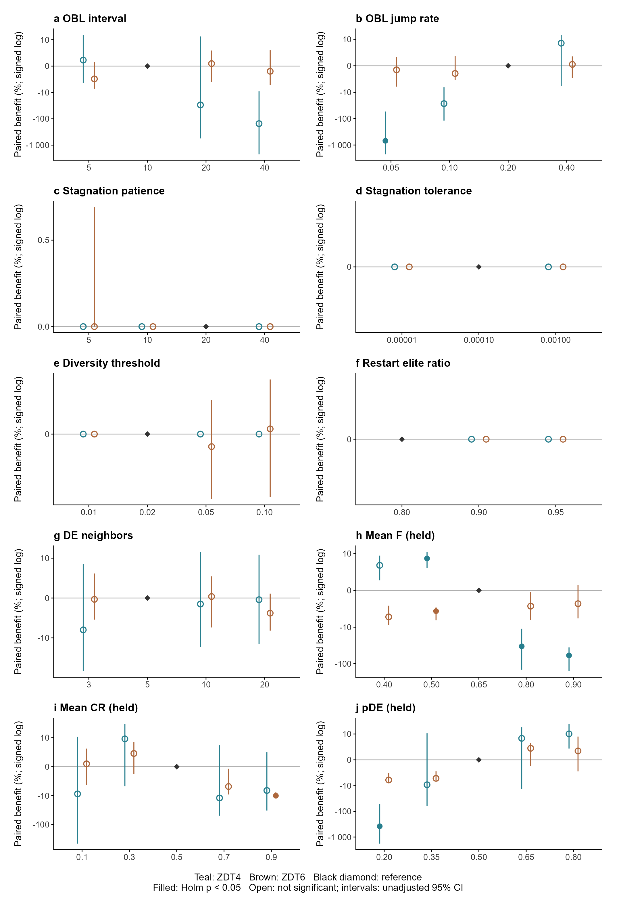

Mỗi panel là một tham số, mỗi chấm màu là một so sánh trên 30 cặp seed. Lợi ích hiển thị = **100 × median(IGD mốc − IGD mức thử) / median(IGD mốc)**. Đoạn dọc là CI 95% percentile bootstrap 20.000 mẫu cặp seed, được chia cho cùng median mốc quan sát như một hằng số trình bày; không phải CI bootstrap cho một tỷ số có mẫu số ngẫu nhiên. CI này **chưa hiệu chỉnh đa kiểm định**; chấm đặc/rỗng theo Holm chứ không theo việc CI có chứa 0.

Trục dọc dùng **signed pseudo-log với sigma=1 điểm phần trăm**, giữ 0, dấu âm và toàn bộ CI dài; nhãn tick vẫn là giá trị phần trăm thật. Gần 0 gần tuyến tính, xa 0 nén kiểu log; không so khoảng cách như một trục tuyến tính. Mỗi panel có phạm vi riêng. Đại lượng này là chênh lệch median theo cặp đã chuẩn hóa, **không phải median phần trăm cải thiện của từng seed**, không bị chặn ở −100%, và không phải phần trăm chất lượng tổng thể.

[PDF](figures/mechanism_sensitivity/paired_igd_overview.pdf) · [SVG](figures/mechanism_sensitivity/paired_igd_overview.svg) · [Dữ liệu nguồn](figures/mechanism_sensitivity/paired_igd_overview.source.csv).

## 2. Tổng quan chênh lệch HV theo cặp seed

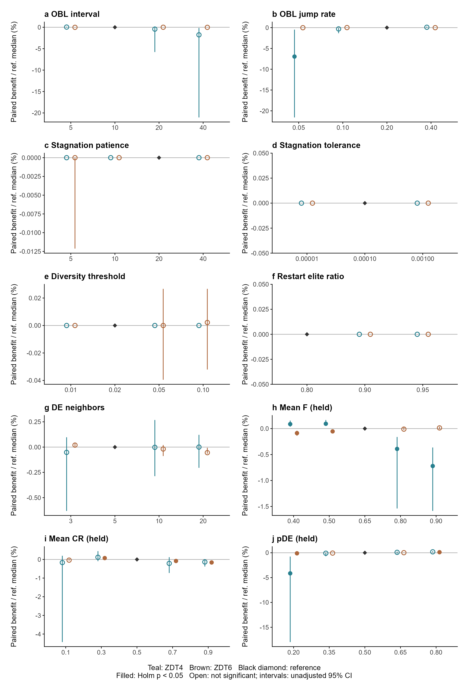

Cách đọc như hình IGD, nhưng lợi ích = **100 × median(HV mức thử − HV mốc) / median(HV mốc)** và trục dọc tuyến tính. Các CI dùng cùng phép đổi dấu/chia hằng số; tất cả 62 endpoint HV được giữ. Hai hình tổng quan gộp đủ 124 endpoint, không chỉ các endpoint đạt ngưỡng. Hai màu cùng panel dùng chung trục; phạm vi có thể khác giữa các panel. Một marker thoi đen là mốc định nghĩa ở 0, không có CI hay p-value riêng.

[PDF](figures/mechanism_sensitivity/paired_hv_overview.pdf) · [SVG](figures/mechanism_sensitivity/paired_hv_overview.svg) · [Dữ liệu nguồn](figures/mechanism_sensitivity/paired_hv_overview.source.csv).

## 3. Phân bố chi tiết theo từng tham số

Mỗi hình có bốn panel: **a** ZDT4 IGD, **b** ZDT4 HV, **c** ZDT6 IGD, **d** ZDT6 HV. IGD có trục log10, không cộng hằng số và không cắt đuôi; thống kê hộp/median tính trên thang dữ liệu gốc trước phép biến đổi tọa độ. HV tuyến tính, phạm vi từng panel có thể được phóng gần nhóm dữ liệu và không bắt buộc bắt đầu ở 0 vì đây là điểm/hộp, không phải chiều cao cột. Không so độ cao hay độ dốc giữa các trục có phạm vi khác nhau.

### 3.1. Chu kỳ OBL — mốc 10

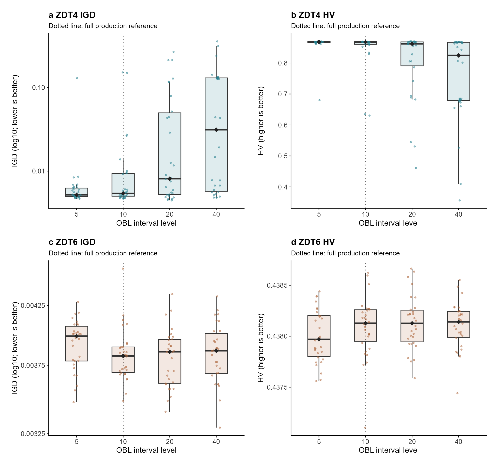

Các mức 5/10/20/40 cho thấy phân bố chất lượng khi thay tần suất OBL. [PDF](figures/mechanism_sensitivity/levels_obl_interval.pdf) · [SVG](figures/mechanism_sensitivity/levels_obl_interval.svg).

### 3.2. Xác suất OBL — mốc 0,2

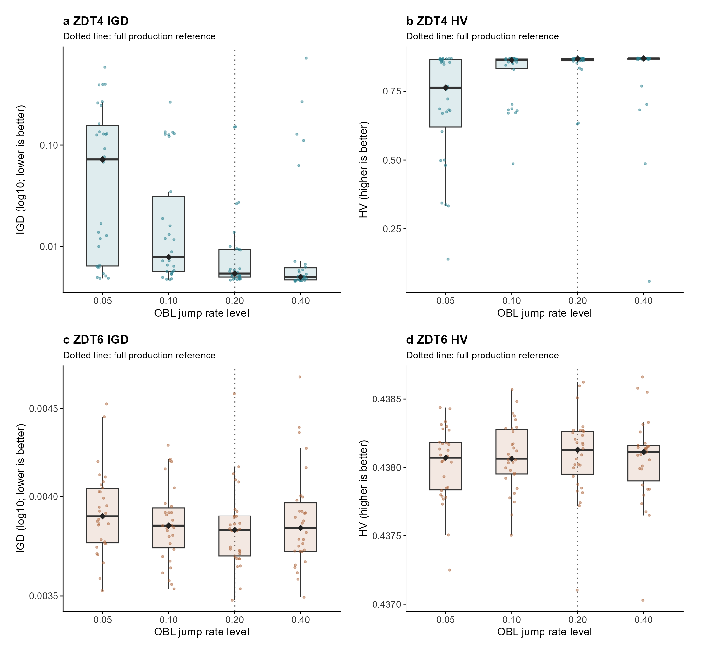

Quan sát ZDT4 ở mức 0,05: chất lượng kém và đuôi sai số được giữ đầy đủ. [PDF](figures/mechanism_sensitivity/levels_obl_jump_rate.pdf) · [SVG](figures/mechanism_sensitivity/levels_obl_jump_rate.svg).

### 3.3. Stagnation patience — mốc 20

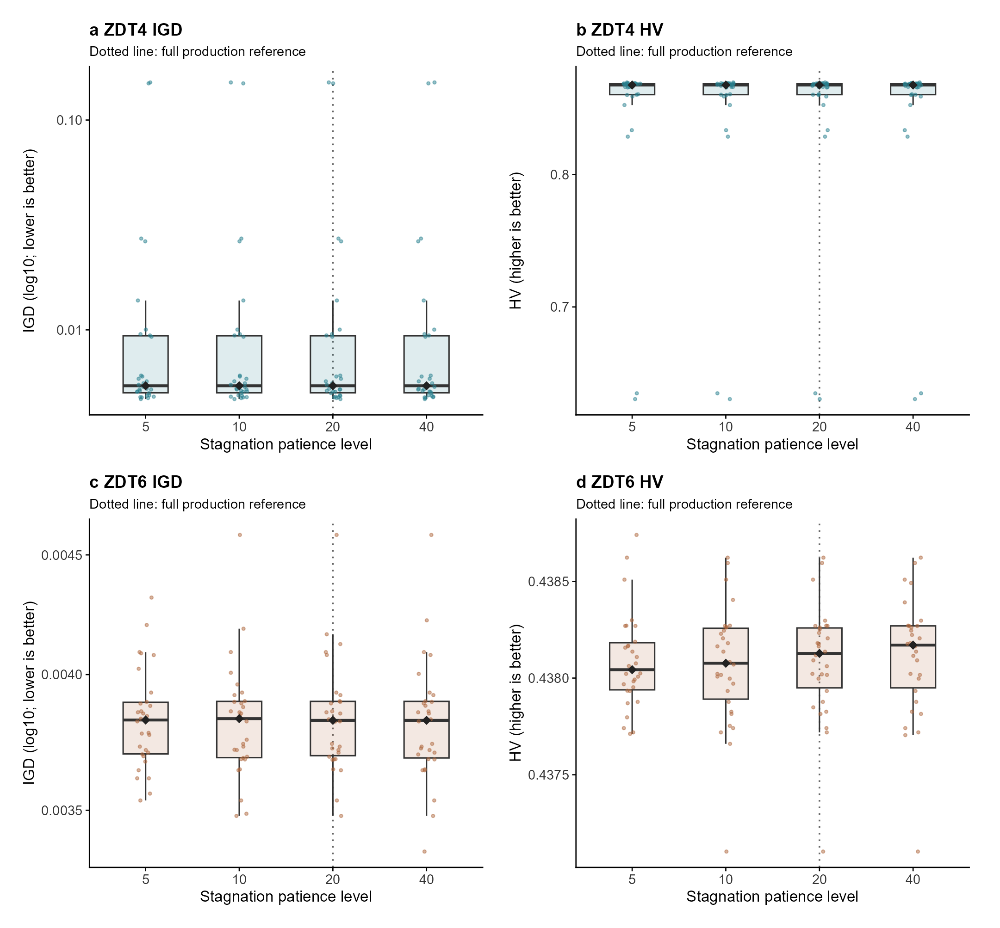

Đọc cùng telemetry trong báo cáo: tăng số lần restart không tự động cải thiện chất lượng cuối lượt. [PDF](figures/mechanism_sensitivity/levels_stagnation_patience.pdf) · [SVG](figures/mechanism_sensitivity/levels_stagnation_patience.svg).

### 3.4. Stagnation tolerance — mốc 0,0001

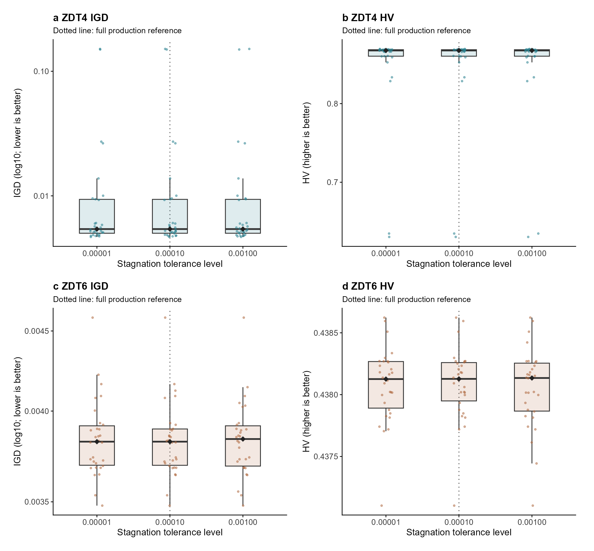

[PDF](figures/mechanism_sensitivity/levels_stagnation_tolerance.pdf) · [SVG](figures/mechanism_sensitivity/levels_stagnation_tolerance.svg).

### 3.5. Ngưỡng đa dạng — mốc 0,02

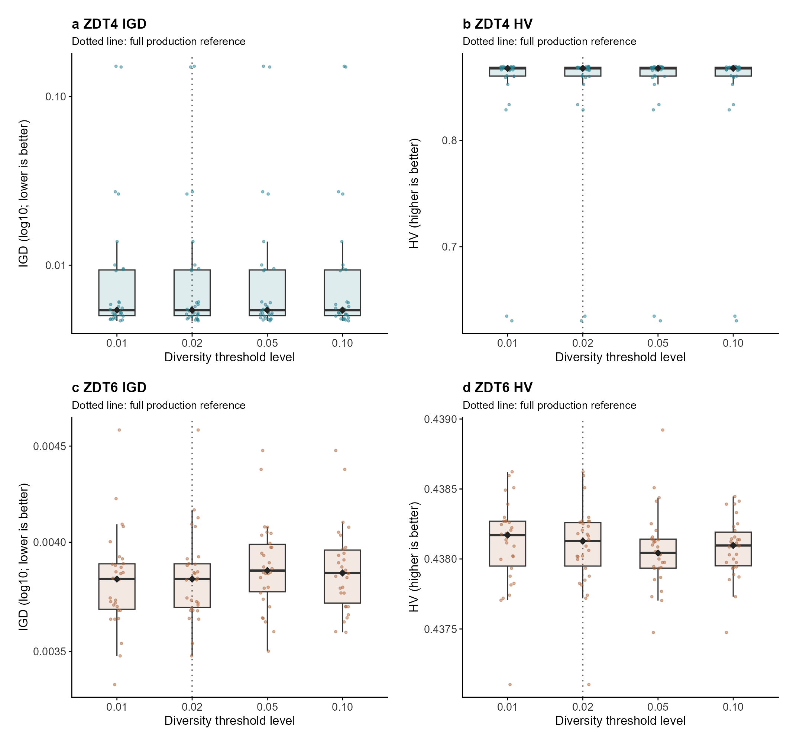

[PDF](figures/mechanism_sensitivity/levels_diversity_threshold.pdf) · [SVG](figures/mechanism_sensitivity/levels_diversity_threshold.svg).

### 3.6. Tỷ lệ elite khi restart — mốc 0,8

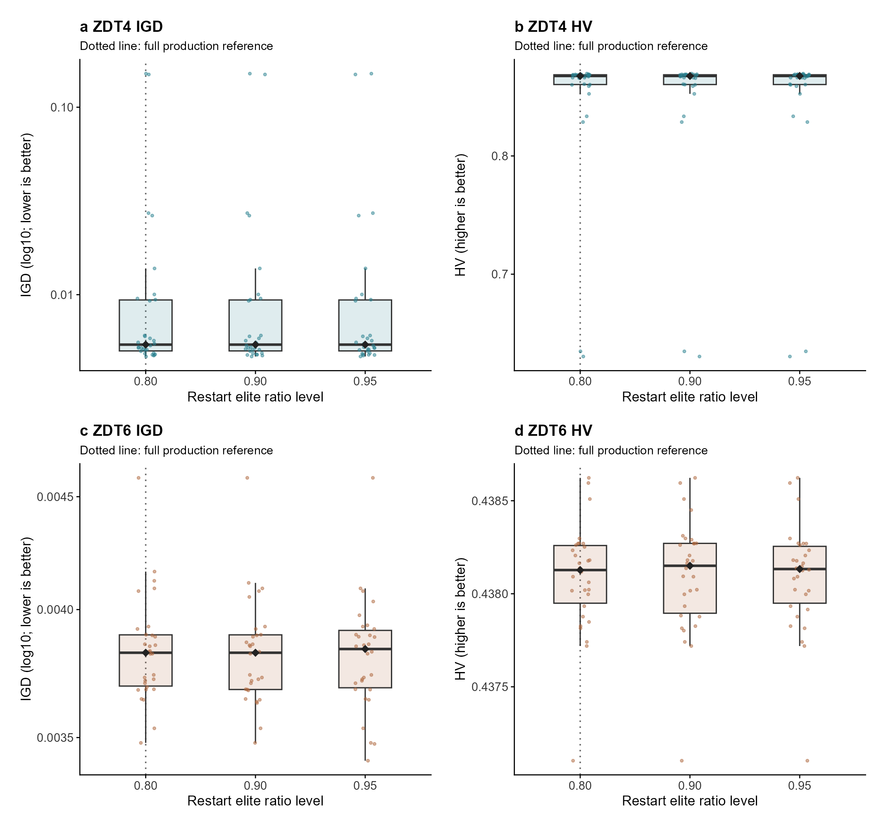

[PDF](figures/mechanism_sensitivity/levels_restart_elite_ratio.pdf) · [SVG](figures/mechanism_sensitivity/levels_restart_elite_ratio.svg).

### 3.7. Số láng giềng DE — mốc 5

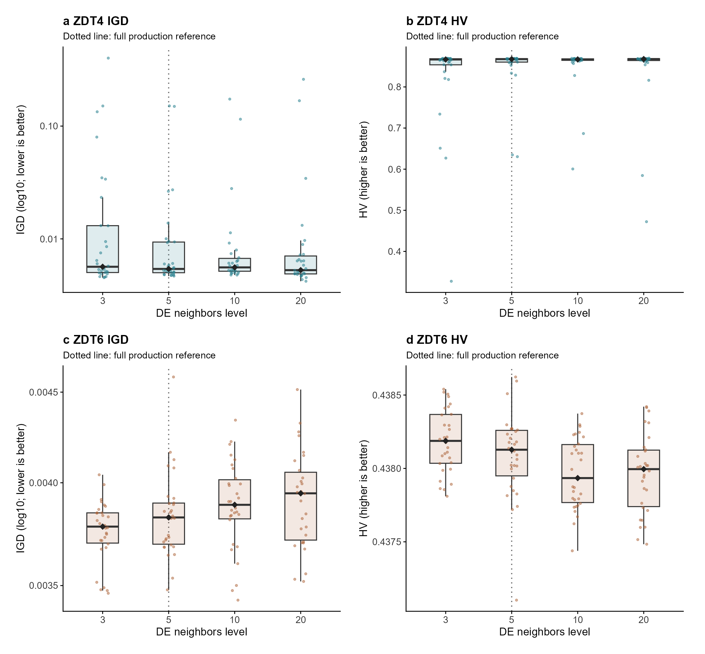

[PDF](figures/mechanism_sensitivity/levels_n_neighbors.pdf) · [SVG](figures/mechanism_sensitivity/levels_n_neighbors.svg).

### 3.8. Mean F giữ cố định — mốc 0,65 held

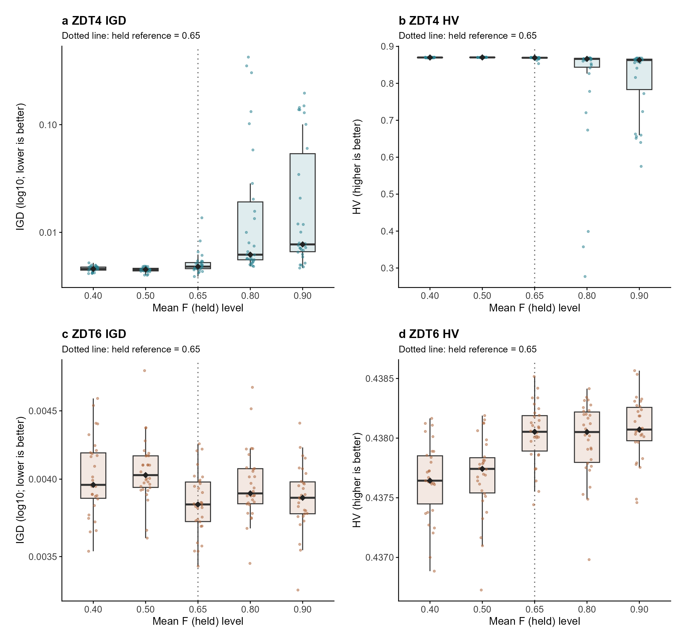

Nhìn cùng cả hai bài để thấy đánh đổi; không dùng riêng ZDT4 để chọn F chung. [PDF](figures/mechanism_sensitivity/levels_mean_F.pdf) · [SVG](figures/mechanism_sensitivity/levels_mean_F.svg).

### 3.9. Mean CR giữ cố định — mốc 0,5 held

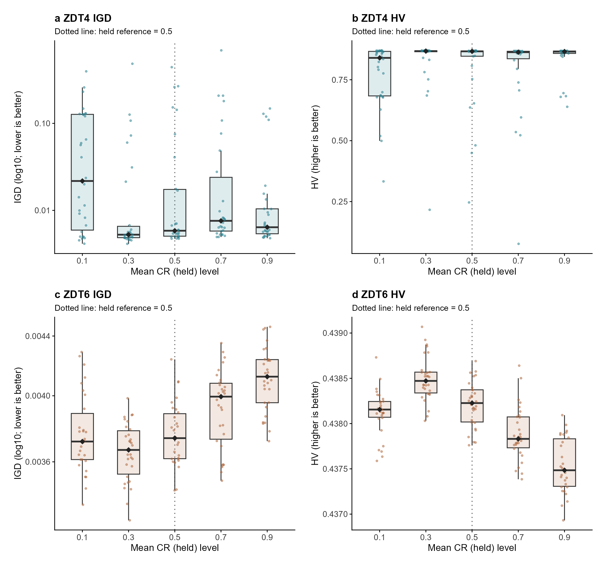

[PDF](figures/mechanism_sensitivity/levels_mean_CR.pdf) · [SVG](figures/mechanism_sensitivity/levels_mean_CR.svg).

### 3.10. pDE giữ cố định — mốc 0,5 held

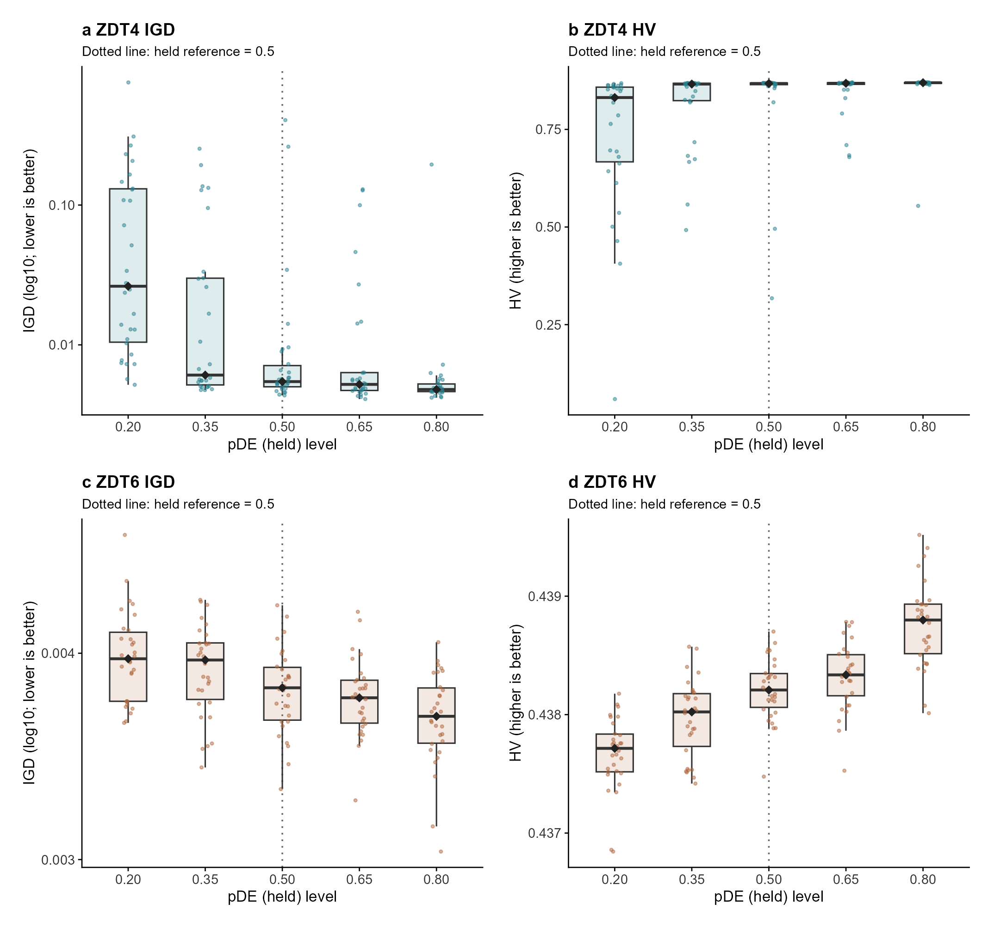

Xem cả IGD và HV: một cải thiện HV không đồng nghĩa cả hai chỉ số đều cải thiện có ý nghĩa. [PDF](figures/mechanism_sensitivity/levels_prob_de.pdf) · [SVG](figures/mechanism_sensitivity/levels_prob_de.svg).

## Tái tạo và tệp nguồn

```powershell
& 'C:/Program Files/R/R-4.6.2/bin/Rscript.exe' --vanilla analysis/plot_mechanism_sensitivity.R
```

[Mã R](../../analysis/plot_mechanism_sensitivity.R). Mỗi hình có CSV `.source.csv` cùng tên, PDF/SVG vector và PNG 300 dpi. Reference được lặp lại trong các hình riêng để tiện đọc, không nhân số replicate trong kiểm định. [QA và hợp đồng biểu đồ](figures/mechanism_sensitivity/QA.md) nêu định nghĩa thống kê, kiểm tra bố cục và ngoại lệ công cụ. Không sửa primary/manifest hoặc kết quả kiểm định khi vẽ.
