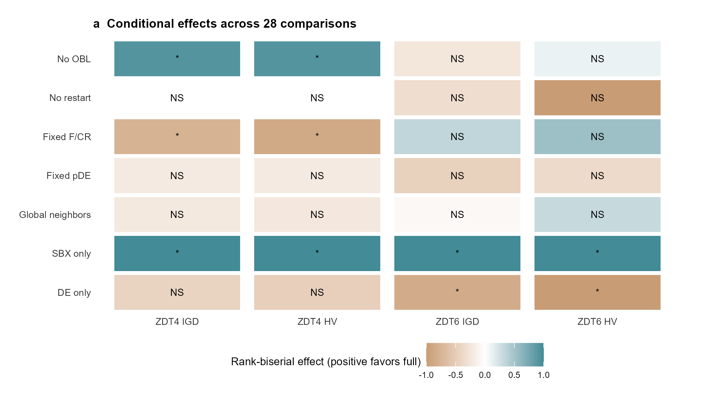
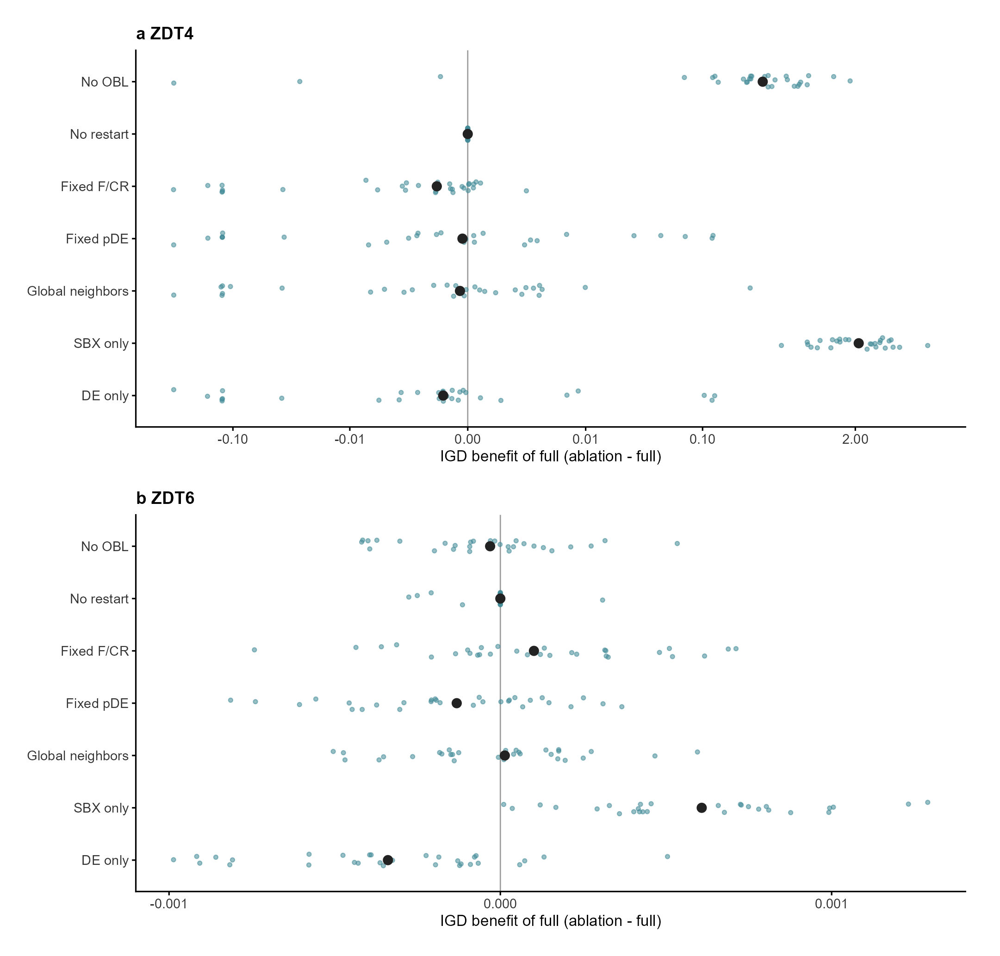

# Đóng góp có điều kiện của các cơ chế OADE trên ZDT4 và ZDT6

Ngày phân tích: 18/11/2026. Phân tích lại 480 lượt chạy hiện có; không chạy lại thuật toán tối ưu. [Giao thức](../protocols/mechanism_impact_zdt46.md) · [Audit](../../results/experiments/oade_mechanism_zdt46/derived/audit.json).

## Kết quả chính

Các cơ chế của OADE không mang lại lợi ích đồng đều trên hai bài toán. Trong 28 endpoint sau hiệu chỉnh Holm chung, cấu hình đầy đủ (`full`) tốt hơn ở 6 endpoint, biến thể can thiệp tốt hơn ở 4 endpoint, và 18 endpoint chưa phát hiện khác biệt. Endpoint là bài toán × can thiệp × chỉ số, không phải 28 thí nghiệm độc lập.

OBL định kỳ có lợi trong cấu hình đang xét trên ZDT4; chỉ dùng SBX làm giảm chất lượng trên cả hai bài. Tuy nhiên, giữ cố định trung bình F/CR cải thiện ZDT4, còn chỉ dùng DE cải thiện ZDT6. Vì vậy, kết quả không ủng hộ nhận định rằng mọi thành phần thích nghi đều cần thiết hoặc bản đầy đủ luôn tốt nhất.

## Thiết kế và phương pháp

Hai bài ZDT4/ZDT6 có D=10, M=2, quần thể 100, tối đa 20.000 lần đánh giá mục tiêu mỗi lượt. Có 8 cấu hình × 2 bài × 30 seed (42–71), tổng 480 lượt. Mỗi lượt là một đơn vị thực nghiệm tính toán; so sánh ghép theo cùng seed trong từng bài. Các thế hệ, cá thể và lần kích hoạt không được coi là các mẫu độc lập để tăng n. Không có dữ liệu sinh học, chia train/test hay thao tác loại outlier.

| Cấu hình | Can thiệp so với `full` |
|---|---|
| `no_obl` | Tắt OBL định kỳ |
| `no_restart` | Chặn adaptive restart |
| `fixed_f_cr` | Giữ mean F=0,65 và mean CR=0,5; vẫn lấy mẫu ngẫu nhiên |
| `fixed_pde` | Giữ xác suất DE=0,5 |
| `global_neighborhood` | Dùng toàn bộ cá thể khác làm lân cận DE; giữ quy tắc chọn donor |
| `sbx_only` | Chỉ chọn SBX; các cơ chế khác vẫn giữ |
| `de_only` | Chỉ chọn DE; các cơ chế khác vẫn giữ |

Đây là các can thiệp một thành phần trong hệ đầy đủ, không phải thiết kế factorial; `sbx_only`/`de_only` là hạn chế lựa chọn toán tử, không phải tắt mọi cơ chế khác. Mã chạy dùng uniform initialization với cùng seed. Sau khi đường tìm kiếm phân kỳ, số ngẫu nhiên tiêu thụ có thể khác nhau. Primary không lưu quần thể ban đầu nên audit không trực tiếp xác minh được sự đồng nhất khởi tạo lịch sử.

IGD thấp hơn tốt hơn; HV cao hơn tốt hơn. Audit dùng Pareto front giải tích từ pymoo và reference point bằng max của reference front theo từng mục tiêu cộng 0,1. Mọi đánh giá trong solver, bao gồm OBL/restart, nằm trong ngân sách; tổng FE lưu là **9.579.987**. Batch nguyên tử có thể để dư ngân sách. Mức dùng thực của mỗi nhóm nằm trong [bảng tổng hợp](../../results/experiments/oade_mechanism_zdt46/derived/audited_summary.csv).

Kiểm định Wilcoxon signed-rank hai phía, ghép 30 seed, `zero_method=wilcox`, `method=auto`; vector chênh lệch toàn 0 có statistic=0 và p=1. Holm áp dụng chung cho 28 endpoint (2 × 7 × 2), alpha=0,05. Không loại cặp nào. Rank-biserial dương thiên về `full`, âm thiên về biến thể. Hiệu ứng này dựa trên thứ hạng độ lớn chênh lệch khác 0, không phải phần trăm cải thiện. Chênh lệch thô lưu theo `full − biến thể`; vì vậy IGD âm và HV dương thiên về `full`.

Không phát hiện khác biệt không chứng minh tương đương. Các kiểm định chia sẻ cùng nhóm `full`; không diễn giải số endpoint như số lần xác nhận độc lập. Wilcoxon không tự động là kiểm định median trong phân bố chênh lệch bất đối xứng. Không suy ra ý nghĩa thống kê từ mean, median hoặc độ chồng lấn phân bố riêng lẻ. Phân tích này chưa bổ sung CI cho hiệu ứng; các điểm theo seed và SD trong bảng nguồn mô tả biến thiên, không thay thế CI.

## Kết quả sau Holm

Mỗi ô dưới đây gộp hai endpoint IGD/HV; p được ghi theo thứ tự đó. Tất cả dùng n=30 cặp.

| Can thiệp | ZDT4: kết luận IGD/HV; p Holm | ZDT6: kết luận IGD/HV; p Holm |
|---|---|---|
| Tắt OBL | Full tốt hơn cả hai; 1,08387×10⁻⁵ / 1,08387×10⁻⁵ | Chưa phát hiện khác biệt; 1 / 1 |
| Tắt restart | Chưa phát hiện khác biệt; 1 / 1 | Chưa phát hiện khác biệt; 1 / 0,603602 |
| Cố định F/CR | Biến thể tốt hơn cả hai; 0,00150302 / 9,28603×10⁻⁵ | Chưa phát hiện khác biệt; 1 / 0,167420 |
| Cố định pDE | Chưa phát hiện khác biệt; 1 / 1 | Chưa phát hiện khác biệt; 0,419664 / 1 |
| Lân cận toàn cục | Chưa phát hiện khác biệt; 1 / 1 | Chưa phát hiện khác biệt; 1 / 1 |
| Chỉ SBX | Full tốt hơn cả hai; 5,21541×10⁻⁸ / 5,21541×10⁻⁸ | Full tốt hơn cả hai; 5,21541×10⁻⁸ / 5,21541×10⁻⁸ |
| Chỉ DE | Chưa phát hiện khác biệt; 0,546525 / 0,375681 | Biến thể tốt hơn cả hai; 0,000212193 / 5,21541×10⁻⁸ |

Toàn bộ 28 dòng gồm statistic, p thô, p Holm, chênh lệch median theo cặp và rank-biserial có tại [audited_impact.csv](../../results/experiments/oade_mechanism_zdt46/derived/audited_impact.csv). [audited_summary.csv](../../results/experiments/oade_mechanism_zdt46/derived/audited_summary.csv) chứa đủ 16 nhóm với mean, SD mẫu và median của IGD/HV; không gộp chỉ số giữa các bài.

### OBL giúp ZDT4 nhưng chưa thể quy lợi ích chung cho cả hai bài

Trên ZDT4, tắt OBL làm IGD mean tăng từ 0,0397899 lên 0,451539 và HV mean giảm từ 0,813943 xuống 0,375511. Hiệu ứng rank-biserial bằng 0,92258 cho cả hai chỉ số, thiên về `full`. Trên ZDT6, hai endpoint đều chưa phát hiện khác biệt. Bằng chứng này hỗ trợ lợi ích có điều kiện của OBL trên ZDT4 dưới ngân sách đã đo; chưa xác định lợi ích trên mọi bài toán hoặc tác động riêng của việc thay đổi lượng FE dành cho các toán tử khác.

### Các biến thể đơn giản hơn có thể cải thiện chất lượng

Trên ZDT4, cố định mean F/CR cho IGD mean **0,00506044 ± 0,000590654 SD**, so với **0,0397899 ± 0,0731355** của `full`; HV mean tương ứng 0,868590 và 0,813943. Cải thiện đạt ngưỡng Holm ở cả hai chỉ số. Đuôi sai số lớn của `full` cần được giữ trong diễn giải; không loại các seed này để nâng kết quả.

Trên ZDT6, `de_only` có IGD mean 0,00354982 so với 0,00388120 và HV mean 0,439380 so với 0,438094 của `full`. Cả hai khác biệt đạt ngưỡng Holm. Trái lại, `sbx_only` kém `full` ở cả hai bài và cả hai chỉ số. Điều này cho thấy DE đóng vai trò hữu ích trong các cấu hình đã đo, nhưng chưa chứng minh quy tắc trộn DE/SBX hoặc thích nghi pDE hiện tại là tối ưu.

### Restart ít kích hoạt nên bằng chứng về hiệu quả còn hạn chế

Trong `full`, ZDT4 không có lần restart hoàn tất nào ở 30 seed; kết quả IGD/HV của `full` và `no_restart` trùng nhau theo seed. Trên ZDT6 có 6 lần restart hoàn tất trong 5/30 seed. Hai so sánh chất lượng sau Holm chưa phát hiện khác biệt. Không thể dùng kết quả này để khẳng định restart vô ích nói chung: trên ZDT4, can thiệp không tạo ra sự khác biệt hành vi do cơ chế không kích hoạt; trên ZDT6, số lượt thực sự tiếp xúc với restart thấp. [Telemetry đã trích độc lập](../../results/experiments/oade_mechanism_zdt46/derived/audited_activation.csv).

## Biểu đồ

### Hình 1 | Lợi ích của cơ chế phụ thuộc bài toán



Mỗi ô biểu diễn rank-biserial theo 30 cặp seed; dương thiên về `full`, âm thiên về biến thể. Dấu * là p Holm <0,05 trong họ 28 endpoint; NS là chưa phát hiện khác biệt, không phải tương đương. Không có thanh sai số vì hình mã hóa hiệu ứng thứ hạng và quyết định kiểm định, không mã hóa mean hay CI. Đủ 28 endpoint, không loại seed. [PDF](figures/mechanism_zdt46/mechanism_effects.pdf) · [SVG](figures/mechanism_zdt46/mechanism_effects.svg) · [Dữ liệu nguồn](figures/mechanism_zdt46/mechanism_effects.source.csv).

### Hình 2 | Chênh lệch theo seed cho thấy đuôi và sự đảo chiều lợi ích



Các phần a/b lần lượt là ZDT4/ZDT6. Mỗi chấm màu là IGD(biến thể) − IGD(full) của một seed; dương thiên về `full`. Chấm đen là median của 30 chênh lệch theo cặp, không phải chênh lệch hai median nhóm. Jitter chỉ theo chiều danh mục, không thay đổi giá trị. Trục pseudo-log với sigma=0,001 giữ được 0 và các giá trị âm; khoảng cách không phải thang tuyến tính hay log thuần. Không có CI; toàn bộ điểm thể hiện biến thiên và giữ các đuôi. Chỉ IGD được vẽ để tránh lặp thông điệp; toàn bộ HV được giữ ở Hình 1 và bảng nguồn. [PDF](figures/mechanism_zdt46/paired_igd.pdf) · [SVG](figures/mechanism_zdt46/paired_igd.svg) · [Dữ liệu nguồn](figures/mechanism_zdt46/paired_igd.source.csv).

## Kiểm chứng độc lập và giới hạn truy xuất nguồn gốc

[Script audit](../../analysis/audit_mechanism_zdt46.py) đọc primary JSON trực tiếp, không gọi solver hoặc các helper thống kê của pipeline. Audit đã:

- Xác nhận đủ 480 khóa bài/cấu hình/seed, không trùng hoặc thiếu; tất cả output hợp lệ theo các kiểm tra cấu trúc, hữu hạn, bounds, front có nhiều hơn một điểm phân biệt và không bị trội.
- Tính lại F từ final X; sai số lớn nhất bằng 0. Tính lại IGD/HV từ final F; sai số lớn nhất bằng 0. Reference lưu khớp reference giải tích hiện tại.
- Kiểm tra ngân sách từng lượt và đối chiếu các trường số của 480 dòng `runs.csv` với primary; tính lại đủ 28 statistic/p/effect/Holm và đối chiếu kết luận, không loại cặp.
- Đối chiếu 8 hash source lưu trong manifest với mã hiện tại; kiểm tra trace length và trạng thái/chi phí event cơ bản. Số lần OBL/restart được trích lại từ primary, không dựa vào `activation.csv` cũ.
- Ghi checksum audit-time của 480 primary và manifest; xác nhận primary không đổi trong quá trình đọc audit. Môi trường phân tích: Python 3.14.7, NumPy 2.5.4, SciPy 1.18.1.

Độc lập ở đây là đường tính lại tách khỏi helper pipeline, do cùng tác nhân thực hiện, không phải tái lập bởi nhóm nghiên cứu khác. Audit vẫn dùng pymoo để tính bài toán và chỉ số; không phải triển khai toán học thứ hai. Manifest gốc **không lưu checksum primary tại thời điểm chạy, phiên bản môi trường chạy hoặc hash quần thể ban đầu**. Checksum bổ sung hôm nay không chứng minh dữ liệu chưa từng bị sửa trước audit. Chưa tái kiểm mọi dòng của `trace.csv`, `events.csv`, `activation.csv` cũ hoặc xác minh từng bước chuyển trạng thái solver; báo cáo dùng primary và các bảng audited cho kết luận.

## Thảo luận và bước tiếp theo

Kết quả thu hẹp đóng góp có thể bảo vệ của cấu hình hiện tại: OBL và sự hiện diện của DE hỗ trợ chất lượng trong một số điều kiện, trong khi thích nghi F/CR và phối trộn toán tử cần được đánh giá theo bài toán. Can thiệp thay đổi cả đường tìm kiếm lẫn phân bổ FE dưới cùng cap; không thể quy toàn bộ chênh lệch cho một cơ chế nội tại, hay cộng các hiệu ứng thành tổng đóng góp. Thiết kế chưa xác định tương tác giữa các thành phần.

ZDT4/ZDT6 được chọn có chủ đích và dùng lại seed của benchmark trước; đây là phân tích tiếp nối, không phải xác nhận trên tập seed giữ kín. Không mở rộng kết luận sang DTLZ/WFG, bài động, nhiều mục tiêu hoặc benchmark thực tế. Runtime có thêm telemetry nên không so trực tiếp với benchmark không quan sát trước đó. Không có tuyên bố về ưu thế SOTA hoặc tính mới cơ chế từ bộ này.

Hai câu hỏi tiếp theo có căn cứ là: (1) lợi ích của `fixed_f_cr` trên ZDT4 và `de_only` trên ZDT6 có giữ trên seed mới đã khóa cấu hình hay không; (2) restart có cải thiện chất lượng khi điều kiện thực sự kích hoạt đủ thường xuyên hay không. Thí nghiệm sau cần giữ ngân sách, ghi trigger/activation/FE, quy định họ kiểm định trước khi chạy và lưu provenance đầy đủ hơn. Báo cáo này không tự thay cấu hình production theo kết quả quan sát.

## Tái tạo phân tích và hình

Chạy từ gốc repository; các lệnh chỉ phân tích dữ liệu đã có và ghi bảng/hình dẫn xuất:

```powershell
.\.venv\Scripts\python.exe analysis/audit_mechanism_zdt46.py
& 'C:/Program Files/R/R-4.6.2/bin/Rscript.exe' --vanilla analysis/plot_mechanism_zdt46.R
```

[Mã R](../../analysis/plot_mechanism_zdt46.R) dùng thư viện dự án hiện có; không tự cài gói. PDF/SVG giữ vector, PNG 300 dpi dùng xem trước. [QA hình](figures/mechanism_zdt46/QA.md) ghi kiểm tra bố cục và giới hạn. Primary, manifest và các CSV gốc được giữ nguyên.
