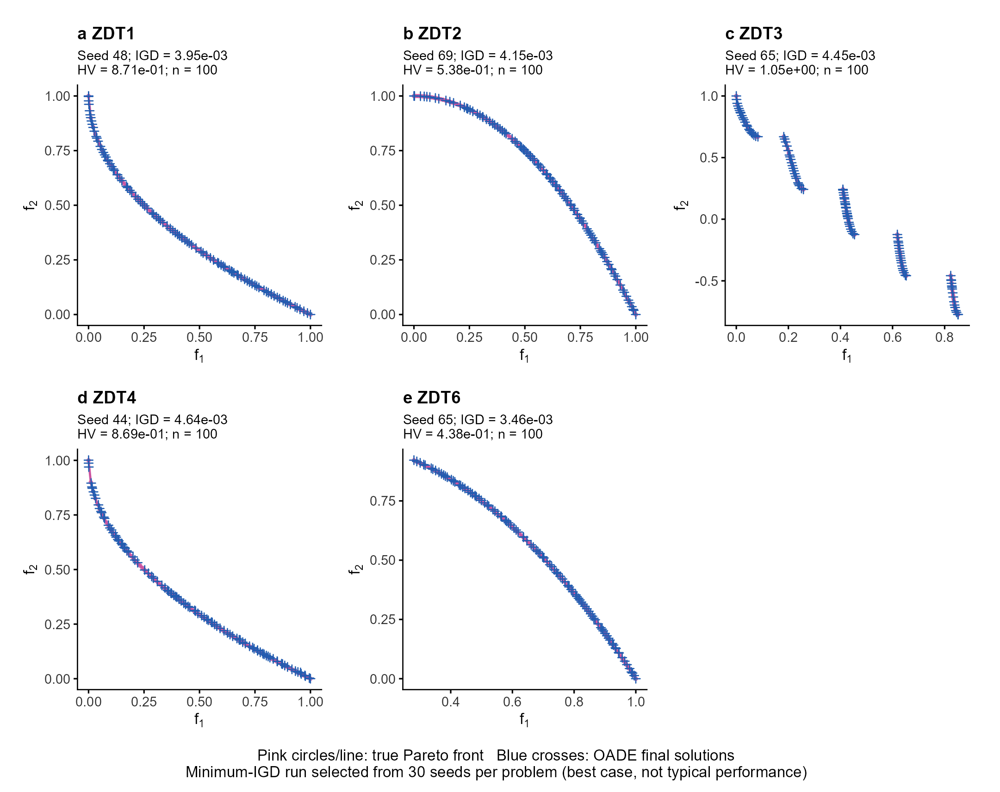

# Nghiệm OADE trên Pareto front chuẩn của các bài ZDT

Theo yêu cầu, chọn **seed có IGD cuối cùng nhỏ nhất trong 30 lượt OADE của từng bài** thuộc bộ sáu thuật toán mới nhất `zdt_six_fixed_oade_v1`. Nếu đồng hạng, chọn seed nhỏ hơn. Các hình đã được trích và vẽ lại từ primary mới, thay bộ hình cũ. Seed và tọa độ giống đợt trước do OADE giữ nguyên cấu hình/seed; provenance và checksum hiện trỏ tới đợt mới. Không chạy lại thuật toán và không gộp cá thể từ nhiều seed để tạo một front đẹp hơn.



**Hồng:** Pareto front chuẩn (đường và vòng tròn rỗng). **Dấu cộng xanh:** 100 nghiệm không bị trội cuối cùng của OADE ở mỗi panel. Trục ngang/dọc lần lượt là mục tiêu f₁/f₂, giữ thang tuyến tính. ZDT3 có năm đoạn Pareto rời và không nối đường qua khoảng trống. Hiển thị đầy đủ các nghiệm lưu trong lượt được chọn, không bỏ điểm, không jitter hoặc làm trơn nghiệm OADE.

Các hình thể hiện **trường hợp tốt nhất theo IGD**, không phải lượt điển hình, kết quả trung bình hay độ bất định qua 30 seed. Seed có IGD tốt nhất không nhất thiết có HV tốt nhất; HV dưới đây thuộc đúng lượt được vẽ. Dữ liệu final X/F là tập nghiệm không bị trội được lưu; không khẳng định bao gồm những cá thể bị trội không được xuất trong primary.

| Panel | Bài | Seed có IGD nhỏ nhất | IGD của lượt vẽ ↓ | HV của lượt vẽ ↑ |
|---|---|---:|---:|---:|
| a | ZDT1 | 48 | 3,952e-3 | 8,712e-1 |
| b | ZDT2 | 69 | 4,149e-3 | 5,377e-1 |
| c | ZDT3 | 65 | 4,453e-3 | 1,051e0 |
| d | ZDT4 | 44 | 4,636e-3 | 8,687e-1 |
| e | ZDT6 | 65 | 3,461e-3 | 4,383e-1 |

[PDF tổng hợp](figures/oade_zdt_fronts_latest/oade_zdt_best_fronts.pdf) · [SVG tổng hợp](figures/oade_zdt_fronts_latest/oade_zdt_best_fronts.svg).

## Tải hình riêng

| Bài | PNG | PDF | SVG |
|---|---|---|---|
| ZDT1 | [Seed 48](figures/oade_zdt_fronts_latest/zdt1_best_igd_seed48.png) | [PDF](figures/oade_zdt_fronts_latest/zdt1_best_igd_seed48.pdf) | [SVG](figures/oade_zdt_fronts_latest/zdt1_best_igd_seed48.svg) |
| ZDT2 | [Seed 69](figures/oade_zdt_fronts_latest/zdt2_best_igd_seed69.png) | [PDF](figures/oade_zdt_fronts_latest/zdt2_best_igd_seed69.pdf) | [SVG](figures/oade_zdt_fronts_latest/zdt2_best_igd_seed69.svg) |
| ZDT3 | [Seed 65](figures/oade_zdt_fronts_latest/zdt3_best_igd_seed65.png) | [PDF](figures/oade_zdt_fronts_latest/zdt3_best_igd_seed65.pdf) | [SVG](figures/oade_zdt_fronts_latest/zdt3_best_igd_seed65.svg) |
| ZDT4 | [Seed 44](figures/oade_zdt_fronts_latest/zdt4_best_igd_seed44.png) | [PDF](figures/oade_zdt_fronts_latest/zdt4_best_igd_seed44.pdf) | [SVG](figures/oade_zdt_fronts_latest/zdt4_best_igd_seed44.svg) |
| ZDT6 | [Seed 65](figures/oade_zdt_fronts_latest/zdt6_best_igd_seed65.png) | [PDF](figures/oade_zdt_fronts_latest/zdt6_best_igd_seed65.pdf) | [SVG](figures/oade_zdt_fronts_latest/zdt6_best_igd_seed65.svg) |

## Kiểm tra dữ liệu và tái tạo

[Script trích dữ liệu](../../analysis/export_oade_zdt_fronts.py) xác minh checksum của năm primary được chọn và reference snapshot với manifest gốc; tính lại F từ X, IGD/HV từ F. [Script R](../../analysis/plot_oade_zdt_fronts.R) chỉ vẽ dữ liệu đã trích, giữ đúng 500 nghiệm cuối. [Selection/checksums](figures/oade_zdt_fronts_latest/extraction.json) · [Tọa độ OADE](figures/oade_zdt_fronts_latest/solutions.source.csv) · [Tọa độ PF chuẩn](figures/oade_zdt_fronts_latest/reference.source.csv) · [Seed và chỉ số đầy đủ](figures/oade_zdt_fronts_latest/panels.source.csv) · [QA hình](figures/oade_zdt_fronts_latest/QA.md).

```powershell
.\.venv\Scripts\python.exe analysis/export_oade_zdt_fronts.py
& 'C:/Program Files/R/R-4.6.2/bin/Rscript.exe' --vanilla analysis/plot_oade_zdt_fronts.R
```

PDF/SVG giữ vector và chữ; PNG 300 dpi để xem nhanh. Xem [báo cáo sáu thuật toán mới nhất](zdt_six_fixed_oade_report.md) cho kết quả trên toàn bộ seed, bao gồm các seed ZDT4 có sai số lớn; hình best-run này không thay thế các kiểm định ở báo cáo đó.
