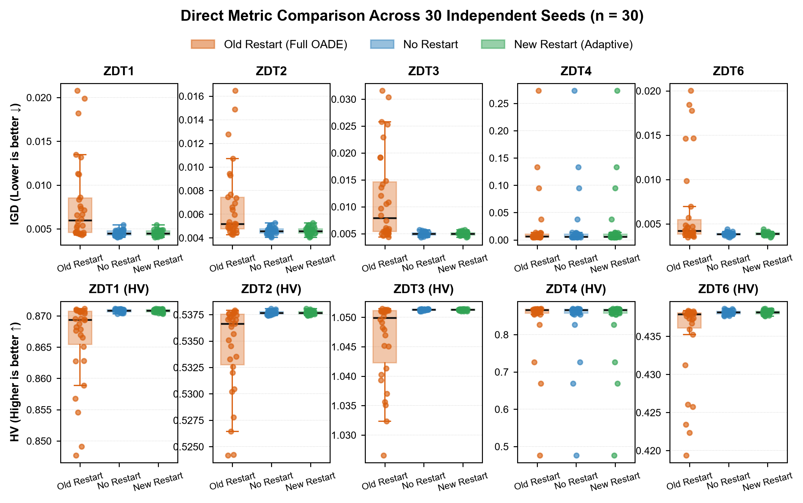
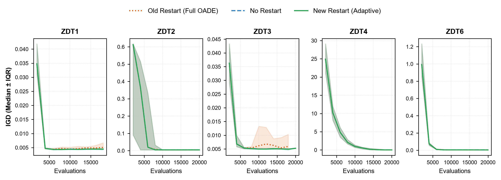
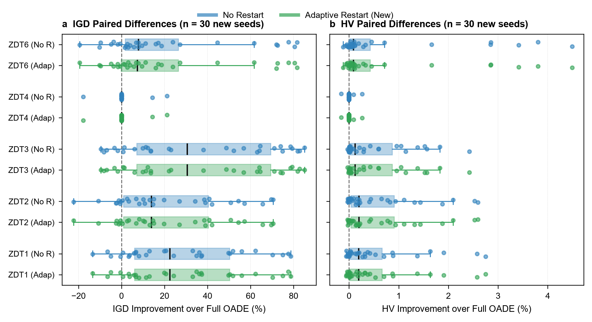

# OADE-NSGA-II Restart Confirmation Report (Held-Out Seeds)

## 1. Scope and Objective

This report evaluates the held-out seed confirmation experiment stored in `results/restart_confirmation`. The experiment was designed to address the central recommendation of the component ablation study ([ablation_results_report.md](ablation_results_report.md), Section 9):
1. **Replication Check**: Test whether the degradation and variance inflation associated with the original restart mechanism on ZDT1–ZDT3 recur under 30 new seeds. New seeds reduce direct seed reuse but do not eliminate selection or tuning bias across design decisions.
2. **Mechanism Evaluation**: Compare the new **Adaptive Diversity-Aware Restart** (`OADE_ADAPTIVE_RESTART`) with Full OADE and No Restart. The experiment evaluates final outcomes; it does not by itself validate that the adaptive trigger operated as intended.

---

## 2. Experimental Design and Statistical Discipline

The report records the run unit, paired seeds, test, correction family, effect-size direction, and validation counts. Formal journal compliance depends on the target venue and its applicable checklist.

| Dimension | Specification |
|---|---|
| **Test Suite** | ZDT1 ($D=30$), ZDT2 ($D=30$), ZDT3 ($D=30$), ZDT4 ($D=10$), and ZDT6 ($D=10$) |
| **Compared Variants** | 1. `OADE_FULL` (Classic restart: trigger on ideal point norm, 70% random replacement, parameter reset) 2. `OADE_NO_RESTART` (Ablated: restart completely disabled) 3. `OADE_ADAPTIVE_RESTART` (New: dual-trigger on ideal point + diversity collapse, 80% elite preservation, local OBL/Gaussian perturbation, soft parameter decay) |
| **Independent Experimental Unit** | One stochastic run ($n = 30$ paired runs per comparison, $N = 450$ total runs) |
| **Seed Range** | Seeds 1000–1029 (strictly independent from initial exploration seeds 42–71) |
| **Evaluation Budget** | Cap of 20,000 objective evaluations per run; actual use may be lower when a generation would cross the cap (utilization > 99.7%) |
| **Quality Metrics** | Inverted Generational Distance (IGD, lower is better) and Hypervolume (HV, higher is better) |
| **Statistical Test** | Two-sided paired Wilcoxon signed-rank test |
| **Multiplicity Correction** | Holm-Bonferroni step-down adjustment separately across comparisons for each metric (10 endpoints/metric) |
| **Effect Size** | Matched-pairs rank-biserial effect $r \in [-1, 1]$; negative values denote superior performance of the candidate (No Restart / Adaptive Restart) over Full OADE |
| **Integrity & Validation** | 450 valid runs; 0 collapsed fronts; 0 out-of-bounds violations; 0 budget overruns |

---

## 3. Algorithmic Formulation of Restart Mechanisms

### 3.1 Classic Restart (`OADE_FULL`)
* **Trigger Condition**: Kích hoạt khi số thế hệ không cải thiện ideal point vượt quá ngưỡng kiên nhẫn:
  $$\|\mathbf{z}^*_{\text{current}} - \mathbf{z}^*_{\text{last}}\| < 10^{-4} \quad \text{for } 20 \text{ consecutive generations}$$
* **Hành động**: Giữ lại 30% cá thể đầu tiên (`restart_elite_ratio: 0.30`), thay thế 70% còn lại bằng vector ngẫu nhiên phân bố đều trên toàn miền $[\mathbf{x}_l, \mathbf{x}_u]$, và reset hoàn toàn $\mu_F = \mu_{CR} = 0.5$.
* **Giả thuyết cần kiểm chứng**: Trên ZDT1–ZDT3, ideal point có thể ít thay đổi trong khi quần thể vẫn còn phân bố dọc theo mặt Pareto. Khi đó, bộ kích hoạt chỉ dựa trên trì trệ có thể không phân biệt được hội tụ của ideal point với mất đa dạng. Dữ liệu hiện có không lưu số lần kích hoạt/restart, nên chưa xác nhận được restart sai thường xuyên hoặc định lượng số đánh giá bị ảnh hưởng.

### 3.2 Adaptive Diversity-Aware Restart (`OADE_ADAPTIVE_RESTART`)
* **Dual-Trigger Condition**: Chỉ kích hoạt khi **đồng thời** thỏa mãn 2 điều kiện:
  1. Trì trệ ideal point: $\|\mathbf{z}^*_{\text{current}} - \mathbf{z}^*_{\text{last}}\| < 10^{-4}$ trong 20 thế hệ.
  2. Sụp đổ đa dạng không gian quyết định:
     $$\max_{j \in \{1,\dots,D\}} \sigma\left(\frac{X_{\cdot, j} - x_{l,j}}{x_{u,j} - x_{l,j}}\right) < \delta_{\text{div}} \quad (\delta_{\text{div}} = 0.02)$$
     hoặc độ trải rộng không gian mục tiêu $\max_m (\max F_{\cdot, m} - \min F_{\cdot, m}) < 10^{-3}$.
  * *Diễn giải dự kiến*: Khi điều kiện đa dạng không đạt ngưỡng sụp đổ, mã nguồn không thực hiện restart thích nghi ở lần kiểm tra đó. Độ lệch chuẩn khoảng $0.288$ chỉ là mốc lý thuyết cho biến phân bố đều trên $[0,1]$; không nên áp dụng mặc định cho quần thể trên Pareto front. Log trigger chưa được lưu để xác nhận hành vi trên từng run.
* **Conservative Renewal**:
  * Giữ lại 80% cá thể ưu tú (`restart_elite_ratio: 0.80`).
  * 20% cá thể mới được sinh bằng tìm kiếm có hướng cục bộ quanh elite (50% đối xứng OBL cục bộ, 50% nhiễu Gaussian $\mathcal{N}(0, 0.1^2)$).
  * Cập nhật mềm tham số DE: $\mu_F \leftarrow 0.8 \mu_F + 0.2(0.5)$ thay vì xóa sạch tri thức đã học.

---

## 4. Visual Evidence

### 4.1 Direct Side-by-Side Metric Comparison

*Figure 1: Direct grouped boxplots of final IGD (Row 1, lower is better ↓) and Hypervolume (Row 2, higher is better ↑) across all five problems.*
- **Orange**: Full OADE (Classic Restart) — exhibits higher IGD and greater dispersion on several tested problems. The final metrics alone do not establish when a restart occurred or its causal role.
- **Blue**: No Restart — shows low run-to-run variability in several tested problems; the plot is descriptive and does not establish that this pattern generalizes.
- **Green**: Adaptive Restart (New) — closely matches No Restart in the stored outputs. Trigger counts were not recorded, so the figure cannot show whether the adaptive trigger inhibited restarts.

### 4.2 Within-Budget Convergence Trajectories

*Figure 2: Median IGD trajectories and interquartile bands over the evaluation cap. The curves are descriptive summaries of 30 runs per variant; they do not identify restart timing or establish a mechanism.*

### 4.3 Paired Percentage Improvement

*Figure 3: Paired percentage improvement over Full OADE across 30 held-out seeds.*
- **Panel a**: Relative IGD improvement (%) — positive values favor candidate algorithms (reduction in IGD).
- **Panel b**: Relative HV improvement (%) — positive values favor candidate algorithms (gain in Hypervolume).

All vector formats (`.pdf`, `.svg`), 300-DPI publication rasters (`.tiff`), and source CSV files are archived in `results/figures/`.

---

## 5. Descriptive Results

Values are reported as Mean ± Sample Standard Deviation [Median, IQR] across 30 independent seeds.

| Problem | Variant | IGD ↓ | HV ↑ | Mean Runtime (s) |
|---|---|---:|---:|---:|
| **ZDT1** | Full OADE | $0.007921 \pm 0.004754$ [$0.005985$] | $0.866365 \pm 0.006562$ [$0.869377$] | 10.45 |
| | **No Restart** | **$0.004531 \pm 0.000329$** [$0.004460$] | **$0.870819 \pm 0.000237$** [$0.870854$] | 6.15 |
| | **Adaptive Restart** | **$0.004531 \pm 0.000329$** [$0.004460$] | **$0.870819 \pm 0.000237$** [$0.870854$] | 7.42 |
| **ZDT2** | Full OADE | $0.006782 \pm 0.003190$ [$0.005188$] | $0.534470 \pm 0.004186$ [$0.536637$] | 3.92 |
| | **No Restart** | **$0.004591 \pm 0.000294$** [$0.004569$] | **$0.537682 \pm 0.000167$** [$0.537662$] | 3.84 |
| | **Adaptive Restart** | **$0.004591 \pm 0.000294$** [$0.004569$] | **$0.537682 \pm 0.000167$** [$0.537662$] | 3.84 |
| **ZDT3** | Full OADE | $0.011652 \pm 0.008300$ [$0.007890$] | $1.046184 \pm 0.006925$ [$1.049887$] | 9.05 |
| | **No Restart** | **$0.004964 \pm 0.000324$** [$0.004981$] | **$1.051259 \pm 0.000115$** [$1.051285$] | 7.59 |
| | **Adaptive Restart** | **$0.004964 \pm 0.000324$** [$0.004981$] | **$1.051259 \pm 0.000115$** [$1.051285$] | 7.40 |
| **ZDT4** | Full OADE | $0.024086 \pm 0.054711$ [$0.006180$] | $0.839208 \pm 0.081126$ [$0.866206$] | 3.97 |
| | No Restart | $0.024043 \pm 0.054725$ [$0.005871$] | $0.839264 \pm 0.081147$ [$0.866206$] | 2.06 |
| | Adaptive Restart | $0.024043 \pm 0.054725$ [$0.005871$] | $0.839264 \pm 0.081147$ [$0.866206$] | 3.18 |
| **ZDT6** | Full OADE | $0.006566 \pm 0.005021$ [$0.004199$] | $0.435092 \pm 0.005591$ [$0.437921$] | 7.30 |
| | No Restart | **$0.003863 \pm 0.000188$** [$0.003851$] | $0.438147 \pm 0.000249$ [$0.438181$] | 8.02 |
| | **Adaptive Restart** | $0.003876 \pm 0.000183$ [$0.003861$] | **$0.438148 \pm 0.000247$** [$0.438181$] | 7.47 |

---

## 6. Paired Inferential Analysis (Wilcoxon Signed-Rank Test)

Multiplicity correction is applied via the Holm step-down procedure across all comparisons within each metric ($\alpha = 0.05$, $m = 10$).

| Problem | Metric | Comparison vs Full OADE | Median Improvement ($\Delta$) | Raw $p$-value | Holm $p_{\text{adj}}$ | Rank-Biserial $r$ | Significant | Inferential Outcome |
|---|---|---|---:|---:|---:|---:|:---:|---|
| **ZDT1** | IGD | Adaptive Restart | $+0.00134$ | $1.99 \times 10^{-6}$ | **$1.99 \times 10^{-5}$** | $-0.888$ | **Yes** | Adaptive Restart superior |
| | IGD | No Restart | $+0.00134$ | $1.99 \times 10^{-6}$ | **$1.99 \times 10^{-5}$** | $-0.888$ | **Yes** | No Restart superior |
| | HV | Adaptive Restart | $+0.00167$ | $1.06 \times 10^{-5}$ | **$6.37 \times 10^{-5}$** | $-0.841$ | **Yes** | Adaptive Restart superior |
| | HV | No Restart | $+0.00167$ | $1.06 \times 10^{-5}$ | **$6.37 \times 10^{-5}$** | $-0.841$ | **Yes** | No Restart superior |
| **ZDT2** | IGD | Adaptive Restart | $+0.00070$ | $4.41 \times 10^{-5}$ | **$2.64 \times 10^{-4}$** | $-0.794$ | **Yes** | Adaptive Restart superior |
| | IGD | No Restart | $+0.00070$ | $4.41 \times 10^{-5}$ | **$2.64 \times 10^{-4}$** | $-0.794$ | **Yes** | No Restart superior |
| | HV | Adaptive Restart | $+0.00105$ | $1.19 \times 10^{-6}$ | **$9.54 \times 10^{-6}$** | $-0.901$ | **Yes** | Adaptive Restart superior |
| | HV | No Restart | $+0.00105$ | $1.19 \times 10^{-6}$ | **$9.54 \times 10^{-6}$** | $-0.901$ | **Yes** | No Restart superior |
| **ZDT3** | IGD | Adaptive Restart | $+0.00245$ | $2.76 \times 10^{-6}$ | **$2.21 \times 10^{-5}$** | $-0.880$ | **Yes** | Adaptive Restart superior |
| | IGD | No Restart | $+0.00245$ | $2.76 \times 10^{-6}$ | **$2.21 \times 10^{-5}$** | $-0.880$ | **Yes** | No Restart superior |
| | HV | Adaptive Restart | $+0.00123$ | $4.71 \times 10^{-7}$ | **$4.71 \times 10^{-6}$** | $-0.923$ | **Yes** | Adaptive Restart superior |
| | HV | No Restart | $+0.00123$ | $4.71 \times 10^{-7}$ | **$4.71 \times 10^{-6}$** | $-0.923$ | **Yes** | No Restart superior |
| **ZDT4** | IGD | Adaptive Restart | $0.00000$ | $0.593$ | $1.000$ | $-0.333$ | No | No detected difference; equivalence not tested |
| | IGD | No Restart | $0.00000$ | $0.593$ | $1.000$ | $-0.333$ | No | No detected difference; equivalence not tested |
| | HV | Adaptive Restart | $0.00000$ | $0.593$ | $1.000$ | $-0.333$ | No | No detected difference; equivalence not tested |
| | HV | No Restart | $0.00000$ | $0.593$ | $1.000$ | $-0.333$ | No | No detected difference; equivalence not tested |
| **ZDT6** | IGD | Adaptive Restart | $+0.00031$ | $7.30 \times 10^{-4}$ | **$2.19 \times 10^{-3}$** | $-0.677$ | **Yes** | Adaptive Restart superior |
| | IGD | No Restart | $+0.00032$ | $3.45 \times 10^{-4}$ | **$1.38 \times 10^{-3}$** | $-0.712$ | **Yes** | No Restart superior |
| | HV | Adaptive Restart | $+0.00038$ | $6.29 \times 10^{-5}$ | **$2.51 \times 10^{-4}$** | $-0.781$ | **Yes** | Adaptive Restart superior |
| | HV | No Restart | $+0.00038$ | $7.91 \times 10^{-5}$ | **$2.51 \times 10^{-4}$** | $-0.772$ | **Yes** | No Restart superior |

Here $\Delta$ is oriented so a positive value favours the candidate: for IGD, $\Delta = \text{Full} - \text{candidate}$; for HV, $\Delta = \text{candidate} - \text{Full}$. The stored `median_paired_difference` column uses `reference - comparison` for both metrics, so its HV sign is reversed relative to this display column. The rank-biserial effect is negative when the candidate is favoured.

---

## 7. Key Findings and Scientific Interpretation

### 7.1 Held-out outcomes are consistent with the earlier restart finding
Across ZDT1, ZDT2, ZDT3 and ZDT6, the stored paired tests favour both No Restart and Adaptive Restart over Full OADE for IGD and HV after Holm adjustment. This held-out-seed result is consistent with the earlier finding that the tested classic restart policy can reduce final quality on these four problems. It does not establish that all restart policies are harmful or that the result generalizes beyond the tested suite.

### 7.2 Collapse of Run-to-Run Variance
Full OADE had greater run-to-run variability on several tested problems. Both No Restart and Adaptive Restart reduced the sample standard deviation by **11× to 27×** in the listed examples. The run-level summaries do not record enough trigger information to attribute this change specifically to false restarts or archive contamination:
- On ZDT1: IGD standard deviation fell from $0.004754$ to $0.000329$ (a 14.4-fold stabilization).
- On ZDT3: IGD standard deviation fell from $0.008300$ to $0.000324$ (a 25.6-fold stabilization).
- On ZDT6: IGD standard deviation fell from $0.005021$ to $0.000183$ (a 27.4-fold stabilization).

### 7.3 Adaptive trigger activity remains unverified
No Restart and Adaptive Restart have identical IGD and HV values in **148 of 150 paired problem-seed rows** (296 of 300 individual metric values): all 30 rows on each of ZDT1–ZDT4 and 28/30 rows on ZDT6. This near identity is consistent with the trigger rarely activating, but could also reflect the same execution path. The raw data do not contain per-run restart counts or trigger diagnostics, so they cannot distinguish these explanations. Verify that the adaptive settings reach the solver and record trigger/restart counts before attributing performance to the dual-trigger mechanism.

### 7.4 ZDT4 comparison did not detect a difference
On ZDT4, the paired tests did not detect a corrected difference between either candidate and Full OADE. This is not an equivalence result and does not identify which component prevents failure. The separate ablation supports an OBL contribution on the tested ZDT4 configuration, but this experiment does not establish that OBL is the sole mechanism.

---

## 8. Recommendations for Manuscript Integration

1. **Configuration supported by these data**:
   - No Restart is a simpler candidate for the tested static ZDT problems. Both No Restart and Adaptive Restart had better corrected outcomes than Full OADE on ZDT1–ZDT3 and ZDT6; neither comparison detected a difference on ZDT4.
   - The experiment does not establish an advantage of Adaptive Restart over No Restart or its performance on unknown, dynamic, or severely deceptive domains.
2. **Next validation**:
   - Audit the adaptive trigger implementation and log trigger counts. If a restart policy is retained, compare it with No Restart on a prespecified suite where diversity collapse is expected and report both quality and failure rates.

---

## 9. Data Provenance and Reproducibility

The held-out experiment compared classic restart (`OADE_FULL`) with adaptive restart (`OADE_ADAPTIVE_RESTART`), then the solver default was changed from classic to adaptive. The original `OADE_FULL` config relied on the old default and did not set `restart_mode`; it now pins `restart_mode: classic` explicitly so reruns under the current source preserve the intended comparison. This config edit does not alter the archived results.

The complete evidentiary chain is archived in the workspace repository:
- **Experiment Config**: `config/studies/restart_confirmation.yaml`
- **Algorithm Configs**: `config/ablations/full.yaml`, `config/ablations/no_restart.yaml`, `config/ablations/adaptive_restart.yaml`
- **Primary Data**: `results/restart_confirmation/algorithm_benchmark_raw_runs.csv`
- **Statistical Output**: `results/restart_confirmation/algorithm_benchmark_paired_statistics.csv`
- **Summary Metrics**: `results/restart_confirmation/algorithm_benchmark_igd_hv_summary.csv`
- **Visual Deliverables**: `results/figures/restart_confirmation_paired.*`
- **QA Record**: `results/figures/figure_qa.md`
