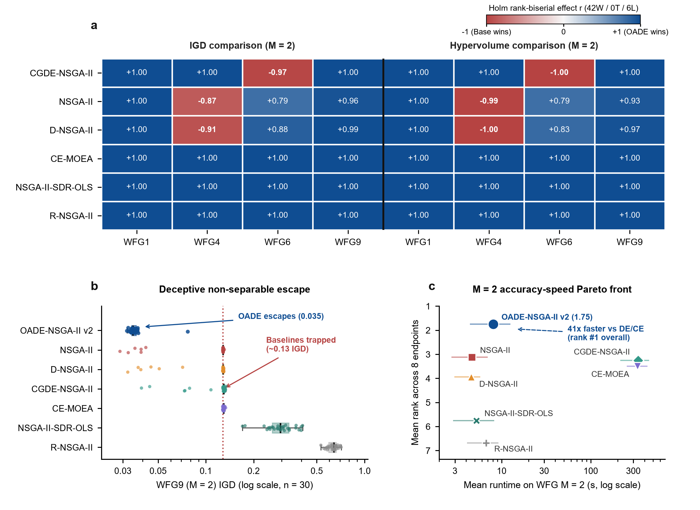
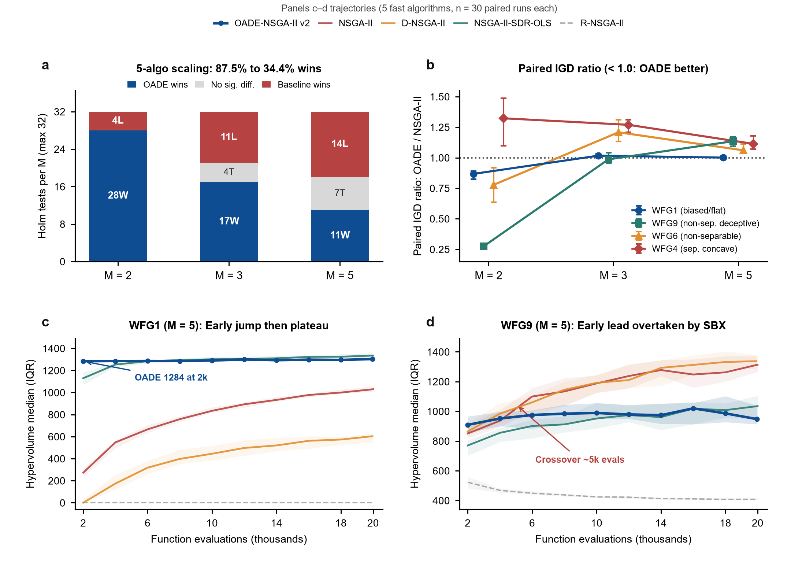

# WFG benchmark and objective-count scaling results

wfg_m2_7algo_benchmark: RNSGA2 has 120/120 valid records, 30 paired seeds per configuration and 20,000 recorded evaluations per run including setup. Against RNSGA2, OADE outcomes are 8 wins, 0 comparisons with no detected difference and 0 losses, within the stated suite-by-metric Holm families.

wfg_compact_benchmark: RNSGA2 has 360/360 valid records, 30 paired seeds per configuration and 20,000 recorded evaluations per run including setup. Against RNSGA2, OADE outcomes are 24 wins, 0 comparisons with no detected difference and 0 losses, within the stated suite-by-metric Holm families.

Four functions (WFG1/4/6/9), D=24. M=2/3 use k=4; M=5 uses k=8. The seven-algorithm table tests M=2; compact WFG tests five algorithms at M=2/3/5. Matching M=2 RNSGA2 records are shared across these tables, not independent replication.

| Dataset | Records | Invalid | Comparisons | OADE W / ND / L |
|---|---:|---:|---:|---|
| wfg_m2_7algo_benchmark | 840 | 0 | 48 | 42 / 0 / 6 |
| wfg_compact_benchmark | 1800 | 0 | 96 | 56 / 11 / 29 |

## wfg_m2_7algo_benchmark

Thirty paired seeds (42–71), population 100, requested cap 20,000 objective evaluations. RNSGA2 aspiration-point setup is included in its evaluation cap and runtime. Two-sided paired Wilcoxon signed-rank tests; Holm correction over m=24 comparisons separately per metric, alpha=0.05. Valid matched pairs range from 30 to 30. Invalid outputs remain in run-level evidence; quality summaries/tests use valid matched observations. Positive rank-biserial effect favors OADE. No detected difference is not equivalence. Mean ± sample SD and median/IQR describe run dispersion, not confidence intervals for paired effects.

### Quality and cost by implementation

| Problem | ID | Valid / scheduled | IGD median [Q25, Q75] ↓ | IGD mean ± SD | HV median [Q25, Q75] ↑ | HV mean ± SD | Mean seconds | Mean n_eval |
|---|---|---:|---:|---:|---:|---:|---:|---:|
| wfg1_m2 | OADE_NSGAII | 30 / 30 | 1.02635 [1.01933, 1.03275] | 1.02608 ± 0.0107426 | 1.77305 [1.75152, 1.78989] | 1.77197 ± 0.0304387 | 12.530 | 19943.7 |
| wfg1_m2 | NSGA2 | 30 / 30 | 1.18944 [1.14675, 1.2328] | 1.20215 ± 0.0747406 | 0.934918 [0.828528, 1.02012] | 0.903008 ± 0.190228 | 6.975 | 20000.0 |
| wfg1_m2 | RNSGA2 | 30 / 30 | 1.68809 [1.63309, 1.7513] | 1.69532 ± 0.0703903 | 0 [0, 0] | 0 ± 0 | 6.399 | 20000.0 |
| wfg1_m2 | DNSGA2 | 30 / 30 | 1.57529 [1.534, 1.6033] | 1.56666 ± 0.0426862 | 0 [0, 0] | 0.00981927 ± 0.0296991 | 5.788 | 19967.7 |
| wfg1_m2 | CGDE_NSGAII | 30 / 30 | 1.13747 [1.13382, 1.14414] | 1.13856 ± 0.00725811 | 1.4531 [1.44003, 1.4642] | 1.45262 ± 0.0179108 | 214.860 | 20000.0 |
| wfg1_m2 | NSGAII_SDR_OLS | 30 / 30 | 1.14583 [1.13428, 1.15975] | 1.14603 ± 0.0181704 | 1.42057 [1.39036, 1.45076] | 1.42008 ± 0.0422428 | 8.262 | 20000.0 |
| wfg1_m2 | CE_MOEA | 30 / 30 | 1.12973 [1.12462, 1.13714] | 1.1299 ± 0.00854937 | 1.48276 [1.46311, 1.49853] | 1.48311 ± 0.0233624 | 253.891 | 20000.0 |
| wfg4_m2 | OADE_NSGAII | 30 / 30 | 0.0332865 [0.0310635, 0.0343525] | 0.0332224 ± 0.00350899 | 2.14882 [2.13729, 2.15496] | 2.146 ± 0.0168258 | 10.241 | 19958.3 |
| wfg4_m2 | NSGA2 | 30 / 30 | 0.0258485 [0.0235649, 0.0291162] | 0.0263514 ± 0.00398152 | 2.20102 [2.19261, 2.2085] | 2.20066 ± 0.0133641 | 5.468 | 20000.0 |
| wfg4_m2 | RNSGA2 | 30 / 30 | 0.776462 [0.738015, 0.840897] | 0.776159 ± 0.0876585 | 1.32372 [1.29558, 1.33952] | 1.31845 ± 0.0363488 | 5.639 | 20000.0 |
| wfg4_m2 | DNSGA2 | 30 / 30 | 0.0269287 [0.023409, 0.0289716] | 0.027004 ± 0.00451905 | 2.19138 [2.1811, 2.20723] | 2.19368 ± 0.0160338 | 5.361 | 19910.0 |
| wfg4_m2 | CGDE_NSGAII | 30 / 30 | 0.0790686 [0.0771785, 0.0808669] | 0.0792816 ± 0.0026062 | 1.91569 [1.913, 1.92605] | 1.91727 ± 0.011875 | 238.423 | 20000.0 |
| wfg4_m2 | NSGAII_SDR_OLS | 30 / 30 | 0.248685 [0.215539, 0.276329] | 0.253584 ± 0.0489736 | 1.23034 [1.17346, 1.3587] | 1.25448 ± 0.151017 | 6.296 | 20000.0 |
| wfg4_m2 | CE_MOEA | 30 / 30 | 0.0718304 [0.0671272, 0.0761215] | 0.0715537 ± 0.00532457 | 1.94842 [1.9338, 1.9728] | 1.95327 ± 0.0275459 | 360.878 | 20000.0 |
| wfg6_m2 | OADE_NSGAII | 30 / 30 | 0.0525525 [0.0438797, 0.0600739] | 0.0547901 ± 0.0164568 | 2.05116 [2.0157, 2.09126] | 2.04237 ± 0.0833676 | 4.423 | 19966.0 |
| wfg6_m2 | NSGA2 | 30 / 30 | 0.0688914 [0.0638133, 0.0806325] | 0.0716943 ± 0.0107337 | 1.96776 [1.91432, 1.99487] | 1.95804 ± 0.0496875 | 2.735 | 20000.0 |
| wfg6_m2 | RNSGA2 | 30 / 30 | 0.75249 [0.705685, 0.844365] | 0.772488 ± 0.0918258 | 1.16152 [1.07898, 1.20495] | 1.15881 ± 0.0880385 | 3.581 | 20000.0 |
| wfg6_m2 | DNSGA2 | 30 / 30 | 0.0714855 [0.0638605, 0.0765533] | 0.0737715 ± 0.0151702 | 1.96232 [1.93502, 1.99229] | 1.9581 ± 0.0501883 | 2.964 | 19910.0 |
| wfg6_m2 | CGDE_NSGAII | 30 / 30 | 0.0301546 [0.0266076, 0.0386911] | 0.0338352 ± 0.0104752 | 2.1894 [2.16641, 2.19882] | 2.182 ± 0.0261591 | 448.085 | 20000.0 |
| wfg6_m2 | NSGAII_SDR_OLS | 30 / 30 | 0.28231 [0.251998, 0.335797] | 0.291287 ± 0.0538188 | 1.23109 [1.13448, 1.35793] | 1.23937 ± 0.147094 | 2.850 | 20000.0 |
| wfg6_m2 | CE_MOEA | 30 / 30 | 0.121544 [0.121126, 0.121936] | 0.116135 ± 0.0162203 | 1.70052 [1.69838, 1.70316] | 1.73085 ± 0.0880383 | 283.463 | 20000.0 |
| wfg9_m2 | OADE_NSGAII | 30 / 30 | 0.0347094 [0.0339824, 0.0362958] | 0.0363613 ± 0.00780928 | 2.15563 [2.1521, 2.15866] | 2.15299 ± 0.0171184 | 5.157 | 19956.9 |
| wfg9_m2 | NSGA2 | 30 / 30 | 0.128344 [0.12794, 0.12871] | 0.110123 ± 0.0376733 | 1.70047 [1.6993, 1.70269] | 1.79242 ± 0.188414 | 3.444 | 20000.0 |
| wfg9_m2 | RNSGA2 | 30 / 30 | 0.634442 [0.590452, 0.665333] | 0.621958 ± 0.0709063 | 1.2917 [1.03792, 1.33324] | 1.20363 ± 0.174846 | 4.080 | 20000.0 |
| wfg9_m2 | DNSGA2 | 30 / 30 | 0.128372 [0.127753, 0.129214] | 0.112191 ± 0.0341716 | 1.70106 [1.69898, 1.7024] | 1.7865 ± 0.177633 | 4.119 | 19910.0 |
| wfg9_m2 | CGDE_NSGAII | 30 / 30 | 0.129454 [0.128162, 0.130665] | 0.118058 ± 0.0268055 | 1.70118 [1.69922, 1.70351] | 1.76547 ± 0.140067 | 453.108 | 20000.0 |
| wfg9_m2 | NSGAII_SDR_OLS | 30 / 30 | 0.295047 [0.262329, 0.333391] | 0.29966 ± 0.0596967 | 1.16924 [1.07477, 1.22918] | 1.14655 ± 0.152618 | 3.461 | 20000.0 |
| wfg9_m2 | CE_MOEA | 30 / 30 | 0.129265 [0.128396, 0.129935] | 0.129474 ± 0.00135727 | 1.70197 [1.70009, 1.70341] | 1.70156 ± 0.00277576 | 434.252 | 20000.0 |

### All configured paired comparisons

| Problem | Metric | Comparator | n | Holm p | Rank-biserial r | Result for OADE |
|---|---|---|---:|---:|---:|---|
| wfg1_m2 | IGD | CE_MOEA | 30 | 4.4703484e-08 | +1.000000 | reference_better |
| wfg1_m2 | IGD | CGDE_NSGAII | 30 | 4.4703484e-08 | +1.000000 | reference_better |
| wfg1_m2 | IGD | DNSGA2 | 30 | 4.4703484e-08 | +1.000000 | reference_better |
| wfg1_m2 | IGD | NSGA2 | 30 | 4.4703484e-08 | +1.000000 | reference_better |
| wfg1_m2 | IGD | NSGAII_SDR_OLS | 30 | 4.4703484e-08 | +1.000000 | reference_better |
| wfg1_m2 | IGD | RNSGA2 | 30 | 4.4703484e-08 | +1.000000 | reference_better |
| wfg4_m2 | IGD | CE_MOEA | 30 | 4.4703484e-08 | +1.000000 | reference_better |
| wfg4_m2 | IGD | CGDE_NSGAII | 30 | 4.4703484e-08 | +1.000000 | reference_better |
| wfg4_m2 | IGD | DNSGA2 | 30 | 3.3304095e-06 | -0.909677 | comparison_better |
| wfg4_m2 | IGD | NSGA2 | 30 | 8.8438392e-06 | -0.866667 | comparison_better |
| wfg4_m2 | IGD | NSGAII_SDR_OLS | 30 | 4.4703484e-08 | +1.000000 | reference_better |
| wfg4_m2 | IGD | RNSGA2 | 30 | 4.4703484e-08 | +1.000000 | reference_better |
| wfg6_m2 | IGD | CE_MOEA | 30 | 4.4703484e-08 | +1.000000 | reference_better |
| wfg6_m2 | IGD | CGDE_NSGAII | 30 | 1.5646219e-07 | -0.974194 | comparison_better |
| wfg6_m2 | IGD | DNSGA2 | 30 | 7.0463866e-06 | +0.883871 | reference_better |
| wfg6_m2 | IGD | NSGA2 | 30 | 4.9684197e-05 | +0.789247 | reference_better |
| wfg6_m2 | IGD | NSGAII_SDR_OLS | 30 | 4.4703484e-08 | +1.000000 | reference_better |
| wfg6_m2 | IGD | RNSGA2 | 30 | 4.4703484e-08 | +1.000000 | reference_better |
| wfg9_m2 | IGD | CE_MOEA | 30 | 4.4703484e-08 | +1.000000 | reference_better |
| wfg9_m2 | IGD | CGDE_NSGAII | 30 | 4.4703484e-08 | +1.000000 | reference_better |
| wfg9_m2 | IGD | DNSGA2 | 30 | 6.519258e-08 | +0.987097 | reference_better |
| wfg9_m2 | IGD | NSGA2 | 30 | 4.0046871e-07 | +0.956989 | reference_better |
| wfg9_m2 | IGD | NSGAII_SDR_OLS | 30 | 4.4703484e-08 | +1.000000 | reference_better |
| wfg9_m2 | IGD | RNSGA2 | 30 | 4.4703484e-08 | +1.000000 | reference_better |
| wfg1_m2 | HV | CE_MOEA | 30 | 4.4703484e-08 | +1.000000 | reference_better |
| wfg1_m2 | HV | CGDE_NSGAII | 30 | 4.4703484e-08 | +1.000000 | reference_better |
| wfg1_m2 | HV | DNSGA2 | 30 | 4.4703484e-08 | +1.000000 | reference_better |
| wfg1_m2 | HV | NSGA2 | 30 | 4.4703484e-08 | +1.000000 | reference_better |
| wfg1_m2 | HV | NSGAII_SDR_OLS | 30 | 4.4703484e-08 | +1.000000 | reference_better |
| wfg1_m2 | HV | RNSGA2 | 30 | 4.4703484e-08 | +1.000000 | reference_better |
| wfg4_m2 | HV | CE_MOEA | 30 | 4.4703484e-08 | +1.000000 | reference_better |
| wfg4_m2 | HV | CGDE_NSGAII | 30 | 4.4703484e-08 | +1.000000 | reference_better |
| wfg4_m2 | HV | DNSGA2 | 30 | 4.4703484e-08 | -1.000000 | comparison_better |
| wfg4_m2 | HV | NSGA2 | 30 | 4.4703484e-08 | -0.991398 | comparison_better |
| wfg4_m2 | HV | NSGAII_SDR_OLS | 30 | 4.4703484e-08 | +1.000000 | reference_better |
| wfg4_m2 | HV | RNSGA2 | 30 | 4.4703484e-08 | +1.000000 | reference_better |
| wfg6_m2 | HV | CE_MOEA | 30 | 4.4703484e-08 | +1.000000 | reference_better |
| wfg6_m2 | HV | CGDE_NSGAII | 30 | 4.4703484e-08 | -1.000000 | comparison_better |
| wfg6_m2 | HV | DNSGA2 | 30 | 3.195554e-05 | +0.827957 | reference_better |
| wfg6_m2 | HV | NSGA2 | 30 | 4.9684197e-05 | +0.789247 | reference_better |
| wfg6_m2 | HV | NSGAII_SDR_OLS | 30 | 4.4703484e-08 | +1.000000 | reference_better |
| wfg6_m2 | HV | RNSGA2 | 30 | 4.4703484e-08 | +1.000000 | reference_better |
| wfg9_m2 | HV | CE_MOEA | 30 | 4.4703484e-08 | +1.000000 | reference_better |
| wfg9_m2 | HV | CGDE_NSGAII | 30 | 4.4703484e-08 | +1.000000 | reference_better |
| wfg9_m2 | HV | DNSGA2 | 30 | 1.8626451e-07 | +0.965591 | reference_better |
| wfg9_m2 | HV | NSGA2 | 30 | 9.4436109e-07 | +0.931183 | reference_better |
| wfg9_m2 | HV | NSGAII_SDR_OLS | 30 | 4.4703484e-08 | +1.000000 | reference_better |
| wfg9_m2 | HV | RNSGA2 | 30 | 4.4703484e-08 | +1.000000 | reference_better |

Sources: results/wfg_m2_7algo_benchmark/algorithm_benchmark_*.csv. Runtime compares recorded implementations/environments, not algorithm-independent complexity.

## wfg_compact_benchmark

Thirty paired seeds (42–71), population 100, requested cap 20,000 objective evaluations. RNSGA2 aspiration-point setup is included in its evaluation cap and runtime. Two-sided paired Wilcoxon signed-rank tests; Holm correction over m=48 comparisons separately per metric, alpha=0.05. Valid matched pairs range from 30 to 30. Invalid outputs remain in run-level evidence; quality summaries/tests use valid matched observations. Positive rank-biserial effect favors OADE. No detected difference is not equivalence. Mean ± sample SD and median/IQR describe run dispersion, not confidence intervals for paired effects.

### Quality and cost by implementation

| Problem | ID | Valid / scheduled | IGD median [Q25, Q75] ↓ | IGD mean ± SD | HV median [Q25, Q75] ↑ | HV mean ± SD | Mean seconds | Mean n_eval |
|---|---|---:|---:|---:|---:|---:|---:|---:|
| wfg1_m2 | OADE_NSGAII | 30 / 30 | 1.02635 [1.01933, 1.03275] | 1.02608 ± 0.0107426 | 1.77305 [1.75152, 1.78989] | 1.77197 ± 0.0304387 | 12.530 | 19943.7 |
| wfg1_m2 | NSGA2 | 30 / 30 | 1.18944 [1.14675, 1.2328] | 1.20215 ± 0.0747406 | 0.934918 [0.828528, 1.02012] | 0.903008 ± 0.190228 | 6.975 | 20000.0 |
| wfg1_m2 | RNSGA2 | 30 / 30 | 1.68809 [1.63309, 1.7513] | 1.69532 ± 0.0703903 | 0 [0, 0] | 0 ± 0 | 6.399 | 20000.0 |
| wfg1_m2 | DNSGA2 | 30 / 30 | 1.57529 [1.534, 1.6033] | 1.56666 ± 0.0426862 | 0 [0, 0] | 0.00981927 ± 0.0296991 | 5.788 | 19967.7 |
| wfg1_m2 | NSGAII_SDR_OLS | 30 / 30 | 1.14583 [1.13428, 1.15975] | 1.14603 ± 0.0181704 | 1.42057 [1.39036, 1.45076] | 1.42008 ± 0.0422428 | 8.262 | 20000.0 |
| wfg1_m3 | OADE_NSGAII | 30 / 30 | 1.4191 [1.41106, 1.42427] | 1.41795 ± 0.0103613 | 16.3951 [16.336, 16.4535] | 16.4028 ± 0.170669 | 13.870 | 19951.1 |
| wfg1_m3 | NSGA2 | 30 / 30 | 1.39078 [1.36911, 1.40857] | 1.39246 ± 0.0309844 | 13.566 [12.925, 14.235] | 13.6941 ± 1.24201 | 8.264 | 20000.0 |
| wfg1_m3 | RNSGA2 | 30 / 30 | 2.11576 [2.08439, 2.14922] | 2.11616 ± 0.0543092 | 0 [0, 0] | 0.105352 ± 0.270438 | 5.416 | 20000.0 |
| wfg1_m3 | DNSGA2 | 30 / 30 | 1.70376 [1.66221, 1.74272] | 1.70689 ± 0.0453545 | 6.10429 [5.27712, 6.98755] | 6.16076 ± 0.994495 | 6.224 | 19966.3 |
| wfg1_m3 | NSGAII_SDR_OLS | 30 / 30 | 1.39082 [1.37868, 1.3963] | 1.38814 ± 0.0207584 | 16.5793 [16.4014, 16.8309] | 16.5964 ± 0.284125 | 8.773 | 20000.0 |
| wfg1_m5 | OADE_NSGAII | 30 / 30 | 1.99127 [1.97053, 2.02305] | 1.99485 ± 0.0365724 | 1303.33 [1293.21, 1311.21] | 1303.85 ± 14.2149 | 13.382 | 19954.9 |
| wfg1_m5 | NSGA2 | 30 / 30 | 1.99843 [1.9701, 2.01659] | 1.99336 ± 0.0272137 | 1029.37 [1008.76, 1054.2] | 1029.87 ± 32.7344 | 7.047 | 20000.0 |
| wfg1_m5 | RNSGA2 | 30 / 30 | 2.76392 [2.71961, 2.79968] | 2.75436 ± 0.0478591 | 0 [0, 0] | 0.121491 ± 0.665436 | 6.984 | 20000.0 |
| wfg1_m5 | DNSGA2 | 30 / 30 | 2.21804 [2.19728, 2.25061] | 2.2249 ± 0.0368315 | 603.446 [547.755, 625.439] | 594.263 ± 71.995 | 5.760 | 19959.7 |
| wfg1_m5 | NSGAII_SDR_OLS | 30 / 30 | 1.89544 [1.87105, 1.91095] | 1.8912 ± 0.0316236 | 1334.68 [1316.13, 1356.41] | 1338.46 ± 35.3508 | 8.950 | 20000.0 |
| wfg4_m2 | OADE_NSGAII | 30 / 30 | 0.0332865 [0.0310635, 0.0343525] | 0.0332224 ± 0.00350899 | 2.14882 [2.13729, 2.15496] | 2.146 ± 0.0168258 | 10.241 | 19958.3 |
| wfg4_m2 | NSGA2 | 30 / 30 | 0.0258485 [0.0235649, 0.0291162] | 0.0263514 ± 0.00398152 | 2.20102 [2.19261, 2.2085] | 2.20066 ± 0.0133641 | 5.468 | 20000.0 |
| wfg4_m2 | RNSGA2 | 30 / 30 | 0.776462 [0.738015, 0.840897] | 0.776159 ± 0.0876585 | 1.32372 [1.29558, 1.33952] | 1.31845 ± 0.0363488 | 5.639 | 20000.0 |
| wfg4_m2 | DNSGA2 | 30 / 30 | 0.0269287 [0.023409, 0.0289716] | 0.027004 ± 0.00451905 | 2.19138 [2.1811, 2.20723] | 2.19368 ± 0.0160338 | 5.361 | 19910.0 |
| wfg4_m2 | NSGAII_SDR_OLS | 30 / 30 | 0.248685 [0.215539, 0.276329] | 0.253584 ± 0.0489736 | 1.23034 [1.17346, 1.3587] | 1.25448 ± 0.151017 | 6.296 | 20000.0 |
| wfg4_m3 | OADE_NSGAII | 30 / 30 | 0.351366 [0.345465, 0.36506] | 0.353783 ± 0.0142237 | 16.314 [15.9524, 16.6151] | 16.2589 ± 0.536186 | 12.656 | 19963.9 |
| wfg4_m3 | NSGA2 | 30 / 30 | 0.278412 [0.272579, 0.286839] | 0.280393 ± 0.0123951 | 19.1261 [18.8957, 19.3145] | 19.0866 ± 0.372234 | 6.917 | 20000.0 |
| wfg4_m3 | RNSGA2 | 30 / 30 | 1.69996 [1.58874, 1.80827] | 1.70429 ± 0.116917 | 6.94428 [6.87512, 7.30739] | 7.09383 ± 0.372797 | 7.483 | 20000.0 |
| wfg4_m3 | DNSGA2 | 30 / 30 | 0.28448 [0.277661, 0.292716] | 0.284702 ± 0.0142707 | 18.9819 [18.6899, 19.2803] | 18.9504 ± 0.385676 | 6.715 | 19910.0 |
| wfg4_m3 | NSGAII_SDR_OLS | 30 / 30 | 0.579879 [0.563822, 0.637332] | 0.59811 ± 0.0588556 | 12.7381 [11.4855, 13.4757] | 12.5101 ± 1.36507 | 8.245 | 20000.0 |
| wfg4_m5 | OADE_NSGAII | 30 / 30 | 1.37932 [1.34309, 1.40634] | 1.38378 ± 0.0581451 | 664.432 [606.334, 731.747] | 663.471 ± 80.3449 | 9.684 | 19950.4 |
| wfg4_m5 | NSGA2 | 30 / 30 | 1.22877 [1.19415, 1.26588] | 1.23067 ± 0.0527609 | 883.275 [844.698, 982.793] | 915.694 ± 89.9789 | 5.307 | 20000.0 |
| wfg4_m5 | RNSGA2 | 30 / 30 | 3.67863 [3.44758, 3.89613] | 3.68988 ± 0.285738 | 281.856 [262.786, 301.277] | 280.65 ± 31.1723 | 6.383 | 20000.0 |
| wfg4_m5 | DNSGA2 | 30 / 30 | 1.23555 [1.18889, 1.26831] | 1.23434 ± 0.0563479 | 865.472 [817.736, 963.544] | 894.704 ± 107.37 | 4.999 | 19910.0 |
| wfg4_m5 | NSGAII_SDR_OLS | 30 / 30 | 1.42349 [1.38209, 1.46357] | 1.42312 ± 0.0629387 | 683.908 [601.295, 765.821] | 693.096 ± 118.865 | 4.834 | 20000.0 |
| wfg6_m2 | OADE_NSGAII | 30 / 30 | 0.0525525 [0.0438797, 0.0600739] | 0.0547901 ± 0.0164568 | 2.05116 [2.0157, 2.09126] | 2.04237 ± 0.0833676 | 4.423 | 19966.0 |
| wfg6_m2 | NSGA2 | 30 / 30 | 0.0688914 [0.0638133, 0.0806325] | 0.0716943 ± 0.0107337 | 1.96776 [1.91432, 1.99487] | 1.95804 ± 0.0496875 | 2.735 | 20000.0 |
| wfg6_m2 | RNSGA2 | 30 / 30 | 0.75249 [0.705685, 0.844365] | 0.772488 ± 0.0918258 | 1.16152 [1.07898, 1.20495] | 1.15881 ± 0.0880385 | 3.581 | 20000.0 |
| wfg6_m2 | DNSGA2 | 30 / 30 | 0.0714855 [0.0638605, 0.0765533] | 0.0737715 ± 0.0151702 | 1.96232 [1.93502, 1.99229] | 1.9581 ± 0.0501883 | 2.964 | 19910.0 |
| wfg6_m2 | NSGAII_SDR_OLS | 30 / 30 | 0.28231 [0.251998, 0.335797] | 0.291287 ± 0.0538188 | 1.23109 [1.13448, 1.35793] | 1.23937 ± 0.147094 | 2.850 | 20000.0 |
| wfg6_m3 | OADE_NSGAII | 30 / 30 | 0.401819 [0.36314, 0.419072] | 0.396159 ± 0.0395792 | 15.5101 [14.7845, 16.7277] | 15.7194 ± 1.36416 | 4.937 | 19957.4 |
| wfg6_m3 | NSGA2 | 30 / 30 | 0.323275 [0.315854, 0.328595] | 0.322633 ± 0.0119867 | 18.1238 [17.8702, 18.4074] | 18.1317 ± 0.432744 | 3.116 | 20000.0 |
| wfg6_m3 | RNSGA2 | 30 / 30 | 1.65105 [1.63807, 1.66279] | 1.65184 ± 0.0252221 | 6.31663 [6.14988, 6.40942] | 6.28094 ± 0.204883 | 5.976 | 20000.0 |
| wfg6_m3 | DNSGA2 | 30 / 30 | 0.327896 [0.317921, 0.336856] | 0.32965 ± 0.0166855 | 17.7868 [17.373, 18.1444] | 17.7908 ± 0.594223 | 3.182 | 19910.0 |
| wfg6_m3 | NSGAII_SDR_OLS | 30 / 30 | 0.495373 [0.471663, 0.523657] | 0.502548 ± 0.0596052 | 14.6454 [13.7277, 15.3655] | 14.4577 ± 1.14767 | 3.194 | 20000.0 |
| wfg6_m5 | OADE_NSGAII | 30 / 30 | 1.45361 [1.42512, 1.48516] | 1.45639 ± 0.0429658 | 1364.36 [1307.12, 1412.06] | 1359.38 ± 84.53 | 4.823 | 19950.5 |
| wfg6_m5 | NSGA2 | 30 / 30 | 1.36541 [1.33351, 1.37721] | 1.35347 ± 0.0437795 | 1500.76 [1446.44, 1541.2] | 1512.44 ± 87.558 | 3.115 | 20000.0 |
| wfg6_m5 | RNSGA2 | 30 / 30 | 3.56792 [3.50841, 3.60111] | 3.56444 ± 0.0646737 | 371.959 [363.122, 376.815] | 370.133 ± 10.0855 | 9.101 | 20000.0 |
| wfg6_m5 | DNSGA2 | 30 / 30 | 1.37555 [1.34758, 1.3939] | 1.3656 ± 0.047183 | 1441.76 [1399.97, 1501.59] | 1457.94 ± 89.5601 | 2.909 | 19910.0 |
| wfg6_m5 | NSGAII_SDR_OLS | 30 / 30 | 1.49245 [1.44265, 1.54525] | 1.49269 ± 0.0796845 | 1413.85 [1306.55, 1520.03] | 1411.23 ± 151.32 | 3.342 | 20000.0 |
| wfg9_m2 | OADE_NSGAII | 30 / 30 | 0.0347094 [0.0339824, 0.0362958] | 0.0363613 ± 0.00780928 | 2.15563 [2.1521, 2.15866] | 2.15299 ± 0.0171184 | 5.157 | 19956.9 |
| wfg9_m2 | NSGA2 | 30 / 30 | 0.128344 [0.12794, 0.12871] | 0.110123 ± 0.0376733 | 1.70047 [1.6993, 1.70269] | 1.79242 ± 0.188414 | 3.444 | 20000.0 |
| wfg9_m2 | RNSGA2 | 30 / 30 | 0.634442 [0.590452, 0.665333] | 0.621958 ± 0.0709063 | 1.2917 [1.03792, 1.33324] | 1.20363 ± 0.174846 | 4.080 | 20000.0 |
| wfg9_m2 | DNSGA2 | 30 / 30 | 0.128372 [0.127753, 0.129214] | 0.112191 ± 0.0341716 | 1.70106 [1.69898, 1.7024] | 1.7865 ± 0.177633 | 4.119 | 19910.0 |
| wfg9_m2 | NSGAII_SDR_OLS | 30 / 30 | 0.295047 [0.262329, 0.333391] | 0.29966 ± 0.0596967 | 1.16924 [1.07477, 1.22918] | 1.14655 ± 0.152618 | 3.461 | 20000.0 |
| wfg9_m3 | OADE_NSGAII | 30 / 30 | 0.337207 [0.326572, 0.350282] | 0.340685 ± 0.0200114 | 17.9026 [17.3362, 18.3732] | 17.6942 ± 0.778976 | 19.913 | 19956.5 |
| wfg9_m3 | NSGA2 | 30 / 30 | 0.338354 [0.333992, 0.344611] | 0.341724 ± 0.013519 | 17.6333 [17.399, 17.9059] | 17.6302 ± 0.395869 | 11.151 | 20000.0 |
| wfg9_m3 | RNSGA2 | 30 / 30 | 1.65878 [1.64677, 1.67417] | 1.66538 ± 0.0457162 | 6.86366 [6.72652, 6.92563] | 6.73738 ± 0.448091 | 3.905 | 20000.0 |
| wfg9_m3 | DNSGA2 | 30 / 30 | 0.338661 [0.330428, 0.346419] | 0.340275 ± 0.0133605 | 17.6163 [17.3554, 17.8938] | 17.6484 ± 0.430828 | 12.887 | 19910.0 |
| wfg9_m3 | NSGAII_SDR_OLS | 30 / 30 | 0.602355 [0.565236, 0.657626] | 0.609205 ± 0.0958726 | 11.7227 [10.2428, 12.7287] | 11.7861 ± 2.16216 | 12.443 | 20000.0 |
| wfg9_m5 | OADE_NSGAII | 30 / 30 | 1.98087 [1.91415, 2.01739] | 1.96313 ± 0.0993474 | 947.629 [912.852, 1039.24] | 983.527 ± 133.117 | 17.528 | 19955.9 |
| wfg9_m5 | NSGA2 | 30 / 30 | 1.72032 [1.68094, 1.77136] | 1.73254 ± 0.0684688 | 1313.48 [1265.58, 1375.99] | 1304.33 ± 96.1508 | 10.316 | 20000.0 |
| wfg9_m5 | RNSGA2 | 30 / 30 | 3.89109 [3.85376, 3.97535] | 3.92028 ± 0.110289 | 408.145 [403.901, 414.841] | 410.321 ± 11.679 | 9.991 | 20000.0 |
| wfg9_m5 | DNSGA2 | 30 / 30 | 1.69265 [1.66471, 1.77373] | 1.71491 ± 0.0714295 | 1337.2 [1287.52, 1378.76] | 1318.3 ± 107.579 | 10.356 | 19910.0 |
| wfg9_m5 | NSGAII_SDR_OLS | 30 / 30 | 1.98926 [1.88728, 2.03706] | 1.97127 ± 0.109114 | 1034.66 [949.104, 1104.41] | 1031.39 ± 130.366 | 10.441 | 20000.0 |

### All configured paired comparisons

| Problem | Metric | Comparator | n | Holm p | Rank-biserial r | Result for OADE |
|---|---|---|---:|---:|---:|---|
| wfg1_m2 | IGD | DNSGA2 | 30 | 8.9406967e-08 | +1.000000 | reference_better |
| wfg1_m2 | IGD | NSGA2 | 30 | 8.9406967e-08 | +1.000000 | reference_better |
| wfg1_m2 | IGD | NSGAII_SDR_OLS | 30 | 8.9406967e-08 | +1.000000 | reference_better |
| wfg1_m2 | IGD | RNSGA2 | 30 | 8.9406967e-08 | +1.000000 | reference_better |
| wfg1_m3 | IGD | DNSGA2 | 30 | 8.9406967e-08 | +1.000000 | reference_better |
| wfg1_m3 | IGD | NSGA2 | 30 | 0.0026606526 | -0.707527 | comparison_better |
| wfg1_m3 | IGD | NSGAII_SDR_OLS | 30 | 1.5646219e-06 | -0.948387 | comparison_better |
| wfg1_m3 | IGD | RNSGA2 | 30 | 8.9406967e-08 | +1.000000 | reference_better |
| wfg1_m5 | IGD | DNSGA2 | 30 | 8.9406967e-08 | +1.000000 | reference_better |
| wfg1_m5 | IGD | NSGA2 | 30 | 1 | -0.036559 | no_significant_difference |
| wfg1_m5 | IGD | NSGAII_SDR_OLS | 30 | 8.9406967e-08 | -0.995699 | comparison_better |
| wfg1_m5 | IGD | RNSGA2 | 30 | 8.9406967e-08 | +1.000000 | reference_better |
| wfg4_m2 | IGD | DNSGA2 | 30 | 9.1586262e-06 | -0.909677 | comparison_better |
| wfg4_m2 | IGD | NSGA2 | 30 | 3.9797276e-05 | -0.866667 | comparison_better |
| wfg4_m2 | IGD | NSGAII_SDR_OLS | 30 | 8.9406967e-08 | +1.000000 | reference_better |
| wfg4_m2 | IGD | RNSGA2 | 30 | 8.9406967e-08 | +1.000000 | reference_better |
| wfg4_m3 | IGD | DNSGA2 | 30 | 8.9406967e-08 | -1.000000 | comparison_better |
| wfg4_m3 | IGD | NSGA2 | 30 | 8.9406967e-08 | -1.000000 | comparison_better |
| wfg4_m3 | IGD | NSGAII_SDR_OLS | 30 | 8.9406967e-08 | +1.000000 | reference_better |
| wfg4_m3 | IGD | RNSGA2 | 30 | 8.9406967e-08 | +1.000000 | reference_better |
| wfg4_m5 | IGD | DNSGA2 | 30 | 8.9406967e-08 | -1.000000 | comparison_better |
| wfg4_m5 | IGD | NSGA2 | 30 | 8.9406967e-08 | -0.995699 | comparison_better |
| wfg4_m5 | IGD | NSGAII_SDR_OLS | 30 | 0.06781837 | +0.522581 | no_significant_difference |
| wfg4_m5 | IGD | RNSGA2 | 30 | 8.9406967e-08 | +1.000000 | reference_better |
| wfg6_m2 | IGD | DNSGA2 | 30 | 2.3487955e-05 | +0.883871 | reference_better |
| wfg6_m2 | IGD | NSGA2 | 30 | 0.00039747357 | +0.789247 | reference_better |
| wfg6_m2 | IGD | NSGAII_SDR_OLS | 30 | 8.9406967e-08 | +1.000000 | reference_better |
| wfg6_m2 | IGD | RNSGA2 | 30 | 8.9406967e-08 | +1.000000 | reference_better |
| wfg6_m3 | IGD | DNSGA2 | 30 | 8.6054206e-07 | -0.961290 | comparison_better |
| wfg6_m3 | IGD | NSGA2 | 30 | 1.5832484e-07 | -0.987097 | comparison_better |
| wfg6_m3 | IGD | NSGAII_SDR_OLS | 30 | 8.9406967e-08 | +0.995699 | reference_better |
| wfg6_m3 | IGD | RNSGA2 | 30 | 8.9406967e-08 | +1.000000 | reference_better |
| wfg6_m5 | IGD | DNSGA2 | 30 | 8.9406967e-08 | -1.000000 | comparison_better |
| wfg6_m5 | IGD | NSGA2 | 30 | 8.9406967e-08 | -1.000000 | comparison_better |
| wfg6_m5 | IGD | NSGAII_SDR_OLS | 30 | 0.15492405 | +0.449462 | no_significant_difference |
| wfg6_m5 | IGD | RNSGA2 | 30 | 8.9406967e-08 | +1.000000 | reference_better |
| wfg9_m2 | IGD | DNSGA2 | 30 | 1.5832484e-07 | +0.987097 | reference_better |
| wfg9_m2 | IGD | NSGA2 | 30 | 1.0412186e-06 | +0.956989 | reference_better |
| wfg9_m2 | IGD | NSGAII_SDR_OLS | 30 | 8.9406967e-08 | +1.000000 | reference_better |
| wfg9_m2 | IGD | RNSGA2 | 30 | 8.9406967e-08 | +1.000000 | reference_better |
| wfg9_m3 | IGD | DNSGA2 | 30 | 1 | -0.027957 | no_significant_difference |
| wfg9_m3 | IGD | NSGA2 | 30 | 1 | +0.135484 | no_significant_difference |
| wfg9_m3 | IGD | NSGAII_SDR_OLS | 30 | 8.9406967e-08 | +1.000000 | reference_better |
| wfg9_m3 | IGD | RNSGA2 | 30 | 8.9406967e-08 | +1.000000 | reference_better |
| wfg9_m5 | IGD | DNSGA2 | 30 | 8.9406967e-08 | -1.000000 | comparison_better |
| wfg9_m5 | IGD | NSGA2 | 30 | 6.9849193e-07 | -0.965591 | comparison_better |
| wfg9_m5 | IGD | NSGAII_SDR_OLS | 30 | 1 | +0.070968 | no_significant_difference |
| wfg9_m5 | IGD | RNSGA2 | 30 | 8.9406967e-08 | +1.000000 | reference_better |
| wfg1_m2 | HV | DNSGA2 | 30 | 8.9406967e-08 | +1.000000 | reference_better |
| wfg1_m2 | HV | NSGA2 | 30 | 8.9406967e-08 | +1.000000 | reference_better |
| wfg1_m2 | HV | NSGAII_SDR_OLS | 30 | 8.9406967e-08 | +1.000000 | reference_better |
| wfg1_m2 | HV | RNSGA2 | 30 | 8.9406967e-08 | +1.000000 | reference_better |
| wfg1_m3 | HV | DNSGA2 | 30 | 8.9406967e-08 | +1.000000 | reference_better |
| wfg1_m3 | HV | NSGA2 | 30 | 1.0058284e-07 | +0.991398 | reference_better |
| wfg1_m3 | HV | NSGAII_SDR_OLS | 30 | 0.012121093 | -0.625806 | comparison_better |
| wfg1_m3 | HV | RNSGA2 | 30 | 8.9406967e-08 | +1.000000 | reference_better |
| wfg1_m5 | HV | DNSGA2 | 30 | 8.9406967e-08 | +1.000000 | reference_better |
| wfg1_m5 | HV | NSGA2 | 30 | 8.9406967e-08 | +1.000000 | reference_better |
| wfg1_m5 | HV | NSGAII_SDR_OLS | 30 | 0.0013758391 | -0.746237 | comparison_better |
| wfg1_m5 | HV | RNSGA2 | 30 | 8.9406967e-08 | +1.000000 | reference_better |
| wfg4_m2 | HV | DNSGA2 | 30 | 8.9406967e-08 | -1.000000 | comparison_better |
| wfg4_m2 | HV | NSGA2 | 30 | 1.0058284e-07 | -0.991398 | comparison_better |
| wfg4_m2 | HV | NSGAII_SDR_OLS | 30 | 8.9406967e-08 | +1.000000 | reference_better |
| wfg4_m2 | HV | RNSGA2 | 30 | 8.9406967e-08 | +1.000000 | reference_better |
| wfg4_m3 | HV | DNSGA2 | 30 | 8.9406967e-08 | -1.000000 | comparison_better |
| wfg4_m3 | HV | NSGA2 | 30 | 8.9406967e-08 | -1.000000 | comparison_better |
| wfg4_m3 | HV | NSGAII_SDR_OLS | 30 | 8.9406967e-08 | +1.000000 | reference_better |
| wfg4_m3 | HV | RNSGA2 | 30 | 8.9406967e-08 | +1.000000 | reference_better |
| wfg4_m5 | HV | DNSGA2 | 30 | 8.9406967e-08 | -1.000000 | comparison_better |
| wfg4_m5 | HV | NSGA2 | 30 | 8.9406967e-08 | -1.000000 | comparison_better |
| wfg4_m5 | HV | NSGAII_SDR_OLS | 30 | 0.48050786 | -0.329032 | no_significant_difference |
| wfg4_m5 | HV | RNSGA2 | 30 | 8.9406967e-08 | +1.000000 | reference_better |
| wfg6_m2 | HV | DNSGA2 | 30 | 0.00017575547 | +0.827957 | reference_better |
| wfg6_m2 | HV | NSGA2 | 30 | 0.00049684197 | +0.789247 | reference_better |
| wfg6_m2 | HV | NSGAII_SDR_OLS | 30 | 8.9406967e-08 | +1.000000 | reference_better |
| wfg6_m2 | HV | RNSGA2 | 30 | 8.9406967e-08 | +1.000000 | reference_better |
| wfg6_m3 | HV | DNSGA2 | 30 | 4.4070184e-06 | -0.931183 | comparison_better |
| wfg6_m3 | HV | NSGA2 | 30 | 8.9406967e-08 | -0.995699 | comparison_better |
| wfg6_m3 | HV | NSGAII_SDR_OLS | 30 | 0.0051072128 | +0.677419 | reference_better |
| wfg6_m3 | HV | RNSGA2 | 30 | 8.9406967e-08 | +1.000000 | reference_better |
| wfg6_m5 | HV | DNSGA2 | 30 | 0.0015088022 | -0.737634 | comparison_better |
| wfg6_m5 | HV | NSGA2 | 30 | 4.4070184e-06 | -0.931183 | comparison_better |
| wfg6_m5 | HV | NSGAII_SDR_OLS | 30 | 0.48050786 | -0.337634 | no_significant_difference |
| wfg6_m5 | HV | RNSGA2 | 30 | 8.9406967e-08 | +1.000000 | reference_better |
| wfg9_m2 | HV | DNSGA2 | 30 | 7.4505806e-07 | +0.965591 | reference_better |
| wfg9_m2 | HV | NSGA2 | 30 | 4.4070184e-06 | +0.931183 | reference_better |
| wfg9_m2 | HV | NSGAII_SDR_OLS | 30 | 8.9406967e-08 | +1.000000 | reference_better |
| wfg9_m2 | HV | RNSGA2 | 30 | 8.9406967e-08 | +1.000000 | reference_better |
| wfg9_m3 | HV | DNSGA2 | 30 | 0.80783042 | +0.053763 | no_significant_difference |
| wfg9_m3 | HV | NSGA2 | 30 | 0.61704154 | +0.217204 | no_significant_difference |
| wfg9_m3 | HV | NSGAII_SDR_OLS | 30 | 8.9406967e-08 | +1.000000 | reference_better |
| wfg9_m3 | HV | RNSGA2 | 30 | 8.9406967e-08 | +1.000000 | reference_better |
| wfg9_m5 | HV | DNSGA2 | 30 | 8.9406967e-08 | -1.000000 | comparison_better |
| wfg9_m5 | HV | NSGA2 | 30 | 1.9557774e-06 | -0.948387 | comparison_better |
| wfg9_m5 | HV | NSGAII_SDR_OLS | 30 | 0.48050786 | -0.350538 | no_significant_difference |
| wfg9_m5 | HV | RNSGA2 | 30 | 8.9406967e-08 | +1.000000 | reference_better |

Sources: results/wfg_compact_benchmark/algorithm_benchmark_*.csv. Runtime compares recorded implementations/environments, not algorithm-independent complexity.

## Figures

Effects are matched-pairs rank-biserial correlations. WFG9 distributions show run-level IGD; cost rank uses median IGD/HV and measured implementation runtime. It does not isolate an escape mechanism.

Panel a counts outcomes by objective count within the compact per-metric Holm families. Panel b shows matched-seed OADE/NSGA-II IGD ratios, median and IQR. Panels c/d show median HV with IQR bands at recorded checkpoints and final evaluations. No general scaling law is inferred.

Sources and implementation boundaries: [registry](../protocols/experiment_registry.md), [baseline identities](../protocols/baselines.md), [composition](../../results/provenance/multiobjective_composition.json). Paired-effect CIs and mechanism attribution remain unresolved.

Execution and dataset checksums are recorded in [multiobjective composition](../../results/provenance/multiobjective_composition.json); independent statistical checks and final PDF QA are in [validation](../../results/provenance/multiobjective_validation.json). These checks verify the configured run records and analyses, not universal algorithm correctness or an isolated mechanism.
