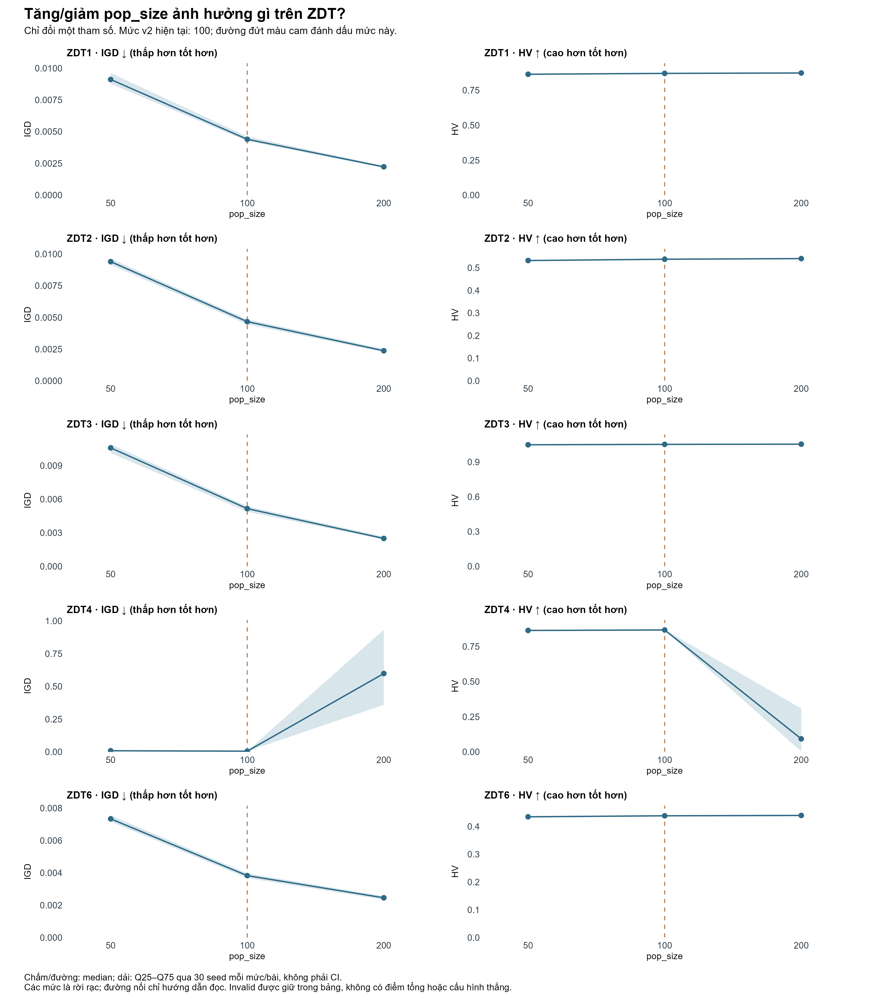
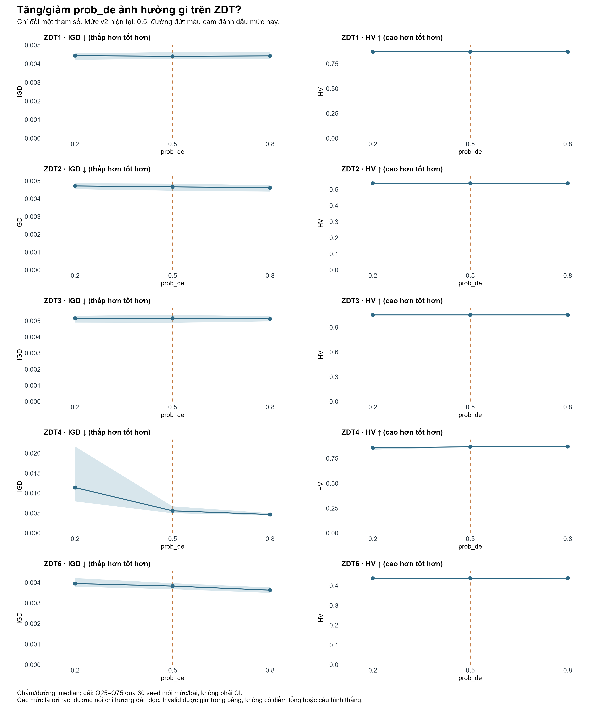
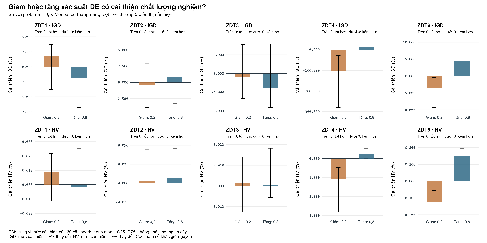
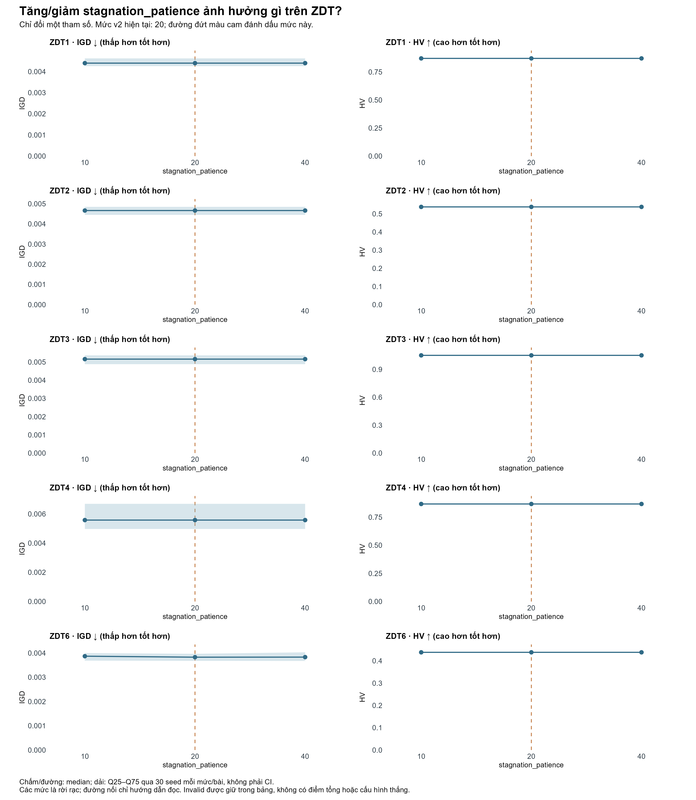
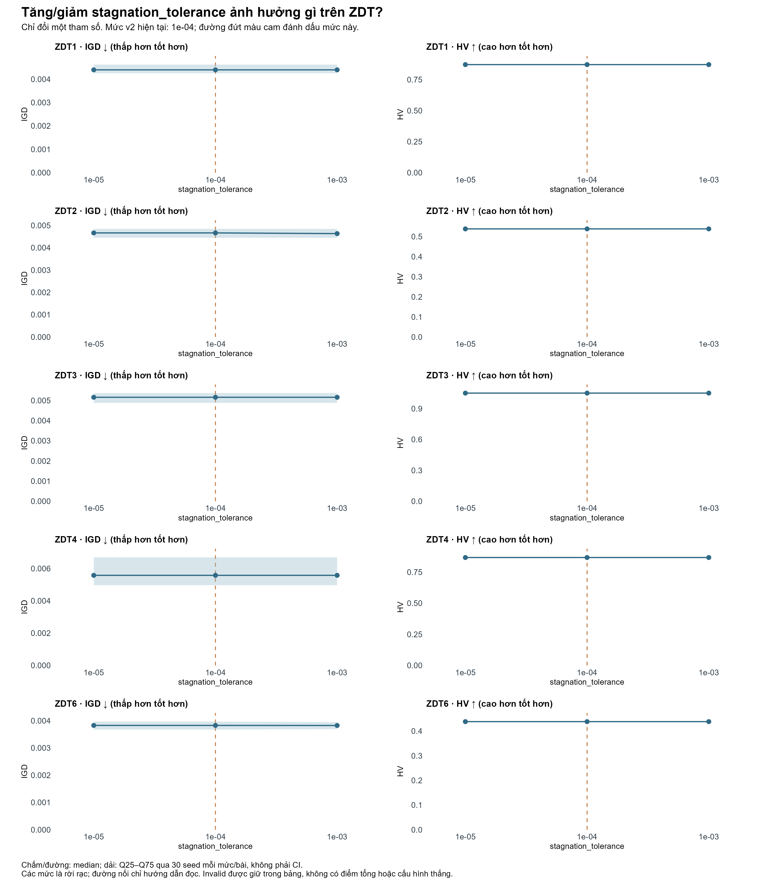
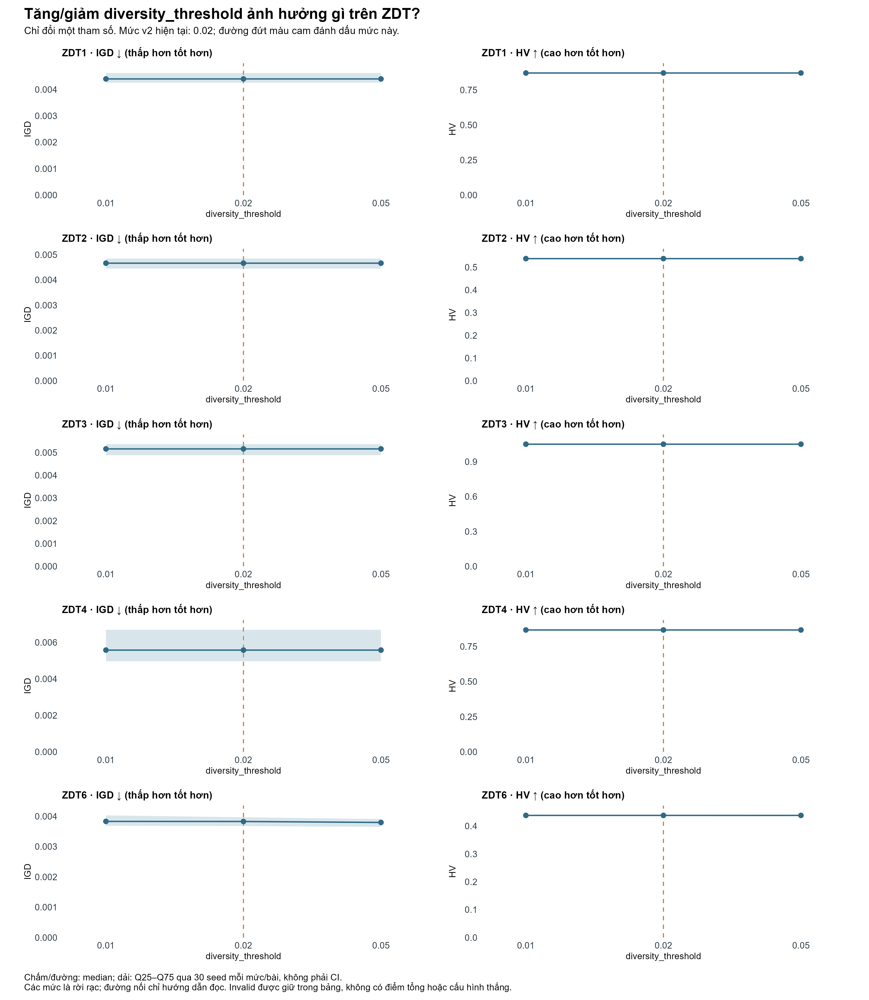
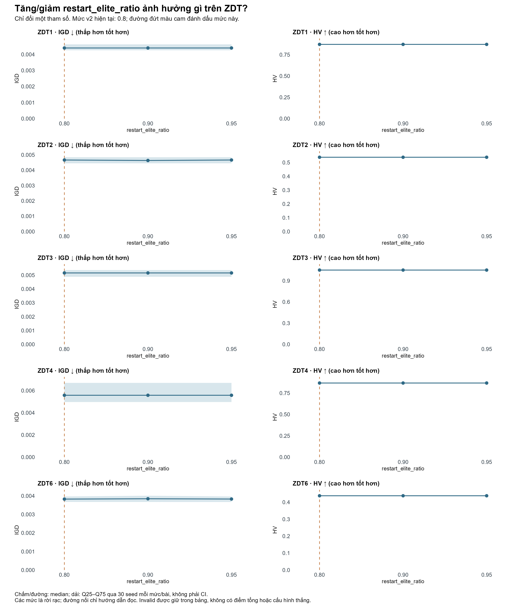
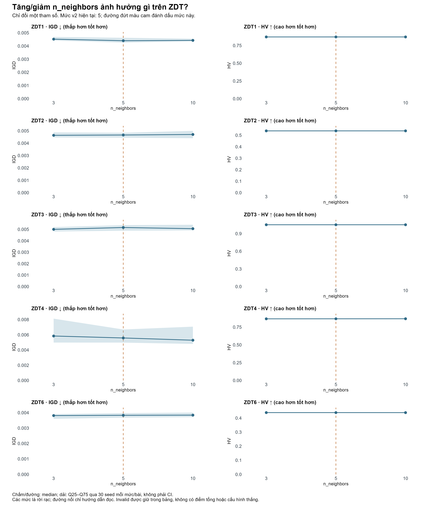
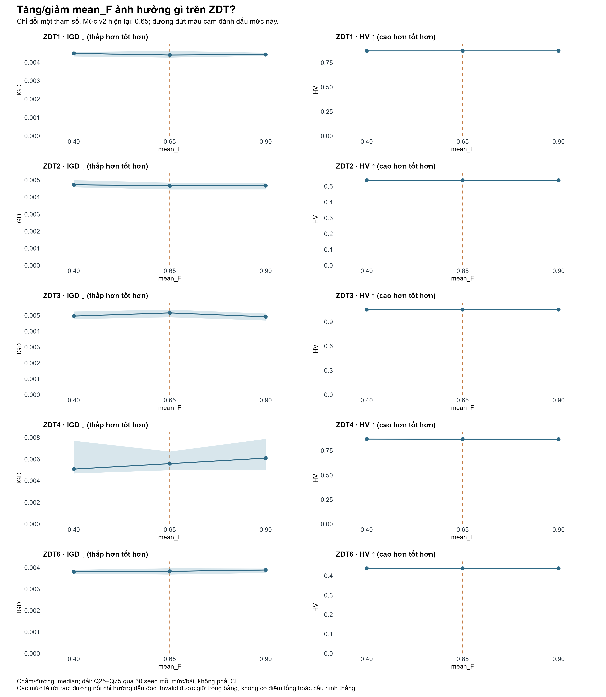
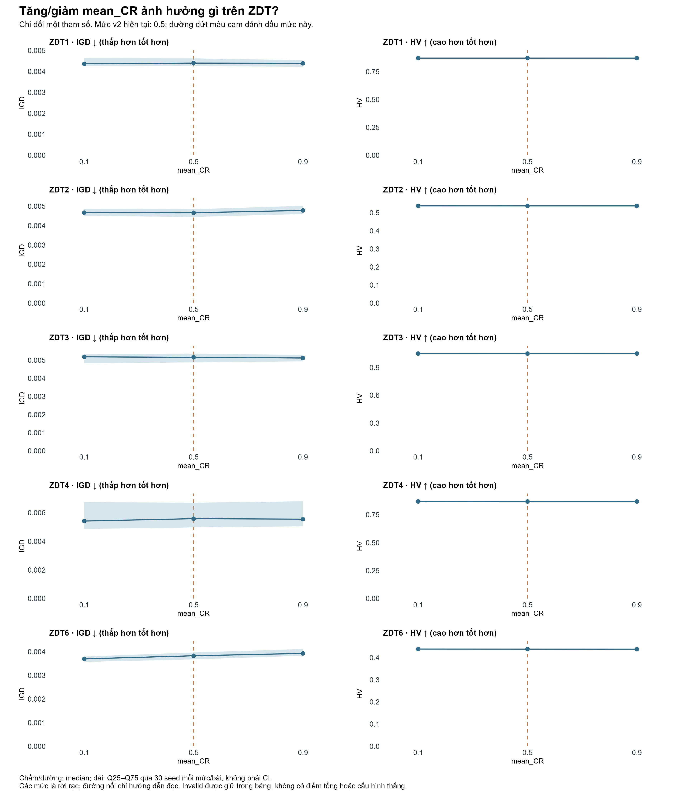

# Độ nhạy tham số OADE-NSGA-II v2 trên ZDT

## Tóm tắt kết quả

Ở ngân sách tối đa 20.000 lần đánh giá hàm mục tiêu, ảnh hưởng của kích thước quần thể khác nhau giữa các bài toán. Mức 200 giảm median IGD khoảng 36–52% ở ZDT1/2/3/6, nhưng làm ZDT4 tăng IGD từ 0,00558 lên 0,59848 và giảm HV từ 0,86722 xuống 0,09286. Trong khi đó, tăng xác suất DE khởi tạo từ 0,5 lên 0,8 cải thiện cả hai median ở ZDT2/3/4/6, rõ nhất trên ZDT4. Kết quả này xác định mức 0,8 là ứng viên cho thí nghiệm xác nhận; chưa xác lập cấu hình tối ưu.

Các tham số restart có ảnh hưởng nhỏ đến median chất lượng trong phần lớn điều kiện đã đo. Điều này đi cùng việc restart không xảy ra trên ZDT1/3/4. Phạm vi bằng chứng về ảnh hưởng của các tham số restart vì vậy chủ yếu tập trung ở ZDT2 và ZDT6.

## 1. Thiết kế thực nghiệm và dữ liệu

Đợt `zdt_sensitivity_ofat_v1` có **2.850/2.850 lượt chạy hoàn tất, 2.850 output hợp lệ, không loại lượt nào**. Có 19 cấu hình duy nhất, mỗi cấu hình chạy 30 seed từ 6000 đến 6029 trên ZDT1/2/3/4/6. ZDT1/2/3 dùng 30 biến; ZDT4/6 dùng 10 biến. Baseline chỉ chạy 150 lượt rồi được dùng chung trong các bảng tham số; không tính các lần tham chiếu lại thành lượt chạy độc lập.

Phương pháp OFAT (one factor at a time) giữ nguyên cấu hình hiện tại và chỉ đổi một tham số mỗi lần. Các mức được khảo sát độc lập quanh cấu hình tham chiếu; thí nghiệm không đánh giá tương tác giữa các tham số. Số lượt là `(1 + 9 × 2) × 5 × 30 = 2.850`.

| Tham số | Mốc hiện tại | Danh sách đã thử |
|---|---:|---|
| `pop_size` | 100 | 50, 100, 200 |
| `stagnation_patience` | 20 | 10, 20, 40 |
| `stagnation_tolerance` | 0,0001 | 0,00001; 0,0001; 0,001 |
| `diversity_threshold` | 0,02 | 0,01; 0,02; 0,05 |
| `restart_elite_ratio` | 0,8 | 0,8; 0,9; 0,95 |
| `prob_de` | 0,5 | 0,2; 0,5; 0,8 |
| `n_neighbors` | 5 | 3, 5, 10 |
| `mean_F` | 0,65 | 0,4; 0,65; 0,9 |
| `mean_CR` | 0,5 | 0,1; 0,5; 0,9 |

Restart dùng chế độ `adaptive`. F, CR và xác suất DE là **giá trị khởi tạo**, có thể được cập nhật trong quá trình chạy. Đợt chạy dùng 8 worker, các biến giới hạn thread BLAS/OpenMP bằng 1.

Ngân sách là **cap 20.000**, không phải mọi lượt đều dùng đúng 20.000 evaluation. Số thực tế từ 19.801 đến 20.000 (ít nhất 99,005% cap); pipeline không vượt ngân sách. Khi population thay đổi, số thế hệ và độ phân giải tập nghiệm cũng thay đổi. Do đó, lợi ích IGD của population lớn không thể được quy hoàn toàn cho tốc độ hội tụ.

## 2. Tổng hợp chỉ số

Chất lượng nghiệm được đánh giá bằng IGD và HV; giá trị IGD thấp hơn và HV cao hơn tương ứng với chất lượng tốt hơn theo từng chỉ số. Mỗi bài sử dụng front tham chiếu và điểm tham chiếu HV cố định giữa các cấu hình. Các kết quả được tổng hợp bằng trung vị và khoảng tứ phân vị Q25–Q75 qua 30 seed. Chênh lệch tương đối được tính bằng `100 × (median mức thử − median tham chiếu) / |median tham chiếu|` trên cùng tập seed.

Các hình 1–2 và 4–10 trình bày trung vị IGD/HV theo mức tham số; vùng tô biểu diễn Q25–Q75, đường đứt màu cam đánh dấu mức tham chiếu. Thang đo trục y được xác định riêng cho từng ô. Các mức tham số là rời rạc; đường nối chỉ liên kết các mức đã khảo sát. Hình 3 tổng hợp mức cải thiện từng cặp seed với quy ước dương là cải thiện cho cả IGD và HV: đảo dấu tỷ lệ thay đổi IGD và giữ nguyên dấu tỷ lệ thay đổi HV. Phân tích có tính mô tả, không thực hiện kiểm định giả thuyết hoặc kiểm định tương đương.

## 3. Kết quả độ nhạy tham số

### 3.1. Kích thước quần thể (`pop_size`)

| Bài | IGD ở 100 | IGD ở 50 | Δ IGD khi giảm xuống 50 | IGD ở 200 | Δ IGD khi tăng lên 200 | Δ HV ở 200 |
|---|---:|---:|---:|---:|---:|---:|
| ZDT1 | 0,004397 | 0,009106 | +107,10% | 0,002229 | −49,30% | +0,328% |
| ZDT2 | 0,004665 | 0,009403 | +101,57% | 0,002367 | −49,26% | +0,533% |
| ZDT3 | 0,005160 | 0,010592 | +105,29% | 0,002493 | −51,68% | +0,155% |
| ZDT4 | 0,005583 | 0,008895 | +59,34% | 0,598477 | +10.620,48% | −89,293% |
| ZDT6 | 0,003828 | 0,007340 | +91,78% | 0,002456 | −35,84% | +0,279% |

Giảm population từ 100 xuống 50 làm xấu cả median IGD và median HV trên cả năm bài. Tăng lên 200 cho chiều ngược lại trên bốn bài, nhưng ZDT4 là ngoại lệ quyết định: IGD tăng khoảng **107,2 lần** so với mốc; IQR của IGD ở mức 200 là 0,35925–0,93250. Có 8/30 lượt ZDT4 ở population 200 có HV bằng 0. Các output này hợp lệ về cấu trúc nhưng có HV bằng 0 đối với điểm tham chiếu đã sử dụng; cả 30 lượt được giữ trong tổng hợp.

Không có restart trên ZDT4 ở các mức population đã thử. Ở cap cố định, quần thể lớn có thể giảm số thế hệ cập nhật; đây là cách giải thích cần kiểm tra bằng đường hội tụ hoặc ngân sách bổ sung, chưa phải nguyên nhân đã được chứng minh. Trong ba mức khảo sát, population 100 tránh được suy giảm lớn trên ZDT4 ghi nhận ở mức 200 và có cả hai median tốt hơn mức 50 trên cả năm bài.

**Hình 1. Ảnh hưởng population lên từng bài ZDT.** Trung vị IGD và HV qua 30 seed ở từng mức tham số; vùng tô biểu diễn Q25–Q75, đường cam là mức tham chiếu.

### 3.2. Xác suất DE khởi tạo (`prob_de`)

| Bài | Δ IGD ở 0,2 | Δ HV ở 0,2 | Δ IGD ở 0,8 | Δ HV ở 0,8 |
|---|---:|---:|---:|---:|
| ZDT1 | +0,863% | +0,002% | +0,547% | −0,002% |
| ZDT2 | +1,101% | +0,020% | −1,131% | +0,009% |
| ZDT3 | −0,066% | −0,000111% | −0,742% | +0,009% |
| ZDT4 | +104,271% | −1,194% | −16,524% | +0,243% |
| ZDT6 | +3,238% | −0,141% | −5,199% | +0,116% |

ZDT4 phản ứng rõ nhất: hạ `prob_de` từ 0,5 xuống 0,2 làm IGD tăng từ 0,00558 lên 0,01140; nâng lên 0,8 làm IGD giảm xuống 0,00466. IQR tương ứng là 0,00795–0,02168 ở mức 0,2 và 0,00450–0,00500 ở mức 0,8. Với ZDT6, mức 0,8 cũng cải thiện cả hai median. ZDT1 lại xấu đi nhẹ ở cả hai chỉ số khi tăng lên 0,8.

Mức `prob_de=0.8` có chênh lệch median thuận lợi trên ZDT2/3/4/6, với mức thay đổi lớn nhất trên ZDT4/6. Kết quả chưa bao gồm DTLZ/WFG hoặc các tổ hợp với population, F và CR khác.

**Hình 2. Ảnh hưởng xác suất DE khởi tạo.** Trung vị IGD và HV qua 30 seed ở từng mức tham số; vùng tô biểu diễn Q25–Q75, đường cam là mức tham chiếu.

Phân tích ghép cặp theo seed cho thấy ảnh hưởng của `prob_de=0.8` trên ZDT4/6 nhất quán về hướng giữa hai cách tổng hợp. Trên ZDT4 ở mức 0,8, median thay đổi IGD là −15,22% (IQR −28,72% đến −2,92%) và HV là +0,228% (IQR +0,017% đến +0,544%). Trên ZDT6, hai giá trị tương ứng là −4,38% và +0,151%. Đây là bằng chứng mô tả bổ sung cho hướng cải thiện trên hai bài này.

Trên ZDT3 ở mức 0,8, tỷ lệ thay đổi của hai median IGD là −0,742%, nhưng median tỷ lệ thay đổi từng seed lại là +3,134%, với IQR đi qua 0. Sự đổi dấu giữa hai thống kê giới hạn kết luận cải thiện trên ZDT3: chênh lệch median tổng thể không đại diện cho hướng thay đổi điển hình của các cặp seed.

**Hình 3. Mức cải thiện IGD và HV khi thay đổi xác suất DE so với mức 0,5.** Mỗi ô biểu diễn một bài toán và một chỉ số; cột cam là mức 0,2, cột xanh là mức 0,8. Giá trị dương biểu thị cải thiện, giá trị âm biểu thị suy giảm. Chiều cao cột là trung vị qua 30 cặp seed; thanh mảnh là Q25–Q75, không phải khoảng tin cậy. Với IGD, mức cải thiện bằng âm tỷ lệ thay đổi; với HV, mức cải thiện bằng tỷ lệ thay đổi. Các ô sử dụng thang đo riêng.

### 3.3. Các tham số restart

Baseline có tổng cộng 0, 1, 0, 0 và 6 restart hoàn tất trên ZDT1/2/3/4/6; đây là tổng qua 30 lượt mỗi bài. Trên ZDT6, 6 restart nằm trong 4/30 lượt. Số lần restart được tổng hợp theo lượt chạy, không được sử dụng làm số lần lặp độc lập.

| Thay đổi | Tổng restart trên ZDT6 | Δ IGD median ZDT6 | Δ HV median ZDT6 |
|---|---:|---:|---:|
| Mốc hiện tại | 6 | 0% | 0% |
| Patience 20 → 10 | 25 | +1,064% | −0,0086% |
| Patience 20 → 40 | 1 | +0,079% | 0% |
| Tolerance 0,0001 → 0,00001 | 7 | 0% | 0% |
| Tolerance 0,0001 → 0,001 | 16 | −0,069% | 0% |
| Diversity 0,02 → 0,01 | 0 | +0,079% | −0,0020% |
| Diversity 0,02 → 0,05 | 78 | −0,834% | −0,0154% |
| Elite 0,8 → 0,9 | 7 | +0,470% | 0% |
| Elite 0,8 → 0,95 | 6 | +0,079% | 0% |

#### 3.3.1. Ngưỡng chờ đình trệ (`stagnation_patience`)

Giảm ngưỡng chờ từ 20 xuống 10 làm tăng số restart trên ZDT6 nhưng không cải thiện hai median. Tăng lên 40 giảm restart còn một lần, median gần mốc. ZDT1/3/4 có IGD và HV khớp chính xác với baseline ở từng seed cho cả hai mức thử.

**Hình 4. Kết quả stagnation_patience.** Trung vị IGD và HV qua 30 seed ở từng mức tham số; vùng tô biểu diễn Q25–Q75, đường cam là mức tham chiếu.

#### 3.3.2. Dung sai đình trệ (`stagnation_tolerance`)

Tăng dung sai lên 0,001 làm ZDT2 có 4 restart thay vì 1 và giảm median IGD 0,669%. Trên ZDT6, tác động median nhỏ, dù số restart thay đổi. Ở mức 0,00001, median ZDT6 bằng mốc nhưng có một cặp seed thay đổi IGD/HV; 29/30 cặp còn lại khớp chính xác.

**Hình 5. Kết quả stagnation_tolerance.** Trung vị IGD và HV qua 30 seed ở từng mức tham số; vùng tô biểu diễn Q25–Q75, đường cam là mức tham chiếu.

#### 3.3.3. Ngưỡng đa dạng (`diversity_threshold`)

Tăng ngưỡng đa dạng lên 0,05 làm ZDT6 có restart trong 26/30 lượt, tổng 78 lần. IGD giảm nhẹ nhưng HV cũng giảm, nên không có cải thiện đồng thời hai median. Hạ xuống 0,01 loại restart trên ZDT6 nhưng chất lượng median vẫn gần mốc. Đây là bằng chứng rõ rằng ngưỡng có điều khiển hành vi restart trong đợt này, nhưng nhiều restart hơn không tự động cho kết quả tốt hơn.

**Hình 6. Kết quả diversity_threshold.** Trung vị IGD và HV qua 30 seed ở từng mức tham số; vùng tô biểu diễn Q25–Q75, đường cam là mức tham chiếu.

#### 3.3.4. Tỷ lệ giữ elite (`restart_elite_ratio`)

Tỷ lệ giữ elite được khảo sát ở ba mức 0,8; 0,9 và 0,95. Mức tham chiếu 0,8 trùng với giới hạn dưới của adaptive kernel. ZDT1/3/4 không restart nên thay mức giữ elite không làm đổi hai chỉ số theo seed. Trên ZDT2/6, tác động median nhỏ và không nhất quán.

**Hình 7. Kết quả restart_elite_ratio.** Trung vị IGD và HV qua 30 seed ở từng mức tham số; vùng tô biểu diễn Q25–Q75, đường cam là mức tham chiếu.

### 3.4. Số lân cận (`n_neighbors`)

Khi `n_neighbors` thay đổi từ 5 sang 3 hoặc 10, chênh lệch median IGD nằm khoảng −5,27% đến +4,62% trong các so sánh đã chạy. Trên ZDT4, mức 10 cải thiện cả median IGD (−5,27%) và HV (+0,064%), còn mức 3 làm xấu cả hai. Trên ZDT3, mức 3 lại cải thiện cả hai. Hướng thay đổi khác nhau giữa các bài; không ghi nhận một mức thay thế cải thiện đồng thời cả hai median trên toàn bộ năm bài toán.

| Bài | Δ IGD ở 3 | Δ HV ở 3 | Δ IGD ở 10 | Δ HV ở 10 |
|---|---:|---:|---:|---:|
| ZDT1 | +2,716% | −0,010% | +0,603% | −0,012% |
| ZDT2 | −0,540% | −0,008% | +0,904% | +0,004% |
| ZDT3 | −3,080% | +0,014% | −1,974% | +0,011% |
| ZDT4 | +4,619% | −0,059% | −5,267% | +0,064% |
| ZDT6 | −0,467% | +0,004% | +0,285% | −0,040% |

**Hình 8. Kết quả n_neighbors.** Trung vị IGD và HV qua 30 seed ở từng mức tham số; vùng tô biểu diễn Q25–Q75, đường cam là mức tham chiếu.

### 3.5. Hệ số khuếch đại DE khởi tạo (`mean_F`)

Giảm `mean_F` từ 0,65 xuống 0,4 cải thiện ZDT3/4 ở cả hai median; ZDT4 giảm IGD 9,06% và tăng HV 0,110%. Tuy nhiên, ZDT1 xấu đi ở cả hai. Tăng F lên 0,9 cải thiện ZDT3 nhưng làm xấu ZDT4/6 ở cả hai median. Lợi ích của F = 0,4 tập trung ở ZDT3/4; ảnh hưởng khi kết hợp với `prob_de=0.8` chưa được đo.

| Bài | Δ IGD ở 0,4 | Δ HV ở 0,4 | Δ IGD ở 0,9 | Δ HV ở 0,9 |
|---|---:|---:|---:|---:|
| ZDT1 | +1,957% | −0,005% | +0,532% | −0,000316% |
| ZDT2 | +1,330% | +0,009% | +0,184% | +0,007% |
| ZDT3 | −3,910% | +0,012% | −4,764% | +0,011% |
| ZDT4 | −9,060% | +0,110% | +9,157% | −0,071% |
| ZDT6 | −0,469% | −0,027% | +1,619% | −0,004% |

**Hình 9. Kết quả mean_F.** Trung vị IGD và HV qua 30 seed ở từng mức tham số; vùng tô biểu diễn Q25–Q75, đường cam là mức tham chiếu.

### 3.6. Xác suất lai ghép DE khởi tạo (`mean_CR`)

Giảm `mean_CR` từ 0,5 xuống 0,1 cải thiện ZDT4/6 ở cả hai median; ZDT6 giảm IGD 3,43% và tăng HV 0,067%. Tăng CR lên 0,9 lại làm xấu ZDT2/6 ở cả hai median. Các bài còn lại có thay đổi nhỏ hoặc hai chỉ số khác chiều. Chưa có một mức CR ưu thế đồng thời trên toàn bộ ZDT.

| Bài | Δ IGD ở 0,1 | Δ HV ở 0,1 | Δ IGD ở 0,9 | Δ HV ở 0,9 |
|---|---:|---:|---:|---:|
| ZDT1 | −0,851% | −0,000275% | −0,212% | −0,009% |
| ZDT2 | +0,092% | +0,021% | +2,578% | −0,015% |
| ZDT3 | +0,522% | +0,006% | −0,721% | +0,006% |
| ZDT4 | −2,975% | +0,050% | −0,601% | +0,011% |
| ZDT6 | −3,426% | +0,067% | +2,608% | −0,075% |

**Hình 10. Kết quả mean_CR.** Trung vị IGD và HV qua 30 seed ở từng mức tham số; vùng tô biểu diễn Q25–Q75, đường cam là mức tham chiếu.

## 4. Thời gian thực thi và giới hạn đo lường

Các run được thực hiện song song và thứ tự cấu hình không được hoán đổi cân bằng theo thời gian. Thời gian median có chênh lệch lớn ngay cả khi chất lượng theo seed khớp chính xác. Ví dụ ZDT4 với patience 40 có 30/30 cặp IGD/HV bằng baseline và đều không restart, nhưng thời gian median thấp hơn khoảng 69,10%. Ngược lại patience 10 cho cùng chất lượng ở 30/30 seed ZDT1 nhưng thời gian cao hơn khoảng 137,50%.

Các chênh lệch thời gian chưa tách được ảnh hưởng của cấu hình khỏi điều kiện thực thi. Runtime được giữ làm số đo quan sát, không dùng để suy luận ưu thế tốc độ của tham số. Đợt đo không thu telemetry tải hệ thống, do đó chưa xác định nguyên nhân cụ thể của biến động thời gian.

## 5. Thảo luận và kết luận

| Nhóm | Kết luận trong phạm vi thí nghiệm |
|---|---|
| Population | Mức 100 có kết quả cân bằng hơn trên năm bài; mức 50 làm xấu cả hai median ở mọi bài, mức 200 suy giảm nghiêm trọng trên ZDT4 |
| Xác suất DE | Mức 0,8 là ứng viên xác nhận, với cải thiện rõ nhất trên ZDT4/6 |
| Restart | Chưa xác lập mức ưu thế về chất lượng; cơ chế không kích hoạt trên ZDT1/3/4 |
| Neighborhood/F/CR | Không có mức thay thế cải thiện đồng thời cả hai median trên toàn bộ năm bài |

Thí nghiệm xác định population và xác suất DE khởi tạo là các tham số có ảnh hưởng nổi bật trong những mức khảo sát, đặc biệt trên ZDT4. Các tham số restart chủ yếu làm thay đổi hành vi trên ZDT6 trong khi mức thay đổi median chất lượng nhỏ. Những kết luận này giới hạn ở năm bài ZDT, 30 seed và ngân sách hiện tại. Thiết kế OFAT không ước lượng tương tác tham số; việc lựa chọn dựa trên chính dữ liệu này cần được xác nhận trên seed độc lập. Chưa có bằng chứng từ đợt đo này để ngoại suy sang DTLZ/WFG hoặc xác lập cấu hình tối ưu toàn cục.

## 6. Dữ liệu nguồn

- [Bằng chứng gốc được đóng gói](../../results/experiments/zdt_sensitivity_ofat_v1/evidence.zip) và [checksum gói dữ liệu](../../results/experiments/zdt_sensitivity_ofat_v1/evidence_archive.json): 2.850 bản ghi, cấu hình và manifest; checkpoint rời được giữ cục bộ để resume.
- [Bảng chi tiết kèm đủ chín biểu đồ](../../results/experiments/zdt_sensitivity_ofat_v1/derived/report.md).
- [Summary: mean, SD, median và IQR (ZIP)](../../results/experiments/zdt_sensitivity_ofat_v1/derived/csv_results.zip).
- [Chênh lệch median so với mốc (ZIP)](../../results/experiments/zdt_sensitivity_ofat_v1/derived/csv_results.zip).
- [Chênh lệch từng seed (ZIP)](../../results/experiments/zdt_sensitivity_ofat_v1/derived/csv_results.zip).
- [Đếm khớp chỉ số, restart và HV bằng 0 (ZIP)](../../results/experiments/zdt_sensitivity_ofat_v1/derived/csv_results.zip).
- [Số liệu nguồn của hình chênh lệch DE theo seed (ZIP)](../../results/experiments/zdt_sensitivity_ofat_v1/derived/csv_results.zip).
- [Kiểm tra toàn vẹn và tái tính bảng](../../results/experiments/zdt_sensitivity_ofat_v1/derived/analysis_audit.json).
- [Protocol và lệnh chạy](../protocols/zdt_sensitivity.md).

Checksum của 2.850 bản ghi gốc và front tham chiếu đã được kiểm tra. Các bảng tổng hợp được tính lại từ dữ liệu gốc và khớp với bảng xuất. Biểu đồ được tạo bằng R, xuất ở định dạng PNG 300 dpi, PDF và SVG; kết quả kiểm tra căn panel, cỡ chữ và chồng lấn được lưu cùng bộ hình.
