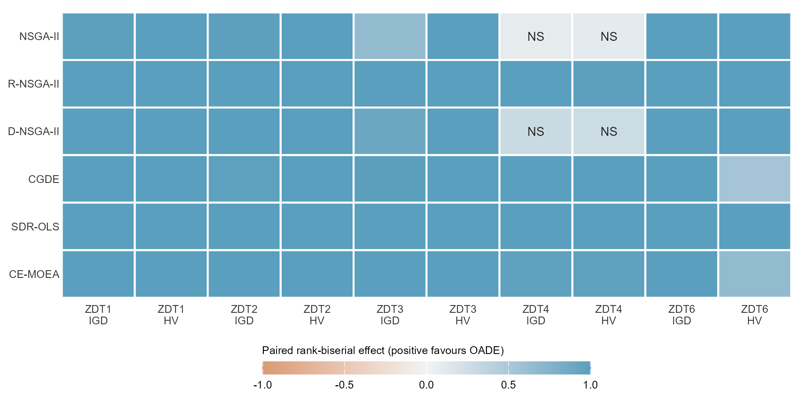
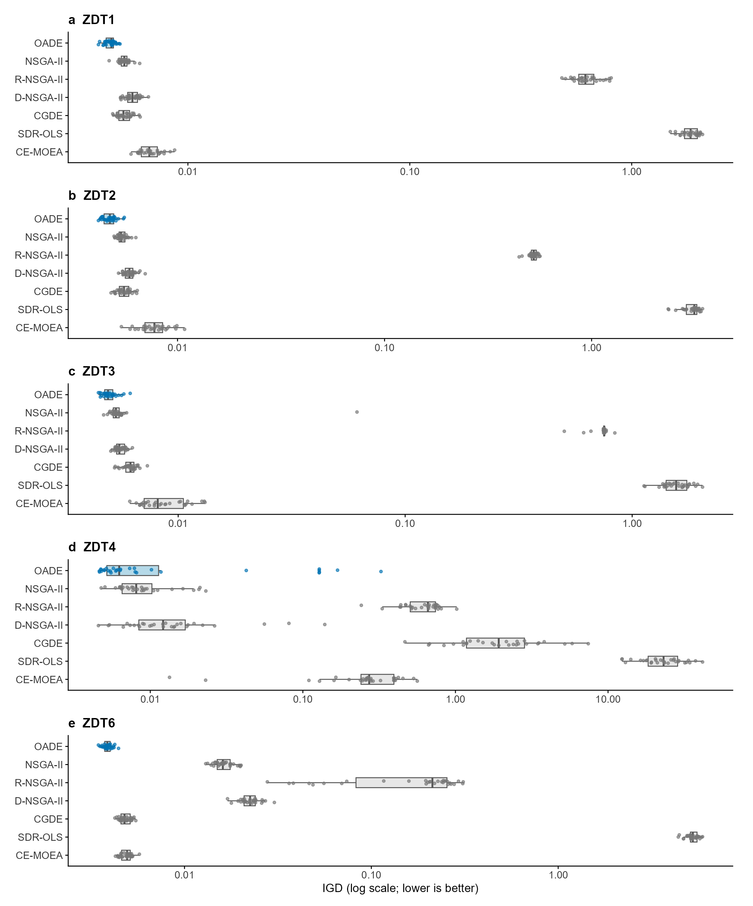
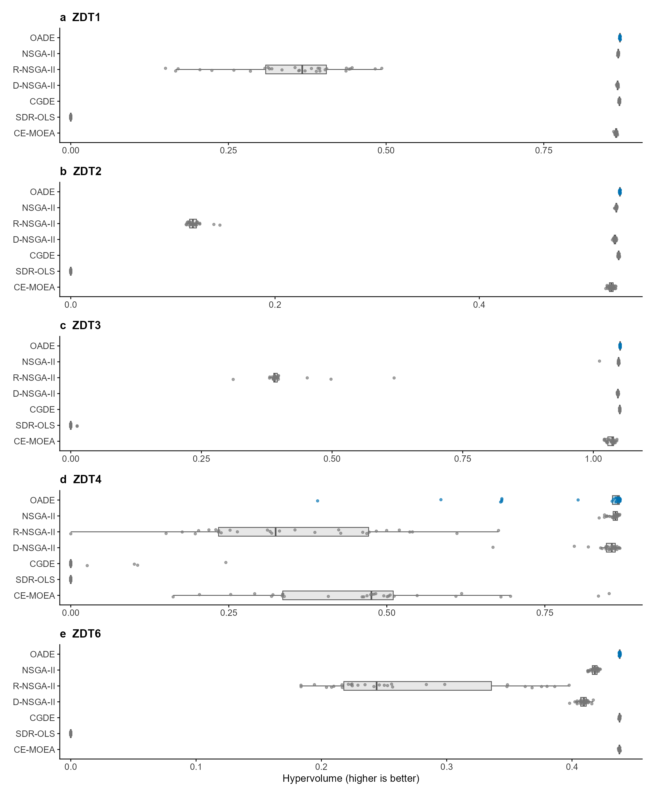
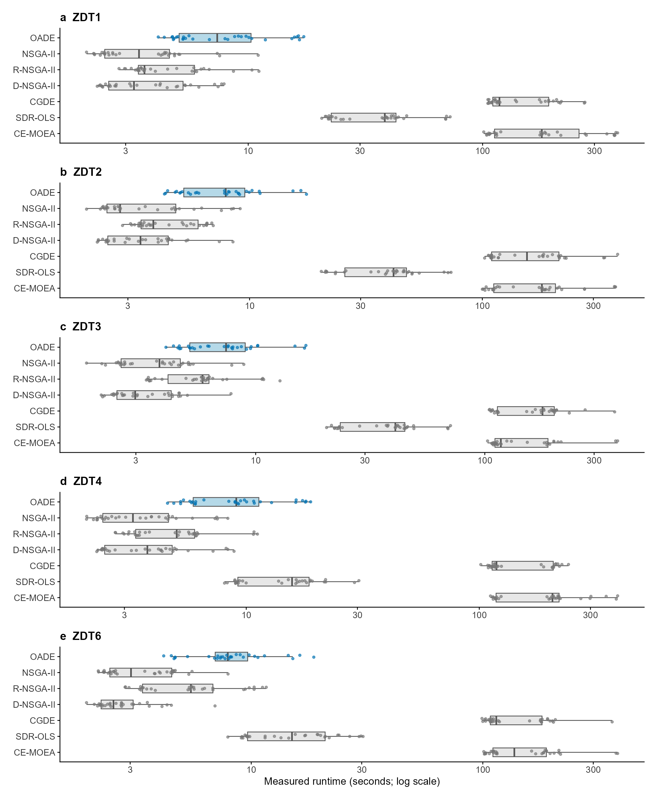
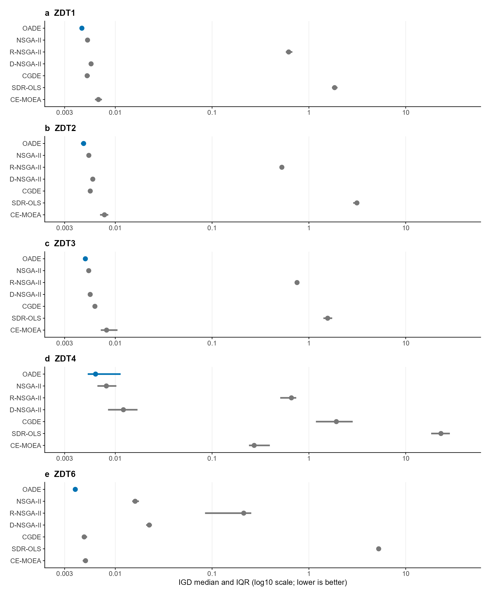
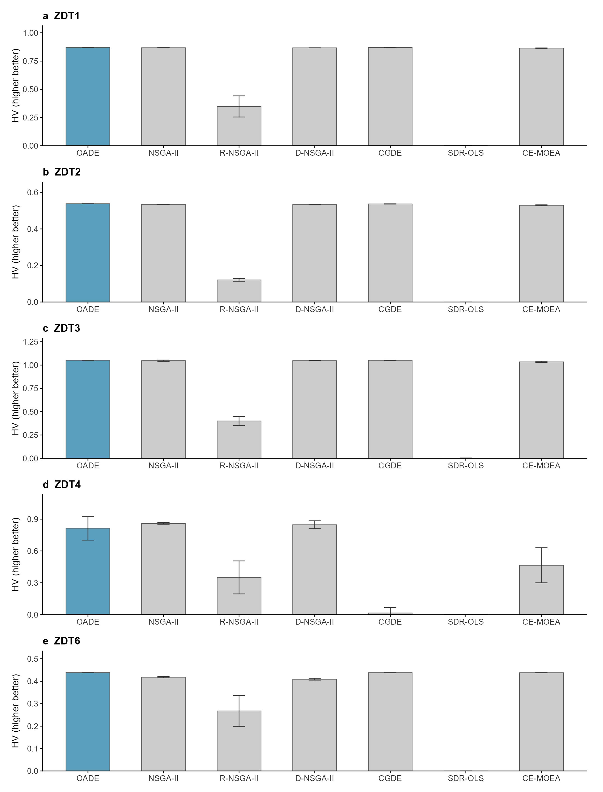
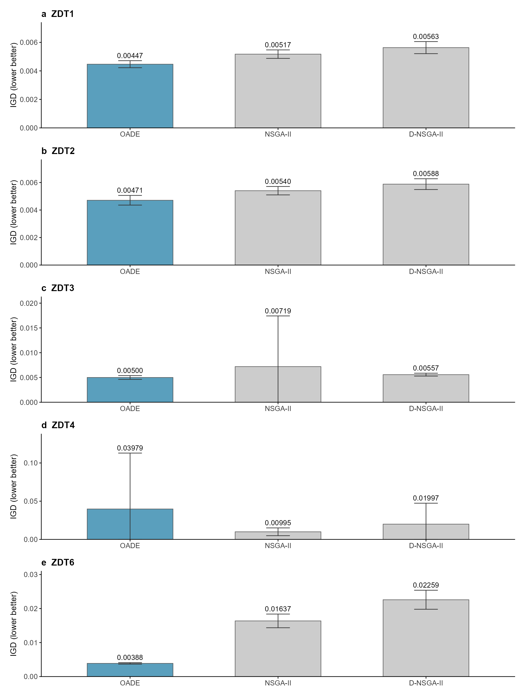
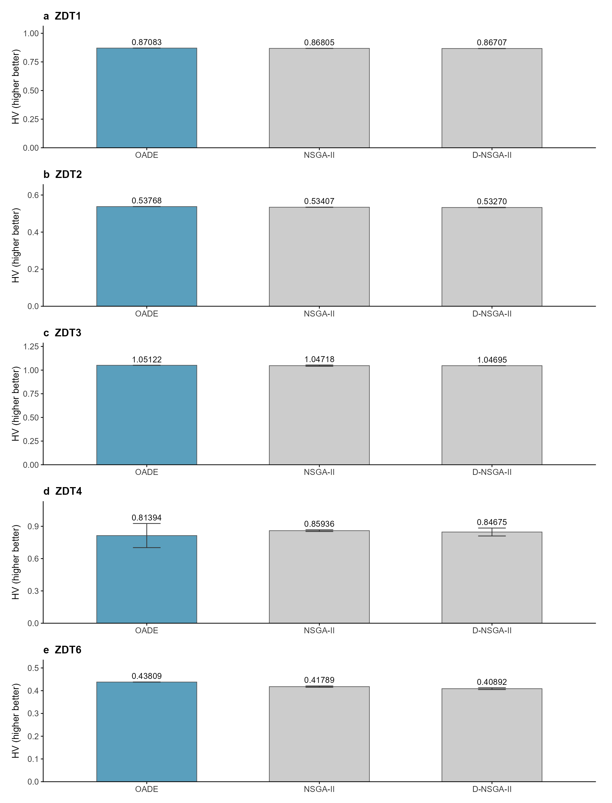

# Đối chứng 7 thuật toán trên ZDT — baseline mới và OADE thống nhất

**Ngày kiểm tra: 15/11/2026.** Bộ dữ liệu: [zdt_seven_fixed_oade_v2](../../results/experiments/zdt_seven_fixed_oade_v2/). Chỉ phân tích lại bằng chứng đã chạy; không chạy lại thuật toán tối ưu.

## Kết quả chính

Đủ **1.050/1.050 run**, gồm **1.049 hợp lệ** và **1 collapsed front**. OADE tốt hơn ở **56/60 endpoint** sau Holm chung 60 kiểm định; 4 endpoint chưa phát hiện khác biệt là IGD/HV trên ZDT4 khi so với NSGA2 và DNSGA2. Không có endpoint nào kết luận baseline tốt hơn OADE theo kiểm định đã định. Đây là số endpoint, không phải 60 thí nghiệm độc lập hay bằng chứng vượt mọi thuật toán.

OADE tốt hơn tất cả sáu đối chứng trên cả IGD/HV ở ZDT1, ZDT2, ZDT3 và ZDT6. Trên ZDT4, OADE tốt hơn RNSGA2, CGDE, SDR-OLS và CE theo chỉ số toàn front, nhưng chưa đủ bằng chứng hơn NSGA2/DNSGA2. Độ ổn định ZDT4 là giới hạn nổi bật.

## Xác minh dữ liệu và cấu hình

- Đã đối chiếu 1050 checksum primary JSON, 106 hash source/dependency với checkout hiện tại; reference snapshot khớp manifest. Không sửa primary hoặc manifest.
- Mỗi block bài/thuật toán đủ 30 seed 42–71; không trùng/mất task; uniform input được tái tạo và hash khớp cho từng seed giữa bảy thuật toán.
- OADE runner `local_oade`, params rỗng, cấu hình uniform + adaptive restart + OBL định kỳ + success_rate. Baseline revision `paper_corrections_2026_11_14`; CGDE dùng NCG/PCG, SDR-OLS bỏ cap 2N, CE dùng PM theo biểu thức công bố.
- Đánh giá lại mọi final X bằng hàm ZDT; sai số X→F lớn nhất bằng 0. Kiểm tra bounds, hữu hạn, kích thước và tính không bị trội; IGD/HV của 1.049 run hợp lệ tính lại khớp tuyệt đối giá trị lưu.
- Tái tính độc lập 35 dòng summary và 60 Wilcoxon/effect/Holm; khớp bảng pipeline. Lần tạo lại báo cáo ban đầu bị từ chối vì thiếu biến thread; khi đặt lại cả OMP/OPENBLAS/MKL=1 đúng manifest, bước report/resume qua. Không bỏ qua kiểm tra môi trường.
- Tổng FE thực: **20,979,322**; mọi run trong cap 20.000. OADE dùng 19.901–20.000; DNSGA2 dùng 19.910; các solver còn lại dùng 20.000.
- Manifest SHA-256: `c4d6fe07c668b1866b68b944b74067161475a3aee90990793a82dd63686f5f4c`.

Python 3.14.7; NumPy 2.5.4; SciPy 1.18.1; pymoo 0.6.2; PyYAML 6.0.3. Bốn worker, ba thư viện thread đặt 1. Hash xác minh tính nhất quán của artifact và mã lưu; không thay thế đối chứng với mã tác giả.

## OADE so với NSGA2

Dùng median riêng từng nhóm để tính phần trăm; số này khác median của chênh lệch theo cặp. IGD giảm tốt, HV tăng tốt. p là Holm chung 60 endpoint.

| Bài | IGD OADE / NSGA2 | IGD giảm (%) | p Holm IGD | HV tăng (%) | p Holm HV |
|---|---:|---:|---:|---:|---:|
| ZDT1 | **0.004519999** / 0.005171058 | 12.59 | 1.210719e-07 | 0.309 | 1.117587e-07 |
| ZDT2 | **0.004711178** / 0.005331691 | 11.64 | 1.564622e-07 | 0.650 | 1.117587e-07 |
| ZDT3 | **0.004909953** / 0.005319162 | 7.69 | 0.008043621 | 0.276 | 1.117587e-07 |
| ZDT4 | **0.006259326** / 0.008090377 | 22.63 | 1 | 0.440 | 1 |
| ZDT6 | **0.003862438** / 0.01604212 | 75.92 | 1.117587e-07 | 4.735 | 1.117587e-07 |

## Phân bố kết quả đủ bảy thuật toán

IGD/HV được tách thành hai bảng, mỗi hàng một bài toán và mỗi cột một thuật toán; ô là mean (best run), chỉ dùng run hợp lệ. Bỏ cột Valid và Runtime; số liệu đầy đủ giữ trong CSV nguồn. Best run là IGD min hoặc HV max trong 30 lượt, riêng CGDE ZDT4 có 29 lượt hợp lệ; hai cực trị không nhất thiết cùng seed. Không hiển thị SD bên cạnh trong bảng, vẫn giữ trong CSV nguồn. Số rút gọn 4 chữ số có nghĩa dạng `4.47e-3`; đồng hạng xét trước làm tròn. Runtime median là thời gian đo trong lần chạy bốn worker; không phải so sánh tốc độ thuật toán thuần túy vì triển khai/thư viện khác nhau.

In đậm giá trị trung tâm và best-run tốt nhất riêng trong cùng bài và cột: IGD nhỏ nhất, HV lớn nhất; giữ đồng hạng. Trong ô OADE / NSGA2, in đậm IGD nhỏ hơn. Đây là nhấn mạnh số học, không thay thế kiểm định; CI và p-value không được coi là các giá trị cần tối ưu.

### Bảng 1. Giá trị IGD

| Bài toán | NSGA-II | R-NSGA-II | D-NSGA-II | CGDE | SDR-OLS | CE-MOEA | OADE-NSGA-II |
|---|---:|---:|---:|---:|---:|---:|---:|
| ZDT1 | 5.175e-3 (4.417e-3) | 6.33e-1 (4.845e-1) | 5.633e-3 (4.97e-3) | 5.202e-3 (4.584e-3) | 1.845e0 (1.493e0) | 6.8e-3 (5.543e-3) | **4.47e-3** (**3.952e-3**) |
| ZDT2 | 5.405e-3 (4.938e-3) | 5.235e-1 (4.467e-1) | 5.881e-3 (5.189e-3) | 5.539e-3 (4.774e-3) | 3.042e0 (2.344e0) | 7.8e-3 (5.356e-3) | **4.71e-3** (**4.149e-3**) |
| ZDT3 | 7.191e-3 (4.695e-3) | 7.406e-1 (5.024e-1) | 5.568e-3 (5.049e-3) | 6.126e-3 (5.246e-3) | 1.575e0 (1.128e0) | 8.813e-3 (6.121e-3) | **4.998e-3** (**4.453e-3**) |
| ZDT4 | **9.953e-3** (4.767e-3) | 6.206e-1 (2.416e-1) | 1.997e-2 (**4.574e-3**) | 2.32e0 (4.666e-1) | 2.384e1 (1.233e1) | 2.884e-1 (1.337e-2) | 3.979e-2 (4.636e-3) |
| ZDT6 | 1.637e-2 (1.299e-2) | 1.858e-1 (2.775e-2) | 2.259e-2 (1.699e-2) | 4.828e-3 (4.24e-3) | 5.257e0 (4.394e0) | 4.887e-3 (4.268e-3) | **3.881e-3** (**3.461e-3**) |

### Bảng 2. Giá trị HV

| Bài toán | NSGA-II | R-NSGA-II | D-NSGA-II | CGDE | SDR-OLS | CE-MOEA | OADE-NSGA-II |
|---|---:|---:|---:|---:|---:|---:|---:|
| ZDT1 | 8.681e-1 (8.686e-1) | 3.481e-1 (4.932e-1) | 8.671e-1 (8.683e-1) | 8.699e-1 (8.706e-1) | 0 (0) | 8.646e-1 (8.67e-1) | **8.708e-1** (**8.713e-1**) |
| ZDT2 | 5.341e-1 (5.349e-1) | 1.209e-1 (1.46e-1) | 5.327e-1 (5.345e-1) | 5.365e-1 (5.373e-1) | 0 (0) | 5.293e-1 (5.338e-1) | **5.377e-1** (**5.38e-1**) |
| ZDT3 | 1.047e0 (1.049e0) | 4.01e-1 (6.188e-1) | 1.047e0 (1.048e0) | 1.051e0 (1.051e0) | 8.119e-4 (1.219e-2) | 1.034e0 (1.045e0) | **1.051e0** (**1.052e0**) |
| ZDT4 | **8.594e-1** (8.686e-1) | 3.511e-1 (6.767e-1) | 8.467e-1 (8.688e-1) | 1.647e-2 (2.453e-1) | 0 (0) | 4.653e-1 (8.518e-1) | 8.139e-1 (**8.693e-1**) |
| ZDT6 | 4.179e-1 (4.226e-1) | 2.676e-1 (3.977e-1) | 4.089e-1 (4.17e-1) | 4.379e-1 (4.385e-1) | 0 (0) | 4.378e-1 (4.385e-1) | **4.381e-1** (**4.385e-1**) |

## ZDT4: median tốt nhưng rủi ro sai số lớn

OADE có IGD mean **0,0397899**, cao hơn NSGA2 **0,00995272** và DNSGA2 **0,0199731**, dù median thấp hơn. OADE thắng NSGA2 ở 21/30 cặp và DNSGA2 ở 22/30 cặp, nhưng những lần thua có độ lớn đáng kể. Wilcoxon xét cả độ lớn qua thứ hạng, không chỉ đếm số lần thắng. Không được bỏ các seed này để nâng kết luận.

| Seed OADE | IGD | HV |
|---|---:|---:|
| 68 | 0.325083 | 0.3904845 |
| 67 | 0.1687905 | 0.5855979 |
| 62 | 0.1282589 | 0.6815798 |
| 56 | 0.1281511 | 0.6820155 |
| 52 | 0.1280398 | 0.6819434 |
| 70 | 0.1279713 | 0.6800568 |
| 51 | **0.04257552** | **0.8026323** |

Độ bất định bổ sung: bootstrap theo cặp seed, 20.000 mẫu, seed 20261115; CI percentile 95% cho **median(OADE − baseline)**, chưa hiệu chỉnh đa kiểm định.

| Baseline | Metric | Median chênh lệch [CI 95%] | Thắng/thua | Rank-biserial | p Holm 60 |
|---|---|---:|---:|---:|---:|
| NSGA2 | IGD | -0.001658529 [-0.002507371, -0.0005697513] | 21/9 | 0.0882 | 1 |
| DNSGA2 | IGD | -0.003017286 [-0.006902325, -0.001796965] | 22/8 | 0.2860 | 0.7087708 |
| NSGA2 | HV | 0.003553813 [0.0009594229, 0.005285475] | 21/9 | 0.1011 | 1 |
| DNSGA2 | HV | 0.00613251 [0.002613459, 0.01276507] | 22/8 | 0.2731 | 0.7087708 |

CI median có thể không chứa 0 trong khi Wilcoxon không đạt ngưỡng: hai phép phân tích nhắm đến đại lượng khác nhau, và CI này chưa hiệu chỉnh. Phân bố lệch/đuôi lớn cũng giới hạn cách diễn giải Wilcoxon như một kiểm định median. Giữ kết luận chính theo phép kiểm định đã định, không chọn phép thử sau khi thấy kết quả.

## CGDE, SDR-OLS và CE: giới hạn diễn giải

- **CGDE ZDT6:** OADE có IGD median thấp hơn 19,10%, nhưng HV median chỉ cao hơn 0,0256% (0,43804748 so với 0,43793530); p Holm HV = 0,0465056, 19/30 cặp thắng, 11/30 thua. Chênh lệch HV có ý nghĩa ở ngưỡng đã chọn nhưng nhỏ và sát ngưỡng; không mô tả là cải thiện mạnh.
- **CGDE ZDT4 seed 63:** hai nghiệm cùng F=(0; 6,114447425477259), bị validator đánh dấu collapsed front. Đây là một run đã chạy xong nhưng không hợp lệ, không phải run thiếu. Hai endpoint liên quan dùng n=29; những cặp còn lại n=30. Phân tích nhạy cảm riêng tính chỉ số trên front collapsed vẫn cho OADE thắng cả 30 seed, p thô=1,862645149×10⁻⁹ cho mỗi metric. Dữ liệu chính vẫn giữ quy tắc loại invalid và không ghi lại IGD/HV vào primary.
- **SDR-OLS:** 148/150 run có HV=0; đây là kết quả theo reference point, không tự động là lỗi hay collapsed front. Với full local search, D=30 cần 2ND=6.000 FE mỗi lượt, còn D=10 cần 2.000. Từ cấu trúc mã và FE: cap 20.000 chỉ đủ 3 hoặc 9 vòng GA đầy đủ sau LS, rồi một lượt LS cuối bị giới hạn bởi ngân sách. Khác biệt hiệu quả có thể liên quan chi phí tìm kiếm này; chưa có ablation để xác định nguyên nhân. Không phục hồi cap cũ nhằm làm đẹp kết quả.
- **RNSGA2/DNSGA2:** kết quả đo toàn front trên bài tĩnh. RNSGA2 nhắm vùng ưu tiên, DNSGA2 nhắm môi trường động; điểm kém ở đây không chứng minh thất bại trên nhiệm vụ gốc.
- **CE-MOEA:** chỉ lõi tìm kiếm liên tục được đo trên ZDT. Các bản tự dựng dựa trên bài báo công khai và quy ước đã ghi, chưa phải xác nhận tương đương mã tác giả. Xem [baseline](../protocols/baselines.md) và [giới hạn tái dựng](../protocols/baseline_paper_corrections.md).

## Chi phí và convergence

OADE runtime median khoảng 7,40–9,06 s/run, NSGA2 2,78–3,80 s/run: OADE chậm hơn khoảng 1,95–2,84 lần theo từng bài trong môi trường này. Không suy ra độ phức tạp từ số đo giữa mã Python cục bộ và thư viện pymoo.

Convergence lưu ở thời điểm callback sau batch: SDR-OLS ZDT1 có các target 2.000/4.000/6.000 cùng n_eval thực=6.300 và cùng metric. Không được coi đó là ba phép đo đúng tại 2.000/4.000/6.000 FE. OADE/DNSGA2 thường có 9 checkpoint vì dừng dưới cap; kết quả cuối dùng final X/F, không lấy checkpoint 90% thay thế. Không tính AUC hoặc suy luận tốc độ hội tụ từ các target chưa được đo đúng thời điểm.

## Phương pháp thống kê và phạm vi kết luận

Đơn vị là run theo seed, ghép cùng seed trong từng bài; mỗi bài có 30 lần chạy mỗi thuật toán. Endpoint là từng bài × đối chứng × metric; các endpoint có chung OADE và tương quan, không gộp thành các mẫu độc lập. Wilcoxon signed-rank hai phía, zero_method=wilcox, SciPy method=auto, all-zero p=1. Giữ họ 60 endpoint cho kết luận chung, alpha=0,05. Holm riêng 30/metric vẫn lưu để đối chiếu, không chọn cách hiệu chỉnh thuận lợi hơn. Rank-biserial dương thiên về OADE; CI bootstrap là phân tích bổ sung chưa hiệu chỉnh. Không phát hiện khác biệt không chứng minh tương đương.

Có thể kết luận: **trong năm bài ZDT và ngân sách đã đo, OADE bản thống nhất cải thiện nhiều chỉ số chất lượng so với các cấu hình đối chứng cụ thể, nhưng độ ổn định ZDT4 chưa tốt hơn NSGA2/DNSGA2 và runtime cao hơn NSGA2**. Không dùng benchmark này để quy lợi ích riêng cho restart, OBL hay success_rate; việc đó cần các ablation đã ghép điều kiện. Không suy ra kết quả khác trước sửa baseline là tác động riêng của một thay đổi: nhiều cơ chế/code đã đổi đồng thời.

## Biểu đồ so sánh bằng R

Các hình dưới đây được tạo từ dữ liệu ZDT v2 hiện có, không chạy lại tối ưu. Bố cục nền trắng, chữ sans-serif, màu xanh nhấn OADE và màu xám cho đối chứng giúp đọc khi thu nhỏ; PDF/SVG giữ chữ và hình vector. Đây là cách trình bày theo hướng Nature, chưa phải xác nhận đáp ứng quy cách của một tạp chí cụ thể.

### Hình 1 | Mức độ nhất quán của lợi thế theo cặp seed



Mỗi ô là rank-biserial effect từ so sánh OADE với đối chứng trên cùng seed, theo từng bài và chỉ số. Giá trị dương thiên về OADE; màu thể hiện effect size, không phải phần trăm cải thiện hay p-value. **NS** đánh dấu p Holm ≥ 0,05 trong họ chung 60 endpoint. Có 56 endpoint phát hiện OADE tốt hơn và 4 endpoint NS trên ZDT4 với NSGA2/DNSGA2; NS không chứng minh tương đương. Mỗi so sánh dùng 30 cặp, riêng CGDE ZDT4 dùng 29. Hiệu ứng thứ hạng có thể lớn khi chênh lệch tuyệt đối nhỏ: HV ZDT6 với CGDE chỉ tăng khoảng 0,0256% theo median nhóm. [PDF](figures/zdt_v2/paired_effects.pdf) · [SVG](figures/zdt_v2/paired_effects.svg).

### Hình 2 | Phân bố IGD và rủi ro ở đuôi



Các phần a–e lần lượt là ZDT1, ZDT2, ZDT3, ZDT4 và ZDT6; IGD thấp hơn tốt hơn. Trục log giúp hiển thị đồng thời các nhóm chênh lệch nhiều bậc độ lớn. Mỗi điểm là một run; dịch điểm theo chiều dọc chỉ để giảm che khuất. Hộp là Q1–Q3, vạch giữa là median, râu đến quan sát xa nhất trong 1,5 IQR; các điểm ngoài râu vẫn hiển thị. Mỗi nhóm có 30 run hợp lệ, riêng CGDE ZDT4 có 29. Giữ đủ 1.049 run hợp lệ; chỉ loại collapsed front đã định trước (CGDE ZDT4 seed 63). Các trục dùng phạm vi riêng theo bài, không gộp IGD giữa bài. Đuôi IGD lớn của OADE trên ZDT4 giải thích vì sao median tốt không đồng nghĩa độ ổn định tốt hơn NSGA2/DNSGA2. [PDF](figures/zdt_v2/igd_distribution.pdf) · [SVG](figures/zdt_v2/igd_distribution.svg).

### Hình 3 | Hypervolume trên toàn front



HV cao hơn tốt hơn; các phần, điểm, hộp và quy tắc loại như Hình 2. Trục tuyến tính bắt đầu từ 0 và có phạm vi riêng theo bài; giữ nguyên các HV bằng 0. Hình này cho thấy mức bao phủ toàn front và các nhóm chất lượng thấp; các khác biệt HV nhỏ giữa nhóm tốt nhất cần đọc cùng số liệu bảng và Hình 1. Không dùng độ cao HV giữa các bài để xếp hạng thuật toán. [PDF](figures/zdt_v2/hv_distribution.pdf) · [SVG](figures/zdt_v2/hv_distribution.svg).

### Hình 4 | Chi phí runtime quan sát được



Runtime tính bằng giây/run, trục log; các phần và định nghĩa hộp như Hình 2. Dùng đủ 1.050 run hoàn tất, kể cả run có front không hợp lệ, vì runtime của run đó vẫn được đo. OADE có runtime median cao hơn NSGA2 khoảng 1,95–2,84 lần tùy bài. Số đo thuộc môi trường bốn worker và các triển khai khác nhau; không suy ra độ phức tạp hay tốc độ hội tụ tại cùng FE từ hình này. [PDF](figures/zdt_v2/runtime_distribution.pdf) · [SVG](figures/zdt_v2/runtime_distribution.svg).

### Hình 5 | IGD trên trục log₁₀



Điểm là **median**, đoạn ngang là **Q1–Q3 (IQR)**, không phải SD hay CI. Dùng chung phạm vi trục log₁₀ cho cả năm bài: khoảng cách biểu diễn tỷ lệ, chẳng hạn 0,01 → 0,1 và 0,1 → 1 đều là tăng 10 lần. Nhờ đó các nhóm IGD nhỏ vẫn nhìn rõ bên cạnh nhóm IGD lớn; không cộng hằng số hay cắt cột. Mỗi nhóm có 30 run hợp lệ, riêng CGDE ZDT4 có 29; không loại thêm seed. Median/IQR không mô tả toàn bộ đuôi: các sai số lớn trên ZDT4 vẫn giữ ở Hình 2 và bảng mean ± SD. [PDF](figures/zdt_v2/igd_log_comparison.pdf) · [SVG](figures/zdt_v2/igd_log_comparison.svg).

### Hình 6 | Biểu đồ cột HV và đối chiếu mean



Chiều cao cột là **mean**, râu sai số là **mean ± 1 SD**, không phải CI hay kiểm định khác biệt. Các phần a–e là ZDT1/2/3/4/6; mỗi phần dùng trục tuyến tính riêng bắt đầu từ 0. Mỗi nhóm có 30 run hợp lệ, riêng CGDE ZDT4 có 29. Nếu mean − SD âm, chỉ đầu râu hiển thị được chặn tại 0 vì IGD/HV không âm; dữ liệu và SD vẫn giữ nguyên. OADE màu xanh, đối chứng màu xám. IGD thấp tốt, HV cao tốt. [HV PDF](figures/zdt_v2/hv_bars.pdf).

Chênh lệch lớn khiến cột IGD của nhóm tốt khó phân biệt trong hình đủ bảy thuật toán. Hai hình bổ sung chỉ tập trung **OADE, NSGA2 và DNSGA2**, giữ trục từ 0 và mean ± SD; số trên cột là mean làm tròn 5 chữ số thập phân. Chọn nhóm theo danh tính đối chứng, giữ toàn bộ seed hợp lệ của từng nhóm. Với HV, các chênh lệch nhỏ đọc bằng nhãn số, không cắt trục để phóng đại.





Trên ZDT4, mean IGD của OADE cao hơn và mean HV thấp hơn NSGA2/DNSGA2 do các seed sai số lớn, dù median có thể tốt hơn. Không suy ra ý nghĩa thống kê từ độ cao cột hay râu chồng nhau: kết luận theo cặp seed và Holm vẫn ở Hình 1. [IGD tập trung PDF](figures/zdt_v2/igd_bars_focus.pdf) · [HV tập trung PDF](figures/zdt_v2/hv_bars_focus.pdf).

### Tái tạo hình

Từ thư mục gốc repository, với R 4.6.2 và các gói trong `renv.lock`:

```powershell
& 'C:/Program Files/R/R-4.6.2/bin/Rscript.exe' --vanilla analysis/plot_zdt_comparison.R
```

Mã nguồn: [script R](../../analysis/plot_zdt_comparison.R), [đo viewport R](../../analysis/measure_r_panels.R). Script dùng thư viện dự án hiện có, không tự cài gói. Thư mục hình chứa dữ liệu nguồn từng hình (`*.source.csv`), checksum đầu vào, phiên bản R/gói và kết quả kiểm tra căn chỉnh. PDF dành cho báo cáo/in, SVG để chỉnh vector, PNG 300 dpi để đọc trên README. Không thay đổi primary data, manifest hoặc kiểm định đã audit.

## Tệp dữ liệu đối chiếu

- [Manifest](../../results/experiments/zdt_seven_fixed_oade_v2/study_manifest.json)
- [Audit JSON](../../results/experiments/zdt_seven_fixed_oade_v2/derived/audit.json)
- [35 dòng summary đã đối chiếu](../../results/experiments/zdt_seven_fixed_oade_v2/derived/audited_summary.csv)
- [60 so sánh, thắng/thua, effect và CI](../../results/experiments/zdt_seven_fixed_oade_v2/derived/audited_comparisons.csv)
- [Bảng gốc pipeline](../../results/experiments/zdt_seven_fixed_oade_v2/derived/comparisons.csv)
- [Mã audit có thể chạy lại](../../analysis/audit_zdt_seven_v2.py)
