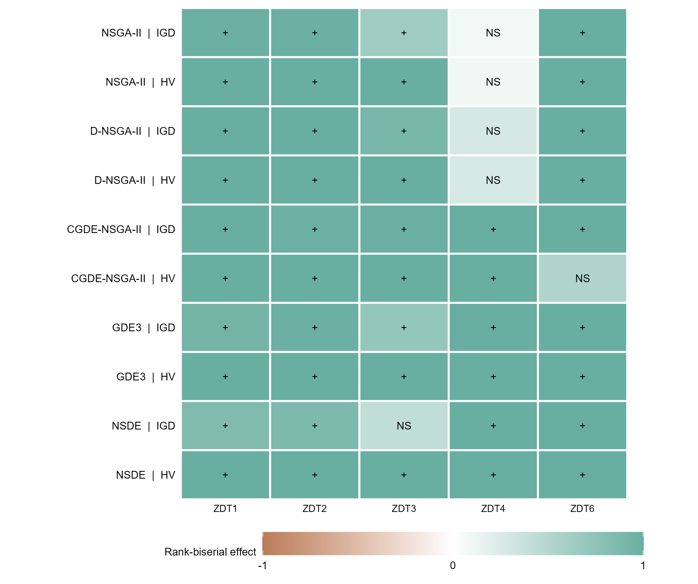
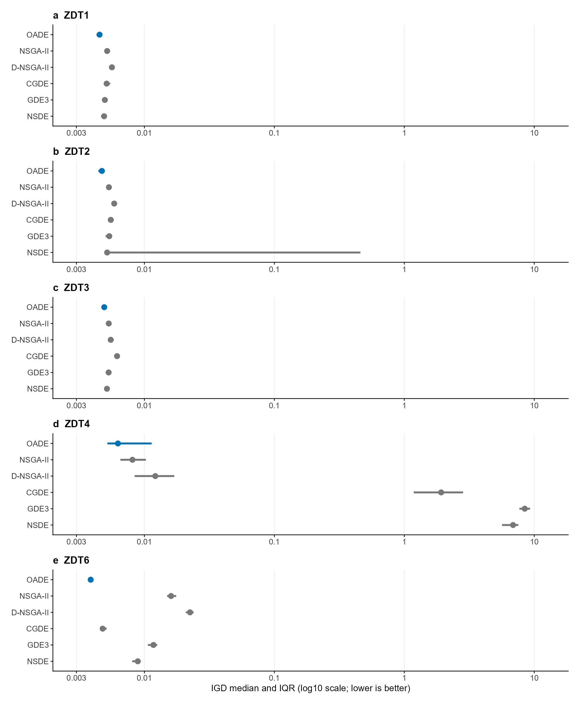
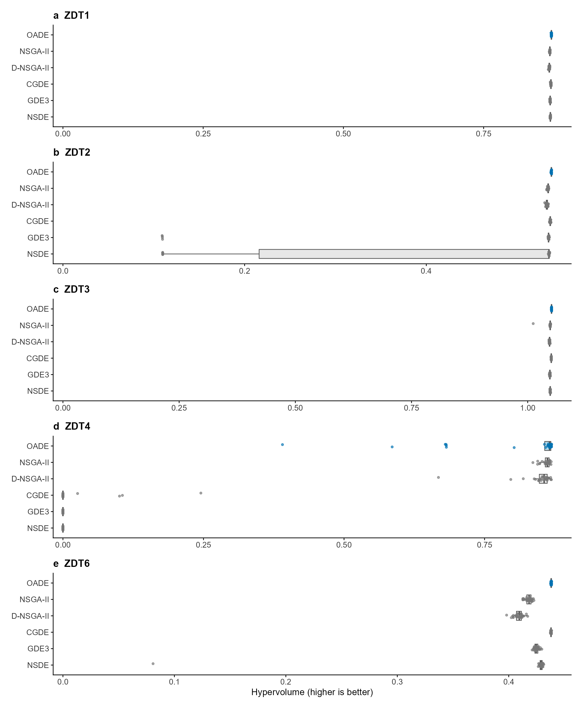

# Kết quả đối chứng sáu thuật toán trên ZDT

Ngày phân tích: 19/11/2026. Bộ `zdt_six_fixed_oade_v1` đã hoàn tất **900 lượt**, trong đó **899 hợp lệ**. Sau hiệu chỉnh Holm chung 50 endpoint, OADE tốt hơn có ý nghĩa ở **44**, **6 chưa phát hiện khác biệt**, không có endpoint baseline tốt hơn có ý nghĩa. OADE có mean IGD thấp nhất và mean HV cao nhất trên ZDT1/2/3/6; NSGA-II có mean tốt nhất trên ZDT4. Đây là kết quả của các triển khai và cấu hình được đo, không phải kết luận ưu thế phổ quát.

## Thiết kế và mẫu phân tích

Sáu thuật toán: OADE_NSGAII, NSGA2, DNSGA2, CGDE_NSGAII, GDE3, NSDE. ZDT1/2/3 có D=30, ZDT4/6 có D=10; tất cả M=2. Mỗi nhóm dùng 30 seed 42–71, quần thể 100, cap 20.000 FE/lượt, cùng khởi tạo uniform theo bài/seed. Tổng thực tế **17,979,322 FE**, không giả định mọi lượt dùng hết cap. [Giao thức](../protocols/zdt_six_fixed_oade.md) · [Manifest](../../results/experiments/zdt_six_fixed_oade_v1/study_manifest.json).

GDE3/NSDE dùng pymoo 0.6.2, DE/rand/1/bin, F=0,5, CR=0,5, gamma=10⁻⁴, bounce-back và RankAndCrowding mặc định. OADE và CGDE giữ nguyên cấu hình. D-NSGA-II được thử trên bài tĩnh; CGDE là bản tái dựng có các giả định đã ghi trong [registry](../protocols/baselines.md).

Một lượt CGDE trên ZDT4, seed 63, có front suy biến (`invalid_collapsed_front`); không gán IGD/HV giả để thay thế. Nhóm CGDE–ZDT4 và hai phép so tương ứng dùng 29 lượt/cặp; các nhóm còn lại dùng 30. Tất cả 300 lượt GDE3/NSDE hợp lệ. HV bằng 0 là kết quả hợp lệ khi front không đóng góp thể tích đối với reference point đã cố định, không đồng nghĩa lỗi chương trình.

## Hai bảng chất lượng

Ô là **mean (best run)** trên các lượt hợp lệ; IGD thấp tốt, HV cao tốt. Best là min IGD hoặc max HV, có thể thuộc seed khác nhau. In đậm mean và best riêng theo số chưa làm tròn; các số cùng cách hiển thị có thể không bằng nhau. SD và runtime được giữ trong CSV, không đặt cạnh mean trong bảng này. Best run chỉ mô tả một lượt, không phải bằng chứng thống kê.

### IGD ↓ — mean (best)

| Problem | NSGA2 | DNSGA2 | CGDE_NSGAII | GDE3 | NSDE | OADE_NSGAII |
|---|---:|---:|---:|---:|---:|---:|
| ZDT1 | 5.175e-3 (4.417e-3) | 5.633e-3 (4.97e-3) | 5.202e-3 (4.584e-3) | 4.961e-3 (4.469e-3) | 4.872e-3 (4.373e-3) | **4.47e-3** (**3.952e-3**) |
| ZDT2 | 5.405e-3 (4.938e-3) | 5.881e-3 (5.189e-3) | 5.539e-3 (4.774e-3) | 8.597e-2 (4.764e-3) | 1.665e-1 (4.535e-3) | **4.71e-3** (**4.149e-3**) |
| ZDT3 | 7.191e-3 (4.695e-3) | 5.568e-3 (5.049e-3) | 6.126e-3 (5.246e-3) | 5.349e-3 (4.917e-3) | 5.186e-3 (4.565e-3) | **4.998e-3** (**4.453e-3**) |
| ZDT4 | **9.953e-3** (4.767e-3) | 1.997e-2 (**4.574e-3**) | 2.32e0 (4.666e-1) | 8.542e0 (5.599e0) | 6.938e0 (3.668e0) | 3.979e-2 (4.636e-3) |
| ZDT6 | 1.637e-2 (1.299e-2) | 2.259e-2 (1.699e-2) | 4.828e-3 (4.24e-3) | 1.154e-2 (8.408e-3) | 2.588e-2 (7.242e-3) | **3.881e-3** (**3.461e-3**) |

### HV ↑ — mean (best)

| Problem | NSGA2 | DNSGA2 | CGDE_NSGAII | GDE3 | NSDE | OADE_NSGAII |
|---|---:|---:|---:|---:|---:|---:|
| ZDT1 | 8.681e-1 (8.686e-1) | 8.671e-1 (8.683e-1) | 8.699e-1 (8.706e-1) | 8.686e-1 (8.693e-1) | 8.689e-1 (8.695e-1) | **8.708e-1** (**8.713e-1**) |
| ZDT2 | 5.341e-1 (5.349e-1) | 5.327e-1 (5.345e-1) | 5.365e-1 (5.373e-1) | 4.78e-1 (5.356e-1) | 4.218e-1 (5.359e-1) | **5.377e-1** (**5.38e-1**) |
| ZDT3 | 1.047e0 (1.049e0) | 1.047e0 (1.048e0) | 1.051e0 (1.051e0) | 1.048e0 (1.049e0) | 1.048e0 (1.049e0) | **1.051e0** (**1.052e0**) |
| ZDT4 | **8.594e-1** (8.686e-1) | 8.467e-1 (8.688e-1) | 1.647e-2 (2.453e-1) | 0 (0) | 0 (0) | 8.139e-1 (**8.693e-1**) |
| ZDT6 | 4.179e-1 (4.226e-1) | 4.089e-1 (4.17e-1) | 4.379e-1 (4.385e-1) | 4.249e-1 (4.297e-1) | 4.175e-1 (4.315e-1) | **4.381e-1** (**4.385e-1**) |

## So sánh theo cặp sau Holm

Đơn vị ghép cặp là seed trong từng bài. Wilcoxon hai phía (`zero_method=wilcox`, `method=auto`; toàn chênh lệch 0 đặt p=1), alpha=0,05; Holm trên **5 bài × 5 baseline × 2 chỉ số = 50 endpoint**. Bảng dưới ghi **IGD / HV**: `+` là OADE tốt hơn có ý nghĩa; NS là chưa phát hiện khác biệt, không chứng minh tương đương. Các endpoint dùng chung reference nên không phải 50 thí nghiệm độc lập.

| Baseline | ZDT1 | ZDT2 | ZDT3 | ZDT4 | ZDT6 | OADE better / 10 |
|---|---|---|---|---|---|---:|
| NSGA2 | + / + | + / + | + / + | NS / NS | + / + | 8 |
| DNSGA2 | + / + | + / + | + / + | NS / NS | + / + | 8 |
| CGDE_NSGAII | + / + | + / + | + / + | + / + | + / NS | 9 |
| GDE3 | + / + | + / + | + / + | + / + | + / + | 10 |
| NSDE | + / + | + / + | NS / + | + / + | + / + | 9 |



Màu là rank-biserial, định hướng dương có lợi cho OADE, âm có lợi cho baseline; đây không phải phần trăm cải thiện. Ký hiệu +/NS lấy từ kiểm định sau Holm; độ lớn hiệu ứng không thay thế p. Mỗi ô dùng 30 cặp, riêng CGDE–ZDT4 dùng 29. [PDF](figures/zdt_six/paired_effects.pdf) · [SVG](figures/zdt_six/paired_effects.svg).

Sáu endpoint chưa đạt ngưỡng:

| Problem | Metric | Baseline | Paired n | Holm p |
|---|---|---|---:|---:|
| ZDT3 | IGD | NSDE | 30 | 2.024e-1 |
| ZDT4 | IGD | NSGA2 | 30 | 1e0 |
| ZDT4 | HV | NSGA2 | 30 | 1e0 |
| ZDT4 | IGD | DNSGA2 | 30 | 7.088e-1 |
| ZDT4 | HV | DNSGA2 | 30 | 7.088e-1 |
| ZDT6 | HV | CGDE_NSGAII | 30 | 5.581e-2 |

[CSV kiểm định đã audit](../../results/experiments/zdt_six_fixed_oade_v1/derived/audited_comparisons.csv) giữ median chênh lệch **OADE − baseline** theo cặp, rank-biserial (dương có lợi cho OADE), số thắng/thua/hòa và CI bootstrap percentile 95% với 20.000 lần lấy mẫu lại cặp seed, RNG 20261119. CI là khoảng biên chưa hiệu chỉnh đa kiểm định; kết luận ý nghĩa dùng p Holm, không suy từ CI đó. Chiều median chênh lệch thuận lợi là âm cho IGD, dương cho HV.

## Diễn giải và kết luận

- **Đối chứng mới:** OADE tốt hơn GDE3 ở cả 10 endpoint và NSDE ở 9/10. Trên ZDT3, mean IGD của OADE thấp hơn NSDE nhưng p Holm=0,2024 nên chưa đủ bằng chứng khác biệt; HV vẫn tốt hơn có ý nghĩa. Các kết quả này hỗ trợ lợi ích chất lượng của cấu hình OADE so với hai cấu hình DE thư viện đã đo, chưa quy được lợi ích cho riêng một cơ chế.
- **ZDT2:** GDE3/NSDE có best IGD gần các thuật toán khác nhưng mean tăng lên 8,597e-2 / 1,665e-1. Khoảng cách giữa best và mean cho thấy chỉ nhìn seed tốt nhất sẽ che các lượt có sai số lớn. OADE có mean IGD 4,710e-3, mean HV 5,377e-1.
- **ZDT4 là hạn chế chính:** NSGA-II có mean IGD 9,953e-3 và mean HV 8,594e-1, tốt hơn mô tả so với OADE 3,979e-2 / 8,139e-1; kiểm định OADE với NSGA-II và D-NSGA-II đều NS ở cả hai chỉ số. Không được diễn giải thành OADE thắng trên ZDT4. GDE3/NSDE có mean IGD 8,542 / 6,938 và HV bằng 0 trong cả 30 lượt mỗi thuật toán; cấu hình DE cố định này chưa phù hợp với ZDT4 ở ngân sách đang xét.
- **ZDT6:** OADE có mean IGD tốt nhất 3,881e-3 và tốt hơn cả năm baseline có ý nghĩa về IGD. HV so với CGDE có p Holm=0,05581, nên chưa đạt ngưỡng dù mean OADE nhỉnh hơn. Không chuyển kết luận từ họ 60 endpoint lịch sử sang họ 50 endpoint mới.
- **Chi phí chạy:** median runtime theo bài của GDE3 khoảng 1,21–1,33 giây, NSDE 1,10–1,18 giây, NSGA-II 2,09–2,23 giây, D-NSGA-II 2,04–2,22 giây, OADE 4,04–4,62 giây và CGDE 93,98–286,35 giây. Hai baseline mới giảm thời gian đo được nhưng có đánh đổi chất lượng, rõ nhất ở ZDT2/4. Runtime là mô tả trên máy và triển khai này, không phải kiểm định tăng tốc hay độ phức tạp thuật toán.

Manifest ghi hai phiên 8 worker (900 lượt chờ ban đầu, 319 khi resume); OMP/OPENBLAS/MKL thread variables không được đặt trong snapshot. Vì vậy không khẳng định mỗi worker chỉ dùng một thread và không so runtime với đợt lịch sử như phép thử tăng tốc có kiểm soát.

**Giới hạn bổ sung (27/11/2026):** [kiểm tra thiên lệch theo vị trí nghiệm tối ưu](bias_location_check_report.md) cho thấy khi dời nghiệm tối ưu vào trong miền mà giữ nguyên Pareto front, ưu thế IGD/HV của OADE so với NSGA-II trên ZDT1/2/3 đảo chiều, OADE thua rõ trên ZDT4, còn ưu thế trên ZDT6 vẫn giữ. Không khái quát các endpoint ZDT1/2/3/4 ở trên cho bài có nghiệm tối ưu nằm trong miền.

Các seed và cấu hình của bốn thuật toán giữ lại trùng thiết kế trước; đợt này chạy mới nhưng không phải xác nhận trên seed holdout. Chưa đo DTLZ/WFG, M>2 hay tối ưu động. Các nghiên cứu cơ chế/OFAT OADE là bằng chứng riêng; không suy nguyên nhân từ bảng so thuật toán. Không có cơ sở đổi cấu hình production chỉ từ best seed hoặc kết quả benchmark này.

## Biểu đồ phân bố và Pareto mới nhất



Điểm là median, đoạn ngang là Q1–Q3 trên cùng phạm vi log10 giữa các panel; không phải CI. Giữ 899 lượt hợp lệ của sáu thuật toán, riêng CGDE–ZDT4 có 29. [Phân bố IGD đủ seed](figures/zdt_six/igd_distribution.png) giữ các đuôi lớn; boxplot tính trên thang gốc rồi đổi trục log khi hiển thị.



HV cao tốt; trục tuyến tính từ 0, giữ mọi giá trị 0. Mỗi chấm là một seed; hộp Q1–Q3, vạch giữa median, râu 1,5 IQR. Phạm vi mỗi bài riêng, không xếp hạng bằng HV giữa các bài. [Runtime](figures/zdt_six/runtime_distribution.png) dùng đủ 900 lượt hoàn tất, kể cả lượt CGDE có front suy biến; trục log và các giới hạn worker/thread như đã nêu.

[Nghiệm OADE trên Pareto front chuẩn](oade_zdt_pareto_fronts.md) đã được trích và vẽ lại từ đợt sáu thuật toán hiện tại, chọn seed có IGD tốt nhất mỗi bài. Đây là hình best-case, không phải mô tả lượt điển hình. Bộ hình bảy thuật toán và các sidecar cũ đã được thay thế; không dùng chúng minh họa kết quả mới.

## Kiểm chứng và tái tạo phân tích

[Script kiểm chứng](../../analysis/audit_zdt_six.py) dùng đường tính riêng với pipeline báo cáo: xác minh **900 checksum primary**, **113 hash source**, **150 khối khởi tạo ghép cặp**, bounds, không trội, tính lại objective từ X và IGD/HV từ F; đối chiếu 900 dòng raw, 30 dòng summary và toàn bộ 50 kiểm định/Holm. Sai số lớn nhất objective, IGD/HV đều **0**. Manifest được kiểm tra không đổi. [Biên bản audit](../../results/experiments/zdt_six_fixed_oade_v1/derived/audit.json) · [Summary](../../results/experiments/zdt_six_fixed_oade_v1/derived/audited_summary.csv).

Đây là kiểm chứng bằng đường tính độc lập do cùng người phân tích thực hiện, vẫn dùng cùng thư viện pymoo cho objective/indicator; không phải xác nhận từ nhóm nghiên cứu bên ngoài, không chạy lại optimizer và không kiểm chứng toàn bộ transition trace.

Sau bảo trì mã nguồn, các hash tại thời điểm chạy được xác minh với [snapshot mã thực thi](../../results/experiments/zdt_six_fixed_oade_v1/config/execution_sources.zip) khi file hiện tại khác hoặc đã được gỡ. Snapshot được lưu và đối chiếu trước khi sửa mã; không sửa hash trong manifest. Khởi tạo benchmark vẫn là uniform theo seed; thay đổi mã sau thí nghiệm không được quy thành mã đã sinh dữ liệu. Muốn chạy lại thiết kế với mã mới phải dùng thư mục output mới; resume strict của dữ liệu cũ cần đúng source/môi trường tại thời điểm chạy.

Kiểm tra bảo trì: `git diff --check`, đối chiếu bảng và liên kết tài liệu đạt. Allowlist kiểm tra cấu trúc đã bổ sung hai package baseline GDE3/NSDE.

```powershell
.\.venv\Scripts\python.exe analysis/audit_zdt_six.py
& "C:/Program Files/R/R-4.6.2/bin/Rscript.exe" --vanilla analysis/plot_zdt_six_comparison.R
& "C:/Program Files/R/R-4.6.2/bin/Rscript.exe" --vanilla analysis/plot_zdt_distributions.R
.\.venv\Scripts\python.exe analysis/report_zdt_six.py
```

Hình dùng dữ liệu đã audit; [mã vẽ hiệu ứng](../../analysis/plot_zdt_six_comparison.R), [mã vẽ phân bố](../../analysis/plot_zdt_distributions.R). Báo cáo và dữ liệu bảy thuật toán vẫn là bằng chứng lịch sử riêng; các hình cũ đã được gỡ sau khi có hình thay thế.
