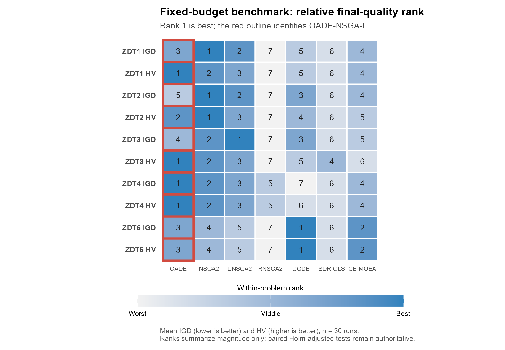
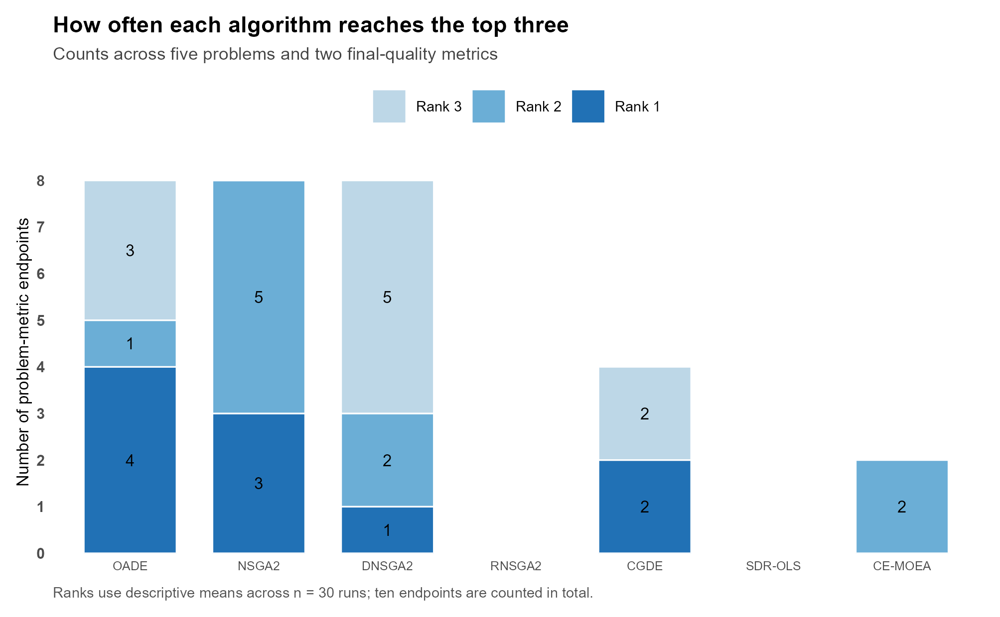
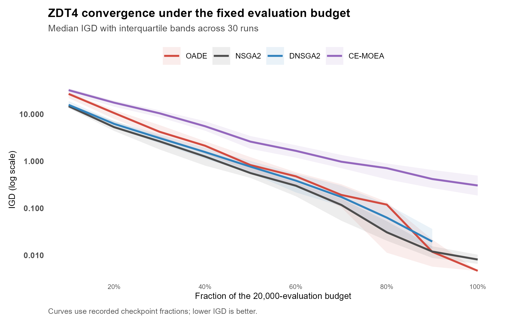
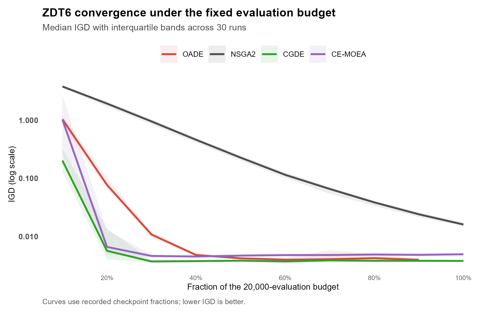
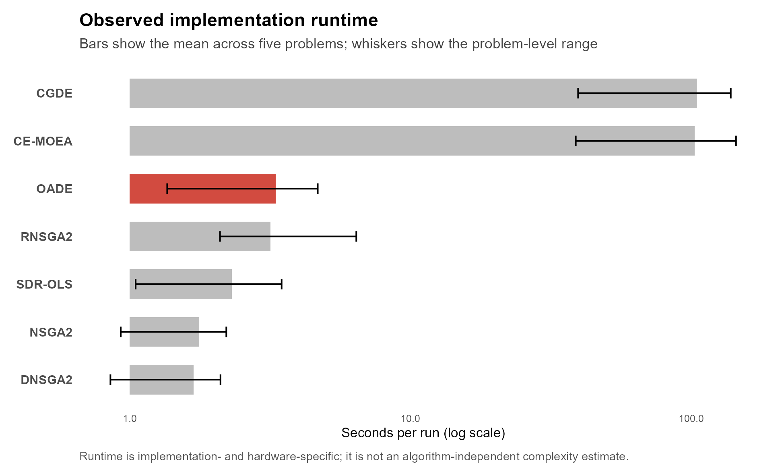

# OADE-NSGA-II: Fixed-Budget Benchmark Results

## Report scope

This report evaluates the completed fixed-budget benchmark stored in `results/algorithm_benchmark`. It replaces the earlier provisional assessment based on smaller and methodologically inconsistent experiment sets. Claims are restricted to the five tested bi-objective ZDT problems and the seven implementations included in this repository.

> **Status:** This is the historical ZDT benchmark using the classic-restart OADE configuration (`results/algorithm_benchmark`). The later v2, held-out restart, DTLZ, WFG, and sensitivity results are documented separately. The open-work list below has been updated to avoid repeating experiments that are already complete.

## Terminology ledger

| Canonical term | Definition used in this report |
|---|---|
| OADE-NSGA-II | The proposed algorithm, recorded as `OADE_NSGAII` in result files |
| IGD | Inverted generational distance; lower values are better |
| HV | Hypervolume computed with the configured problem-specific reference point; higher values are better |
| Independent run | One stochastic run identified by a distinct `run_idx` and seed |
| Paired comparison | A comparison between algorithms using the same problem and run index |
| Evaluation budget | Maximum of 20,000 objective-function evaluations per run |

## Executive summary

The benchmark completed successfully for all five configured problems. It contains 1,050 valid final observations: 5 problems, 7 algorithms, and 30 paired runs per algorithm. All validation records have status `ok`, and every algorithm-problem group contains the planned 30 runs.

The results support a bounded conclusion. OADE-NSGA-II was competitive across the ZDT suite and produced the highest mean HV on ZDT1, ZDT3, and ZDT4. Its clearest advantage occurred on ZDT4, where it had the best mean IGD and HV. OADE-NSGA-II also substantially outperformed NSGA-II on both metrics on ZDT6, although CGDE-NSGA-II retained the highest mean HV on that problem. OADE-NSGA-II did not dominate ZDT2: NSGA-II obtained better mean IGD and slightly better mean HV, and neither paired comparison was significant after Holm correction.

Across all 60 paired metric-comparator tests, OADE-NSGA-II was significantly better in 39 comparisons, significantly worse in one, and not significantly different in 20. The only corrected comparison favouring another algorithm was HV against CGDE-NSGA-II on ZDT6. These counts describe the configured comparison family and should not be interpreted as evidence of universal superiority.

The completed component ablation materially qualifies the benchmark result. Opposition-based learning was essential on ZDT4, but the current restart policy reduced performance on ZDT1-ZDT3. Removing restart significantly improved HV on all three problems and IGD on ZDT2-ZDT3. F/CR adaptation, probability adaptation, and neighbourhood selection showed no isolated Holm-corrected benefit. The detailed analysis is reported in `docs/ablation_results_report.md`.

## Experimental design and completeness

| Design item | Implemented value |
|---|---|
| Problems | ZDT1, ZDT2, ZDT3, ZDT4, and ZDT6 |
| Objectives | 2 |
| Decision variables | 30 for ZDT1-ZDT3; 10 for ZDT4 and ZDT6 |
| Algorithms | OADE-NSGA-II, NSGA-II, R-NSGA-II, D-NSGA-II, CGDE-NSGA-II, NSGA-II-SDR-OLS, and CE-MOEA |
| Independent runs | 30 per algorithm and problem |
| Evaluation budget | Cap of 20,000 evaluations per run; actual use can be lower when a generation would cross the cap |
| Final observations | 1,050 |
| Validation result | 1,050 `ok`; 0 invalid |
| Primary metrics | IGD and HV |
| Inferential test | Two-sided paired Wilcoxon signed-rank test |
| Multiplicity control | Holm adjustment over the configured comparison family for each metric |
| Effect size | Rank-biserial effect |

The independent statistical unit is one stochastic run. Algorithms are paired by problem and `run_idx`. Each reported pairwise test therefore uses 30 paired observations. Mean and sample standard deviation are retained for comparison with prior optimization literature, while paired median differences and rank-biserial effects provide distribution-aware inferential evidence.

## Final quality results

Values are mean ± sample standard deviation over 30 runs. Bold values identify the best mean within each problem and metric; bolding is descriptive and does not replace paired inference.

### Visual summary

The heatmap ranks algorithms within each problem and metric using the descriptive mean. Rank 1 is best, and the red outline marks OADE-NSGA-II. The figure is a navigation aid; paired Holm-adjusted results below remain the basis for inferential claims.

Across the ten problem-metric endpoints, OADE-NSGA-II reached the descriptive top three eight times and ranked first four times. NSGA-II also reached the top three eight times, including three first-place and five second-place results. This count summarizes breadth but does not weight endpoints by effect magnitude or statistical certainty.

| Problem | Algorithm | IGD ↓ | HV ↑ |
|---|---|---:|---:|
| ZDT1 | OADE-NSGA-II | 0.005925 ± 0.002536 | **0.868961 ± 0.003342** |
|  | NSGA-II | **0.005175 ± 0.000298** | 0.868053 ± 0.000417 |
|  | R-NSGA-II | 0.632213 ± 0.081377 | 0.350416 ± 0.086453 |
|  | D-NSGA-II | 0.005633 ± 0.000423 | 0.867066 ± 0.000685 |
|  | CGDE-NSGA-II | 0.007433 ± 0.000527 | 0.863362 ± 0.000969 |
|  | NSGA-II-SDR-OLS | 0.015633 ± 0.019704 | 0.858421 ± 0.014846 |
|  | CE-MOEA | 0.006908 ± 0.000874 | 0.864472 ± 0.001779 |
| ZDT2 | OADE-NSGA-II | 0.007734 ± 0.005316 | 0.533739 ± 0.006240 |
|  | NSGA-II | **0.005405 ± 0.000306** | **0.534072 ± 0.000611** |
|  | R-NSGA-II | 0.520240 ± 0.030498 | 0.121961 ± 0.008550 |
|  | D-NSGA-II | 0.005881 ± 0.000392 | 0.532697 ± 0.000974 |
|  | CGDE-NSGA-II | 0.006815 ± 0.000510 | 0.530572 ± 0.001170 |
|  | NSGA-II-SDR-OLS | 0.050319 ± 0.152326 | 0.499634 ± 0.106117 |
|  | CE-MOEA | 0.007477 ± 0.000980 | 0.529670 ± 0.001905 |
| ZDT3 | OADE-NSGA-II | 0.008319 ± 0.005096 | **1.049238 ± 0.003634** |
|  | NSGA-II | 0.007191 ± 0.010231 | 1.047182 ± 0.006699 |
|  | R-NSGA-II | 0.729365 ± 0.061686 | 0.409883 ± 0.051660 |
|  | D-NSGA-II | **0.005568 ± 0.000291** | 1.046953 ± 0.000680 |
|  | CGDE-NSGA-II | 0.008262 ± 0.000984 | 1.035047 ± 0.003604 |
|  | NSGA-II-SDR-OLS | 0.018648 ± 0.002970 | 1.035815 ± 0.004358 |
|  | CE-MOEA | 0.008561 ± 0.001533 | 1.034400 ± 0.005116 |
| ZDT4 | OADE-NSGA-II | **0.006977 ± 0.003323** | **0.864878 ± 0.005621** |
|  | NSGA-II | 0.009953 ± 0.005080 | 0.859362 ± 0.007910 |
|  | R-NSGA-II | 0.637785 ± 0.167283 | 0.335380 ± 0.160439 |
|  | D-NSGA-II | 0.019973 ± 0.027370 | 0.846750 ± 0.036867 |
|  | CGDE-NSGA-II | 12.171576 ± 2.800419 | 0.000000 ± 0.000000 |
|  | NSGA-II-SDR-OLS | 10.891407 ± 6.777696 | 0.000000 ± 0.000000 |
|  | CE-MOEA | 0.357214 ± 0.234331 | 0.409725 ± 0.227870 |
| ZDT6 | OADE-NSGA-II | 0.005286 ± 0.003371 | 0.436557 ± 0.003740 |
|  | NSGA-II | 0.016368 ± 0.002011 | 0.417891 ± 0.002872 |
|  | R-NSGA-II | 0.189393 ± 0.092652 | 0.264148 ± 0.068359 |
|  | D-NSGA-II | 0.022588 ± 0.002794 | 0.408917 ± 0.003997 |
|  | CGDE-NSGA-II | **0.003823 ± 0.000223** | **0.439057 ± 0.000199** |
|  | NSGA-II-SDR-OLS | 0.139446 ± 0.082748 | 0.282923 ± 0.058962 |
|  | CE-MOEA | 0.004957 ± 0.000336 | 0.437794 ± 0.000360 |

## Paired statistical interpretation

### Comparison with NSGA-II

| Problem | IGD result | HV result |
|---|---|---|
| ZDT1 | No significant difference, adjusted p = 1.000 | No significant difference, adjusted p = 0.147 |
| ZDT2 | No significant difference, adjusted p = 1.000 | No significant difference, adjusted p = 0.720 |
| ZDT3 | No significant difference, adjusted p = 0.423 | No significant difference, adjusted p = 0.064 |
| ZDT4 | No significant difference, adjusted p = 0.093 | OADE better, adjusted p = 0.020, effect = 0.622 |
| ZDT6 | OADE better, adjusted p = 7.45 × 10⁻⁸, effect = 0.996 | OADE better, adjusted p = 5.59 × 10⁻⁸, effect = 1.000 |

The NSGA-II comparison shows that OADE-NSGA-II's advantage is problem-dependent. Mean HV was higher for OADE-NSGA-II on ZDT1, ZDT3, and ZDT4, but only the ZDT4 difference remained significant after correction. On ZDT6, both metrics strongly favoured OADE-NSGA-II. On ZDT2, the descriptive means favoured NSGA-II, but the paired tests did not establish a corrected difference.

### Comparison with other competitive baselines

- On ZDT1, OADE-NSGA-II had better HV than CE-MOEA, CGDE-NSGA-II, and D-NSGA-II after correction. Its IGD was significantly better only than CGDE-NSGA-II among these three comparators.
- On ZDT2, OADE-NSGA-II had better HV than CE-MOEA (adjusted p = 0.026), but differences from CGDE-NSGA-II and D-NSGA-II were not significant. None of the four selected IGD comparisons was significant.
- On ZDT3, OADE-NSGA-II had better HV than CE-MOEA, CGDE-NSGA-II, and D-NSGA-II, with rank-biserial effects from 0.703 to 0.996. IGD differences among the competitive methods were not significant.
- On ZDT4, OADE-NSGA-II had better IGD and HV than CE-MOEA, CGDE-NSGA-II, and D-NSGA-II. The corrected IGD comparison with NSGA-II did not reach 0.05, while the HV comparison did.
- On ZDT6, OADE-NSGA-II was better than NSGA-II and D-NSGA-II on both metrics. CGDE-NSGA-II had significantly better HV (adjusted p = 5.59 × 10⁻⁸, effect = -1.000), while its IGD advantage over OADE-NSGA-II was not significant after correction. CE-MOEA and OADE-NSGA-II were not significantly different on either metric.

The complete adjusted p-values, median paired differences, and effect sizes remain authoritative in `algorithm_benchmark_paired_statistics.csv`. This report highlights the comparisons that determine the central claim rather than duplicating all 60 rows.

## Validation, convergence, and computational cost

The convergence plots use the recorded checkpoint fractions and show the median IGD with interquartile bands. On ZDT4, OADE-NSGA-II continues improving late in the budget and ends below the displayed alternatives. On ZDT6, CGDE-NSGA-II reaches a low IGD early, while OADE-NSGA-II approaches a similar final scale; NSGA-II remains visibly higher. These curves are descriptive and do not replace paired final-quality inference or an anytime statistical comparison.

All 1,050 runs passed the implemented checks for finite objectives, non-empty fronts, bounds, and front-quality diagnostics. The anomalous ZDT4 outcomes for CGDE-NSGA-II and NSGA-II-SDR-OLS are therefore valid under the current automated rules, but their mean HV of zero and very large IGD indicate algorithmic failure on this problem rather than a malformed output file. Pareto-front inspection is still required before attributing the failure to a specific operator or implementation detail.

The convergence file contains 10,203 checkpoint observations. Most algorithms recorded ten checkpoints per run; D-NSGA-II and OADE-NSGA-II usually recorded nine because generation-level evaluation counts did not always coincide exactly with nominal checkpoint targets. Consequently, convergence curves should use actual `n_eval` values or a documented interpolation rule. Directly grouping only by nominal checkpoint number would mix unequal evaluation counts.

Budget utilization was close to complete. OADE-NSGA-II used 99.70% to 99.88% of the 20,000-evaluation cap on average, while D-NSGA-II used 99.55%; the other runners recorded 100%. This small difference should be disclosed because OADE-NSGA-II and D-NSGA-II did not always consume exactly the full cap.

Runtime results reveal a large implementation-cost difference. OADE-NSGA-II required approximately 1.36-4.67 seconds per run across the five problems. The local CE-MOEA and CGDE-NSGA-II runners required approximately 38.8-144.5 seconds and 39.6-138.4 seconds, respectively. The pymoo-based algorithms and NSGA-II-SDR-OLS generally required less than 3.5 seconds. These values characterize this Python implementation and execution environment, not algorithm-independent complexity. Hardware, worker count, system load, and package versions must be recorded before using runtime as a publication-level efficiency claim.

## Current claim boundary

The completed benchmark supports the following statement:

> Under a 20,000-evaluation budget, 30 paired runs, and the five tested bi-objective ZDT problems, OADE-NSGA-II was competitive with six included baselines. It achieved the best mean HV on ZDT1, ZDT3, and ZDT4, showed its strongest two-metric result on ZDT4, and outperformed NSGA-II on both metrics on ZDT6. Its advantage was not uniform: NSGA-II led the descriptive means on ZDT2, D-NSGA-II led mean IGD on ZDT3, and CGDE-NSGA-II led both descriptive metrics and significantly led HV on ZDT6.

The evidence does not yet support general superiority, state-of-the-art status, many-objective scalability, robustness to constraints or noise, or hardware-independent computational efficiency.

The ablation further limits attribution of the benchmark gains. The current evidence identifies OBL as critical on ZDT4 but does not establish an isolated final-quality benefit from F/CR adaptation, probability adaptation, or neighbourhood selection. The current restart implementation should not be presented as beneficial because removing it improved several ZDT1-ZDT3 outcomes after Holm correction.

## Remaining research work

### P0: required for attribution and trustworthy interpretation

1. **Audit the adaptive restart mechanism.** A held-out comparison is available in `docs/restart_confirmation_report.md`, but the near-identical Adaptive Restart and No Restart outputs and missing trigger counts leave the mechanism unexplained. Log trigger/restart counts and verify the configured code path before attributing the v2 improvement to adaptive restarts.
2. **Inspect ZDT4 failure fronts.** Plot representative and worst CGDE-NSGA-II and NSGA-II-SDR-OLS fronts. Also inspect the tail failures produced by No Probability Adaptation and No Neighbourhood. Confirm initialization, bounds, selection, and reference-point handling against the intended baseline definitions.
3. **Add uncertainty intervals.** Report a prespecified confidence-interval method for paired differences or rank-biserial effects. Current paired-statistics files do not store these intervals.
4. **Document execution and baseline provenance.** Record CPU, memory, operating system, Python and package versions, worker count, and the source/version/citation for each baseline implementation.

### P1: required for generalization

5. **Use completed DTLZ/WFG evidence to plan component studies.** The current suites reveal both strengths and deficits but do not isolate component effects. Prioritize targeted ablations on the smooth three-objective deficits and the five-objective WFG regressions.
6. **Interpret the completed sensitivity study.** `docs/sensitivity_analysis.md` now summarizes the stored sweep and its correction families; the sweep uses the classic-restart configuration and should not be presented as direct tuning evidence for v2.
7. **Summarize convergence statistically.** Align trajectories by actual evaluations, plot medians with uncertainty bands, and compare an anytime measure such as normalized area under the IGD/HV curve.
8. **Repeat from a clean locked environment.** Regenerate the raw runs and summaries with a single documented command and publish checksums for the result package.

### P2: scope extensions

9. Evaluate higher-dimensional decision spaces and constrained, noisy, or dynamic problems if those domains are part of the intended claim.
10. Analyse worst runs and adaptation trajectories to identify when restarts or parameter adaptation help and when they add cost without improving the front.

## Statistical reporting notes

- `n = 30` independent stochastic runs for every algorithm-problem group.
- Pairing is defined by common problem and `run_idx`; the same run-level initialization protocol should be stated explicitly in the Methods section.
- Tests are two-sided paired Wilcoxon signed-rank tests against OADE-NSGA-II.
- Holm adjustment is applied within each metric's configured family of 30 comparisons.
- Exact adjusted p-values and rank-biserial effects are stored in the paired-statistics CSV.
- A non-significant comparison is reported as insufficient evidence of a difference, not as equivalence.
- Mean ± sample standard deviation is descriptive; medians, paired differences, effects, and uncertainty intervals should carry the inferential interpretation.

## Data provenance

The numerical statements in this report were derived from the following files generated at the end of the completed benchmark run:

- `results/algorithm_benchmark/algorithm_benchmark_raw_runs.csv`
- `results/algorithm_benchmark/algorithm_benchmark_igd_hv_summary.csv`
- `results/algorithm_benchmark/algorithm_benchmark_paired_statistics.csv`
- `results/algorithm_benchmark/algorithm_benchmark_validation.csv`
- `results/algorithm_benchmark/algorithm_benchmark_cost_summary.csv`
- `results/algorithm_benchmark/algorithm_benchmark_convergence.csv`
- `results/ablation/algorithm_benchmark_raw_runs.csv`
- `results/ablation/algorithm_benchmark_igd_hv_summary.csv`
- `results/ablation/algorithm_benchmark_paired_statistics.csv`
- `results/ablation/algorithm_benchmark_validation.csv`

The completion log ends with `Saved benchmark outputs to results/algorithm_benchmark (0 invalid runs).`

The visual summary is generated reproducibly by `analysis/figures/generate_research_figures.R`; on Windows, run `./scripts/render_research_figures.ps1`. Editable PDF/SVG, high-resolution TIFF, PNG preview, and figure source-data CSV files are stored under `results/figures`.

## Author input needed

- Confirm the formal expansion of “OADE” for the title and method section.
- Identify the target venue and its reproducibility checklist.
- Provide the hardware and software environment used for this run.
- Confirm which baseline implementations have been checked against their cited algorithms.
