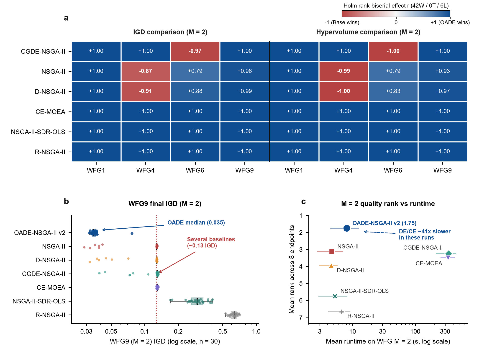
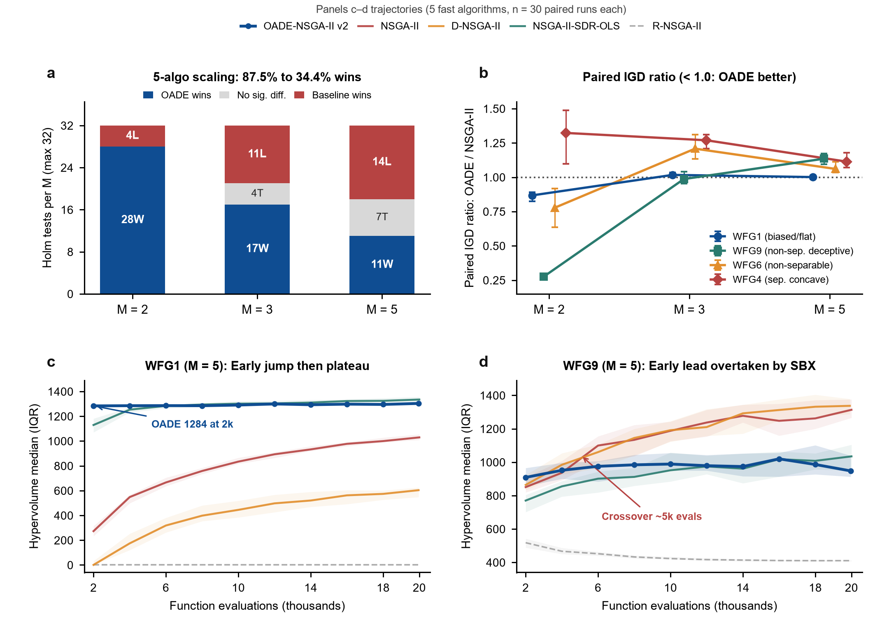

# OADE-NSGA-II v2: Compact WFG Benchmark & Scaling Report (Non-Separability, Deception, and Objective Scaling)

> [Implementation identity correction] Names refer to the implementations in [baseline registry](baselines.md): Dynamic NSGA-II, local Cross-Generation DE, continuous-search CE adaptation, and opposition/local-search SDR-OLS. Fixed-budget OADE uses a common uniform warm start, bypassing standalone Sobol/initial OBL. DTLZ comparisons have 26–30 valid matched pairs; historical corner-collapse diagnostics are distinct from invalid `collapsed_front` records.

## 1. Executive Summary

To evaluate **OADE-NSGA-II v2** on four selected **WFG (Walking Fish Group)** problems ($D = 24$ decision variables; evaluation cap 20,000; $n = 30$ paired runs per configuration), we executed two benchmark experiments:

* **Experiment A — 7-algorithm bi-objective WFG study (`results/wfg_m2_7algo_benchmark/`, 840 runs)**: Compares OADE-NSGA-II v2 with six baselines on four WFG problems at $M=2$. Holm correction is applied separately per metric family ($m=24$).
* **Experiment B — 5-algorithm study across $M \in \{2, 3, 5\}$ (`results/wfg_compact_benchmark/`, 1,800 runs)**: Compares OADE-NSGA-II v2 with four baselines on the same four WFG functions across objective counts. Holm correction is applied separately per metric family ($m=48$); convergence summaries cover recorded checkpoints and the final result.

### Core Findings:
1. **Outcome profile at $M = 2$ (`42W / 0ND / 6L`, `87.5%` wins, mean rank `1.75`)**:
   * **OADE-NSGA-II v2** achieves zero losses against **`CE-MOEA`** (8–0–0), **`NSGA-II-SDR-OLS`** (8–0–0), and **`R-NSGA-II`** (8–0–0), and beats **`CGDE-NSGA-II`**, **`NSGA-II`**, and **`D-NSGA-II`** 6–0–2 each.
   * **Observed `wfg9_m2` result**: In these runs, comparator median IGD values ranged from `0.1283` to `0.6396`, while OADE-NSGA-II v2 reached **`IGD_med = 0.0347 [IQR 0.0023]`** and **`HV_med = 2.1556 [IQR 0.0066]`** in **`5.2s/run`**. The result supports a large difference on this selected case; it does not establish that all comparators generally converge to this trap.
   * **Observed quality–runtime trade-off on `wfg6_m2`**: Among the six tested comparators, `CGDE-NSGA-II` had better corrected IGD than OADE ($\text{IGD}_{\text{med}} = 0.0302$ vs $0.0526$, $p_{\text{adj}} = 1.56 \times 10^{-7}$). Its measured runtime was `448.1s/run`, about 101 times OADE's `4.4s/run` in this execution environment. OADE had better corrected outcomes than the other five comparators in the reported comparisons.
2. **Outcome counts across objective settings in this selected WFG sample (`56W / 11ND / 29L`)**:
   * OADE-NSGA-II v2's corrected win fraction declined across these four functions: **`28W / 0ND / 4L` (87.5%)** at $M=2$ $\to$ **`17W / 4ND / 11L` (53.1%)** at $M=3$ $\to$ **`11W / 7ND / 14L` (34.4%)** at $M=5$. This is a pattern in the selected suite and comparator pool, not a general scaling law.
   * On biased/flat mixed **`WFG1`**, OADE's reported median HV exceeded `NSGA-II` at all three tested dimensions (`+89.6%` at $M=2$, `+20.9%` at $M=3$, `+26.6%` at $M=5$). `NSGA-II-SDR-OLS` had the best reported $M=5$ medians in this comparison ($\text{IGD}_{\text{med}} = 1.8954$, $\text{HV}_{\text{med}} = 1334.68$).
3. **Observed late-budget behavior and candidate explanations**:
   * The recorded trajectories show an early HV lead in some cases and a later deficit on `wfg9_m5` (`1019.73` near 16k evaluations, `947.63` at the final checkpoint). These are descriptive trajectories; checkpoints do not establish why the change occurred.
   * Source inspection suggests three hypotheses for targeted tests: the configured `n_neighbors: 5` may limit neighborhood size at higher $M$; the DE ratio update measures the generated share rather than the survival success of DE offspring; and crowding-distance boundary assignment may affect selection on differently scaled objectives. The current experiments do not establish these as causes or confirm that the probability update is a bug.

---

## 2. Experimental Protocol & Validation Integrity

| Design Parameter | Experiment A: `WFG M=2 (7 Algos)` (`results/wfg_m2_7algo_benchmark`) | Experiment B: `Compact WFG M=2,3,5 (5 Algos)` (`results/wfg_compact_benchmark`) |
|---|---|---|
| **Benchmark Problems** | `wfg1_m2`, `wfg4_m2`, `wfg6_m2`, `wfg9_m2` ($D=24$, $k=4$) | `wfg1`, `wfg4`, `wfg6`, `wfg9` × $M \in \{2,3,5\}$ ($D=24$; $k=4$ for $M \le 3$, $k=8$ for $M=5$) |
| **Algorithm Pool** | All 7: `OADE_NSGAII`, `NSGA2`, `DNSGA2`, `CGDE_NSGAII`, `CE_MOEA`, `NSGAII_SDR_OLS`, `RNSGA2` | 5 fast solvers: `OADE_NSGAII`, `NSGA2`, `DNSGA2`, `NSGAII_SDR_OLS`, `RNSGA2` |
| **Sample Size & Pairing** | $n = 30$ paired seeds (`42–71`), matched initial populations (total **840 runs**) | $n = 30$ paired seeds (`42–71`), matched initial populations (total **1,800 runs**) |
| **Validation Status** | **840 / 840 `ok`** (0 collapsed or invalid runs) | **1,800 / 1,800 `ok`** (0 collapsed or invalid runs) |
| **Reference Front & HV** | Das-Dennis directions ($H = 200$); $\mathbf{r} = \max(\text{PF}) + 0.1$ | Das-Dennis directions ($H \in \{200, 20, 6\}$ for $M \in \{2,3,5\}$); $\mathbf{r} = \max(\text{PF}) + 0.1$ |
| **Budget Cap** | 20,000 evaluations (`OADE` utilization: `99.72%–99.83%`) | 20,000 evaluations (`OADE` utilization: `99.72%–99.83%`) |
| **Inference & Multiplicity** | Two-sided paired Wilcoxon; Holm step-down separately per metric ($m = 24$ / family, $\alpha = 0.05$) | Two-sided paired Wilcoxon; Holm step-down separately per metric ($m = 48$ / family, $\alpha = 0.05$) |

*(Balanced statistical design note: Keeping Experiment A and Experiment B in separate directories prevents unbalanced multiplicity family sizes when comparing 7 solvers at $M=2$ vs 5 solvers across $M \in \{2,3,5\}$.)*

---

## 3. Experiment A: Full 7-Algorithm `M = 2` WFG Results (840 Runs)

### 3.1 Holm-Adjusted Scorecard & Mean Ranks (48 Comparisons, 8 Endpoints)

| Algorithm | Combined Mean Rank (8 Endpoints) | IGD W / ND / L | HV W / ND / L | Total vs OADE (`OADE` W / ND / L) | Mean Runtime at $M=2$ (`OMP_NUM_THREADS=1`) |
|---|---:|---:|---:|---:|---:|
| **`OADE_NSGAII` (v2)** | **1.75 (#1)** | REF | REF | **42 / 0 / 6 (87.5%)** | **8.09 s** (`4.42–12.53 s`) |
| **`NSGA2`** | 3.12 (#2) | 1L / 0ND / 3W (OADE) | 1L / 0ND / 3W (OADE) | 6 / 0 / 2 | 4.66 s (`2.73–6.98 s`) |
| **`CGDE_NSGAII`** | 3.25 (#3) | 1L / 0ND / 3W (OADE) | 1L / 0ND / 3W (OADE) | 6 / 0 / 2 | 338.62 s (`214.86–453.11 s`) |
| **`CE_MOEA`** | 3.50 (#4) | 0L / 0ND / 4W (OADE) | 0L / 0ND / 4W (OADE) | **8 / 0 / 0** | 333.12 s (`253.89–434.25 s`) |
| **`DNSGA2`** | 3.88 (#5) | 1L / 0ND / 3W (OADE) | 1L / 0ND / 3W (OADE) | 6 / 0 / 2 | 4.56 s (`2.96–5.79 s`) |
| **`NSGAII_SDR_OLS`** | 5.75 (#6) | 0L / 0ND / 4W (OADE) | 0L / 0ND / 4W (OADE) | **8 / 0 / 0** | 5.22 s (`2.85–8.26 s`) |
| **`RNSGA2`** | 6.75 (#7) | 0L / 0ND / 4W (OADE) | 0L / 0ND / 4W (OADE) | **8 / 0 / 0** | 6.72 s (`4.09–9.21 s`) |

### 3.2 Problem-Level 7-Algorithm Table (`n = 30`, Median [IQR width] and Mean ± SD)

| Problem | Algorithm | IGD ↓ Median [IQR] | IGD Mean ± SD | HV ↑ Median [IQR] | HV Mean ± SD | $p_{\text{adj}}$ vs OADE (IGD / HV) | Effect $r$ (IGD / HV) |
|---|---|---|---|---|---|---|---|
| **`wfg1_m2`** *(biased, flat)* | **`OADE_NSGAII`** | **1.0264** `[0.0134]` | **1.0261 ± 0.0107** | **1.7730** `[0.0384]` | **1.7720 ± 0.0304** | REF (#1) | REF |
| | `CE_MOEA` | 1.1297 `[0.0125]` | 1.1299 ± 0.0085 | 1.4828 `[0.0354]` | 1.4831 ± 0.0234 | $4.47\times 10^{-8}$ / $4.47\times 10^{-8}$ | +1.000 / +1.000 |
| | `CGDE_NSGAII` | 1.1375 `[0.0103]` | 1.1386 ± 0.0073 | 1.4531 `[0.0242]` | 1.4526 ± 0.0179 | $4.47\times 10^{-8}$ / $4.47\times 10^{-8}$ | +1.000 / +1.000 |
| | `NSGAII_SDR_OLS` | 1.1458 `[0.0255]` | 1.1460 ± 0.0182 | 1.4206 `[0.0604]` | 1.4201 ± 0.0422 | $4.47\times 10^{-8}$ / $4.47\times 10^{-8}$ | +1.000 / +1.000 |
| | `NSGA2` | 1.1894 `[0.0861]` | 1.2021 ± 0.0747 | 0.9349 `[0.1916]` | 0.9030 ± 0.1902 | $4.47\times 10^{-8}$ / $4.47\times 10^{-8}$ | +1.000 / +1.000 |
| | `DNSGA2` / `RNSGA2` | 1.5753 / 1.6880 | 1.5667 / 1.6969 | 0.0000 / 0.0000 | 0.0098 / 0.0000 | $4.47\times 10^{-8}$ / $4.47\times 10^{-8}$ | +1.000 / +1.000 |
| **`wfg4_m2`** *(sep., concave)* | **`NSGA2`** | **0.0258** `[0.0056]` | **0.0264 ± 0.0040** | **2.2010** `[0.0159]` | **2.2007 ± 0.0134** | $8.84\times 10^{-6}$ (Loss) / $4.47\times 10^{-8}$ (Loss) | -0.867 / -0.991 |
| | `DNSGA2` | 0.0269 `[0.0056]` | 0.0270 ± 0.0045 | 2.1914 `[0.0261]` | 2.1937 ± 0.0160 | $3.33\times 10^{-6}$ (Loss) / $4.47\times 10^{-8}$ (Loss) | -0.910 / -1.000 |
| | `OADE_NSGAII` | 0.0333 `[0.0033]` | 0.0332 ± 0.0035 | 2.1488 `[0.0177]` | 2.1460 ± 0.0168 | REF (#3) | REF |
| | `CE_MOEA` | 0.0718 `[0.0090]` | 0.0716 ± 0.0053 | 1.9484 `[0.0390]` | 1.9533 ± 0.0275 | $4.47\times 10^{-8}$ / $4.47\times 10^{-8}$ (Win) | +1.000 / +1.000 |
| | `CGDE_NSGAII` | 0.0791 `[0.0037]` | 0.0793 ± 0.0026 | 1.9157 `[0.0131]` | 1.9173 ± 0.0119 | $4.47\times 10^{-8}$ / $4.47\times 10^{-8}$ (Win) | +1.000 / +1.000 |
| **`wfg6_m2`** *(non-separable)* | **`CGDE_NSGAII`** | **0.0302** `[0.0121]` | **0.0338 ± 0.0105** | **2.1894** `[0.0324]` | **2.1820 ± 0.0262** | $1.56\times 10^{-7}$ (Loss) / $4.47\times 10^{-8}$ (Loss) | -0.974 / -1.000 |
| | `OADE_NSGAII` | 0.0526 `[0.0162]` | 0.0548 ± 0.0165 | 2.0512 `[0.0756]` | 2.0424 ± 0.0834 | REF (#2, 101× faster than CGDE) | REF |
| | `NSGA2` | 0.0689 `[0.0168]` | 0.0717 ± 0.0107 | 1.9678 `[0.0805]` | 1.9580 ± 0.0497 | $4.97\times 10^{-5}$ / $4.97\times 10^{-5}$ (Win) | +0.789 / +0.789 |
| | `DNSGA2` | 0.0715 `[0.0127]` | 0.0738 ± 0.0152 | 1.9623 `[0.0573]` | 1.9581 ± 0.0502 | $7.05\times 10^{-6}$ / $3.20\times 10^{-5}$ (Win) | +0.884 / +0.828 |
| | `CE_MOEA` | 0.1215 `[0.0008]` | 0.1161 ± 0.0162 | 1.7005 `[0.0048]` | 1.7308 ± 0.0880 | $4.47\times 10^{-8}$ / $4.47\times 10^{-8}$ (Win) | +1.000 / +1.000 |
| **`wfg9_m2`** *(non-sep., deceptive)* | **`OADE_NSGAII`** | **0.0347** `[0.0023]` | **0.0364 ± 0.0078** | **2.1556** `[0.0066]` | **2.1530 ± 0.0171** | REF (lowest median IGD among tested algorithms) | REF |
| | `NSGA2` | 0.1283 `[0.0008]` | 0.1101 ± 0.0377 | 1.7005 `[0.0034]` | 1.7924 ± 0.1884 | $4.00\times 10^{-7}$ / $9.44\times 10^{-7}$ (Win) | +0.957 / +0.931 |
| | `DNSGA2` | 0.1284 `[0.0015]` | 0.1122 ± 0.0342 | 1.7011 `[0.0034]` | 1.7865 ± 0.1776 | $6.52\times 10^{-8}$ / $1.86\times 10^{-7}$ (Win) | +0.987 / +0.966 |
| | `CE_MOEA` | 0.1293 `[0.0015]` | 0.1295 ± 0.0014 | 1.7020 `[0.0033]` | 1.7016 ± 0.0028 | $4.47\times 10^{-8}$ / $4.47\times 10^{-8}$ (Win) | +1.000 / +1.000 |
| | `CGDE_NSGAII` | 0.1295 `[0.0025]` | 0.1181 ± 0.0268 | 1.7012 `[0.0043]` | 1.7655 ± 0.1401 | $4.47\times 10^{-8}$ / $4.47\times 10^{-8}$ (Win) | +1.000 / +1.000 |

*Figure 1: Full 7-algorithm bi-objective WFG comparison ($M=2, D=24, n=30$ paired runs per group; 20,000-evaluation cap). **a**, Holm-corrected matched-pairs rank-biserial effects ($r \in [-1, +1]$; separate $m=24$ families for IGD and HV at $\alpha=0.05$; all 48 comparisons were significant after the stated correction). **b**, Run-level IGD distributions for non-separable deceptive `WFG9` (log x-axis; minimum observed IGD `0.0189`): comparator medians ranged from `0.1283` to `0.6396`, while OADE's median was `0.0347`. This is a descriptive result on the selected problem and does not establish a general escape mechanism. **c**, Mean rank across eight endpoints and measured BLAS-pinned runtime (`OMP_NUM_THREADS=1`; horizontal bars show min–max problem means). Runtime ratios describe these implementations and this environment. Source data: `results/figures/wfg_m2_7algo_source_data.csv` and `results/figures/wfg_m2_7algo_cost_rank_source.csv`.*

---

## 4. Experiment B: Objective-Scaling Trajectory Across `M = 2 -> 3 -> 5` (5 Fast Solvers, 1,800 Runs)

### 4.1 Corrected Outcome Counts by Objective Dimension

| Dimension $M$ | Comparisons ($m=32$/level) | `OADE` Total (W / ND / L) | IGD (W / ND / L) | HV (W / ND / L) | Combined Mean Rank Trajectory (`OADE` / `NSGA2` / `DNSGA2` / `SDR-OLS` / `RNSGA2`) |
|---|---:|---:|---:|---:|---|
| **$M = 2$** | 32 | **28 / 0 / 4 (87.5%)** | 14 / 0 / 2 | 14 / 0 / 2 | **1.50 (#1)** / 2.12 / 2.88 / 3.75 / 4.75 |
| **$M = 3$** | 32 | **17 / 4 / 11 (53.1%)** | 8 / 2 / 6 | 9 / 2 / 5 | 2.38 (#2) / **1.50 (#1)** / 2.75 / 3.38 / 5.00 |
| **$M = 5$** | 32 | **11 / 7 / 14 (34.4%)** | 5 / 4 / 7 | 6 / 3 / 7 | 3.12 (#4) / **1.75 (#1)** / 2.25 (#2) / 2.88 (#3) / 5.00 |
| **Combined (12 configs)** | **96** | **56 / 11 / 29 (58.3%)** | **27 / 6 / 15** | **29 / 5 / 14** | 2.33 (#2) / **1.79 (#1)** / 2.63 (#3) / 3.33 (#4) / 4.92 (#5) |

### 4.2 High-Dimensional (`M = 3` and `M = 5`) Quantitative Comparison (`Median [IQR]`, `n = 30`)

| Problem | `OADE_NSGAII` IGD / HV | `NSGA2` IGD / HV | `DNSGA2` IGD / HV | `NSGAII_SDR_OLS` IGD / HV | Holm Verdict (`OADE` vs `NSGA2` / Top Solver) |
|---|---|---|---|---|---|
| **`wfg1_m3`** | 1.4191 `[0.0132]` / 16.3951 `[0.1175]` | 1.3908 `[0.0395]` / 13.5660 `[1.3100]` | 1.7038 `[0.0805]` / 6.1043 `[1.7104]` | **1.3908** `[0.0176]` / **16.5793** `[0.4294]` | Wins HV vs NSGA-II (`+20.9%`); trails `SDR-OLS` (`HV`, $p_{\text{adj}}=0.0121$) |
| **`wfg1_m5`** | 1.9913 `[0.0525]` / 1303.3270 `[18.0044]` | 1.9984 `[0.0465]` / 1029.3707 `[45.4364]` | 2.2180 `[0.0533]` / 603.4462 `[77.6840]` | **1.8954** `[0.0399]` / **1334.6816** `[40.2742]` | No detected IGD difference (`p=1.000`); HV higher by `+26.6%` vs NSGA-II; #2 behind `SDR-OLS` |
| **`wfg4_m3`** | 0.3514 `[0.0196]` / 16.3140 `[0.6628]` | **0.2784** `[0.0143]` / **19.1261** `[0.4187]` | 0.2845 `[0.0151]` / 18.9819 `[0.5904]` | 0.5799 `[0.0735]` / 12.7381 `[1.9902]` | Trails `NSGA2` & `DNSGA2` ($r = -1.000$) |
| **`wfg4_m5`** | 1.3793 `[0.0632]` / 664.4325 `[125.4125]` | **1.2288** `[0.0717]` / **883.2753** `[138.0950]` | 1.2356 `[0.0794]` / 865.4722 `[145.8077]` | 1.4235 `[0.0815]` / 683.9079 `[164.5258]` | Trails `NSGA2` (`-24.8%` HV, $r=-1.000$); no detected difference vs `SDR-OLS` |
| **`wfg6_m3`** | 0.4018 `[0.0559]` / 15.5101 `[1.9432]` | **0.3233** `[0.0127]` / **18.1238** `[0.5372]` | 0.3279 `[0.0189]` / 17.7868 `[0.7713]` | 0.4954 `[0.0520]` / 14.6454 `[1.6378]` | Trails `NSGA2` ($r = -0.987 / -0.996$) & `DNSGA2` |
| **`wfg6_m5`** | 1.4536 `[0.0600]` / 1364.3584 `[104.9400]` | **1.3654** `[0.0437]` / **1500.7626** `[94.7660]` | 1.3755 `[0.0463]` / 1441.7648 `[101.6237]` | 1.4924 `[0.1026]` / 1413.8526 `[213.4812]` | Trails `NSGA2` ($r = -1.000 / -0.931$); no detected difference vs `SDR-OLS` (`p >= 0.155`) |
| **`wfg9_m3`** | **0.3372** `[0.0237]` / **17.9026** `[1.0370]` | 0.3384 `[0.0106]` / 17.6333 `[0.5069]` | 0.3387 `[0.0160]` / 17.6163 `[0.5384]` | 0.6024 `[0.0924]` / 11.7227 `[2.4859]` | No detected difference vs `NSGA2`/`DNSGA2` (`p_adj >= 0.617`) |
| **`wfg9_m5`** | 1.9809 `[0.1032]` / 947.6289 `[126.3847]` | 1.7203 `[0.0904]` / 1313.4834 `[110.4070]` | **1.6927** `[0.1090]` / **1337.1957** `[91.2451]` | 1.9893 `[0.1498]` / 1034.6641 `[155.3095]` | Trails `DNSGA2` & `NSGA2` ($r \le -0.948$); no detected difference vs `SDR-OLS` |

*Figure 2: Results across the tested dimensions ($M = 2 \to 3 \to 5$) and within-budget HV trajectories for five fast algorithms on compact WFG (`n=30` paired runs per problem-algorithm cell; 20,000-evaluation cap). **a**, Holm-adjusted outcome counts at each tested dimension (`32` comparisons per level). **b**, Matched-seed IGD ratio ($\text{IGD}_{\text{OADE}} / \text{IGD}_{\text{NSGA2}}$; values below 1 favor OADE; median with IQR error bars) for the selected WFG problems. **c, d**, Median HV trajectories (shaded bands show 25th–75th percentiles) at checkpoints `2k–18k` and the final recorded evaluations near the cap for `wfg1_m5` (**c**) and `wfg9_m5` (**d**). Source data: `results/figures/wfg_scaling_source_data.csv`.*

---

## 5. Candidate Mechanisms & Engineering Questions

The convergence trajectories (`results/wfg_compact_benchmark/algorithm_benchmark_convergence.csv`) and solver source suggest hypotheses for the observed performance differences across these dimensions. They do not establish causal explanations:

1. **Early-budget observations (`WFG1`, `WFG9`)**:
   At the recorded 2,000-evaluation checkpoint, `wfg1_m5` HV was `1283.63` for OADE and `272.87` for NSGA-II. On `wfg9_m2`, OADE had lower final IGD than the tested comparators. These observations are consistent with strong early exploration, but the experiment does not isolate DE mutation or periodic OBL injection as the cause; Sobol/initial OBL is bypassed by the common uniform warm start. OADE also retained a mean front size of 100 in the 12 compact configurations; this is descriptive, not a quality guarantee.
2. **Candidate causes of 3D/5D regression (`WFG4/6/9` at $M = 3, 5$)**:
   *(Source-level hypotheses only; no component-level WFG ablation has been run to quantify individual contributions.)*
   * **Hard-coded `n_neighbors: 5` Config Override**: Although [`OADE_NSGAII.__init__`](../src/oade_nsga2/algorithm.py#L53-L54) specifies scaling `n_neighbors` up to `15` for $M \ge 3$, [`config/algorithms/oade_nsga2.yaml`](../config/algorithms/oade_nsga2.yaml#L10) sets `n_neighbors: 5`, restricting [`_neighborhood_mutant`](../src/oade_nsga2/operators.py#L140-L160) to `top_k = 1` neighbor even in 5-objective spaces.
   * **Operator-probability feedback**: In [`_update_adaptive_parameters`](../src/oade_nsga2/algorithm.py#L261-L276), `de_ratio = len(de_offspring) / total` measures the generated share rather than rank-1 survival success. Whether this is a defect depends on the intended update rule; a targeted ablation is needed to test whether survivor-based feedback improves these WFG cases.
   * **Crowding-distance scaling hypothesis**: WFG objective ranges differ by objective. Boundary points receive infinite crowding distance in [`calculate_crowding_distance`](../src/oade_nsga2/selection.py#L63-L88), which could affect survival ordering in higher dimensions. The observed `wfg9_m5` trajectories do not test this explanation; an ablation is needed to determine whether crowding-distance handling contributes to the final difference.

---

## 6. Claim Boundaries & Scope

1. **Scope Boundary**: Experiment A evaluates all 7 solvers at $M=2$ (`840` runs); Experiment B evaluates the 5 fast solvers across $M \in \{2, 3, 5\}$ (`1,800` runs) without `CE_MOEA` and `CGDE_NSGAII` at $M=3, 5$ (projected ~4–4.5 hours extra runtime due to unvectorized Python DE/CE overhead). Results apply specifically to `WFG1, WFG4, WFG6, WFG9` ($D=24, k \in \{4, 8\}$); `WFG2` (disconnected), `WFG3` (degenerate), `WFG5` (deceptive separable), `WFG7` (biased separable), and `WFG8` (biased non-separable) remain untested here.
2. **Runtime Qualification**: Mean runtimes (`OADE_NSGAII`: `4.42–19.91s`; `CGDE_NSGAII`: `214.86–453.11s`; `CE_MOEA`: `253.89–434.25s`) reflect single-threaded BLAS execution (`OMP_NUM_THREADS=1`, parallelized with `--jobs 8` / `--jobs 10` on a 12-logical-CPU Windows host) across `pymoo` vs local Python implementations and do not establish asymptotic $\mathcal{O}(\cdot)$ scaling.
3. **Non-significant comparisons**: Outcomes such as `wfg9_m3` vs `NSGA2` ($p_{\text{adj}} \ge 0.617$) and `wfg1_m5` IGD vs `NSGA2` ($p_{\text{adj}} = 1.0$) mean that a difference was not detected at $n=30$ after the stated Holm correction; they do not establish equivalence.

---

## 7. Data & Code Provenance

* **Experiment A Config & Data (7 Algos, $M=2$)**: `config/wfg_m2_7algo_benchmark.yaml`, `results/wfg_m2_7algo_benchmark/*` (`840` valid rows; `48` Holm-adjusted rows)
* **Experiment B Config & Data (5 Fast Algos, $M \in \{2,3,5\}$)**: `config/wfg_compact_benchmark.yaml`, `results/wfg_compact_benchmark/*` (`1,800` valid rows; `96` Holm-adjusted rows)
* **Publication Figures & Source CSVs**: `results/figures/wfg_m2_7algo_profile.{pdf,svg,png}`, `results/figures/wfg_scaling_diagnosis.{pdf,svg,png}`, `results/figures/wfg_m2_7algo_source_data.csv`, `results/figures/wfg_m2_7algo_cost_rank_source.csv`, `results/figures/wfg_scaling_source_data.csv`, `results/figures/figure_qa.md`
