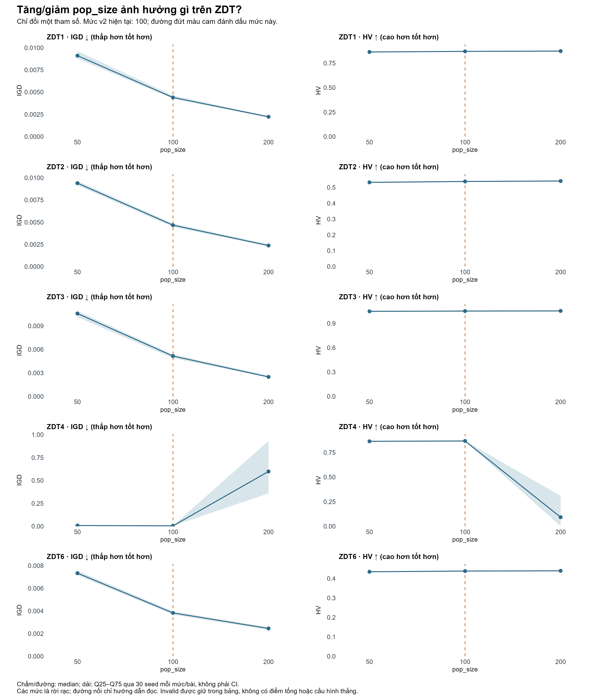
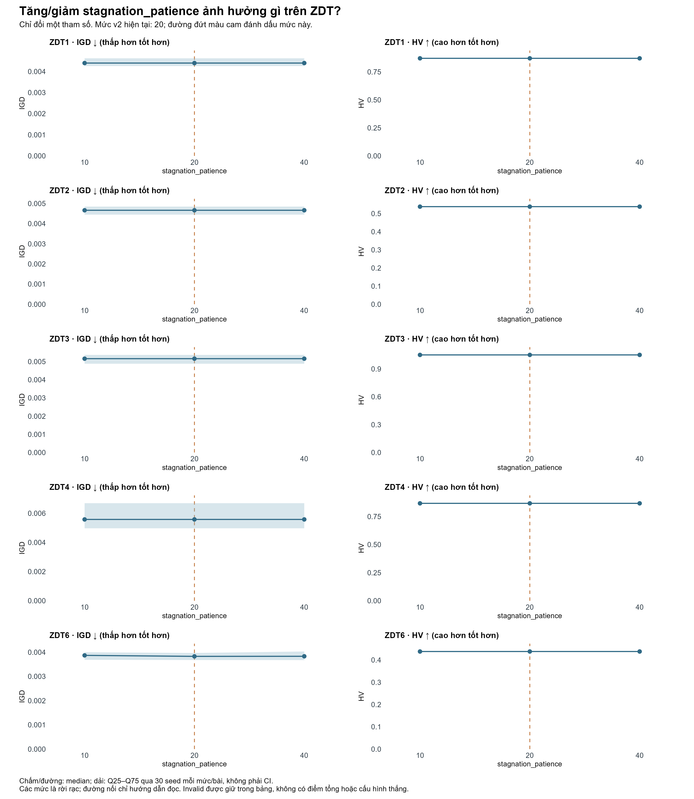
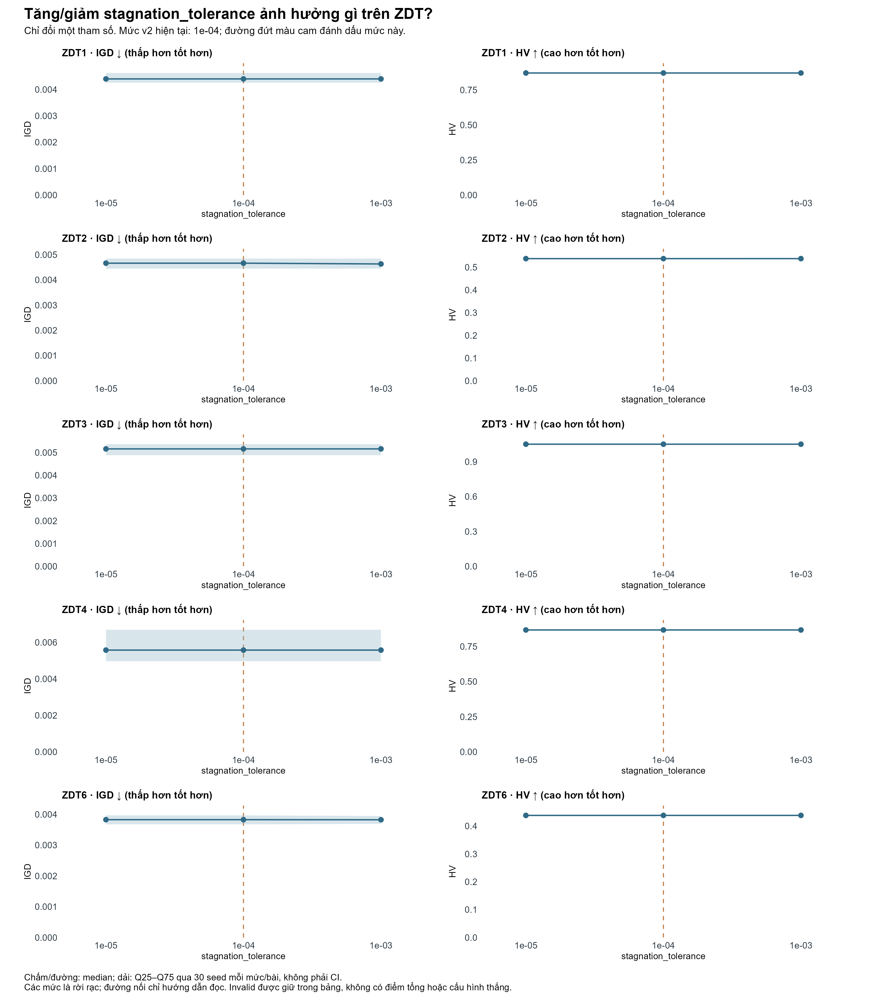
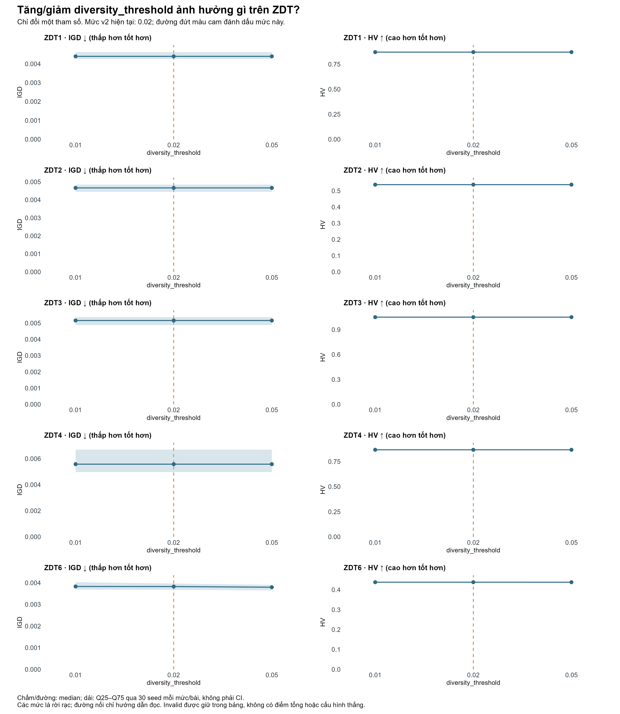
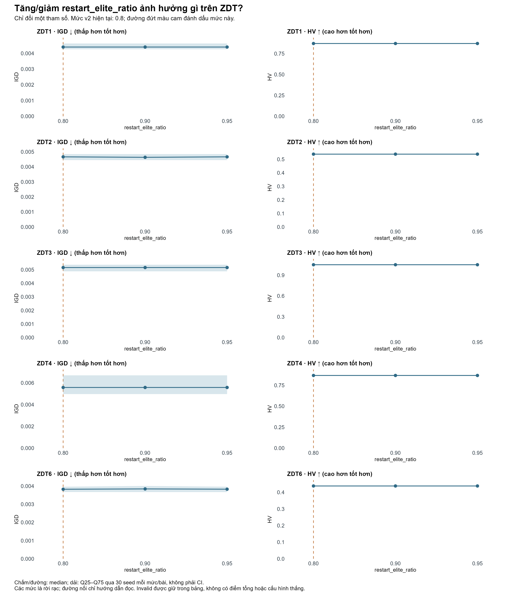
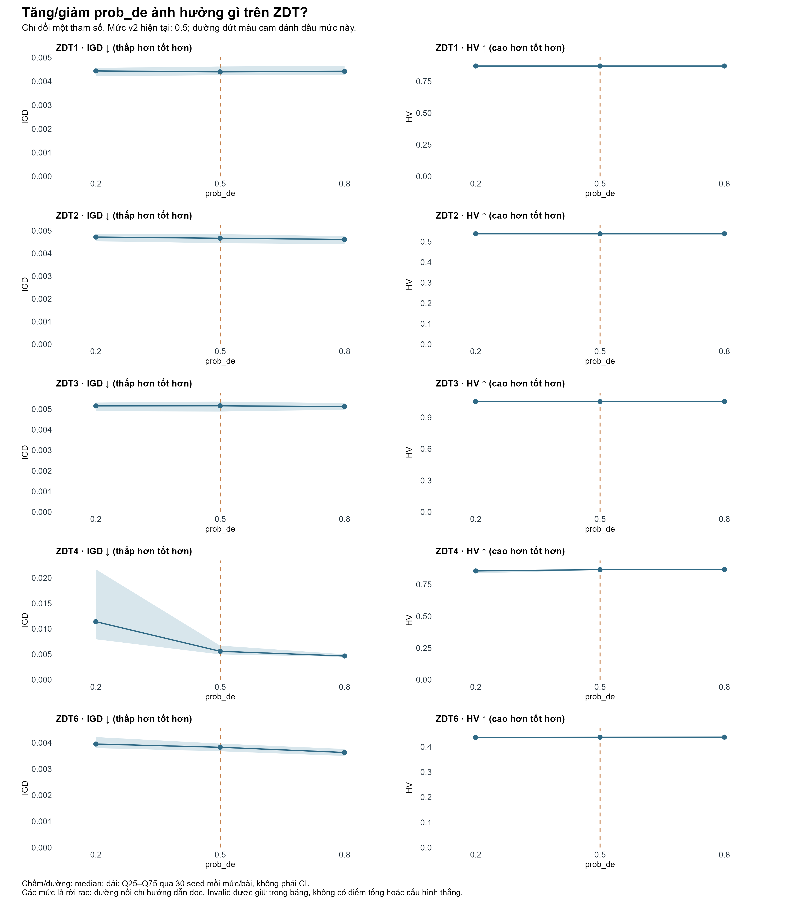
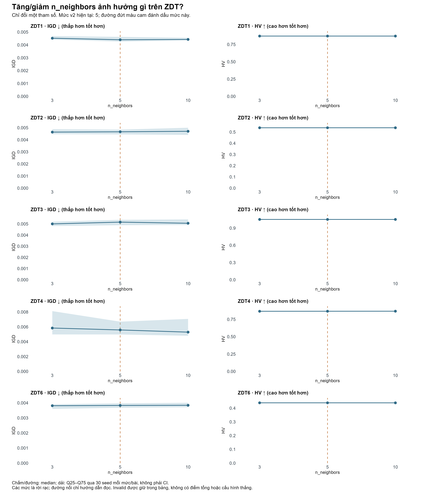
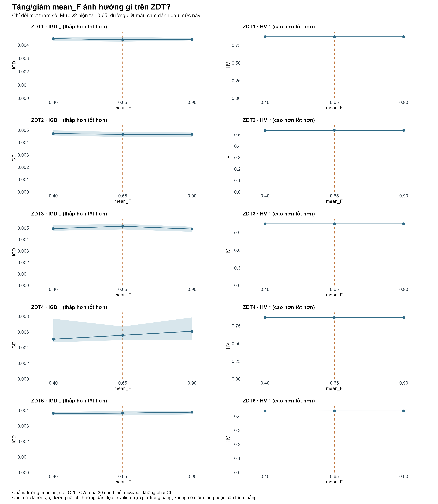
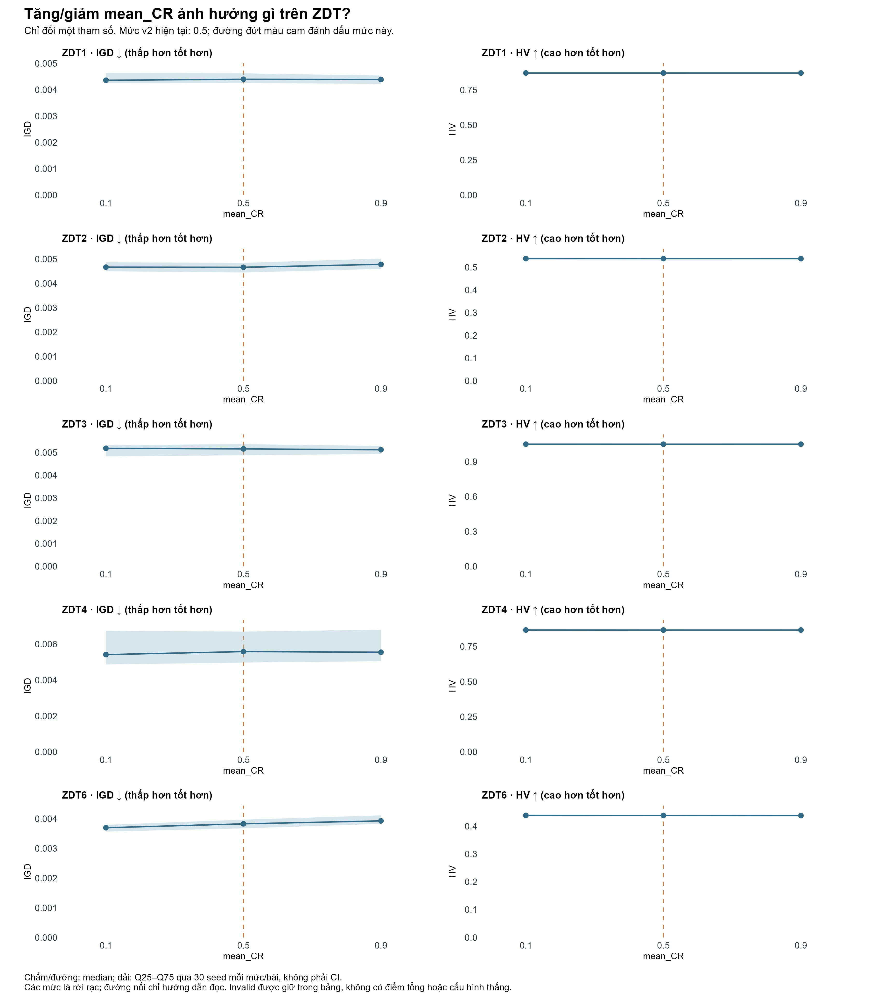

# Độ nhạy tham số v2 trên ZDT: tăng/giảm từng tham số

Đo trực tiếp tác động của từng mức tham số. Không có điểm tổng, thứ hạng hoặc cấu hình thắng tự động.

Đã hoàn tất 2850 run; 19 cấu hình duy nhất; 30 seed mỗi cấu hình/bài.
Cap: 20000 evaluation/run; invalid: 0.

IGD giảm là tốt; HV tăng là tốt. Thời gian là số đo mô tả trên máy/worker đang dùng.
Mỗi lần chỉ thay một tham số; các tham số còn lại giữ theo baseline adaptive v2.
Population khác nhau dùng cùng seed và khởi tạo theo prefix, không có cùng số cá thể ban đầu.

## pop_size — mức hiện tại: 100

Các mức đã chạy: [50, 100, 200].

| Bài | Mức thử | Thay đổi | IGD median | Δ IGD (%) | HV median | Δ HV (%) | Thời gian median (s) | Valid/run | Restart |
|---|---:|---|---:|---:|---:|---:|---:|---:|---:|
| ZDT1 | 50 | giảm | 0.00910643 | +107.10 | 0.864754 | -0.71 | 14.152 | 30/30 | 0 |
| ZDT2 | 50 | giảm | 0.00940258 | +101.57 | 0.531951 | -1.06 | 14.701 | 30/30 | 2 |
| ZDT3 | 50 | giảm | 0.0105921 | +105.29 | 1.04766 | -0.33 | 14.939 | 30/30 | 0 |
| ZDT4 | 50 | giảm | 0.00889516 | +59.34 | 0.863823 | -0.39 | 14.256 | 30/30 | 0 |
| ZDT6 | 50 | giảm | 0.00734024 | +91.78 | 0.434608 | -0.83 | 12.073 | 30/30 | 1 |
| ZDT1 | 100 | mốc | 0.00439707 | +0.00 | 0.870962 | +0.00 | 5.943 | 30/30 | 0 |
| ZDT2 | 100 | mốc | 0.0046646 | +0.00 | 0.537652 | +0.00 | 18.708 | 30/30 | 1 |
| ZDT3 | 100 | mốc | 0.00515966 | +0.00 | 1.05118 | +0.00 | 12.084 | 30/30 | 0 |
| ZDT4 | 100 | mốc | 0.00558256 | +0.00 | 0.867216 | +0.00 | 14.375 | 30/30 | 0 |
| ZDT6 | 100 | mốc | 0.00382752 | +0.00 | 0.438266 | +0.00 | 14.652 | 30/30 | 6 |
| ZDT1 | 200 | tăng | 0.00222923 | -49.30 | 0.87382 | +0.33 | 16.167 | 30/30 | 0 |
| ZDT2 | 200 | tăng | 0.00236691 | -49.26 | 0.540519 | +0.53 | 16.918 | 30/30 | 0 |
| ZDT3 | 200 | tăng | 0.00249304 | -51.68 | 1.0528 | +0.15 | 16.262 | 30/30 | 0 |
| ZDT4 | 200 | tăng | 0.598477 | +10620.48 | 0.092856 | -89.29 | 20.020 | 30/30 | 0 |
| ZDT6 | 200 | tăng | 0.0024559 | -35.84 | 0.439487 | +0.28 | 16.887 | 30/30 | 1 |

## stagnation_patience — mức hiện tại: 20

Các mức đã chạy: [10, 20, 40].

| Bài | Mức thử | Thay đổi | IGD median | Δ IGD (%) | HV median | Δ HV (%) | Thời gian median (s) | Valid/run | Restart |
|---|---:|---|---:|---:|---:|---:|---:|---:|---:|
| ZDT1 | 10 | giảm | 0.00439707 | +0.00 | 0.870962 | +0.00 | 14.114 | 30/30 | 0 |
| ZDT2 | 10 | giảm | 0.0046646 | +0.00 | 0.537653 | +0.00 | 15.078 | 30/30 | 1 |
| ZDT3 | 10 | giảm | 0.00515966 | +0.00 | 1.05118 | +0.00 | 15.190 | 30/30 | 0 |
| ZDT4 | 10 | giảm | 0.00558256 | +0.00 | 0.867216 | +0.00 | 15.764 | 30/30 | 0 |
| ZDT6 | 10 | giảm | 0.00386825 | +1.06 | 0.438228 | -0.01 | 13.742 | 30/30 | 25 |
| ZDT1 | 20 | mốc | 0.00439707 | +0.00 | 0.870962 | +0.00 | 5.943 | 30/30 | 0 |
| ZDT2 | 20 | mốc | 0.0046646 | +0.00 | 0.537652 | +0.00 | 18.708 | 30/30 | 1 |
| ZDT3 | 20 | mốc | 0.00515966 | +0.00 | 1.05118 | +0.00 | 12.084 | 30/30 | 0 |
| ZDT4 | 20 | mốc | 0.00558256 | +0.00 | 0.867216 | +0.00 | 14.375 | 30/30 | 0 |
| ZDT6 | 20 | mốc | 0.00382752 | +0.00 | 0.438266 | +0.00 | 14.652 | 30/30 | 6 |
| ZDT1 | 40 | tăng | 0.00439707 | +0.00 | 0.870962 | +0.00 | 6.715 | 30/30 | 0 |
| ZDT2 | 40 | tăng | 0.0046646 | +0.00 | 0.537652 | +0.00 | 4.903 | 30/30 | 0 |
| ZDT3 | 40 | tăng | 0.00515966 | +0.00 | 1.05118 | +0.00 | 3.909 | 30/30 | 0 |
| ZDT4 | 40 | tăng | 0.00558256 | +0.00 | 0.867216 | +0.00 | 4.442 | 30/30 | 0 |
| ZDT6 | 40 | tăng | 0.00383056 | +0.08 | 0.438266 | +0.00 | 4.468 | 30/30 | 1 |

## stagnation_tolerance — mức hiện tại: 0.0001

Các mức đã chạy: [1e-05, 0.0001, 0.001].

| Bài | Mức thử | Thay đổi | IGD median | Δ IGD (%) | HV median | Δ HV (%) | Thời gian median (s) | Valid/run | Restart |
|---|---:|---|---:|---:|---:|---:|---:|---:|---:|
| ZDT1 | 1e-05 | giảm | 0.00439707 | +0.00 | 0.870962 | +0.00 | 4.688 | 30/30 | 0 |
| ZDT2 | 1e-05 | giảm | 0.0046646 | +0.00 | 0.537652 | +0.00 | 4.637 | 30/30 | 0 |
| ZDT3 | 1e-05 | giảm | 0.00515966 | +0.00 | 1.05118 | +0.00 | 3.923 | 30/30 | 0 |
| ZDT4 | 1e-05 | giảm | 0.00558256 | +0.00 | 0.867216 | +0.00 | 4.457 | 30/30 | 0 |
| ZDT6 | 1e-05 | giảm | 0.00382752 | +0.00 | 0.438266 | +0.00 | 3.879 | 30/30 | 7 |
| ZDT1 | 0.0001 | mốc | 0.00439707 | +0.00 | 0.870962 | +0.00 | 5.943 | 30/30 | 0 |
| ZDT2 | 0.0001 | mốc | 0.0046646 | +0.00 | 0.537652 | +0.00 | 18.708 | 30/30 | 1 |
| ZDT3 | 0.0001 | mốc | 0.00515966 | +0.00 | 1.05118 | +0.00 | 12.084 | 30/30 | 0 |
| ZDT4 | 0.0001 | mốc | 0.00558256 | +0.00 | 0.867216 | +0.00 | 14.375 | 30/30 | 0 |
| ZDT6 | 0.0001 | mốc | 0.00382752 | +0.00 | 0.438266 | +0.00 | 14.652 | 30/30 | 6 |
| ZDT1 | 0.001 | tăng | 0.00439707 | +0.00 | 0.870962 | +0.00 | 3.914 | 30/30 | 0 |
| ZDT2 | 0.001 | tăng | 0.00463339 | -0.67 | 0.537707 | +0.01 | 4.502 | 30/30 | 4 |
| ZDT3 | 0.001 | tăng | 0.00515966 | +0.00 | 1.05118 | +0.00 | 4.666 | 30/30 | 0 |
| ZDT4 | 0.001 | tăng | 0.00558256 | +0.00 | 0.867216 | +0.00 | 4.908 | 30/30 | 0 |
| ZDT6 | 0.001 | tăng | 0.00382487 | -0.07 | 0.438266 | +0.00 | 3.963 | 30/30 | 16 |

## diversity_threshold — mức hiện tại: 0.02

Các mức đã chạy: [0.01, 0.02, 0.05].

| Bài | Mức thử | Thay đổi | IGD median | Δ IGD (%) | HV median | Δ HV (%) | Thời gian median (s) | Valid/run | Restart |
|---|---:|---|---:|---:|---:|---:|---:|---:|---:|
| ZDT1 | 0.01 | giảm | 0.00439707 | +0.00 | 0.870962 | +0.00 | 3.891 | 30/30 | 0 |
| ZDT2 | 0.01 | giảm | 0.0046646 | +0.00 | 0.537652 | +0.00 | 4.038 | 30/30 | 1 |
| ZDT3 | 0.01 | giảm | 0.00515966 | +0.00 | 1.05118 | +0.00 | 4.571 | 30/30 | 0 |
| ZDT4 | 0.01 | giảm | 0.00558256 | +0.00 | 0.867216 | +0.00 | 5.413 | 30/30 | 0 |
| ZDT6 | 0.01 | giảm | 0.00383056 | +0.08 | 0.438257 | -0.00 | 4.775 | 30/30 | 0 |
| ZDT1 | 0.02 | mốc | 0.00439707 | +0.00 | 0.870962 | +0.00 | 5.943 | 30/30 | 0 |
| ZDT2 | 0.02 | mốc | 0.0046646 | +0.00 | 0.537652 | +0.00 | 18.708 | 30/30 | 1 |
| ZDT3 | 0.02 | mốc | 0.00515966 | +0.00 | 1.05118 | +0.00 | 12.084 | 30/30 | 0 |
| ZDT4 | 0.02 | mốc | 0.00558256 | +0.00 | 0.867216 | +0.00 | 14.375 | 30/30 | 0 |
| ZDT6 | 0.02 | mốc | 0.00382752 | +0.00 | 0.438266 | +0.00 | 14.652 | 30/30 | 6 |
| ZDT1 | 0.05 | tăng | 0.00439707 | +0.00 | 0.870962 | +0.00 | 4.121 | 30/30 | 0 |
| ZDT2 | 0.05 | tăng | 0.0046646 | +0.00 | 0.537652 | +0.00 | 3.975 | 30/30 | 1 |
| ZDT3 | 0.05 | tăng | 0.00515966 | +0.00 | 1.05118 | +0.00 | 3.805 | 30/30 | 0 |
| ZDT4 | 0.05 | tăng | 0.00558256 | +0.00 | 0.867216 | +0.00 | 4.420 | 30/30 | 0 |
| ZDT6 | 0.05 | tăng | 0.00379559 | -0.83 | 0.438198 | -0.02 | 3.750 | 30/30 | 78 |

## restart_elite_ratio — mức hiện tại: 0.8

Các mức đã chạy: [0.8, 0.9, 0.95].

| Bài | Mức thử | Thay đổi | IGD median | Δ IGD (%) | HV median | Δ HV (%) | Thời gian median (s) | Valid/run | Restart |
|---|---:|---|---:|---:|---:|---:|---:|---:|---:|
| ZDT1 | 0.8 | mốc | 0.00439707 | +0.00 | 0.870962 | +0.00 | 5.943 | 30/30 | 0 |
| ZDT2 | 0.8 | mốc | 0.0046646 | +0.00 | 0.537652 | +0.00 | 18.708 | 30/30 | 1 |
| ZDT3 | 0.8 | mốc | 0.00515966 | +0.00 | 1.05118 | +0.00 | 12.084 | 30/30 | 0 |
| ZDT4 | 0.8 | mốc | 0.00558256 | +0.00 | 0.867216 | +0.00 | 14.375 | 30/30 | 0 |
| ZDT6 | 0.8 | mốc | 0.00382752 | +0.00 | 0.438266 | +0.00 | 14.652 | 30/30 | 6 |
| ZDT1 | 0.9 | tăng | 0.00439707 | +0.00 | 0.870962 | +0.00 | 3.790 | 30/30 | 0 |
| ZDT2 | 0.9 | tăng | 0.00463339 | -0.67 | 0.537652 | +0.00 | 3.902 | 30/30 | 1 |
| ZDT3 | 0.9 | tăng | 0.00515966 | +0.00 | 1.05118 | +0.00 | 3.853 | 30/30 | 0 |
| ZDT4 | 0.9 | tăng | 0.00558256 | +0.00 | 0.867216 | +0.00 | 4.372 | 30/30 | 0 |
| ZDT6 | 0.9 | tăng | 0.00384552 | +0.47 | 0.438266 | +0.00 | 3.800 | 30/30 | 7 |
| ZDT1 | 0.95 | tăng | 0.00439707 | +0.00 | 0.870962 | +0.00 | 3.748 | 30/30 | 0 |
| ZDT2 | 0.95 | tăng | 0.0046646 | +0.00 | 0.537654 | +0.00 | 3.824 | 30/30 | 1 |
| ZDT3 | 0.95 | tăng | 0.00515966 | +0.00 | 1.05118 | +0.00 | 3.807 | 30/30 | 0 |
| ZDT4 | 0.95 | tăng | 0.00558256 | +0.00 | 0.867216 | +0.00 | 4.320 | 30/30 | 0 |
| ZDT6 | 0.95 | tăng | 0.00383056 | +0.08 | 0.438266 | +0.00 | 3.594 | 30/30 | 6 |

## prob_de — mức hiện tại: 0.5

Các mức đã chạy: [0.2, 0.5, 0.8].

| Bài | Mức thử | Thay đổi | IGD median | Δ IGD (%) | HV median | Δ HV (%) | Thời gian median (s) | Valid/run | Restart |
|---|---:|---|---:|---:|---:|---:|---:|---:|---:|
| ZDT1 | 0.2 | giảm | 0.00443502 | +0.86 | 0.87098 | +0.00 | 3.480 | 30/30 | 0 |
| ZDT2 | 0.2 | giảm | 0.00471597 | +1.10 | 0.537759 | +0.02 | 3.661 | 30/30 | 0 |
| ZDT3 | 0.2 | giảm | 0.00515625 | -0.07 | 1.05117 | -0.00 | 3.564 | 30/30 | 0 |
| ZDT4 | 0.2 | giảm | 0.0114036 | +104.27 | 0.85686 | -1.19 | 4.032 | 30/30 | 0 |
| ZDT6 | 0.2 | giảm | 0.00395148 | +3.24 | 0.437647 | -0.14 | 3.358 | 30/30 | 22 |
| ZDT1 | 0.5 | mốc | 0.00439707 | +0.00 | 0.870962 | +0.00 | 5.943 | 30/30 | 0 |
| ZDT2 | 0.5 | mốc | 0.0046646 | +0.00 | 0.537652 | +0.00 | 18.708 | 30/30 | 1 |
| ZDT3 | 0.5 | mốc | 0.00515966 | +0.00 | 1.05118 | +0.00 | 12.084 | 30/30 | 0 |
| ZDT4 | 0.5 | mốc | 0.00558256 | +0.00 | 0.867216 | +0.00 | 14.375 | 30/30 | 0 |
| ZDT6 | 0.5 | mốc | 0.00382752 | +0.00 | 0.438266 | +0.00 | 14.652 | 30/30 | 6 |
| ZDT1 | 0.8 | tăng | 0.00442112 | +0.55 | 0.870941 | -0.00 | 3.672 | 30/30 | 0 |
| ZDT2 | 0.8 | tăng | 0.00461182 | -1.13 | 0.537702 | +0.01 | 3.800 | 30/30 | 5 |
| ZDT3 | 0.8 | tăng | 0.00512136 | -0.74 | 1.05127 | +0.01 | 3.715 | 30/30 | 0 |
| ZDT4 | 0.8 | tăng | 0.00466007 | -16.52 | 0.869327 | +0.24 | 4.186 | 30/30 | 0 |
| ZDT6 | 0.8 | tăng | 0.00362852 | -5.20 | 0.438773 | +0.12 | 3.718 | 30/30 | 2 |

## n_neighbors — mức hiện tại: 5

Các mức đã chạy: [3, 5, 10].

| Bài | Mức thử | Thay đổi | IGD median | Δ IGD (%) | HV median | Δ HV (%) | Thời gian median (s) | Valid/run | Restart |
|---|---:|---|---:|---:|---:|---:|---:|---:|---:|
| ZDT1 | 3 | giảm | 0.0045165 | +2.72 | 0.870872 | -0.01 | 3.630 | 30/30 | 0 |
| ZDT2 | 3 | giảm | 0.00463943 | -0.54 | 0.537609 | -0.01 | 3.683 | 30/30 | 0 |
| ZDT3 | 3 | giảm | 0.00500073 | -3.08 | 1.05132 | +0.01 | 3.651 | 30/30 | 0 |
| ZDT4 | 3 | giảm | 0.0058404 | +4.62 | 0.866702 | -0.06 | 4.248 | 30/30 | 0 |
| ZDT6 | 3 | giảm | 0.00380965 | -0.47 | 0.438284 | +0.00 | 3.622 | 30/30 | 3 |
| ZDT1 | 5 | mốc | 0.00439707 | +0.00 | 0.870962 | +0.00 | 5.943 | 30/30 | 0 |
| ZDT2 | 5 | mốc | 0.0046646 | +0.00 | 0.537652 | +0.00 | 18.708 | 30/30 | 1 |
| ZDT3 | 5 | mốc | 0.00515966 | +0.00 | 1.05118 | +0.00 | 12.084 | 30/30 | 0 |
| ZDT4 | 5 | mốc | 0.00558256 | +0.00 | 0.867216 | +0.00 | 14.375 | 30/30 | 0 |
| ZDT6 | 5 | mốc | 0.00382752 | +0.00 | 0.438266 | +0.00 | 14.652 | 30/30 | 6 |
| ZDT1 | 10 | tăng | 0.00442358 | +0.60 | 0.870856 | -0.01 | 3.732 | 30/30 | 0 |
| ZDT2 | 10 | tăng | 0.00470678 | +0.90 | 0.537673 | +0.00 | 3.787 | 30/30 | 0 |
| ZDT3 | 10 | tăng | 0.00505781 | -1.97 | 1.05129 | +0.01 | 3.643 | 30/30 | 0 |
| ZDT4 | 10 | tăng | 0.00528855 | -5.27 | 0.867774 | +0.06 | 4.296 | 30/30 | 0 |
| ZDT6 | 10 | tăng | 0.00383844 | +0.29 | 0.438091 | -0.04 | 3.642 | 30/30 | 7 |

## mean_F — mức hiện tại: 0.65

Các mức đã chạy: [0.4, 0.65, 0.9].

| Bài | Mức thử | Thay đổi | IGD median | Δ IGD (%) | HV median | Δ HV (%) | Thời gian median (s) | Valid/run | Restart |
|---|---:|---|---:|---:|---:|---:|---:|---:|---:|
| ZDT1 | 0.4 | giảm | 0.00448312 | +1.96 | 0.870919 | -0.00 | 3.675 | 30/30 | 0 |
| ZDT2 | 0.4 | giảm | 0.00472666 | +1.33 | 0.537702 | +0.01 | 3.730 | 30/30 | 0 |
| ZDT3 | 0.4 | giảm | 0.00495791 | -3.91 | 1.0513 | +0.01 | 3.723 | 30/30 | 0 |
| ZDT4 | 0.4 | giảm | 0.00507678 | -9.06 | 0.868173 | +0.11 | 4.314 | 30/30 | 0 |
| ZDT6 | 0.4 | giảm | 0.00380955 | -0.47 | 0.438148 | -0.03 | 3.537 | 30/30 | 4 |
| ZDT1 | 0.65 | mốc | 0.00439707 | +0.00 | 0.870962 | +0.00 | 5.943 | 30/30 | 0 |
| ZDT2 | 0.65 | mốc | 0.0046646 | +0.00 | 0.537652 | +0.00 | 18.708 | 30/30 | 1 |
| ZDT3 | 0.65 | mốc | 0.00515966 | +0.00 | 1.05118 | +0.00 | 12.084 | 30/30 | 0 |
| ZDT4 | 0.65 | mốc | 0.00558256 | +0.00 | 0.867216 | +0.00 | 14.375 | 30/30 | 0 |
| ZDT6 | 0.65 | mốc | 0.00382752 | +0.00 | 0.438266 | +0.00 | 14.652 | 30/30 | 6 |
| ZDT1 | 0.9 | tăng | 0.00442046 | +0.53 | 0.870959 | -0.00 | 3.829 | 30/30 | 0 |
| ZDT2 | 0.9 | tăng | 0.0046732 | +0.18 | 0.537688 | +0.01 | 3.757 | 30/30 | 0 |
| ZDT3 | 0.9 | tăng | 0.00491386 | -4.76 | 1.05129 | +0.01 | 3.657 | 30/30 | 0 |
| ZDT4 | 0.9 | tăng | 0.00609374 | +9.16 | 0.866599 | -0.07 | 4.178 | 30/30 | 0 |
| ZDT6 | 0.9 | tăng | 0.00388948 | +1.62 | 0.43825 | -0.00 | 3.490 | 30/30 | 4 |

## mean_CR — mức hiện tại: 0.5

Các mức đã chạy: [0.1, 0.5, 0.9].

| Bài | Mức thử | Thay đổi | IGD median | Δ IGD (%) | HV median | Δ HV (%) | Thời gian median (s) | Valid/run | Restart |
|---|---:|---|---:|---:|---:|---:|---:|---:|---:|
| ZDT1 | 0.1 | giảm | 0.00435968 | -0.85 | 0.870959 | -0.00 | 3.494 | 30/30 | 0 |
| ZDT2 | 0.1 | giảm | 0.00466891 | +0.09 | 0.537763 | +0.02 | 3.739 | 30/30 | 0 |
| ZDT3 | 0.1 | giảm | 0.00518662 | +0.52 | 1.05124 | +0.01 | 3.842 | 30/30 | 0 |
| ZDT4 | 0.1 | giảm | 0.0054165 | -2.97 | 0.867651 | +0.05 | 4.140 | 30/30 | 0 |
| ZDT6 | 0.1 | giảm | 0.00369641 | -3.43 | 0.438561 | +0.07 | 5.401 | 30/30 | 8 |
| ZDT1 | 0.5 | mốc | 0.00439707 | +0.00 | 0.870962 | +0.00 | 5.943 | 30/30 | 0 |
| ZDT2 | 0.5 | mốc | 0.0046646 | +0.00 | 0.537652 | +0.00 | 18.708 | 30/30 | 1 |
| ZDT3 | 0.5 | mốc | 0.00515966 | +0.00 | 1.05118 | +0.00 | 12.084 | 30/30 | 0 |
| ZDT4 | 0.5 | mốc | 0.00558256 | +0.00 | 0.867216 | +0.00 | 14.375 | 30/30 | 0 |
| ZDT6 | 0.5 | mốc | 0.00382752 | +0.00 | 0.438266 | +0.00 | 14.652 | 30/30 | 6 |
| ZDT1 | 0.9 | tăng | 0.00438775 | -0.21 | 0.870885 | -0.01 | 14.013 | 30/30 | 0 |
| ZDT2 | 0.9 | tăng | 0.00478485 | +2.58 | 0.53757 | -0.02 | 14.202 | 30/30 | 1 |
| ZDT3 | 0.9 | tăng | 0.00512248 | -0.72 | 1.05124 | +0.01 | 14.218 | 30/30 | 0 |
| ZDT4 | 0.9 | tăng | 0.00554901 | -0.60 | 0.867312 | +0.01 | 15.521 | 30/30 | 0 |
| ZDT6 | 0.9 | tăng | 0.00392733 | +2.61 | 0.437938 | -0.07 | 13.103 | 30/30 | 9 |

## Cách diễn giải

Đọc từng bài: mức tăng/giảm nào làm IGD giảm hoặc HV tăng; xem IQR/std và invalid để đánh giá độ dao động. Không gộp các bài thành điểm.
Median tốt hơn chỉ là chênh lệch mô tả; báo cáo này không gọi đó là thắng thống kê hoặc chứng minh tối ưu.
Các tham số F/CR/probability là giá trị khởi tạo và có thể được adaptation cập nhật trong run.
Nếu restart không xảy ra, chưa có bằng chứng về tác động của các mức tham số restart. Kernel giữ elite tối thiểu 0.8; mức thấp hơn bị từ chối.
Baseline được chạy một lần mỗi seed/bài và tham chiếu lại trong từng bảng, không tính như các replicate độc lập mới.
Hình: mỗi chấm là median, dải là Q25–Q75; không phải CI. Đường nối chỉ hướng dẫn đọc các mức rời rạc, không ước lượng các mức chưa đo.
Bảng CSV đầy đủ: summary.csv (mean, std, median, Q25/Q75), comparisons.csv (chênh lệch ghép seed), raw_runs.csv (từng run).
Không tự đổi cấu hình v2 sau báo cáo. Giữ toàn bộ invalid, kể cả khi không thể tính chất lượng trên cặp hợp lệ.
